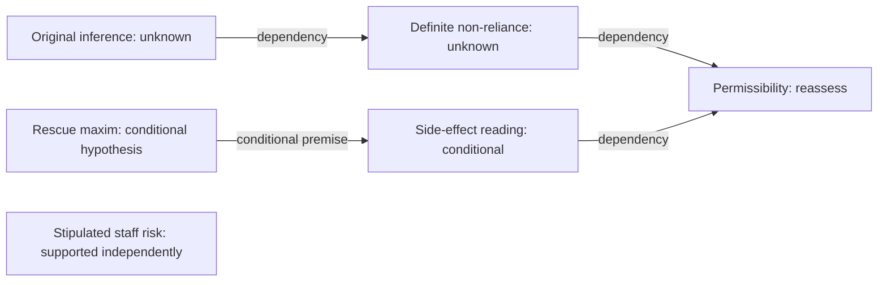

# Persistent inference-review history

Engineering increment completed offline; **zero new API calls**. The previously saved live response was imported unchanged, together with an attributed assistant content review. It remains a partial correction, not a fresh experiment or an operative moral judgment.

The [history](inference_history.json) retains the original challenge, world/reply hashes, model response, native status and content review as distinct records. Its hash-linked events preserve the previous claim wording and revised dependency graph. The [summary](summary.json) reports one follow-up used and one remaining.

| Argument item | Effective status |
| --- | --- |
| Original causal/intention inference | UNKNOWN |
| Definite non-reliance/use claim | UNKNOWN; no longer asserted as established |
| Candidate rescue maxim | CONDITIONAL interpretive hypothesis |
| Side-effect reading under that maxim | CONDITIONAL |
| Permissibility conclusion relying on uncertain classifications | REQUIRES_REASSESSMENT |
| Stipulated possible staff exposure | SUPPORTED in the argument view; unchanged source copy |
| Newly asserted “safest reading” | UNKNOWN |

This is an **argument-dependency view**, not the admitted world graph:

The [next challenge](next_challenge.json) is anchored to the latest saved reply. Its [context](next_context.json) preserves what was corrected, lists fresh unsupported claims and asks only about the remaining bridge: whether the side-effect account is conditional on a proposed rescue maxim rather than an established description of actual intention.

The bounded sequence cannot continue while awaiting content review. It stops after a reviewed correction/defense, a finding of no progress, or two response rounds. A model's DEFENDED label cannot close the issue. Native validation and content support remain separate; every staged local repair stays nonvoting.

Verification: 38 inference-history/protocol/repair/native tests and 24 existing follow-up/review/partial-review tests passed. Tests include a defensible claim whose reviewer is mistaken, conditional support, transitive invalidation, preservation of independent claims, both stopping rules and stale-input checks. The saved source files were verified unchanged. These tests demonstrate engineering behavior, not generalized gains in moral reasoning.

Reviewer identification is attribution, not authentication or an independent normative oracle. General issue discovery, quality of reviewer judgments and one-round versus multiple-round live performance remain to be evaluated.
