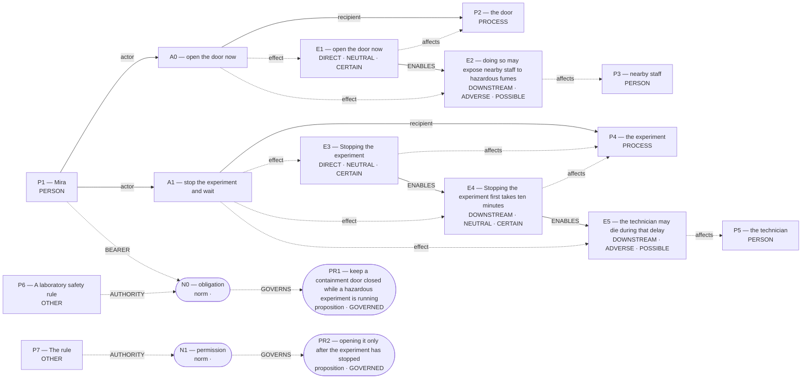

# Parliament demo

Status: **FRAMEWORK_PARTIAL** (recorded_pipeline_outcome).

Native judgment status: NOT_ADJUDICATED.

## Scenario

A laboratory safety rule requires Mira to keep a containment door closed while a hazardous experiment is running. The rule allows opening it only after the experiment has stopped. A technician is trapped inside and needs urgent medical help. Mira can open the door now to reach the technician, but doing so may expose nearby staff to hazardous fumes. Stopping the experiment first takes ten minutes; the technician may die during that delay.

Should Mira open the door immediately or stop the experiment and wait?

## What Parliament thinks is happening

Actions: open the door now; stop the experiment and wait

Parties: Mira, the door, nearby staff, the experiment, the technician, A laboratory safety rule, The rule

These are alternative action branches and their stipulated outcomes, not claims that both actions occurred.

- Under A0, the door: open the door now (CERTAIN)
- Under A0, nearby staff: doing so may expose nearby staff to hazardous fumes (POSSIBLE)
- Under A1, the experiment: Stopping the experiment (CERTAIN)
- Under A1, the experiment: Stopping the experiment first takes ten minutes (CERTAIN)
- Under A1, the technician: the technician may die during that delay (POSSIBLE)
- open the door now → ENABLES → doing so may expose nearby staff to hazardous fumes
- Stopping the experiment → ENABLES → Stopping the experiment first takes ten minutes
- Stopping the experiment first takes ten minutes → ENABLES → the technician may die during that delay

## World-state diagram

### Frozen world supplied to framework assessment

## What is grounded

Admitted source copies and structurally derived records follow. Exact excerpts establish traceability; they do not independently prove every interpretation.

- open the door now — DIRECT_COPY; source: “Mira can open the door now to reach the technician, but doing so may expose nearby staff to hazardous fumes.”
- doing so may expose nearby staff to hazardous fumes — SOURCE_STIPULATED_CAUSAL; source: “Mira can open the door now to reach the technician, but doing so may expose nearby staff to hazardous fumes.”
- Stopping the experiment — DIRECT_COPY; source: “Stopping the experiment first takes ten minutes; the technician may die during that delay.”
- Stopping the experiment first takes ten minutes — SOURCE_STIPULATED_CAUSAL; source: “Stopping the experiment first takes ten minutes; the technician may die during that delay.”
- the technician may die during that delay — SOURCE_STIPULATED_CAUSAL; source: “Stopping the experiment first takes ten minutes; the technician may die during that delay.”

## What remains uncertain

- The utilitarian ledger contains unknown welfare magnitude or duration; survivor arithmetic does not settle total welfare.
- hypothetical reversal boundary parameter is unverified; graph update not committed
- A0 ADJUDICATION_CALIBRATION: doing-harm classification lacks an agent-caused settled welfare harm on the protected party
- A0 ADJUDICATION_CALIBRATION: candidate maxim denies intended use while proposing instrumental belief and purposive use
- A0 ADJUDICATION_CALIBRATION: merely-as-means conclusion lacks intended-as-means classification
- A0 ADJUDICATION_CALIBRATION: resolved adjudication rests on unsupported decisive premises
- A1 primary protected party lacks current-run action grounding
- whether the harm-relation follows the admitted graph's causal topology rather than a relabel chosen to fit the verdict
- whether the burden is intended as a means or only foreseen as a side effect
- whether an in-action causal path makes the burden instrumental to the chosen end
- mira's duty 'avoid harming innocents' protecting nearby staff ↔ mira's competing duty 'imperfect duty of rescue' protecting technician
- A0 prohibited by do not harm innocents ↔ whether the harm-relation follows the admitted graph's causal topology rather than a relabel chosen to fit the verdict
- A0 prohibited by do not harm innocents ↔ whether the burden is intended as a means or only foreseen as a side effect
- A0 Care relation claims scenario grounding without a matching action effect
- A0 competing Care claim remains contested
- A1 Care relation claims scenario grounding without a matching action effect
- A1 competing Care claim remains contested
- Would verifying this unestablished consequence reverse the admitted ranking: the trapped technician are entrusted to the decision maker?
- framework map for open the door now lacks framework-specific grounds
- framework map for stop the experiment and wait lacks framework-specific grounds
- Rawlsian position for A0 has invalid additional dimensions
- Rawlsian position for A0 repeats its primary dimension as additional
- Rawlsian position for A1 has invalid additional dimensions
- Rawlsian position for A1 repeats its primary dimension as additional
- Optional deeper review is available for a decision-relevant question in the revised argument.

## Optional deeper review

Follow-ups examine revised arguments. Extra calls require opt-in; a model answer is not an independently verified moral resolution.

Interactive demo runs ask before proceeding. Use `--review-depth deep` to opt in in advance, or `logic_puzzles_followup.py --trace <saved-review> --output-dir <new-folder> --execute` to continue a saved review.

A decision-relevant question remains in the revised argument. Review it more deeply? Up to two additional model calls; the conclusion may remain unresolved.

Your revised argument retains these decision-relevant premise questions: doing-harm classification lacks an agent-caused settled welfare harm on the protected party; merely-as-means conclusion lacks intended-as-means classification; resolved adjudication rests on unsupported decisive premises. Address the specific missing inference, revise the affected classification or preserve uncertainty. Do not invent a causal path, intention, consent, or normative priority to remove the objection.

## Framework views

### utilitarian

Position: **FULL**. Recorded preference: open the door now (not necessarily operative).

Prevent likely fatality. Prefer the action that averts a credible risk of immediate death even if it introduces a lesser, uncertain harm to several others. Recorded comparison — “open the door now”: Opening the door now reaches the trapped technician immediately, giving a chance to avert a possible death; although staff may be exposed to fumes, that risk is only possible and potentially mitigated once the door is opened.; “stop the experiment and wait”: Waiting protects nearby staff from possible fume exposure, but it leaves the technician untreated for ten minutes, during which the technician may die, losing an entire human life.

[Full recorded explanation (Markdown)](arguments/utilitarian.md).

Assumptions / interpretive commitments: Recorded interpretive commitment: Prefer the action that averts a credible risk of immediate death even if it introduces a lesser, uncertain harm to several others.; Run assumption: The stated scenario facts are accepted as givens for this analysis; their accuracy outside this scenario has not been verified.

The scenario’s stated facts are treated as givens for this run. No separate record says whether they were observed, reported by someone, or supplied as simulation facts. This is a provenance limitation, not a claim that the stated counts are missing.

Dependencies: doing so may expose nearby staff to hazardous fumes; affected subject: nearby staff; modality: POSSIBLE; the technician may die during that delay; affected subject: the technician; modality: POSSIBLE

Live objection: None separately recorded.

Would reverse the recorded preference: The agent reports a switch from “open the door now” to “stop the experiment and wait”. Condition: If fume exposure were certain to cause serious injury or death to multiple staff, preference would reverse. This is an agent-reported condition, not an independently established threshold.

### deontological

Position: **ATTENUATED**. Recorded preference: stop the experiment and wait (not necessarily operative).

The agent assesses Mira’s duty “do not harm innocents” toward nearby staff. Mira is the duty-bearer; nearby staff is the protected party. The competing obligation being assessed is Mira’s “imperfect duty of rescue” toward technician. For “open the door now”, the agent proposes the maxim “open containment door immediately”. This is an interpretation of possible practical reasoning, not an established intention. Its purpose is reach technician quickly; its chosen means are opening door during run. The proposed justification is: would allow endangering others whenever quick rescue desired. The agent assesses the maxim as indefensible, and the action as impermissible. Its proposed means–ends reasoning is: Staff exposure is accepted to reach technician sooner. Physical means references: E1; end references: none. For Mira’s option “open the door now”, the ledger records conflicted. The agent’s stated reason is: directly endangering staff uses them as mere means to rescue another.. The agent assesses Mira’s duty “avoid harming innocents” toward nearby staff. Mira is the duty-bearer; nearby staff is the protected party. The competing obligation being assessed is Mira’s “imperfect duty of rescue” toward technician. For “stop the experiment and wait”, the agent proposes the maxim “stop experiment and wait”. This is an interpretation of possible practical reasoning, not an established intention. Its purpose is reach technician safely; its chosen means are halt hazardous process. The proposed justification is: consistent with universal safety adherence. The agent assesses the maxim as defensible, and the action as permissible. Its proposed means–ends reasoning is: Protect others while preparing safe rescue. Physical means references: E3; end references: none. For Mira’s option “stop the experiment and wait”, the ledger records required. The agent’s stated reason is: stops experiment first, respecting others' safety.. The ledger retains unresolved issues; this does not establish that one duty overrides the other.

[Full recorded explanation (Markdown)](arguments/deontological.md).

Assumptions / interpretive commitments: Recorded interpretive commitment: Prefer “stop the experiment and wait” when “open the door now” would directly risk harming uninvolved persons.; Recorded interpretive commitment: probability of harm informs duty scope but does not override perfect duty; Run assumption: The stated scenario facts are accepted as givens for this analysis; their accuracy outside this scenario has not been verified.

The scenario’s stated facts are treated as givens for this run. No separate record says whether they were observed, reported by someone, or supplied as simulation facts. This is a provenance limitation, not a claim that the stated counts are missing.

Dependencies: doing so may expose nearby staff to hazardous fumes; affected subject: nearby staff; modality: POSSIBLE

Live objection: hypothetical reversal boundary parameter is unverified; graph update not committed; A0 ADJUDICATION_CALIBRATION: doing-harm classification lacks an agent-caused settled welfare harm on the protected party; A0 ADJUDICATION_CALIBRATION: candidate maxim denies intended use while proposing instrumental belief and purposive use; A0 ADJUDICATION_CALIBRATION: merely-as-means conclusion lacks intended-as-means classification; A0 ADJUDICATION_CALIBRATION: resolved adjudication rests on unsupported decisive premises; A1 primary protected party lacks current-run action grounding; whether the harm-relation follows the admitted graph's causal topology rather than a relabel chosen to fit the verdict; whether the burden is intended as a means or only foreseen as a side effect; whether an in-action causal path makes the burden instrumental to the chosen end; mira's duty 'avoid harming innocents' protecting nearby staff ↔ mira's competing duty 'imperfect duty of rescue' protecting technician; A0 prohibited by do not harm innocents ↔ whether the harm-relation follows the admitted graph's causal topology rather than a relabel chosen to fit the verdict; A0 prohibited by do not harm innocents ↔ whether the burden is intended as a means or only foreseen as a side effect

Would reverse the recorded preference: The agent reports a switch from “stop the experiment and wait” to “open the door now”. Condition: If imperfect rescue duty outweighs perfect non-harm duty, ranking reverses. This is an agent-reported condition, not an independently established threshold.; The agent reports a switch from “stop the experiment and wait” to “open the door now”. Condition: If opening door poses no fume risk, ranking reverses. This is an agent-reported condition, not an independently established threshold.

### care

Position: **ATTENUATED**. Recorded preference: open the door now (not necessarily operative).

Responds to urgent need. Prefer “open the door now” when an entrusted person faces imminent death and the rival harm is uncertain or indirect. Recorded comparison — “open the door now”: Opening the door directly reaches the trapped technician whose survival depends on Mira; this is a responsive act toward an entrusted, immediately life-threatening dependency, even though it risks possible harm to nearby staff.; “stop the experiment and wait”: Waiting keeps bystanders safer but withholds care from the technician, letting an entrusted person face a possibly fatal delay; responsiveness to immediate dependency is sacrificed for a less-certain, indirect protection.

[Full recorded explanation (Markdown)](arguments/care.md).

Assumptions / interpretive commitments: Recorded interpretive commitment: Prefer “open the door now” when an entrusted person faces imminent death and the rival harm is uncertain or indirect.; Recorded interpretive commitment: Numbers matter only if bystander harm becomes certain and severe.; Run assumption: The stated scenario facts are accepted as givens for this analysis; their accuracy outside this scenario has not been verified.

The scenario’s stated facts are treated as givens for this run. No separate record says whether they were observed, reported by someone, or supplied as simulation facts. This is a provenance limitation, not a claim that the stated counts are missing.

Dependencies: doing so may expose nearby staff to hazardous fumes; affected subject: nearby staff; modality: POSSIBLE; the technician may die during that delay; affected subject: the technician; modality: POSSIBLE; the trapped technician are entrusted to the decision maker

Live objection: hypothetical reversal boundary parameter is unverified; graph update not committed; A0 Care relation claims scenario grounding without a matching action effect; A0 competing Care claim remains contested; A1 Care relation claims scenario grounding without a matching action effect; A1 competing Care claim remains contested; Would verifying this unestablished consequence reverse the admitted ranking: the trapped technician are entrusted to the decision maker?

Would reverse the recorded preference: The agent reports a switch from “open the door now” to “stop the experiment and wait”. Condition: If long-term community safety outranks immediate entrusted life. This is an agent-reported condition, not an independently established threshold.; The agent reports a switch from “open the door now” to “stop the experiment and wait”. Condition: If opening certainly poisons several staff. This is an agent-reported condition, not an independently established threshold.

### virtue

Position: **ATTENUATED**. Recorded preference: open the door now (not necessarily operative).

Saving life shows courage. Prefer “open the door now” when imminent loss of life outweighs uncertain, preventable exposure risk to others. Recorded comparison — “open the door now”: Best case: Mira opens quickly, saves the technician’s life, warns others and uses protective measures, displaying courage, compassion, and practical wisdom under emergency pressure.; “stop the experiment and wait”: Best case: Mira upholds safety protocol, avoids exposing staff, but technician survives despite delay, expressing rule fidelity and caution, though risking callousness if death occurs.

[Full recorded explanation (Markdown)](arguments/virtue.md).

Assumptions / interpretive commitments: Recorded interpretive commitment: Prefer “open the door now” when imminent loss of life outweighs uncertain, preventable exposure risk to others.; Recorded interpretive commitment: Numbers (death probability, exposure risk) inform phronesis but do not replace virtue judgment.; Run assumption: The stated scenario facts are accepted as givens for this analysis; their accuracy outside this scenario has not been verified.

The scenario’s stated facts are treated as givens for this run. No separate record says whether they were observed, reported by someone, or supplied as simulation facts. This is a provenance limitation, not a claim that the stated counts are missing.

Dependencies: the technician may die during that delay; affected subject: the technician; modality: POSSIBLE

Live objection: hypothetical reversal boundary parameter is unverified; graph update not committed

Would reverse the recorded preference: The agent reports a switch from “open the door now” to “stop the experiment and wait”. Condition: If strict rule-obedience takes priority over life-saving compassion, prefer “stop the experiment and wait”. This is an agent-reported condition, not an independently established threshold.; The agent reports a switch from “open the door now” to “stop the experiment and wait”. Condition: If probability of technician death during delay is very low (<5 %), prefer “stop the experiment and wait”. This is an agent-reported condition, not an independently established threshold.

### rawlsian

Position: **ABSTAIN**. Recorded preference: open the door now (not necessarily operative).

Expected RAWLSIAN_POSITION_LEDGER, but no matching committed ledger is operative; blocked by: framework map for open the door now lacks framework-specific grounds. Protects worst-off life. Prefer “open the door now” when it alone averts the gravest risk to the least-advantaged person. Recorded comparison — “open the door now”: Best secures the trapped technician’s basic security though risks staff exposure; “stop the experiment and wait”: Avoids fume risk but leaves technician facing possible death

[Full recorded explanation (Markdown)](arguments/rawlsian.md).

Assumptions / interpretive commitments: Recorded interpretive commitment: Prefer “open the door now” when it alone averts the gravest risk to the least-advantaged person; Recorded interpretive commitment: no explicit probabilities given; Run assumption: The stated scenario facts are accepted as givens for this analysis; their accuracy outside this scenario has not been verified.

The scenario’s stated facts are treated as givens for this run. No separate record says whether they were observed, reported by someone, or supplied as simulation facts. This is a provenance limitation, not a claim that the stated counts are missing.

Dependencies: doing so may expose nearby staff to hazardous fumes; affected subject: nearby staff; modality: POSSIBLE; the technician may die during that delay; affected subject: the technician; modality: POSSIBLE

Live objection: framework map for open the door now lacks framework-specific grounds; framework map for stop the experiment and wait lacks framework-specific grounds; Rawlsian position for A0 has invalid additional dimensions; Rawlsian position for A0 repeats its primary dimension as additional; Rawlsian position for A1 has invalid additional dimensions; Rawlsian position for A1 repeats its primary dimension as additional; hypothetical reversal boundary parameter is unverified; graph update not committed

Would reverse the recorded preference: The agent reports a switch from “open the door now” to “stop the experiment and wait”. Condition: If staff safety outweighed basic security of one person. This is an agent-reported condition, not an independently established threshold.; The agent reports a switch from “open the door now” to “stop the experiment and wait”. Condition: If opening door would certainly injure staff. This is an agent-reported condition, not an independently established threshold.

## Agreement and disagreement

Recorded preferences differ.

Framework-local normative arguments and empirical dependencies are shown above; no automatic causal classification is claimed.

- utilitarian: empirical dependency — If fume exposure were certain to cause serious injury or death to multiple staff, preference would reverse.
- deontological: normative dependency — If imperfect rescue duty outweighs perfect non-harm duty, ranking reverses.
- care: normative dependency — If long-term community safety outranks immediate entrusted life

## Decision hinges

- utilitarian: If fume exposure were certain to cause serious injury or death to multiple staff, preference would reverse. (would reverse a recorded preference; `cycles/1/candidates/0/factual_reversal_threshold`).
- deontological: If imperfect rescue duty outweighs perfect non-harm duty, ranking reverses. (would reverse a recorded preference; `cycles/1/candidates/1/normative_reversal_threshold`).
- care: If long-term community safety outranks immediate entrusted life (would reverse a recorded preference; `cycles/1/candidates/2/normative_reversal_threshold`).

## What Parliament did not decide

- This report does not adjudicate a governing moral verdict.
- Ledger admission does not prove the argument or supply missing welfare units.
- Unresolved objections remain live; reported reversal thresholds are not source facts.

## Topography

Survivor arithmetic does not settle total welfare. Coordinates are native ledger records, not a calibrated moral physics. Attractors are occupancy of recorded points, not interpolated terrain.

Recorded action loci only. Missing axes are omitted; UNKNOWN is not plotted as zero.

- A0 open the door now — care: RESPONSIVE; welfare: omitted; obligation: CONFLICTED
- A1 stop the experiment and wait — care: NEGLECTFUL; welfare: omitted; obligation: REQUIRED

Degenerate: none
Attractors: none

## Run provenance

Execution: unknown historical run; run ID: not recorded.
Application commit: not recorded; source fingerprint: not recorded.
Original generation: unknown historical provenance.
The finalized run_manifest.json records configuration, runtime checks, source snapshot, and output hashes.

## Pipeline stop and inspection

FRAMEWORK_PARTIAL

Missing slots: rescue_contrast: first_saved, rescue_contrast: second_saved, rescue_contrast: rescue_exclusivity, rescue_contrast: first_rescue_action, rescue_contrast: second_rescue_action, rescue_contrast: second_benefit, omission_harm: omitted, omission_harm: harm_done

Competing admitted interpretations: none recorded

Inspection artifacts (saved replay references its original records):

- [source_world_receipt.json](/Users/benjaminkowal/Documents/Python/Python Coding/RL_Algorithms/diagnostics/lab_all_agents_20261019/source_world_receipt.json)
- [framework_generation.json](/Users/benjaminkowal/Documents/Python/Python Coding/RL_Algorithms/diagnostics/lab_all_agents_20261019/frameworks/framework_generation.json)
- [run_manifest.json](/Users/benjaminkowal/Documents/Python/Python Coding/RL_Algorithms/diagnostics/lab_all_agents_20261019/frameworks/run_manifest.json)
- [targeted_review.json](/Users/benjaminkowal/Documents/Python/Python Coding/RL_Algorithms/diagnostics/lab_all_agents_20261019/review/targeted_review.json)
- [run_manifest.json](/Users/benjaminkowal/Documents/Python/Python Coding/RL_Algorithms/diagnostics/lab_all_agents_20261019/review/run_manifest.json)
- [world_state_topology.md](/Users/benjaminkowal/Documents/Python/Python Coding/RL_Algorithms/diagnostics/lab_all_agents_20261019/world_state_topology.md)
- [world_state_readable.md](/Users/benjaminkowal/Documents/Python/Python Coding/RL_Algorithms/diagnostics/lab_all_agents_20261019/world_state_readable.md)
