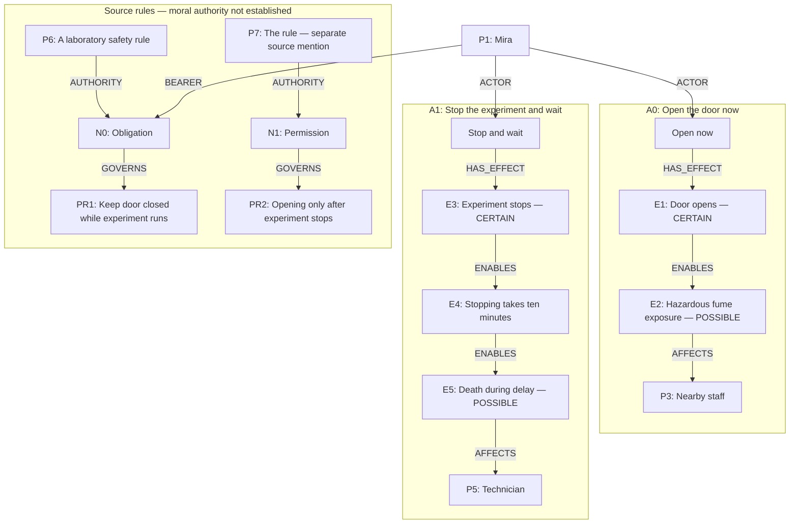

# Frozen laboratory world: readable projection

This view groups the existing effects by action. The full saved topology is in [world_state_topology.md](world_state_topology.md). Edges shown below exist in the supplied world; some duplicate action-to-effect and participant edges are omitted for readability. These are alternative branches, not events asserted to have occurred. CERTAIN effects are conditional on choosing their branch. ENABLES is the saved structural relation, not an established probability of the next effect.

The graph supplies no numerical risk probabilities, fume-injury severity or guaranteed rescue effect. The technician's trapped state and urgent need also appear in the full scenario supplied to every agent. N1 has no resolved bearer; the two authority mentions were not silently merged. No norm-to-action compliance edge or actual rule violation is inferred in this display.
