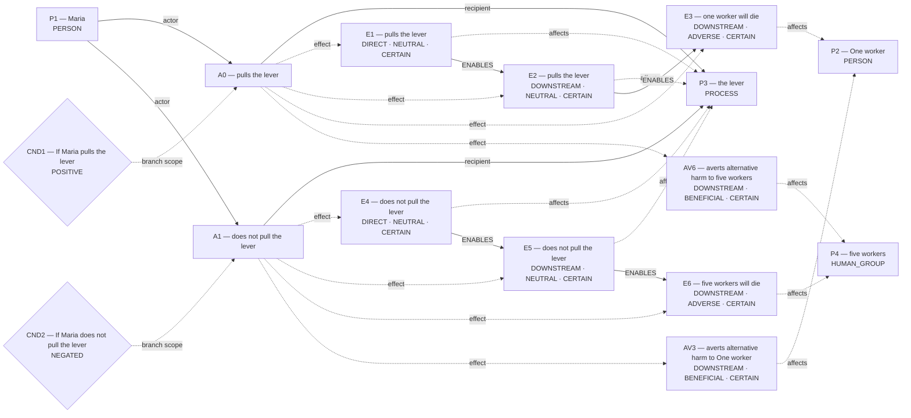
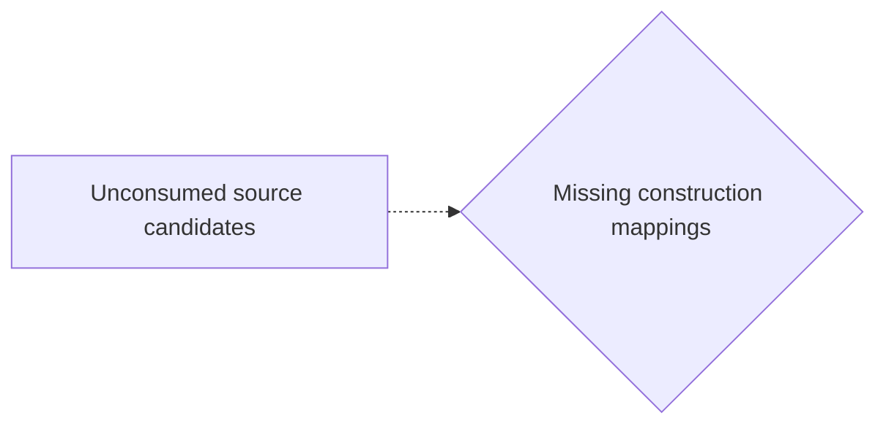
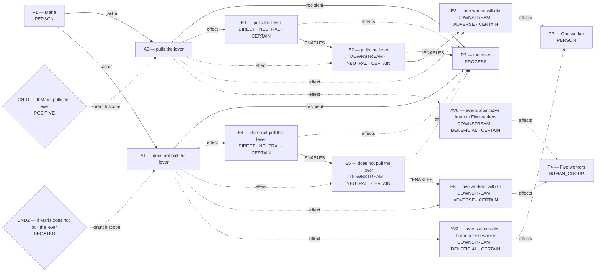
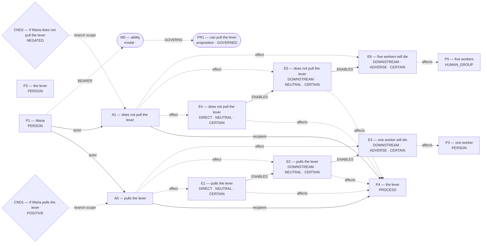
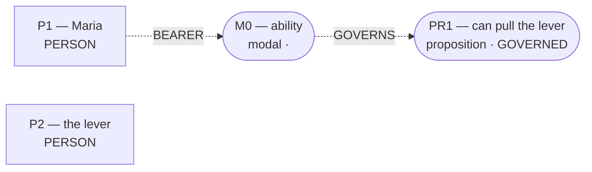
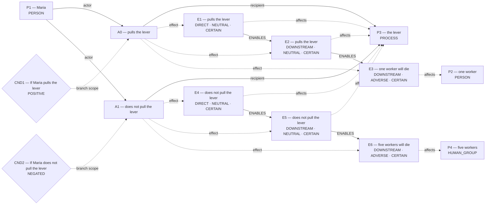

# Candidate world attempts

Chosen blueprint: **omission_harm**  
Chooser status: **FILLED**

## 1. omission_harm (alternative; baseline)

Template status: **FILLED**  
Proposal status: **FILLED**  
Contract valid: **true**  
Missing slots: none

### omission_harm candidate graph



Hypothesis overlay (not submitted as world effects):

- `AV3`: averts alternative harm to One worker; unresolved_derivation_assumptions, unsupported_outcome_transformation, hypothesized_averted_harm
- `AV6`: averts alternative harm to five workers; unresolved_derivation_assumptions, unsupported_outcome_transformation, hypothesized_averted_harm

### Supported core for admission


Native admission:

```json
{
  "blueprint_id": "omission_harm",
  "rank": 0,
  "variant": "baseline",
  "candidate_path": "/Users/benjaminkowal/Documents/Python/Python Coding/RL_Algorithms/diagnostics/live_pipeline_latest_20261006/trolley/admission_attempts/00_omission_harm/candidate.json",
  "overlay_path": "/Users/benjaminkowal/Documents/Python/Python Coding/RL_Algorithms/diagnostics/live_pipeline_latest_20261006/trolley/admission_attempts/00_omission_harm/hypothesis_overlay.json",
  "status": "ADMITTED",
  "admission": {
    "status": "COMMITTED",
    "world_model_status": "COMMITTED",
    "effects": 6,
    "causal_links": 4,
    "frozen_trace_valid": true,
    "discourse_committed": false,
    "relent_workspace": {
      "established": [
        {
          "kind": "occurrence_effect",
          "effect_id": "E1",
          "outcome": "pulls the lever",
          "predicate": null,
          "status": "established"
        },
        {
          "kind": "occurrence_effect",
          "effect_id": "E2",
          "outcome": "pulls the lever",
          "predicate": null,
          "status": "established"
        },
        {
          "kind": "occurrence_effect",
          "effect_id": "E3",
          "outcome": "one worker will die",
          "predicate": null,
          "status": "established"
        },
        {
          "kind": "occurrence_effect",
          "effect_id": "E4",
          "outcome": "does not pull the lever",
          "predicate": null,
          "status": "established"
        },
        {
          "kind": "occurrence_effect",
          "effect_id": "E5",
          "outcome": "does not pull the lever",
          "predicate": null,
          "status": "established"
        },
        {
          "kind": "occurrence_effect",
          "effect_id": "E6",
          "outcome": "five workers will die",
          "predicate": null,
          "status": "established"
        }
      ],
      "not_established": [],
      "duty_ledger_citations": [],
      "ev_forbidden_proposition_ids": [],
      "factual_status_sources": [
        "occurrence_effects"
      ]
    },
    "fingerprint_sha256": "dc6382916d4c448e8f8323121ebd5e1f1d9c9f4c7af9d6eea225ba84f1ced6a7"
  },
  "trace_path": "/Users/benjaminkowal/Documents/Python/Python Coding/RL_Algorithms/diagnostics/live_pipeline_latest_20261006/trolley/admission_attempts/00_omission_harm/frozen_world_trace.json"
}
```

Source constructions retained outside the admitted world:

Parser proposals below preserve alternatives and local scope; they do not establish occurrence or a resolved interpretation.

Unconsumed parser candidates: **35**. These are visible mapping gaps, not admission failures.



- `c0`: Which construction should preserve this PREDICATION reading?
- `c1`: Which construction should preserve this PREDICATION reading?
- `c2`: Which construction should preserve this PREDICATION reading?
- `c9`: Which construction should preserve this MODALITY reading?
- `c10`: Which construction should preserve this MODALITY reading?
- `c11`: Which construction should preserve this MODALITY reading?
- `c12`: Which construction should preserve this MODALITY reading?
- `c13`: Which construction should preserve this MODALITY reading?
- `c14`: Which construction should preserve this PARTICIPANT reading?
- `c15`: Which construction should preserve this PARTICIPANT reading?
- `c16`: Which construction should preserve this PARTICIPANT reading?
- `c17`: Which construction should preserve this PARTICIPANT reading?
- `c18`: Which construction should preserve this PARTICIPANT reading?
- `c19`: Which construction should preserve this PARTICIPANT reading?
- `c22`: Which construction should preserve this PARTICIPANT reading?
- `c25`: Which construction should preserve this PARTICIPANT reading?
- `c26`: Which construction should preserve this QUANTITY reading?
- `c27`: Which construction should preserve this QUANTITY reading?
- `c28`: Which construction should preserve this QUANTITY reading?
- `c29`: Which construction should preserve this QUANTITY reading?
- `c30`: Which construction should preserve this SAME_REFERENT reading?
- `c31`: Which construction should preserve this SAME_REFERENT reading?
- `c32`: Which construction should preserve this SAME_REFERENT reading?
- `c33`: Which construction should preserve this SAME_REFERENT reading?
- `c34`: Which construction should preserve this SAME_REFERENT reading?
- `c35`: Which construction should preserve this SAME_REFERENT reading?
- `c36`: Which construction should preserve this SAME_REFERENT reading?
- `c39`: Which construction should preserve this SAME_REFERENT reading?
- `c40`: Which construction should preserve this SAME_REFERENT reading?
- `c41`: Which construction should preserve this PREDICATION reading?
- `c42`: Which construction should preserve this PARTICIPANT reading?
- `c43`: Which construction should preserve this PARTICIPANT reading?
- `c44`: Which construction should preserve this MODALITY reading?
- `c45`: Which construction should preserve this MODALITY reading?
- `c46`: Which construction should preserve this MODALITY reading?

## 2. conditional_outcome (alternative; baseline)

Template status: **FILLED**  
Proposal status: **FILLED**  
Contract valid: **true**  
Missing slots: `chance`

### conditional_outcome candidate graph



Hypothesis overlay (not submitted as world effects):

- `AV3`: averts alternative harm to One worker; unresolved_derivation_assumptions, unsupported_outcome_transformation, hypothesized_averted_harm
- `AV6`: averts alternative harm to Five workers; unresolved_derivation_assumptions, unsupported_outcome_transformation, hypothesized_averted_harm

### Supported core for admission


Native admission:

```json
{
  "blueprint_id": "conditional_outcome",
  "rank": 1,
  "variant": "baseline",
  "candidate_path": "/Users/benjaminkowal/Documents/Python/Python Coding/RL_Algorithms/diagnostics/live_pipeline_latest_20261006/trolley/admission_attempts/01_conditional_outcome/candidate.json",
  "overlay_path": "/Users/benjaminkowal/Documents/Python/Python Coding/RL_Algorithms/diagnostics/live_pipeline_latest_20261006/trolley/admission_attempts/01_conditional_outcome/hypothesis_overlay.json",
  "status": "ADMITTED",
  "admission": {
    "status": "COMMITTED",
    "world_model_status": "COMMITTED",
    "effects": 6,
    "causal_links": 4,
    "frozen_trace_valid": true,
    "discourse_committed": false,
    "relent_workspace": {
      "established": [
        {
          "kind": "occurrence_effect",
          "effect_id": "E1",
          "outcome": "pulls the lever",
          "predicate": null,
          "status": "established"
        },
        {
          "kind": "occurrence_effect",
          "effect_id": "E2",
          "outcome": "pulls the lever",
          "predicate": null,
          "status": "established"
        },
        {
          "kind": "occurrence_effect",
          "effect_id": "E3",
          "outcome": "one worker will die",
          "predicate": null,
          "status": "established"
        },
        {
          "kind": "occurrence_effect",
          "effect_id": "E4",
          "outcome": "does not pull the lever",
          "predicate": null,
          "status": "established"
        },
        {
          "kind": "occurrence_effect",
          "effect_id": "E5",
          "outcome": "does not pull the lever",
          "predicate": null,
          "status": "established"
        },
        {
          "kind": "occurrence_effect",
          "effect_id": "E6",
          "outcome": "five workers will die",
          "predicate": null,
          "status": "established"
        }
      ],
      "not_established": [],
      "duty_ledger_citations": [],
      "ev_forbidden_proposition_ids": [],
      "factual_status_sources": [
        "occurrence_effects"
      ]
    },
    "fingerprint_sha256": "03956dba5c0d1e1ec2be825ecd9c49032a0f3560d2615418eb5dcb8097d317fb"
  },
  "trace_path": "/Users/benjaminkowal/Documents/Python/Python Coding/RL_Algorithms/diagnostics/live_pipeline_latest_20261006/trolley/admission_attempts/01_conditional_outcome/frozen_world_trace.json"
}
```

Source constructions retained outside the admitted world:

Parser proposals below preserve alternatives and local scope; they do not establish occurrence or a resolved interpretation.

Unconsumed parser candidates: **35**. These are visible mapping gaps, not admission failures.


- `c0`: Which construction should preserve this PREDICATION reading?
- `c1`: Which construction should preserve this PREDICATION reading?
- `c2`: Which construction should preserve this PREDICATION reading?
- `c9`: Which construction should preserve this MODALITY reading?
- `c10`: Which construction should preserve this MODALITY reading?
- `c11`: Which construction should preserve this MODALITY reading?
- `c12`: Which construction should preserve this MODALITY reading?
- `c13`: Which construction should preserve this MODALITY reading?
- `c14`: Which construction should preserve this PARTICIPANT reading?
- `c15`: Which construction should preserve this PARTICIPANT reading?
- `c16`: Which construction should preserve this PARTICIPANT reading?
- `c17`: Which construction should preserve this PARTICIPANT reading?
- `c18`: Which construction should preserve this PARTICIPANT reading?
- `c19`: Which construction should preserve this PARTICIPANT reading?
- `c22`: Which construction should preserve this PARTICIPANT reading?
- `c25`: Which construction should preserve this PARTICIPANT reading?
- `c26`: Which construction should preserve this QUANTITY reading?
- `c27`: Which construction should preserve this QUANTITY reading?
- `c28`: Which construction should preserve this QUANTITY reading?
- `c29`: Which construction should preserve this QUANTITY reading?
- `c30`: Which construction should preserve this SAME_REFERENT reading?
- `c31`: Which construction should preserve this SAME_REFERENT reading?
- `c32`: Which construction should preserve this SAME_REFERENT reading?
- `c33`: Which construction should preserve this SAME_REFERENT reading?
- `c34`: Which construction should preserve this SAME_REFERENT reading?
- `c35`: Which construction should preserve this SAME_REFERENT reading?
- `c36`: Which construction should preserve this SAME_REFERENT reading?
- `c39`: Which construction should preserve this SAME_REFERENT reading?
- `c40`: Which construction should preserve this SAME_REFERENT reading?
- `c41`: Which construction should preserve this PREDICATION reading?
- `c42`: Which construction should preserve this PARTICIPANT reading?
- `c43`: Which construction should preserve this PARTICIPANT reading?
- `c44`: Which construction should preserve this MODALITY reading?
- `c45`: Which construction should preserve this MODALITY reading?
- `c46`: Which construction should preserve this MODALITY reading?

## 3. ability_permission (alternative; amended)

Template status: **FILLED**  
Proposal status: **FILLED**  
Contract valid: **true**  
Missing slots: `duty_or_prohibition`

### ability_permission candidate graph



Native admission:

```json
{
  "blueprint_id": "ability_permission",
  "rank": 1.9,
  "variant": "amended",
  "candidate_path": "/Users/benjaminkowal/Documents/Python/Python Coding/RL_Algorithms/diagnostics/live_pipeline_latest_20261006/trolley/admission_attempts/02_ability_permission/candidate.json",
  "overlay_path": "/Users/benjaminkowal/Documents/Python/Python Coding/RL_Algorithms/diagnostics/live_pipeline_latest_20261006/trolley/admission_attempts/02_ability_permission/hypothesis_overlay.json",
  "status": "ADMITTED",
  "admission": {
    "status": "COMMITTED",
    "world_model_status": "COMMITTED",
    "effects": 6,
    "causal_links": 4,
    "frozen_trace_valid": true,
    "discourse_committed": false,
    "relent_workspace": {
      "established": [
        {
          "kind": "occurrence_effect",
          "effect_id": "E1",
          "outcome": "pulls the lever",
          "predicate": null,
          "status": "established"
        },
        {
          "kind": "occurrence_effect",
          "effect_id": "E2",
          "outcome": "pulls the lever",
          "predicate": null,
          "status": "established"
        },
        {
          "kind": "occurrence_effect",
          "effect_id": "E3",
          "outcome": "one worker will die",
          "predicate": null,
          "status": "established"
        },
        {
          "kind": "occurrence_effect",
          "effect_id": "E4",
          "outcome": "does not pull the lever",
          "predicate": null,
          "status": "established"
        },
        {
          "kind": "occurrence_effect",
          "effect_id": "E5",
          "outcome": "does not pull the lever",
          "predicate": null,
          "status": "established"
        },
        {
          "kind": "occurrence_effect",
          "effect_id": "E6",
          "outcome": "five workers will die",
          "predicate": null,
          "status": "established"
        }
      ],
      "not_established": [
        {
          "kind": "proposition",
          "proposition_id": "PR1",
          "predication": "can pull the lever",
          "status": "GOVERNED"
        },
        {
          "kind": "modal_operator",
          "modal_id": "M0",
          "force": "ability",
          "governed_proposition_id": "PR1",
          "status": "modal"
        }
      ],
      "duty_ledger_citations": [],
      "ev_forbidden_proposition_ids": [
        "PR1"
      ],
      "factual_status_sources": [
        "occurrence_effects"
      ]
    },
    "fingerprint_sha256": "a86b12b88dbc3731fe1ad0f17821900ac65f34a9eacaf122cc3d0dda3fa38e8f"
  },
  "trace_path": "/Users/benjaminkowal/Documents/Python/Python Coding/RL_Algorithms/diagnostics/live_pipeline_latest_20261006/trolley/admission_attempts/02_ability_permission/frozen_world_trace.json"
}
```

Source constructions retained outside the admitted world:

Parser proposals below preserve alternatives and local scope; they do not establish occurrence or a resolved interpretation.

Unconsumed parser candidates: **35**. These are visible mapping gaps, not admission failures.


- `c0`: Which construction should preserve this PREDICATION reading?
- `c1`: Which construction should preserve this PREDICATION reading?
- `c2`: Which construction should preserve this PREDICATION reading?
- `c9`: Which construction should preserve this MODALITY reading?
- `c10`: Which construction should preserve this MODALITY reading?
- `c11`: Which construction should preserve this MODALITY reading?
- `c12`: Which construction should preserve this MODALITY reading?
- `c13`: Which construction should preserve this MODALITY reading?
- `c14`: Which construction should preserve this PARTICIPANT reading?
- `c15`: Which construction should preserve this PARTICIPANT reading?
- `c16`: Which construction should preserve this PARTICIPANT reading?
- `c17`: Which construction should preserve this PARTICIPANT reading?
- `c18`: Which construction should preserve this PARTICIPANT reading?
- `c19`: Which construction should preserve this PARTICIPANT reading?
- `c22`: Which construction should preserve this PARTICIPANT reading?
- `c25`: Which construction should preserve this PARTICIPANT reading?
- `c26`: Which construction should preserve this QUANTITY reading?
- `c27`: Which construction should preserve this QUANTITY reading?
- `c28`: Which construction should preserve this QUANTITY reading?
- `c29`: Which construction should preserve this QUANTITY reading?
- `c30`: Which construction should preserve this SAME_REFERENT reading?
- `c31`: Which construction should preserve this SAME_REFERENT reading?
- `c32`: Which construction should preserve this SAME_REFERENT reading?
- `c33`: Which construction should preserve this SAME_REFERENT reading?
- `c34`: Which construction should preserve this SAME_REFERENT reading?
- `c35`: Which construction should preserve this SAME_REFERENT reading?
- `c36`: Which construction should preserve this SAME_REFERENT reading?
- `c39`: Which construction should preserve this SAME_REFERENT reading?
- `c40`: Which construction should preserve this SAME_REFERENT reading?
- `c41`: Which construction should preserve this PREDICATION reading?
- `c42`: Which construction should preserve this PARTICIPANT reading?
- `c43`: Which construction should preserve this PARTICIPANT reading?
- `c44`: Which construction should preserve this MODALITY reading?
- `c45`: Which construction should preserve this MODALITY reading?
- `c46`: Which construction should preserve this MODALITY reading?

## 4. ability_permission (alternative; baseline)

Template status: **FILLED**  
Proposal status: **FILLED**  
Contract valid: **true**  
Missing slots: `duty_or_prohibition`

### ability_permission candidate graph



Native admission:

```json
{
  "blueprint_id": "ability_permission",
  "rank": 2,
  "variant": "baseline",
  "candidate_path": "/Users/benjaminkowal/Documents/Python/Python Coding/RL_Algorithms/diagnostics/live_pipeline_latest_20261006/trolley/admission_attempts/03_ability_permission/candidate.json",
  "overlay_path": "/Users/benjaminkowal/Documents/Python/Python Coding/RL_Algorithms/diagnostics/live_pipeline_latest_20261006/trolley/admission_attempts/03_ability_permission/hypothesis_overlay.json",
  "status": "ADMITTED",
  "admission": {
    "status": "COMMITTED",
    "world_model_status": "COMMITTED",
    "effects": 0,
    "causal_links": 0,
    "frozen_trace_valid": false,
    "discourse_committed": true,
    "relent_workspace": {
      "established": [],
      "not_established": [
        {
          "kind": "proposition",
          "proposition_id": "PR1",
          "predication": "can pull the lever",
          "status": "GOVERNED"
        },
        {
          "kind": "modal_operator",
          "modal_id": "M0",
          "force": "ability",
          "governed_proposition_id": "PR1",
          "status": "modal"
        }
      ],
      "duty_ledger_citations": [],
      "ev_forbidden_proposition_ids": [
        "PR1"
      ],
      "factual_status_sources": [
        "occurrence_effects"
      ]
    },
    "fingerprint_sha256": null
  },
  "trace_path": "/Users/benjaminkowal/Documents/Python/Python Coding/RL_Algorithms/diagnostics/live_pipeline_latest_20261006/trolley/admission_attempts/03_ability_permission/frozen_world_trace.json"
}
```

Source constructions retained outside the admitted world:

Parser proposals below preserve alternatives and local scope; they do not establish occurrence or a resolved interpretation.

Unconsumed parser candidates: **35**. These are visible mapping gaps, not admission failures.


- `c0`: Which construction should preserve this PREDICATION reading?
- `c1`: Which construction should preserve this PREDICATION reading?
- `c2`: Which construction should preserve this PREDICATION reading?
- `c9`: Which construction should preserve this MODALITY reading?
- `c10`: Which construction should preserve this MODALITY reading?
- `c11`: Which construction should preserve this MODALITY reading?
- `c12`: Which construction should preserve this MODALITY reading?
- `c13`: Which construction should preserve this MODALITY reading?
- `c14`: Which construction should preserve this PARTICIPANT reading?
- `c15`: Which construction should preserve this PARTICIPANT reading?
- `c16`: Which construction should preserve this PARTICIPANT reading?
- `c17`: Which construction should preserve this PARTICIPANT reading?
- `c18`: Which construction should preserve this PARTICIPANT reading?
- `c19`: Which construction should preserve this PARTICIPANT reading?
- `c22`: Which construction should preserve this PARTICIPANT reading?
- `c25`: Which construction should preserve this PARTICIPANT reading?
- `c26`: Which construction should preserve this QUANTITY reading?
- `c27`: Which construction should preserve this QUANTITY reading?
- `c28`: Which construction should preserve this QUANTITY reading?
- `c29`: Which construction should preserve this QUANTITY reading?
- `c30`: Which construction should preserve this SAME_REFERENT reading?
- `c31`: Which construction should preserve this SAME_REFERENT reading?
- `c32`: Which construction should preserve this SAME_REFERENT reading?
- `c33`: Which construction should preserve this SAME_REFERENT reading?
- `c34`: Which construction should preserve this SAME_REFERENT reading?
- `c35`: Which construction should preserve this SAME_REFERENT reading?
- `c36`: Which construction should preserve this SAME_REFERENT reading?
- `c39`: Which construction should preserve this SAME_REFERENT reading?
- `c40`: Which construction should preserve this SAME_REFERENT reading?
- `c41`: Which construction should preserve this PREDICATION reading?
- `c42`: Which construction should preserve this PARTICIPANT reading?
- `c43`: Which construction should preserve this PARTICIPANT reading?
- `c44`: Which construction should preserve this MODALITY reading?
- `c45`: Which construction should preserve this MODALITY reading?
- `c46`: Which construction should preserve this MODALITY reading?

## 5. flexible_graph (alternative; flexible)

Template status: **FILLED**  
Proposal status: **FILLED**  
Contract valid: **true**  
Missing slots: none

### flexible_graph candidate graph



Native admission:

```json
{
  "blueprint_id": "flexible_graph",
  "rank": 3,
  "variant": "flexible",
  "candidate_path": "/Users/benjaminkowal/Documents/Python/Python Coding/RL_Algorithms/diagnostics/live_pipeline_latest_20261006/trolley/admission_attempts/04_flexible_graph/candidate.json",
  "overlay_path": "/Users/benjaminkowal/Documents/Python/Python Coding/RL_Algorithms/diagnostics/live_pipeline_latest_20261006/trolley/admission_attempts/04_flexible_graph/hypothesis_overlay.json",
  "status": "ADMITTED",
  "admission": {
    "status": "COMMITTED",
    "world_model_status": "COMMITTED",
    "effects": 6,
    "causal_links": 4,
    "frozen_trace_valid": true,
    "discourse_committed": false,
    "relent_workspace": {
      "established": [
        {
          "kind": "occurrence_effect",
          "effect_id": "E1",
          "outcome": "pulls the lever",
          "predicate": null,
          "status": "established"
        },
        {
          "kind": "occurrence_effect",
          "effect_id": "E2",
          "outcome": "pulls the lever",
          "predicate": null,
          "status": "established"
        },
        {
          "kind": "occurrence_effect",
          "effect_id": "E3",
          "outcome": "one worker will die",
          "predicate": null,
          "status": "established"
        },
        {
          "kind": "occurrence_effect",
          "effect_id": "E4",
          "outcome": "does not pull the lever",
          "predicate": null,
          "status": "established"
        },
        {
          "kind": "occurrence_effect",
          "effect_id": "E5",
          "outcome": "does not pull the lever",
          "predicate": null,
          "status": "established"
        },
        {
          "kind": "occurrence_effect",
          "effect_id": "E6",
          "outcome": "five workers will die",
          "predicate": null,
          "status": "established"
        }
      ],
      "not_established": [],
      "duty_ledger_citations": [],
      "ev_forbidden_proposition_ids": [],
      "factual_status_sources": [
        "occurrence_effects"
      ]
    },
    "fingerprint_sha256": "2525fb53ccf6ae95c9f794d12db7a67c85d442975a78b1f596a3f5af826d36cb"
  },
  "trace_path": "/Users/benjaminkowal/Documents/Python/Python Coding/RL_Algorithms/diagnostics/live_pipeline_latest_20261006/trolley/admission_attempts/04_flexible_graph/frozen_world_trace.json"
}
```

Source constructions retained outside the admitted world:

Parser proposals below preserve alternatives and local scope; they do not establish occurrence or a resolved interpretation.

Unconsumed parser candidates: **35**. These are visible mapping gaps, not admission failures.


- `c0`: Which construction should preserve this PREDICATION reading?
- `c1`: Which construction should preserve this PREDICATION reading?
- `c2`: Which construction should preserve this PREDICATION reading?
- `c9`: Which construction should preserve this MODALITY reading?
- `c10`: Which construction should preserve this MODALITY reading?
- `c11`: Which construction should preserve this MODALITY reading?
- `c12`: Which construction should preserve this MODALITY reading?
- `c13`: Which construction should preserve this MODALITY reading?
- `c14`: Which construction should preserve this PARTICIPANT reading?
- `c15`: Which construction should preserve this PARTICIPANT reading?
- `c16`: Which construction should preserve this PARTICIPANT reading?
- `c17`: Which construction should preserve this PARTICIPANT reading?
- `c18`: Which construction should preserve this PARTICIPANT reading?
- `c19`: Which construction should preserve this PARTICIPANT reading?
- `c22`: Which construction should preserve this PARTICIPANT reading?
- `c25`: Which construction should preserve this PARTICIPANT reading?
- `c26`: Which construction should preserve this QUANTITY reading?
- `c27`: Which construction should preserve this QUANTITY reading?
- `c28`: Which construction should preserve this QUANTITY reading?
- `c29`: Which construction should preserve this QUANTITY reading?
- `c30`: Which construction should preserve this SAME_REFERENT reading?
- `c31`: Which construction should preserve this SAME_REFERENT reading?
- `c32`: Which construction should preserve this SAME_REFERENT reading?
- `c33`: Which construction should preserve this SAME_REFERENT reading?
- `c34`: Which construction should preserve this SAME_REFERENT reading?
- `c35`: Which construction should preserve this SAME_REFERENT reading?
- `c36`: Which construction should preserve this SAME_REFERENT reading?
- `c39`: Which construction should preserve this SAME_REFERENT reading?
- `c40`: Which construction should preserve this SAME_REFERENT reading?
- `c41`: Which construction should preserve this PREDICATION reading?
- `c42`: Which construction should preserve this PARTICIPANT reading?
- `c43`: Which construction should preserve this PARTICIPANT reading?
- `c44`: Which construction should preserve this MODALITY reading?
- `c45`: Which construction should preserve this MODALITY reading?
- `c46`: Which construction should preserve this MODALITY reading?

## 6. primitive_composition (alternative; composition)

Template status: **FILLED**  
Proposal status: **FILLED**  
Contract valid: **true**  
Missing slots: none

### primitive_composition candidate graph


Native admission:

```json
{
  "blueprint_id": "primitive_composition",
  "rank": 4,
  "variant": "composition",
  "candidate_path": "/Users/benjaminkowal/Documents/Python/Python Coding/RL_Algorithms/diagnostics/live_pipeline_latest_20261006/trolley/admission_attempts/05_primitive_composition/candidate.json",
  "overlay_path": "/Users/benjaminkowal/Documents/Python/Python Coding/RL_Algorithms/diagnostics/live_pipeline_latest_20261006/trolley/admission_attempts/05_primitive_composition/hypothesis_overlay.json",
  "status": "ADMITTED",
  "admission": {
    "status": "COMMITTED",
    "world_model_status": "COMMITTED",
    "effects": 6,
    "causal_links": 4,
    "frozen_trace_valid": true,
    "discourse_committed": false,
    "relent_workspace": {
      "established": [
        {
          "kind": "occurrence_effect",
          "effect_id": "E1",
          "outcome": "pulls the lever",
          "predicate": null,
          "status": "established"
        },
        {
          "kind": "occurrence_effect",
          "effect_id": "E2",
          "outcome": "pulls the lever",
          "predicate": null,
          "status": "established"
        },
        {
          "kind": "occurrence_effect",
          "effect_id": "E3",
          "outcome": "one worker will die",
          "predicate": null,
          "status": "established"
        },
        {
          "kind": "occurrence_effect",
          "effect_id": "E4",
          "outcome": "does not pull the lever",
          "predicate": null,
          "status": "established"
        },
        {
          "kind": "occurrence_effect",
          "effect_id": "E5",
          "outcome": "does not pull the lever",
          "predicate": null,
          "status": "established"
        },
        {
          "kind": "occurrence_effect",
          "effect_id": "E6",
          "outcome": "five workers will die",
          "predicate": null,
          "status": "established"
        }
      ],
      "not_established": [],
      "duty_ledger_citations": [],
      "ev_forbidden_proposition_ids": [],
      "factual_status_sources": [
        "occurrence_effects"
      ]
    },
    "fingerprint_sha256": "503c727e9ca175a62486a2478dbb3970b68fbf37b4af79a4e537d3987a194a47"
  },
  "trace_path": "/Users/benjaminkowal/Documents/Python/Python Coding/RL_Algorithms/diagnostics/live_pipeline_latest_20261006/trolley/admission_attempts/05_primitive_composition/frozen_world_trace.json"
}
```

Source constructions retained outside the admitted world:

Parser proposals below preserve alternatives and local scope; they do not establish occurrence or a resolved interpretation.

Unconsumed parser candidates: **35**. These are visible mapping gaps, not admission failures.


- `c0`: Which construction should preserve this PREDICATION reading?
- `c1`: Which construction should preserve this PREDICATION reading?
- `c2`: Which construction should preserve this PREDICATION reading?
- `c9`: Which construction should preserve this MODALITY reading?
- `c10`: Which construction should preserve this MODALITY reading?
- `c11`: Which construction should preserve this MODALITY reading?
- `c12`: Which construction should preserve this MODALITY reading?
- `c13`: Which construction should preserve this MODALITY reading?
- `c14`: Which construction should preserve this PARTICIPANT reading?
- `c15`: Which construction should preserve this PARTICIPANT reading?
- `c16`: Which construction should preserve this PARTICIPANT reading?
- `c17`: Which construction should preserve this PARTICIPANT reading?
- `c18`: Which construction should preserve this PARTICIPANT reading?
- `c19`: Which construction should preserve this PARTICIPANT reading?
- `c22`: Which construction should preserve this PARTICIPANT reading?
- `c25`: Which construction should preserve this PARTICIPANT reading?
- `c26`: Which construction should preserve this QUANTITY reading?
- `c27`: Which construction should preserve this QUANTITY reading?
- `c28`: Which construction should preserve this QUANTITY reading?
- `c29`: Which construction should preserve this QUANTITY reading?
- `c30`: Which construction should preserve this SAME_REFERENT reading?
- `c31`: Which construction should preserve this SAME_REFERENT reading?
- `c32`: Which construction should preserve this SAME_REFERENT reading?
- `c33`: Which construction should preserve this SAME_REFERENT reading?
- `c34`: Which construction should preserve this SAME_REFERENT reading?
- `c35`: Which construction should preserve this SAME_REFERENT reading?
- `c36`: Which construction should preserve this SAME_REFERENT reading?
- `c39`: Which construction should preserve this SAME_REFERENT reading?
- `c40`: Which construction should preserve this SAME_REFERENT reading?
- `c41`: Which construction should preserve this PREDICATION reading?
- `c42`: Which construction should preserve this PARTICIPANT reading?
- `c43`: Which construction should preserve this PARTICIPANT reading?
- `c44`: Which construction should preserve this MODALITY reading?
- `c45`: Which construction should preserve this MODALITY reading?
- `c46`: Which construction should preserve this MODALITY reading?
