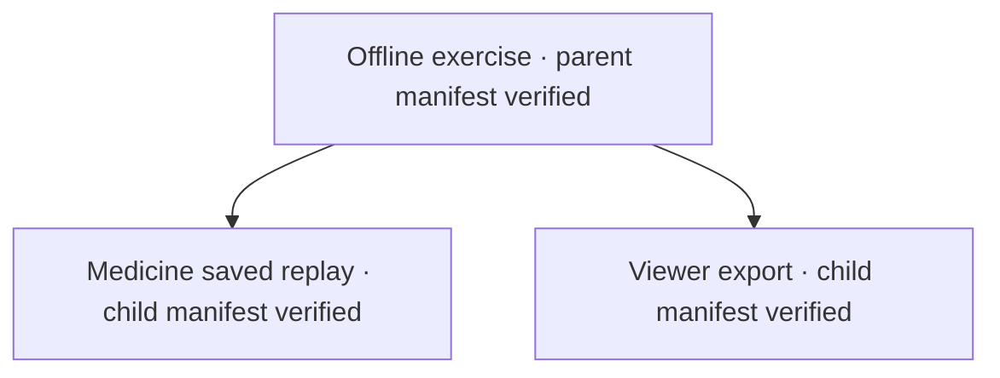

# Manifest and lineage exercise

Passed with real subprocesses and zero LLM API calls. This tests execution tracking;
it is not a fresh model-generated deliberation.



All three run IDs are unique. Both child manifests cite the correct parent.
Source archives, resource snapshots, and artifact hashes verify successfully.
A deliberately changed report in a temporary copy was correctly rejected; the real
run was not changed. The admitted world and all original saved reports are unchanged.
Historical generation provenance remains explicitly unknown.

- [Detailed results](RESULT.json)
- [Parent manifest](run_185006_175144/run_manifest.json)
- [Replay report](run_185006_175144/replay/DEMO_REPORT.md)
- [Replay manifest](run_185006_175144/replay/run_manifest.json)
- [Viewer export manifest](run_185006_175144/viewer/data/provenance/run_1c0a059def754abcbd19bbae38cf24d1.json)
- [Recorded lineage](run_185006_175144/LINEAGE.json)

Rerun from the project root; each invocation creates a new run directory:

```bash
.venv/bin/python diagnostics/manifest_lineage_20261014/exercise.py
```
