# Logic_Puzzles claim/conflict projection

Read-only projection. Native records remain attributed; evidence links do not establish whole-record correctness.

```mermaid
flowchart LR
    n0["WORLD_EFFECT: Ada gives the medicine to Ben"]
    n1["WORLD_EFFECT: Ben has a 95% chance of survival"]
    n2["WORLD_EFFECT: Ada gives the medicine to Cara"]
    n3["WORLD_EFFECT: Cara has a 5% chance of survival"]
    n4["WORLD_EFFECT: does not receive one dose of medicine"]
    n5["WORLD_EFFECT: does not receive one dose of medicine"]
    n6["WORLD_EFFECT: will die"]
    n7["WORLD_EFFECT: will die"]
    n8["PROPOSITION: Ada gives the medicine to Ben; affected subject: Ben"]
    n9["PROPOSITION: Ben has a 95% chance of survival; affected subject: Ben; modality: PROBABILISTIC"]
    n10["PROPOSITION: 95% chance — Ben has a 95% chance of survival"]
    n11["PROPOSITION: Ada gives the medicine to Cara; affected subject: Cara"]
    n12["PROPOSITION: Cara has a 5% chance of survival; affected subject: Cara; modality: PROBABILISTIC"]
    n13["PROPOSITION: 5% chance — Cara has a 5% chance of survival"]
    n14["PROPOSITION: does not receive one dose of medicine; affected subject: Cara; magnitude or qualifier: one"]
    n15["PROPOSITION: does not receive one dose of medicine; affected subject: Ben; magnitude or qualifier: one"]
    n16["PROPOSITION: will die; affected subject: Cara"]
    n17["PROPOSITION: will die; affected subject: Ben"]
    n18["PROPOSITION: A clinic has one dose of medicine."]
    n19["PROPOSITION: Ada promised Cara that she would give Cara the medicine."]
    n20["PROPOSITION: Ada can give the medicine to Ben or Cara, but not both."]
    n21["PROPOSITION: The patient who does not get the medicine will die."]
    n22["PROPOSITION: If Ada gives the medicine to Ben, Ben has a 95% chance of survival."]
    n23["PROPOSITION: If Ada gives the medicine to Cara, Cara has a 5% chance of survival."]
    n24["PROPOSITION: Disutility of broken promise assumed &lt; 0.9 expected life"]
    n25["PROPOSITION: Ben has a 95% chance of survival; affected subject: Ben; modality: PROBABILISTIC"]
    n26["PROPOSITION: Cara has a 5% chance of survival; affected subject: Cara; modality: PROBABILISTIC"]
    n27["PROPOSITION: Ada promised Cara that she would give Cara the medicine."]
    n28["PROPOSITION: Ada promised Cara that she would give Cara the medicine."]
    n29["PROPOSITION: Ben has a 95% chance of survival; affected subject: Ben; modality: PROBABILISTIC"]
    n30["PROPOSITION: Cara has a 5% chance of survival; affected subject: Cara; modality: PROBABILISTIC"]
    n31["PROPOSITION: Ada promised Cara that she would give Cara the medicine."]
    n32["CLAIM: utilitarian: A0 assessment"]
    n33["CLAIM: utilitarian: A0 assessment"]
    n34["CLAIM: utilitarian: A0 assessment"]
    n35["CLAIM: utilitarian: A0 assessment"]
    n36["CLAIM: utilitarian: A1 assessment"]
    n37["CLAIM: utilitarian: A1 assessment"]
    n38["CLAIM: utilitarian: A1 assessment"]
    n39["CLAIM: utilitarian: A1 assessment"]
    n40["UNRESOLVED_CONFLICT: numeric reversal threshold lacks a scenario-grounded quantity"]
    n41["CLAIM: deontological: A0 CONFLICTED"]
    n42["FRAMEWORK_COMMITMENT: perfect duty to keep promises"]
    n43["FRAMEWORK_COMMITMENT: perfect duties override imperfect"]
    n44["UNRESOLVED_CONFLICT: omission was classified as a perfect negative-duty violation without a separate basis"]
    n45["UNRESOLVED_CONFLICT: resolved adjudication rests on unsupported decisive premises"]
    n46["CLAIM: deontological: A1 CONFLICTED"]
    n47["UNRESOLVED_CONFLICT: perfect positive duty lacks a right-correlative, undertaking, or grounded emergency basis"]
    n48["UNRESOLVED_CONFLICT: resolved adjudication rests on unsupported decisive premises"]
    n49["UNRESOLVED_CONFLICT: cara: perfect duty to keep promises ↔ ben: imperfect duty of beneficence"]
    n50["UNRESOLVED_CONFLICT: A0 ADJUDICATION_CALIBRATION: omission was classified as a perfect negative-duty violation without a separate basis"]
    n51["UNRESOLVED_CONFLICT: A0 ADJUDICATION_CALIBRATION: resolved adjudication rests on unsupported decisive premises"]
    n52["UNRESOLVED_CONFLICT: A1 ADJUDICATION_CALIBRATION: perfect positive duty lacks a right-correlative, undertaking, or grounded emergency basis"]
    n53["UNRESOLVED_CONFLICT: A1 ADJUDICATION_CALIBRATION: resolved adjudication rests on unsupported decisive premises"]
    n32 -->|"DEPENDENCY"| n25
    n32 -->|"DEPENDENCY"| n26
    n33 -->|"DEPENDENCY"| n25
    n33 -->|"DEPENDENCY"| n26
    n34 -->|"DEPENDENCY"| n25
    n34 -->|"DEPENDENCY"| n26
    n35 -->|"DEPENDENCY"| n25
    n35 -->|"DEPENDENCY"| n26
    n36 -->|"DEPENDENCY"| n25
    n36 -->|"DEPENDENCY"| n26
    n37 -->|"DEPENDENCY"| n25
    n37 -->|"DEPENDENCY"| n26
    n38 -->|"DEPENDENCY"| n25
    n38 -->|"DEPENDENCY"| n26
    n39 -->|"DEPENDENCY"| n25
    n39 -->|"DEPENDENCY"| n26
    n41 -->|"DEPENDENCY"| n28
    n42 -->|"SUPPORT"| n41
    n43 -->|"SUPPORT"| n41
    n44 -->|"OBJECTION"| n41
    n45 -->|"OBJECTION"| n41
    n46 -->|"DEPENDENCY"| n28
    n42 -->|"SUPPORT"| n46
    n43 -->|"SUPPORT"| n46
    n47 -->|"OBJECTION"| n46
    n48 -->|"OBJECTION"| n46
```

Proposed review queue (at most two issues):

- omission was classified as a perfect negative-duty violation without a separate basis
- resolved adjudication rests on unsupported decisive premises
