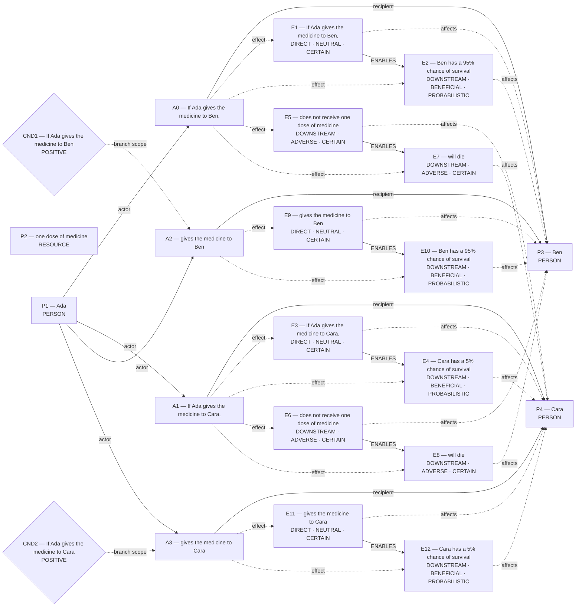
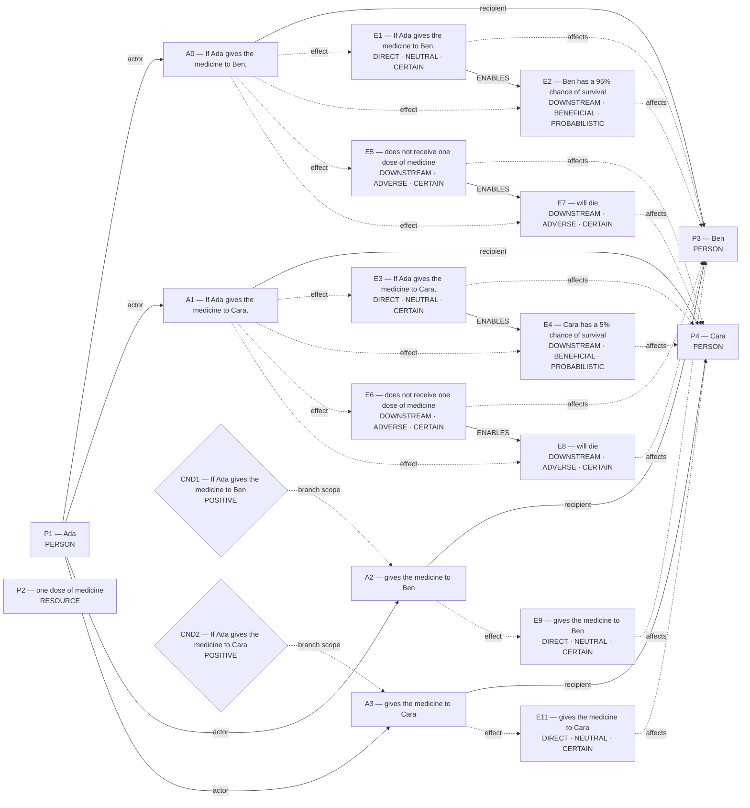
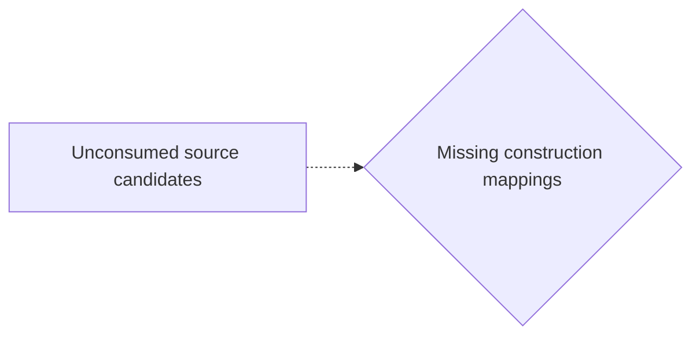
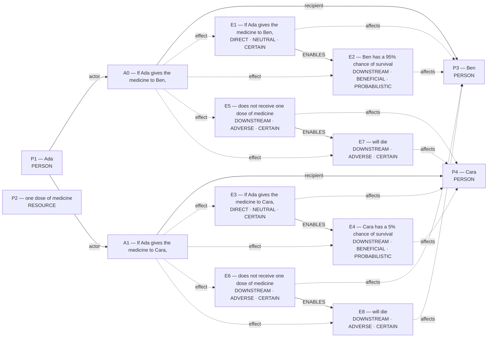
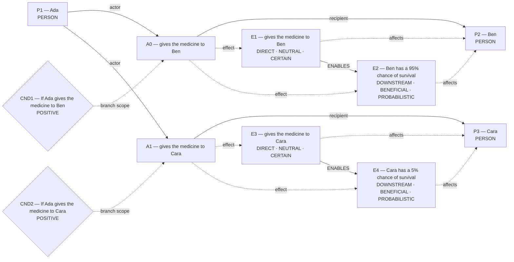
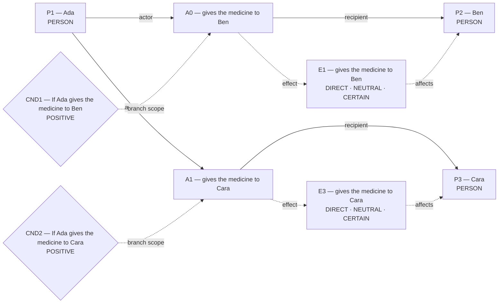

# Candidate world attempts

Chosen blueprint: **exclusive_allocation**  
Chooser status: **FILLED**

## 1. exclusive_allocation (alternative; amended)

Template status: **FILLED**  
Proposal status: **FILLED**  
Contract valid: **true**  
Missing slots: none

### exclusive_allocation candidate graph



Hypothesis overlay (not submitted as world effects):

- `E10`: Ben has a 95% chance of survival; unlicensed_welfare_effect
- `E12`: Cara has a 5% chance of survival; unlicensed_welfare_effect

### Supported core for admission



Native admission:

```json
{
  "blueprint_id": "exclusive_allocation",
  "rank": -0.1,
  "variant": "amended",
  "candidate_path": "/Users/benjaminkowal/Documents/Python/Python Coding/RL_Algorithms/diagnostics/occurrence_path_beam/medicine/admission_attempts/00_exclusive_allocation/candidate.json",
  "overlay_path": "/Users/benjaminkowal/Documents/Python/Python Coding/RL_Algorithms/diagnostics/occurrence_path_beam/medicine/admission_attempts/00_exclusive_allocation/hypothesis_overlay.json",
  "status": "REJECTED",
  "returncode": 1,
  "error": "Parliament rejected the blueprint candidate: {\"status\": \"REJECTED\", \"actions\": {}, \"world_model\": {}, \"world_model_status\": \"COMMITTED\", \"world_contradictions\": [], \"errors\": [\"A0 has no distinguishing source clause; its grounding ['C2'] is covered entirely by the other actions\", \"A1 has no distinguishing source clause; its grounding ['C3'] is covered entirely by the other actions\", \"A2 has no distinguishing source clause; its grounding ['C2'] is covered entirely by the other actions\", \"A3 has no distinguishing source clause; its grounding ['C3'] is covered entirely by the other actions\"], \"warnings\": [], \"validation_issues\": [{\"code\": \"WORLD_VALIDATION_ERROR\", \"message\": \"A0 has no distinguishing source clause; its grounding ['C2'] is covered entirely by the other actions\", \"entity_kind\": \"action\", \"entity_id\": \"A0\", \"field\": \"\", \"related_ids\": [], \"repair_class\": \"SEMANTIC_PATCH\", \"permits_removal\": false}, {\"code\": \"WORLD_VALIDATION_ERROR\", \"message\": \"A1 has no distinguishing source clause; its grounding ['C3'] is covered entirely by the other actions\", \"entity_kind\": \"action\", \"entity_id\": \"A1\", \"field\": \"\", \"related_ids\": [], \"repair_class\": \"SEMANTIC_PATCH\", \"permits_removal\": false}, {\"code\": \"WORLD_VALIDATION_ERROR\", \"message\": \"A2 has no distinguishing source clause; its grounding ['C2'] is covered entirely by the other actions\", \"entity_kind\": \"action\", \"entity_id\": \"A2\", \"field\": \"\", \"related_ids\": [], \"repair_class\": \"SEMANTIC_PATCH\", \"permits_removal\": false}, {\"code\": \"WORLD_VALIDATION_ERROR\", \"message\": \"A3 has no distinguishing source clause; its grounding ['C3'] is covered entirely by the other actions\", \"entity_kind\": \"action\", \"entity_id\": \"A3\", \"field\": \"\", \"related_ids\": [], \"repair_class\": \"SEMANTIC_PATCH\", \"permits_removal\": false}], \"compiler_loss_telemetry\": {}, \"clauses\": [{\"clause_id\": \"C0\", \"text\": \"A clinic has one dose of medicine.\"}, {\"clause_id\": \"C1\", \"text\": \"Ada can give the medicine to Ben or Cara, but not both.\"}, {\"clause_id\": \"C2\", \"text\": \"If Ada gives the medicine to Ben, Ben has a 95% chance of survival.\"}, {\"clause_id\": \"C3\", \"text\": \"If Ada gives the medicine to Cara, Cara has a 5% chance of survival.\"}, {\"clause_id\": \"C4\", \"text\": \"The patient who does not get the medicine will die.\"}]}\n"
}
```

Source constructions retained outside the admitted world:

Parser proposals below preserve alternatives and local scope; they do not establish occurrence or a resolved interpretation.

Unconsumed parser candidates: **40**. These are visible mapping gaps, not admission failures.



- `c0`: Which construction should preserve this PREDICATION reading?
- `c1`: Which construction should preserve this PREDICATION reading?
- `c6`: Which construction should preserve this PREDICATION reading?
- `c7`: Which construction should preserve this PREDICATION reading?
- `c10`: Which construction should preserve this MODALITY reading?
- `c11`: Which construction should preserve this MODALITY reading?
- `c12`: Which construction should preserve this MODALITY reading?
- `c13`: Which construction should preserve this MODALITY reading?
- `c14`: Which construction should preserve this PARTICIPANT reading?
- `c15`: Which construction should preserve this PARTICIPANT reading?
- `c16`: Which construction should preserve this PARTICIPANT reading?
- `c17`: Which construction should preserve this PARTICIPANT reading?
- `c18`: Which construction should preserve this PARTICIPANT reading?
- `c22`: Which construction should preserve this PARTICIPANT reading?
- `c23`: Which construction should preserve this PARTICIPANT reading?
- `c27`: Which construction should preserve this PARTICIPANT reading?
- `c28`: Which construction should preserve this PARTICIPANT reading?
- `c29`: Which construction should preserve this PARTICIPANT reading?
- `c30`: Which construction should preserve this PARTICIPANT reading?
- `c31`: Which construction should preserve this PARTICIPANT reading?
- `c32`: Which construction should preserve this PARTICIPANT reading?
- `c33`: Which construction should preserve this QUANTITY reading?
- `c34`: Which construction should preserve this SAME_REFERENT reading?
- `c35`: Which construction should preserve this SAME_REFERENT reading?
- `c36`: Which construction should preserve this SAME_REFERENT reading?
- `c37`: Which construction should preserve this SAME_REFERENT reading?
- `c38`: Which construction should preserve this SAME_REFERENT reading?
- `c39`: Which construction should preserve this SAME_REFERENT reading?
- `c40`: Which construction should preserve this SAME_REFERENT reading?
- `c41`: Which construction should preserve this SAME_REFERENT reading?
- `c42`: Which construction should preserve this SAME_REFERENT reading?
- `c43`: Which construction should preserve this SAME_REFERENT reading?
- `c44`: Which construction should preserve this SAME_REFERENT reading?
- `c45`: Which construction should preserve this SAME_REFERENT reading?
- `c46`: Which construction should preserve this SAME_REFERENT reading?
- `c47`: Which construction should preserve this SAME_REFERENT reading?
- `c48`: Which construction should preserve this SAME_REFERENT reading?
- `c49`: Which construction should preserve this SAME_REFERENT reading?
- `c50`: Which construction should preserve this SAME_REFERENT reading?
- `c51`: Which construction should preserve this SAME_REFERENT reading?

## 2. exclusive_allocation (selected; baseline)

Template status: **FILLED**  
Proposal status: **FILLED**  
Contract valid: **true**  
Missing slots: none

### exclusive_allocation candidate graph



Native admission:

```json
{
  "blueprint_id": "exclusive_allocation",
  "rank": 0,
  "variant": "baseline",
  "candidate_path": "/Users/benjaminkowal/Documents/Python/Python Coding/RL_Algorithms/diagnostics/occurrence_path_beam/medicine/admission_attempts/01_exclusive_allocation/candidate.json",
  "overlay_path": "/Users/benjaminkowal/Documents/Python/Python Coding/RL_Algorithms/diagnostics/occurrence_path_beam/medicine/admission_attempts/01_exclusive_allocation/hypothesis_overlay.json",
  "status": "ADMITTED",
  "admission": {
    "status": "COMMITTED",
    "world_model_status": "COMMITTED",
    "effects": 8,
    "causal_links": 6,
    "frozen_trace_valid": true,
    "discourse_committed": false,
    "relent_workspace": {
      "established": [
        {
          "kind": "occurrence_effect",
          "effect_id": "E1",
          "outcome": "If Ada gives the medicine to Ben,",
          "predicate": null,
          "status": "established"
        },
        {
          "kind": "occurrence_effect",
          "effect_id": "E2",
          "outcome": "Ben has a 95% chance of survival",
          "predicate": null,
          "status": "established"
        },
        {
          "kind": "occurrence_effect",
          "effect_id": "E3",
          "outcome": "If Ada gives the medicine to Cara,",
          "predicate": null,
          "status": "established"
        },
        {
          "kind": "occurrence_effect",
          "effect_id": "E4",
          "outcome": "Cara has a 5% chance of survival",
          "predicate": null,
          "status": "established"
        },
        {
          "kind": "occurrence_effect",
          "effect_id": "E5",
          "outcome": "does not receive one dose of medicine",
          "predicate": null,
          "status": "established"
        },
        {
          "kind": "occurrence_effect",
          "effect_id": "E6",
          "outcome": "does not receive one dose of medicine",
          "predicate": null,
          "status": "established"
        },
        {
          "kind": "occurrence_effect",
          "effect_id": "E7",
          "outcome": "will die",
          "predicate": null,
          "status": "established"
        },
        {
          "kind": "occurrence_effect",
          "effect_id": "E8",
          "outcome": "will die",
          "predicate": null,
          "status": "established"
        }
      ],
      "not_established": [],
      "duty_ledger_citations": [],
      "ev_forbidden_proposition_ids": [],
      "factual_status_sources": [
        "occurrence_effects"
      ]
    },
    "fingerprint_sha256": "20eb45b994e290de27fc7bfd938f318d42871f335bc4dbecfb303bded3ae9755"
  },
  "trace_path": "/Users/benjaminkowal/Documents/Python/Python Coding/RL_Algorithms/diagnostics/occurrence_path_beam/medicine/admission_attempts/01_exclusive_allocation/frozen_world_trace.json"
}
```

Source constructions retained outside the admitted world:

Parser proposals below preserve alternatives and local scope; they do not establish occurrence or a resolved interpretation.

Unconsumed parser candidates: **40**. These are visible mapping gaps, not admission failures.


- `c0`: Which construction should preserve this PREDICATION reading?
- `c1`: Which construction should preserve this PREDICATION reading?
- `c6`: Which construction should preserve this PREDICATION reading?
- `c7`: Which construction should preserve this PREDICATION reading?
- `c10`: Which construction should preserve this MODALITY reading?
- `c11`: Which construction should preserve this MODALITY reading?
- `c12`: Which construction should preserve this MODALITY reading?
- `c13`: Which construction should preserve this MODALITY reading?
- `c14`: Which construction should preserve this PARTICIPANT reading?
- `c15`: Which construction should preserve this PARTICIPANT reading?
- `c16`: Which construction should preserve this PARTICIPANT reading?
- `c17`: Which construction should preserve this PARTICIPANT reading?
- `c18`: Which construction should preserve this PARTICIPANT reading?
- `c22`: Which construction should preserve this PARTICIPANT reading?
- `c23`: Which construction should preserve this PARTICIPANT reading?
- `c27`: Which construction should preserve this PARTICIPANT reading?
- `c28`: Which construction should preserve this PARTICIPANT reading?
- `c29`: Which construction should preserve this PARTICIPANT reading?
- `c30`: Which construction should preserve this PARTICIPANT reading?
- `c31`: Which construction should preserve this PARTICIPANT reading?
- `c32`: Which construction should preserve this PARTICIPANT reading?
- `c33`: Which construction should preserve this QUANTITY reading?
- `c34`: Which construction should preserve this SAME_REFERENT reading?
- `c35`: Which construction should preserve this SAME_REFERENT reading?
- `c36`: Which construction should preserve this SAME_REFERENT reading?
- `c37`: Which construction should preserve this SAME_REFERENT reading?
- `c38`: Which construction should preserve this SAME_REFERENT reading?
- `c39`: Which construction should preserve this SAME_REFERENT reading?
- `c40`: Which construction should preserve this SAME_REFERENT reading?
- `c41`: Which construction should preserve this SAME_REFERENT reading?
- `c42`: Which construction should preserve this SAME_REFERENT reading?
- `c43`: Which construction should preserve this SAME_REFERENT reading?
- `c44`: Which construction should preserve this SAME_REFERENT reading?
- `c45`: Which construction should preserve this SAME_REFERENT reading?
- `c46`: Which construction should preserve this SAME_REFERENT reading?
- `c47`: Which construction should preserve this SAME_REFERENT reading?
- `c48`: Which construction should preserve this SAME_REFERENT reading?
- `c49`: Which construction should preserve this SAME_REFERENT reading?
- `c50`: Which construction should preserve this SAME_REFERENT reading?
- `c51`: Which construction should preserve this SAME_REFERENT reading?

## 3. rescue_contrast (alternative; baseline)

Template status: **PARTIAL**  
Proposal status: **WITHHELD**  
Contract valid: **true**  
Missing slots: `first_saved`, `second_saved`, `first_rescue_action`, `second_rescue_action`, `first_benefit`, `second_benefit`

World withheld:

- Required slots remain unfilled: first_saved, second_saved, first_rescue_action, second_rescue_action, first_benefit, second_benefit

Source constructions retained outside the admitted world:

Parser proposals below preserve alternatives and local scope; they do not establish occurrence or a resolved interpretation.

Unconsumed parser candidates: **40**. These are visible mapping gaps, not admission failures.


- `c0`: Which construction should preserve this PREDICATION reading?
- `c1`: Which construction should preserve this PREDICATION reading?
- `c6`: Which construction should preserve this PREDICATION reading?
- `c7`: Which construction should preserve this PREDICATION reading?
- `c10`: Which construction should preserve this MODALITY reading?
- `c11`: Which construction should preserve this MODALITY reading?
- `c12`: Which construction should preserve this MODALITY reading?
- `c13`: Which construction should preserve this MODALITY reading?
- `c14`: Which construction should preserve this PARTICIPANT reading?
- `c15`: Which construction should preserve this PARTICIPANT reading?
- `c16`: Which construction should preserve this PARTICIPANT reading?
- `c17`: Which construction should preserve this PARTICIPANT reading?
- `c18`: Which construction should preserve this PARTICIPANT reading?
- `c22`: Which construction should preserve this PARTICIPANT reading?
- `c23`: Which construction should preserve this PARTICIPANT reading?
- `c27`: Which construction should preserve this PARTICIPANT reading?
- `c28`: Which construction should preserve this PARTICIPANT reading?
- `c29`: Which construction should preserve this PARTICIPANT reading?
- `c30`: Which construction should preserve this PARTICIPANT reading?
- `c31`: Which construction should preserve this PARTICIPANT reading?
- `c32`: Which construction should preserve this PARTICIPANT reading?
- `c33`: Which construction should preserve this QUANTITY reading?
- `c34`: Which construction should preserve this SAME_REFERENT reading?
- `c35`: Which construction should preserve this SAME_REFERENT reading?
- `c36`: Which construction should preserve this SAME_REFERENT reading?
- `c37`: Which construction should preserve this SAME_REFERENT reading?
- `c38`: Which construction should preserve this SAME_REFERENT reading?
- `c39`: Which construction should preserve this SAME_REFERENT reading?
- `c40`: Which construction should preserve this SAME_REFERENT reading?
- `c41`: Which construction should preserve this SAME_REFERENT reading?
- `c42`: Which construction should preserve this SAME_REFERENT reading?
- `c43`: Which construction should preserve this SAME_REFERENT reading?
- `c44`: Which construction should preserve this SAME_REFERENT reading?
- `c45`: Which construction should preserve this SAME_REFERENT reading?
- `c46`: Which construction should preserve this SAME_REFERENT reading?
- `c47`: Which construction should preserve this SAME_REFERENT reading?
- `c48`: Which construction should preserve this SAME_REFERENT reading?
- `c49`: Which construction should preserve this SAME_REFERENT reading?
- `c50`: Which construction should preserve this SAME_REFERENT reading?
- `c51`: Which construction should preserve this SAME_REFERENT reading?

## 4. omission_harm (alternative; baseline)

Template status: **PARTIAL**  
Proposal status: **WITHHELD**  
Contract valid: **true**  
Missing slots: `done`, `done_hedge`, `omitted_hedge`, `group_counts`, `instrument`

World withheld:

- Required slots remain unfilled: done

Source constructions retained outside the admitted world:

Parser proposals below preserve alternatives and local scope; they do not establish occurrence or a resolved interpretation.

Unconsumed parser candidates: **40**. These are visible mapping gaps, not admission failures.


- `c0`: Which construction should preserve this PREDICATION reading?
- `c1`: Which construction should preserve this PREDICATION reading?
- `c6`: Which construction should preserve this PREDICATION reading?
- `c7`: Which construction should preserve this PREDICATION reading?
- `c10`: Which construction should preserve this MODALITY reading?
- `c11`: Which construction should preserve this MODALITY reading?
- `c12`: Which construction should preserve this MODALITY reading?
- `c13`: Which construction should preserve this MODALITY reading?
- `c14`: Which construction should preserve this PARTICIPANT reading?
- `c15`: Which construction should preserve this PARTICIPANT reading?
- `c16`: Which construction should preserve this PARTICIPANT reading?
- `c17`: Which construction should preserve this PARTICIPANT reading?
- `c18`: Which construction should preserve this PARTICIPANT reading?
- `c22`: Which construction should preserve this PARTICIPANT reading?
- `c23`: Which construction should preserve this PARTICIPANT reading?
- `c27`: Which construction should preserve this PARTICIPANT reading?
- `c28`: Which construction should preserve this PARTICIPANT reading?
- `c29`: Which construction should preserve this PARTICIPANT reading?
- `c30`: Which construction should preserve this PARTICIPANT reading?
- `c31`: Which construction should preserve this PARTICIPANT reading?
- `c32`: Which construction should preserve this PARTICIPANT reading?
- `c33`: Which construction should preserve this QUANTITY reading?
- `c34`: Which construction should preserve this SAME_REFERENT reading?
- `c35`: Which construction should preserve this SAME_REFERENT reading?
- `c36`: Which construction should preserve this SAME_REFERENT reading?
- `c37`: Which construction should preserve this SAME_REFERENT reading?
- `c38`: Which construction should preserve this SAME_REFERENT reading?
- `c39`: Which construction should preserve this SAME_REFERENT reading?
- `c40`: Which construction should preserve this SAME_REFERENT reading?
- `c41`: Which construction should preserve this SAME_REFERENT reading?
- `c42`: Which construction should preserve this SAME_REFERENT reading?
- `c43`: Which construction should preserve this SAME_REFERENT reading?
- `c44`: Which construction should preserve this SAME_REFERENT reading?
- `c45`: Which construction should preserve this SAME_REFERENT reading?
- `c46`: Which construction should preserve this SAME_REFERENT reading?
- `c47`: Which construction should preserve this SAME_REFERENT reading?
- `c48`: Which construction should preserve this SAME_REFERENT reading?
- `c49`: Which construction should preserve this SAME_REFERENT reading?
- `c50`: Which construction should preserve this SAME_REFERENT reading?
- `c51`: Which construction should preserve this SAME_REFERENT reading?

## 5. flexible_graph (alternative; flexible)

Template status: **FILLED**  
Proposal status: **FILLED**  
Contract valid: **true**  
Missing slots: none

### flexible_graph candidate graph



Hypothesis overlay (not submitted as world effects):

- `E2`: Ben has a 95% chance of survival; unlicensed_welfare_effect
- `E4`: Cara has a 5% chance of survival; unlicensed_welfare_effect

### Supported core for admission



Native admission:

```json
{
  "blueprint_id": "flexible_graph",
  "rank": 3,
  "variant": "flexible",
  "candidate_path": "/Users/benjaminkowal/Documents/Python/Python Coding/RL_Algorithms/diagnostics/occurrence_path_beam/medicine/admission_attempts/04_flexible_graph/candidate.json",
  "overlay_path": "/Users/benjaminkowal/Documents/Python/Python Coding/RL_Algorithms/diagnostics/occurrence_path_beam/medicine/admission_attempts/04_flexible_graph/hypothesis_overlay.json",
  "status": "ADMITTED",
  "admission": {
    "status": "COMMITTED",
    "world_model_status": "COMMITTED",
    "effects": 2,
    "causal_links": 0,
    "frozen_trace_valid": true,
    "discourse_committed": false,
    "relent_workspace": {
      "established": [
        {
          "kind": "occurrence_effect",
          "effect_id": "E1",
          "outcome": "gives the medicine to Ben",
          "predicate": null,
          "status": "established"
        },
        {
          "kind": "occurrence_effect",
          "effect_id": "E3",
          "outcome": "gives the medicine to Cara",
          "predicate": null,
          "status": "established"
        }
      ],
      "not_established": [],
      "duty_ledger_citations": [],
      "ev_forbidden_proposition_ids": [],
      "factual_status_sources": [
        "occurrence_effects"
      ]
    },
    "fingerprint_sha256": "9f0a036aa79e506b284e0b40610c0ae34b3b04946859d82874df35d2cf6391a9"
  },
  "trace_path": "/Users/benjaminkowal/Documents/Python/Python Coding/RL_Algorithms/diagnostics/occurrence_path_beam/medicine/admission_attempts/04_flexible_graph/frozen_world_trace.json"
}
```

Source constructions retained outside the admitted world:

Parser proposals below preserve alternatives and local scope; they do not establish occurrence or a resolved interpretation.

Unconsumed parser candidates: **40**. These are visible mapping gaps, not admission failures.


- `c0`: Which construction should preserve this PREDICATION reading?
- `c1`: Which construction should preserve this PREDICATION reading?
- `c6`: Which construction should preserve this PREDICATION reading?
- `c7`: Which construction should preserve this PREDICATION reading?
- `c10`: Which construction should preserve this MODALITY reading?
- `c11`: Which construction should preserve this MODALITY reading?
- `c12`: Which construction should preserve this MODALITY reading?
- `c13`: Which construction should preserve this MODALITY reading?
- `c14`: Which construction should preserve this PARTICIPANT reading?
- `c15`: Which construction should preserve this PARTICIPANT reading?
- `c16`: Which construction should preserve this PARTICIPANT reading?
- `c17`: Which construction should preserve this PARTICIPANT reading?
- `c18`: Which construction should preserve this PARTICIPANT reading?
- `c22`: Which construction should preserve this PARTICIPANT reading?
- `c23`: Which construction should preserve this PARTICIPANT reading?
- `c27`: Which construction should preserve this PARTICIPANT reading?
- `c28`: Which construction should preserve this PARTICIPANT reading?
- `c29`: Which construction should preserve this PARTICIPANT reading?
- `c30`: Which construction should preserve this PARTICIPANT reading?
- `c31`: Which construction should preserve this PARTICIPANT reading?
- `c32`: Which construction should preserve this PARTICIPANT reading?
- `c33`: Which construction should preserve this QUANTITY reading?
- `c34`: Which construction should preserve this SAME_REFERENT reading?
- `c35`: Which construction should preserve this SAME_REFERENT reading?
- `c36`: Which construction should preserve this SAME_REFERENT reading?
- `c37`: Which construction should preserve this SAME_REFERENT reading?
- `c38`: Which construction should preserve this SAME_REFERENT reading?
- `c39`: Which construction should preserve this SAME_REFERENT reading?
- `c40`: Which construction should preserve this SAME_REFERENT reading?
- `c41`: Which construction should preserve this SAME_REFERENT reading?
- `c42`: Which construction should preserve this SAME_REFERENT reading?
- `c43`: Which construction should preserve this SAME_REFERENT reading?
- `c44`: Which construction should preserve this SAME_REFERENT reading?
- `c45`: Which construction should preserve this SAME_REFERENT reading?
- `c46`: Which construction should preserve this SAME_REFERENT reading?
- `c47`: Which construction should preserve this SAME_REFERENT reading?
- `c48`: Which construction should preserve this SAME_REFERENT reading?
- `c49`: Which construction should preserve this SAME_REFERENT reading?
- `c50`: Which construction should preserve this SAME_REFERENT reading?
- `c51`: Which construction should preserve this SAME_REFERENT reading?

## 6. primitive_composition (alternative; composition)

Template status: **FILLED**  
Proposal status: **FILLED**  
Contract valid: **true**  
Missing slots: none

### primitive_composition candidate graph


Native admission:

```json
{
  "blueprint_id": "primitive_composition",
  "rank": 4,
  "variant": "composition",
  "candidate_path": "/Users/benjaminkowal/Documents/Python/Python Coding/RL_Algorithms/diagnostics/occurrence_path_beam/medicine/admission_attempts/05_primitive_composition/candidate.json",
  "overlay_path": "/Users/benjaminkowal/Documents/Python/Python Coding/RL_Algorithms/diagnostics/occurrence_path_beam/medicine/admission_attempts/05_primitive_composition/hypothesis_overlay.json",
  "status": "REJECTED",
  "returncode": 1,
  "error": "Traceback (most recent call last):\n  File \"/var/folders/n8/ljhm3wm554j1rvxbx9vdvw600000gn/T/tmpkphg_unr/admit_blueprint.py\", line 148, in <module>\n    parse_world_model(\n  File \"/private/tmp/parliament-smoke-614af0c/global_workspace/world_state.py\", line 3123, in parse_world_model\n    raise WorldModelValidationError(\nglobal_workspace.world_validation.WorldModelValidationError: causal_link[0] is conditional but has no condition; causal_link[1] is conditional but has no condition\n"
}
```

Source constructions retained outside the admitted world:

Parser proposals below preserve alternatives and local scope; they do not establish occurrence or a resolved interpretation.

Unconsumed parser candidates: **40**. These are visible mapping gaps, not admission failures.


- `c0`: Which construction should preserve this PREDICATION reading?
- `c1`: Which construction should preserve this PREDICATION reading?
- `c6`: Which construction should preserve this PREDICATION reading?
- `c7`: Which construction should preserve this PREDICATION reading?
- `c10`: Which construction should preserve this MODALITY reading?
- `c11`: Which construction should preserve this MODALITY reading?
- `c12`: Which construction should preserve this MODALITY reading?
- `c13`: Which construction should preserve this MODALITY reading?
- `c14`: Which construction should preserve this PARTICIPANT reading?
- `c15`: Which construction should preserve this PARTICIPANT reading?
- `c16`: Which construction should preserve this PARTICIPANT reading?
- `c17`: Which construction should preserve this PARTICIPANT reading?
- `c18`: Which construction should preserve this PARTICIPANT reading?
- `c22`: Which construction should preserve this PARTICIPANT reading?
- `c23`: Which construction should preserve this PARTICIPANT reading?
- `c27`: Which construction should preserve this PARTICIPANT reading?
- `c28`: Which construction should preserve this PARTICIPANT reading?
- `c29`: Which construction should preserve this PARTICIPANT reading?
- `c30`: Which construction should preserve this PARTICIPANT reading?
- `c31`: Which construction should preserve this PARTICIPANT reading?
- `c32`: Which construction should preserve this PARTICIPANT reading?
- `c33`: Which construction should preserve this QUANTITY reading?
- `c34`: Which construction should preserve this SAME_REFERENT reading?
- `c35`: Which construction should preserve this SAME_REFERENT reading?
- `c36`: Which construction should preserve this SAME_REFERENT reading?
- `c37`: Which construction should preserve this SAME_REFERENT reading?
- `c38`: Which construction should preserve this SAME_REFERENT reading?
- `c39`: Which construction should preserve this SAME_REFERENT reading?
- `c40`: Which construction should preserve this SAME_REFERENT reading?
- `c41`: Which construction should preserve this SAME_REFERENT reading?
- `c42`: Which construction should preserve this SAME_REFERENT reading?
- `c43`: Which construction should preserve this SAME_REFERENT reading?
- `c44`: Which construction should preserve this SAME_REFERENT reading?
- `c45`: Which construction should preserve this SAME_REFERENT reading?
- `c46`: Which construction should preserve this SAME_REFERENT reading?
- `c47`: Which construction should preserve this SAME_REFERENT reading?
- `c48`: Which construction should preserve this SAME_REFERENT reading?
- `c49`: Which construction should preserve this SAME_REFERENT reading?
- `c50`: Which construction should preserve this SAME_REFERENT reading?
- `c51`: Which construction should preserve this SAME_REFERENT reading?
