# Logic_Puzzles claim/conflict projection

Read-only projection. Native records remain attributed; evidence links do not establish whole-record correctness.

```mermaid
flowchart LR
    n0["WORLD_EFFECT: If Ada gives the medicine to Ben,"]
    n1["WORLD_EFFECT: Ben has a 95% chance of survival"]
    n2["WORLD_EFFECT: If Ada gives the medicine to Cara,"]
    n3["WORLD_EFFECT: Cara has a 5% chance of survival"]
    n4["WORLD_EFFECT: does not receive one dose of medicine"]
    n5["WORLD_EFFECT: does not receive one dose of medicine"]
    n6["WORLD_EFFECT: will die"]
    n7["WORLD_EFFECT: will die"]
    n8["PROPOSITION: If Ada gives the medicine to Ben,; affected subject: Ben"]
    n9["PROPOSITION: Ben has a 95% chance of survival; affected subject: Ben; modality: PROBABILISTIC"]
    n10["PROPOSITION: 95% chance — Ben has a 95% chance of survival"]
    n11["PROPOSITION: If Ada gives the medicine to Cara,; affected subject: Cara"]
    n12["PROPOSITION: Cara has a 5% chance of survival; affected subject: Cara; modality: PROBABILISTIC"]
    n13["PROPOSITION: 5% chance — Cara has a 5% chance of survival"]
    n14["PROPOSITION: does not receive one dose of medicine; affected subject: Cara; magnitude or qualifier: one"]
    n15["PROPOSITION: does not receive one dose of medicine; affected subject: Ben; magnitude or qualifier: one"]
    n16["PROPOSITION: will die; affected subject: Cara"]
    n17["PROPOSITION: will die; affected subject: Ben"]
    n18["PROPOSITION: A clinic has one dose of medicine."]
    n19["PROPOSITION: Ada can give the medicine to Ben or Cara, but not both."]
    n20["PROPOSITION: The patient who does not get the medicine will die."]
    n21["PROPOSITION: If Ada gives the medicine to Ben, Ben has a 95% chance of survival."]
    n22["PROPOSITION: If Ada gives the medicine to Cara, Cara has a 5% chance of survival."]
    n23["PROPOSITION: Ben has a 95% chance of survival; affected subject: Ben; modality: PROBABILISTIC"]
    n24["PROPOSITION: Cara has a 5% chance of survival; affected subject: Cara; modality: PROBABILISTIC"]
    n25["PROPOSITION: will die; affected subject: Cara"]
    n26["PROPOSITION: will die; affected subject: Ben"]
    n27["PROPOSITION: Ben has a 95% chance of survival; affected subject: Ben; modality: PROBABILISTIC"]
    n28["PROPOSITION: Cara has a 5% chance of survival; affected subject: Cara; modality: PROBABILISTIC"]
    n29["PROPOSITION: Ada can give the medicine to Ben or Cara, but not both."]
    n30["PROPOSITION: Ben has a 95% chance of survival; affected subject: Ben; modality: PROBABILISTIC"]
    n31["PROPOSITION: Cara has a 5% chance of survival; affected subject: Cara; modality: PROBABILISTIC"]
    n32["PROPOSITION: Ben has a 95% chance of survival; affected subject: Ben; modality: PROBABILISTIC"]
    n33["PROPOSITION: Cara has a 5% chance of survival; affected subject: Cara; modality: PROBABILISTIC"]
    n34["PROPOSITION: Ben has a 95% chance of survival; affected subject: Ben; modality: PROBABILISTIC"]
    n35["PROPOSITION: Cara has a 5% chance of survival; affected subject: Cara; modality: PROBABILISTIC"]
    n36["CLAIM: utilitarian: A0 assessment"]
    n37["CLAIM: utilitarian: A0 assessment"]
    n38["CLAIM: utilitarian: A0 assessment"]
    n39["CLAIM: utilitarian: A0 assessment"]
    n40["CLAIM: utilitarian: A1 assessment"]
    n41["CLAIM: utilitarian: A1 assessment"]
    n42["CLAIM: utilitarian: A1 assessment"]
    n43["CLAIM: utilitarian: A1 assessment"]
    n44["CLAIM: care: A0 RESPONSIVE"]
    n45["FRAMEWORK_COMMITMENT: Control creates responsibility to respond competently"]
    n46["FRAMEWORK_COMMITMENT: ACUTE_DEPENDENCY"]
    n47["CLAIM: care: A1 MIXED"]
    n48["FRAMEWORK_COMMITMENT: Control creates responsibility to respond"]
    n49["UNRESOLVED_CONFLICT: decisive counts lack relational comparability"]
    n50["UNRESOLVED_CONFLICT: A0 competing Care claim remains contested"]
    n51["UNRESOLVED_CONFLICT: A1 competing Care claim remains contested"]
    n52["CLAIM: virtue: A0 EXEMPLIFIES"]
    n53["FRAMEWORK_COMMITMENT: PRACTICAL_WISDOM"]
    n54["CLAIM: virtue: A1 MIXED"]
    n55["CLAIM: rawlsian: A0 assessment"]
    n56["FRAMEWORK_COMMITMENT: ORIGINAL_POSITION_PUBLIC_RULE"]
    n57["CLAIM: rawlsian: A1 assessment"]
    n58["UNRESOLVED_CONFLICT: decisive numbers are not tied to the affected subject or Rawlsian position"]
    n59["UNRESOLVED_CONFLICT: A0 IMPROVES lacked directional support; committed as UNCERTAIN"]
    n60["UNRESOLVED_CONFLICT: A1 WORSENS lacked directional support; committed as UNCERTAIN"]
    n36 -->|"DEPENDENCY"| n23
    n36 -->|"DEPENDENCY"| n24
    n37 -->|"DEPENDENCY"| n23
    n37 -->|"DEPENDENCY"| n24
    n38 -->|"DEPENDENCY"| n23
    n38 -->|"DEPENDENCY"| n24
    n39 -->|"DEPENDENCY"| n23
    n39 -->|"DEPENDENCY"| n24
    n40 -->|"DEPENDENCY"| n23
    n40 -->|"DEPENDENCY"| n24
    n41 -->|"DEPENDENCY"| n23
    n41 -->|"DEPENDENCY"| n24
    n42 -->|"DEPENDENCY"| n23
    n42 -->|"DEPENDENCY"| n24
    n43 -->|"DEPENDENCY"| n23
    n43 -->|"DEPENDENCY"| n24
    n0 -->|"SUPPORT"| n44
    n1 -->|"SUPPORT"| n44
    n44 -->|"DEPENDENCY"| n30
    n44 -->|"DEPENDENCY"| n31
    n45 -->|"SUPPORT"| n44
    n46 -->|"SUPPORT"| n44
    n2 -->|"SUPPORT"| n47
    n3 -->|"SUPPORT"| n47
    n47 -->|"DEPENDENCY"| n30
    n47 -->|"DEPENDENCY"| n31
    n48 -->|"SUPPORT"| n47
    n46 -->|"SUPPORT"| n47
    n53 -->|"SUPPORT"| n52
    n53 -->|"SUPPORT"| n54
    n56 -->|"SUPPORT"| n55
    n56 -->|"SUPPORT"| n57
```

Proposed review queue (at most two issues):

- decisive counts lack relational comparability
- A0 competing Care claim remains contested
