# Logic_Puzzles claim/conflict projection

Read-only projection. Native records remain attributed; evidence links do not establish whole-record correctness.

```mermaid
flowchart LR
    n0["WORLD_EFFECT: If Ada gives the medicine to Ben,"]
    n1["WORLD_EFFECT: Ben has a 95% chance of survival"]
    n2["WORLD_EFFECT: If Ada gives the medicine to Cara,"]
    n3["WORLD_EFFECT: Cara has a 5% chance of survival"]
    n4["WORLD_EFFECT: does not receive one dose of medicine"]
    n5["WORLD_EFFECT: does not receive one dose of medicine"]
    n6["WORLD_EFFECT: will die"]
    n7["WORLD_EFFECT: will die"]
    n8["PROPOSITION: Cara’s potential life quality or benefit does not greatly exceed Ben’s"]
    n9["PROPOSITION: Treating Cara instead of Ben would not create large positive externalities that outweigh Ben’s survival chance"]
    n10["PROPOSITION: Cara are entrusted to the decision maker"]
    n11["PROPOSITION: Ben are entrusted to the decision maker"]
    n12["PROPOSITION: If Ada gives the medicine to Ben,; affected subject: Ben"]
    n13["PROPOSITION: Ben has a 95% chance of survival; affected subject: Ben; modality: PROBABILISTIC"]
    n14["PROPOSITION: 95% chance — Ben has a 95% chance of survival"]
    n15["PROPOSITION: If Ada gives the medicine to Cara,; affected subject: Cara"]
    n16["PROPOSITION: Cara has a 5% chance of survival; affected subject: Cara; modality: PROBABILISTIC"]
    n17["PROPOSITION: 5% chance — Cara has a 5% chance of survival"]
    n18["PROPOSITION: does not receive one dose of medicine; affected subject: Cara; magnitude or qualifier: one"]
    n19["PROPOSITION: does not receive one dose of medicine; affected subject: Ben; magnitude or qualifier: one"]
    n20["PROPOSITION: will die; affected subject: Cara"]
    n21["PROPOSITION: will die; affected subject: Ben"]
    n22["PROPOSITION: A clinic has one dose of medicine."]
    n23["PROPOSITION: Ada can give the medicine to Ben or Cara, but not both."]
    n24["PROPOSITION: The patient who does not get the medicine will die."]
    n25["PROPOSITION: If Ada gives the medicine to Ben, Ben has a 95% chance of survival."]
    n26["PROPOSITION: If Ada gives the medicine to Cara, Cara has a 5% chance of survival."]
    n27["CLAIM: utilitarian: A0 assessment"]
    n28["CLAIM: utilitarian: A0 assessment"]
    n29["CLAIM: utilitarian: A0 assessment"]
    n30["CLAIM: utilitarian: A0 assessment"]
    n31["CLAIM: utilitarian: A1 assessment"]
    n32["CLAIM: utilitarian: A1 assessment"]
    n33["CLAIM: utilitarian: A1 assessment"]
    n34["CLAIM: utilitarian: A1 assessment"]
    n35["UNRESOLVED_CONFLICT: dependency continuity preserved unresolved proposition IDs: PROP:HYPOTHESIS:9d094e80563b6a62"]
    n36["REVERSAL_CONDITION: Recommendation holds only if Cara’s potential life quality/benefit does not greatly exceed Ben’s or create large positive externalities."]
    n37["CLAIM: deontological: A0 PERMISSIBLE"]
    n38["FRAMEWORK_COMMITMENT: imperfect duty of beneficence (rescue)"]
    n39["FRAMEWORK_COMMITMENT: when duties are imperfect choose act that most advances the end within means"]
    n40["CLAIM: deontological: A1 PROHIBITED"]
    n41["FRAMEWORK_COMMITMENT: imperfect duty of beneficence"]
    n42["FRAMEWORK_COMMITMENT: neglect of more effective rescue unjustifiable"]
    n43["CLAIM: virtue: A0 EXEMPLIFIES"]
    n44["FRAMEWORK_COMMITMENT: PRACTICAL_WISDOM"]
    n45["CLAIM: virtue: A1 MIXED"]
    n46["REVERSAL_CONDITION: Unresolved priority between efficient-benevolence/justice toward Ben and egalitarian compassion toward Cara"]
    n47["CLAIM: care: A0 RESPONSIVE"]
    n48["FRAMEWORK_COMMITMENT: Control of sole dose creates responsibility"]
    n49["FRAMEWORK_COMMITMENT: ACUTE_DEPENDENCY"]
    n50["CLAIM: care: A1 NEGLECTFUL"]
    n51["UNRESOLVED_CONFLICT: decisive counts lack relational comparability"]
    n52["UNRESOLVED_CONFLICT: rejected update: decisive counts lack relational comparability"]
    n53["UNRESOLVED_CONFLICT: rejected update: Care principle state changed without a framework-relevant workspace reason (A0 RESPONSIVE/Ben/ENTRUSTED/Ben depends on Ada for lifesaving drug/Control of sole dose creates responsibility/SURVIVAL_HEALTH/IMMEDIATE/PRESERVES/DIRECT/ESTABLISHED/Cara’s equal need/RESOLVED -&gt; RESPONSIVE/Ben/ENTRUSTED/Ada controls sole lifesaving dose/Control plus presentation for care create responsibility/SURVIVAL_HEALTH/IMMEDIATE/PRESERVES/DIRECT/ESTABLISHED/Cara’s equal need/RESOLVED; A1 NEGLECTFUL/Cara/ENTRUSTED/Cara depends on Ada for lifesaving drug/Control of sole dose creates responsibility/SURVIVAL_HEALTH/IMMEDIATE/STRAINS/DIRECT/ESTABLISHED/Ben’s much higher chance/RESOLVED -&gt; NEGLECTFUL/Cara/ENTRUSTED/Ada controls sole lifesaving dose/Control plus presentation for care create responsibility/SURVIVAL_HEALTH/IMMEDIATE/STRAINS/DIRECT/ESTABLISHED/Ben’s much higher chance/RESOLVED); previous committed ledger preserved"]
    n54["CLAIM: rawlsian: A0 assessment"]
    n55["FRAMEWORK_COMMITMENT: MAXIMIN_PRIMARY_GOODS"]
    n56["CLAIM: rawlsian: A1 assessment"]
    n57["UNRESOLVED_CONFLICT: Rawlsian position for A0 conflicts with its framework map"]
    n58["UNRESOLVED_CONFLICT: Rawlsian position for A1 conflicts with its framework map"]
    n59["UNRESOLVED_CONFLICT: A0 PRESERVES lacked directional support; committed as UNCERTAIN"]
    n60["UNRESOLVED_CONFLICT: A1 PRESERVES lacked directional support; committed as UNCERTAIN"]
    n61["UNRESOLVED_CONFLICT: rejected update: Rawlsian position for A0 conflicts with its framework map"]
    n62["UNRESOLVED_CONFLICT: rejected update: Rawlsian position for A1 conflicts with its framework map"]
    n63["UNRESOLVED_CONFLICT: rejected update: A0 PRESERVES lacked directional support; committed as UNCERTAIN"]
    n64["UNRESOLVED_CONFLICT: rejected update: A1 PRESERVES lacked directional support; committed as UNCERTAIN"]
    n65["UNRESOLVED_CONFLICT: rejected update: framework map for If Ada gives the medicine to Ben, lacks framework-specific grounds"]
    n66["UNRESOLVED_CONFLICT: rejected update: Rawlsian preference lacks a stated difference in position or principle priority"]
    n27 -->|"DEPENDENCY"| n8
    n27 -->|"DEPENDENCY"| n9
    n28 -->|"DEPENDENCY"| n8
    n28 -->|"DEPENDENCY"| n9
    n29 -->|"DEPENDENCY"| n8
    n29 -->|"DEPENDENCY"| n9
    n30 -->|"DEPENDENCY"| n8
    n30 -->|"DEPENDENCY"| n9
    n31 -->|"DEPENDENCY"| n8
    n31 -->|"DEPENDENCY"| n9
    n32 -->|"DEPENDENCY"| n8
    n32 -->|"DEPENDENCY"| n9
    n33 -->|"DEPENDENCY"| n8
    n33 -->|"DEPENDENCY"| n9
    n34 -->|"DEPENDENCY"| n8
    n34 -->|"DEPENDENCY"| n9
    n38 -->|"SUPPORT"| n37
    n39 -->|"SUPPORT"| n37
    n41 -->|"SUPPORT"| n40
    n42 -->|"SUPPORT"| n40
    n4 -->|"SUPPORT"| n43
    n1 -->|"SUPPORT"| n43
    n43 -->|"DEPENDENCY"| n13
    n43 -->|"DEPENDENCY"| n16
    n43 -->|"DEPENDENCY"| n24
    n44 -->|"SUPPORT"| n43
    n5 -->|"SUPPORT"| n45
    n3 -->|"SUPPORT"| n45
    n45 -->|"DEPENDENCY"| n13
    n45 -->|"DEPENDENCY"| n16
    n45 -->|"DEPENDENCY"| n24
    n44 -->|"SUPPORT"| n45
    n0 -->|"SUPPORT"| n47
    n1 -->|"SUPPORT"| n47
    n48 -->|"SUPPORT"| n47
    n49 -->|"SUPPORT"| n47
    n2 -->|"SUPPORT"| n50
    n3 -->|"SUPPORT"| n50
    n48 -->|"SUPPORT"| n50
    n49 -->|"SUPPORT"| n50
    n54 -->|"DEPENDENCY"| n20
    n54 -->|"DEPENDENCY"| n21
    n55 -->|"SUPPORT"| n54
    n56 -->|"DEPENDENCY"| n20
    n56 -->|"DEPENDENCY"| n21
    n55 -->|"SUPPORT"| n56
```

Proposed review queue (at most two issues):

- dependency continuity preserved unresolved proposition IDs: PROP:HYPOTHESIS:9d094e80563b6a62
- decisive counts lack relational comparability
