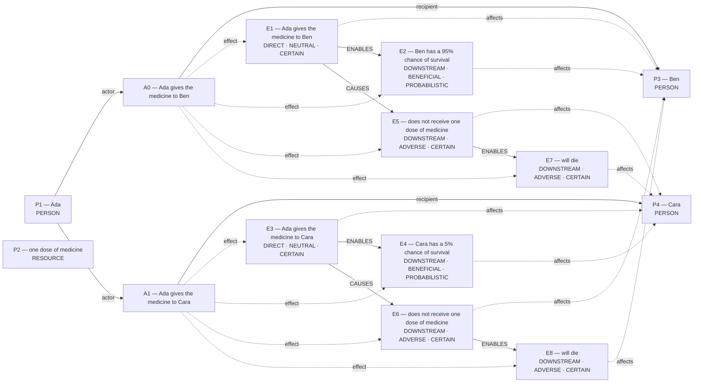

# Parliament demo

Status: **FRAMEWORK_PARTIAL** (recorded_pipeline_outcome).

Native judgment status: UNRESOLVED.

## Scenario

A clinic has one dose of medicine. Ada can give the medicine to Ben or Cara, but not both. If Ada gives the medicine to Ben, Ben has a 95% chance of survival. If Ada gives the medicine to Cara, Cara has a 5% chance of survival. The patient who does not get the medicine will die.

## What Parliament thinks is happening

Actions: Ada gives the medicine to Ben; Ada gives the medicine to Cara

Parties: Ada, one dose of medicine, Ben, Cara

These are alternative action branches and their stipulated outcomes, not claims that both actions occurred.

- Under A0, Ben: Ada gives the medicine to Ben (CERTAIN)
- Under A0, Ben: Ben has a 95% chance of survival (PROBABILISTIC)
- Under A1, Cara: Ada gives the medicine to Cara (CERTAIN)
- Under A1, Cara: Cara has a 5% chance of survival (PROBABILISTIC)
- Under A0, Cara: does not receive one dose of medicine (CERTAIN)
- Under A1, Ben: does not receive one dose of medicine (CERTAIN)
- Under A0, Cara: will die (CERTAIN)
- Under A1, Ben: will die (CERTAIN)
- Ada gives the medicine to Ben → ENABLES → Ben has a 95% chance of survival
- Ada gives the medicine to Cara → ENABLES → Cara has a 5% chance of survival
- does not receive one dose of medicine → ENABLES → will die
- does not receive one dose of medicine → ENABLES → will die
- Ada gives the medicine to Ben → CAUSES → does not receive one dose of medicine
- Ada gives the medicine to Cara → CAUSES → does not receive one dose of medicine

## World-state diagram

### Frozen world supplied to framework assessment

## What is grounded

Admitted source copies and structurally derived records follow. Exact excerpts establish traceability; they do not independently prove every interpretation.

- Ada gives the medicine to Ben — DIRECT_COPY; source: “If Ada gives the medicine to Ben, Ben has a 95% chance of survival.”
- Ben has a 95% chance of survival — SOURCE_STIPULATED_CAUSAL; source: “If Ada gives the medicine to Ben, Ben has a 95% chance of survival.”
- Ada gives the medicine to Cara — DIRECT_COPY; source: “If Ada gives the medicine to Cara, Cara has a 5% chance of survival.”
- Cara has a 5% chance of survival — SOURCE_STIPULATED_CAUSAL; source: “If Ada gives the medicine to Cara, Cara has a 5% chance of survival.”
- does not receive one dose of medicine — EXCLUSIVE_ALLOCATION_COMPLEMENT; source: “A clinic has one dose of medicine.; Ada can give the medicine to Ben or Cara, but not both.; If Ada gives the medicine to Ben, Ben has a 95% chance of survival.”
- does not receive one dose of medicine — EXCLUSIVE_ALLOCATION_COMPLEMENT; source: “A clinic has one dose of medicine.; Ada can give the medicine to Ben or Cara, but not both.; If Ada gives the medicine to Cara, Cara has a 5% chance of survival.”
- will die — SOURCE_STIPULATED_CAUSAL; source: “The patient who does not get the medicine will die.”
- will die — SOURCE_STIPULATED_CAUSAL; source: “The patient who does not get the medicine will die.”
- Stipulated source claim: Ben has a 95% chance of survival; affected subject: Ben; modality: PROBABILISTIC
- Stipulated source claim: 95% chance — Ben has a 95% chance of survival
- Stipulated source claim: Cara has a 5% chance of survival; affected subject: Cara; modality: PROBABILISTIC
- Stipulated source claim: 5% chance — Cara has a 5% chance of survival

## What remains uncertain

- dependency continuity preserved unresolved proposition IDs: PROP:HYPOTHESIS:b11eb479a9d1aeb0
- Would verifying this unestablished consequence reverse the admitted ranking: Only one dose of the life-saving medicine is available (so only one patient can receive it)?
- The utilitarian ledger contains unknown welfare magnitude or duration; survivor arithmetic does not settle total welfare.
- perfect-duty priority for A0 lacks a perfect-duty classification
- perfect-duty priority for A1 lacks a perfect-duty classification
- rejected update: perfect-duty priority for A0 lacks a perfect-duty classification
- rejected update: perfect-duty priority for A1 lacks a perfect-duty classification
- Would verifying this unestablished consequence reverse the admitted ranking: Only one dose of the life-saving medicine is available (so only one patient can be aided)?
- dependency continuity preserved unresolved proposition IDs: PROP:HYPOTHESIS:3481f0238231ad3a
- Would verifying this unestablished consequence reverse the admitted ranking: The medicine is a scarce resource that can be given to only one patient?
- dependency continuity preserved unresolved proposition IDs: PROP:HYPOTHESIS:ba3744fde6124acf
- Would verifying this unestablished consequence reverse the admitted ranking: Ben are entrusted to the decision maker?
- decisive numbers are not tied to the affected subject or Rawlsian position
- Rawlsian preference lacks a stated difference in position or principle priority
- Rawlsian position for A0 conflicts with its framework map
- Rawlsian position for A1 conflicts with its framework map
- A0 IMPROVES lacked directional support; committed as UNCERTAIN
- A1 WORSENS lacked directional support; committed as UNCERTAIN
- rejected update: Rawlsian position for A0 conflicts with its framework map
- rejected update: Rawlsian position for A1 conflicts with its framework map
- rejected update: A0 IMPROVES lacked directional support; committed as UNCERTAIN
- rejected update: A1 WORSENS lacked directional support; committed as UNCERTAIN
- rejected update: decisive numbers are not tied to the affected subject or Rawlsian position
- rejected update: Rawlsian preference lacks a stated difference in position or principle priority
- Would verifying this unestablished consequence reverse the admitted ranking: There is only one dose of medicine, so only one patient can benefit?

## Framework views

### utilitarian

Position: **ABSTAIN**. Recorded preference: Ada gives the medicine to Ben (not necessarily operative).

95% beats 5% survival

Assumption: Survival probabilities decisive for utilitarian calculus.

Dependencies: 95% chance — Ben has a 95% chance of survival; 5% chance — Cara has a 5% chance of survival; Only one dose of the life-saving medicine is available (so only one patient can receive it)

Live objection: dependency continuity preserved unresolved proposition IDs: PROP:HYPOTHESIS:b11eb479a9d1aeb0; Would verifying this unestablished consequence reverse the admitted ranking: Only one dose of the life-saving medicine is available (so only one patient can receive it)?

Reversal: Survival probabilities decisive for utilitarian calculus.; Cara’s survival chance exceeds Ben’s

### deontological

Position: **ABSTAIN**. Recorded preference: Ada gives the medicine to Ben (not necessarily operative).

stronger rescue duty

Assumption: Probability difference grounds rescue duty

Dependencies: Only one dose of the life-saving medicine is available (so only one patient can be aided); Ben has a 95% chance of survival; affected subject: Ben; modality: PROBABILISTIC; Cara has a 5% chance of survival; affected subject: Cara; modality: PROBABILISTIC

Live objection: perfect-duty priority for A0 lacks a perfect-duty classification; perfect-duty priority for A1 lacks a perfect-duty classification; rejected update: perfect-duty priority for A0 lacks a perfect-duty classification; rejected update: perfect-duty priority for A1 lacks a perfect-duty classification; Would verifying this unestablished consequence reverse the admitted ranking: Only one dose of the life-saving medicine is available (so only one patient can be aided)?

Reversal: rescue duty no longer decisive; Cara survival > Ben survival

### virtue

Position: **ATTENUATED**. Recorded preference: Ada gives the medicine to Ben (not necessarily operative).

Prudence saves life

Assumption: Higher efficacy is decisive for prudent stewardship

Dependencies: Ben has a 95% chance of survival; affected subject: Ben; modality: PROBABILISTIC; Cara has a 5% chance of survival; affected subject: Cara; modality: PROBABILISTIC; The medicine is a scarce resource that can be given to only one patient

Live objection: dependency continuity preserved unresolved proposition IDs: PROP:HYPOTHESIS:3481f0238231ad3a; Would verifying this unestablished consequence reverse the admitted ranking: The medicine is a scarce resource that can be given to only one patient?

Reversal: Higher efficacy is decisive for prudent stewardship; Impartial equality overrides outcome maximisation; Cara survival probability exceeds Ben’s

### care

Position: **ATTENUATED**. Recorded preference: Ada gives the medicine to Ben (not necessarily operative).

Higher survival for entrusted

Assumption: Probability values already stated

Dependencies: Ben has a 95% chance of survival; affected subject: Ben; modality: PROBABILISTIC; Cara has a 5% chance of survival; affected subject: Cara; modality: PROBABILISTIC; Ben are entrusted to the decision maker; Ada controls the sole dose of medicine, so only one dependent patient can receive it

Live objection: dependency continuity preserved unresolved proposition IDs: PROP:HYPOTHESIS:ba3744fde6124acf; Would verifying this unestablished consequence reverse the admitted ranking: Ben are entrusted to the decision maker?

Reversal: The audited variable does not govern this framework's primary rule; priority for strict equality over competent care; Cara survival probability ≥ Ben’s

### rawlsian

Position: **ABSTAIN**. Recorded preference: Ada gives the medicine to Ben (not necessarily operative).

NONE」「fr":true,

Assumption: utility-uncertainty audit not Rawls-decisive

Dependencies: will die; affected subject: Cara; will die; affected subject: Ben; There is only one dose of medicine, so only one patient can benefit; Ben has a 95% chance of survival; affected subject: Ben; modality: PROBABILISTIC

Live objection: decisive numbers are not tied to the affected subject or Rawlsian position; Rawlsian preference lacks a stated difference in position or principle priority; Rawlsian position for A0 conflicts with its framework map; Rawlsian position for A1 conflicts with its framework map; A0 IMPROVES lacked directional support; committed as UNCERTAIN; A1 WORSENS lacked directional support; committed as UNCERTAIN; rejected update: Rawlsian position for A0 conflicts with its framework map; rejected update: Rawlsian position for A1 conflicts with its framework map; rejected update: A0 IMPROVES lacked directional support; committed as UNCERTAIN; rejected update: A1 WORSENS lacked directional support; committed as UNCERTAIN; rejected update: decisive numbers are not tied to the affected subject or Rawlsian position; rejected update: Rawlsian preference lacks a stated difference in position or principle priority; Would verifying this unestablished consequence reverse the admitted ranking: There is only one dose of medicine, so only one patient can benefit?

Reversal: lexical liberty priority introduced; Cara survival probability rises above Ben’s

## Agreement and disagreement

Recorded preferences agree; this is not a collective verdict.

Framework-local normative arguments and empirical dependencies are shown above; no automatic causal classification is claimed.

- utilitarian: unclassified dependency — Survival probabilities decisive for utilitarian calculus.
- deontological: normative dependency — rescue duty no longer decisive
- virtue: unclassified dependency — Higher efficacy is decisive for prudent stewardship

## Decision hinges

- utilitarian: Survival probabilities decisive for utilitarian calculus. (reported argument, not verified premise; `cycles/2/candidates/0/reversal_condition`).
- deontological: rescue duty no longer decisive (reported argument, not verified premise; `cycles/2/candidates/1/normative_reversal_threshold`).
- virtue: Higher efficacy is decisive for prudent stewardship (reported argument, not verified premise; `cycles/2/candidates/2/reversal_condition`).

## What Parliament did not decide

- This report does not adjudicate a governing moral verdict.
- Ledger admission does not prove the argument or supply missing welfare units.
- Unresolved objections remain live; reported reversal thresholds are not source facts.

## Pipeline stop and inspection

FRAMEWORK_PARTIAL

Missing slots: none recorded

Competing admitted interpretations: exclusive_allocation: Ada gives the medicine to Ben, Ada gives the medicine to Cara; flexible_graph: gives the medicine to Ben, gives the medicine to Cara

Inspection artifacts (saved replay references its original records):

- [candidate_graphs.md](/Users/benjaminkowal/Documents/Python/Python Coding/RL_Algorithms/diagnostics/live_pipeline_latest_20261006/medicine/candidate_graphs.md)
- [candidate_attempts.json](/Users/benjaminkowal/Documents/Python/Python Coding/RL_Algorithms/diagnostics/live_pipeline_latest_20261006/medicine/candidate_attempts.json)
- [question_assessment.json](/Users/benjaminkowal/Documents/Python/Python Coding/RL_Algorithms/diagnostics/live_pipeline_latest_20261006/medicine/question_assessment.json)
- [world_beam.json](/Users/benjaminkowal/Documents/Python/Python Coding/RL_Algorithms/diagnostics/live_pipeline_latest_20261006/medicine/world_beam.json)
- [preparation_manifest.json](/Users/benjaminkowal/Documents/Python/Python Coding/RL_Algorithms/diagnostics/live_pipeline_latest_20261006/medicine/preparation_manifest.json)
- [frozen_world_trace.json](/Users/benjaminkowal/Documents/Python/Python Coding/RL_Algorithms/diagnostics/live_pipeline_latest_20261006/medicine/frozen_world_trace.json)
