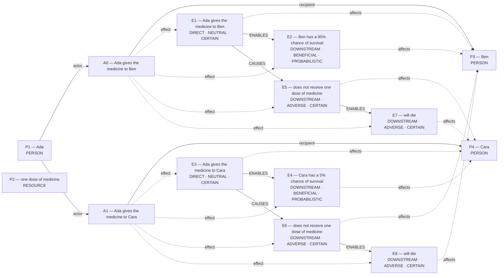

# Parliament demo

Status: **FRAMEWORK_PARTIAL** (recorded_pipeline_outcome).

Native judgment status: NOT_ADJUDICATED.

## Scenario

A clinic has one dose of medicine. Ada can give the medicine to Ben or Cara, but not both. If Ada gives the medicine to Ben, Ben has a 95% chance of survival. If Ada gives the medicine to Cara, Cara has a 5% chance of survival. The patient who does not get the medicine will die. Ada promised Cara that she would give Cara the medicine.

## What Parliament thinks is happening

Actions: Ada gives the medicine to Ben; Ada gives the medicine to Cara

Parties: Ada, one dose of medicine, Ben, Cara

These are alternative action branches and their stipulated outcomes, not claims that both actions occurred.

- Under A0, Ben: Ada gives the medicine to Ben (CERTAIN)
- Under A0, Ben: Ben has a 95% chance of survival (PROBABILISTIC)
- Under A1, Cara: Ada gives the medicine to Cara (CERTAIN)
- Under A1, Cara: Cara has a 5% chance of survival (PROBABILISTIC)
- Under A0, Cara: does not receive one dose of medicine (CERTAIN)
- Under A1, Ben: does not receive one dose of medicine (CERTAIN)
- Under A0, Cara: will die (CERTAIN)
- Under A1, Ben: will die (CERTAIN)
- Ada gives the medicine to Ben → ENABLES → Ben has a 95% chance of survival
- Ada gives the medicine to Cara → ENABLES → Cara has a 5% chance of survival
- does not receive one dose of medicine → ENABLES → will die
- does not receive one dose of medicine → ENABLES → will die
- Ada gives the medicine to Ben → CAUSES → does not receive one dose of medicine
- Ada gives the medicine to Cara → CAUSES → does not receive one dose of medicine

## World-state diagram

### Frozen world supplied to framework assessment

## What is grounded

Admitted source copies and structurally derived records follow. Exact excerpts establish traceability; they do not independently prove every interpretation.

- Ada gives the medicine to Ben — DIRECT_COPY; source: “If Ada gives the medicine to Ben, Ben has a 95% chance of survival.”
- Ben has a 95% chance of survival — SOURCE_STIPULATED_CAUSAL; source: “If Ada gives the medicine to Ben, Ben has a 95% chance of survival.”
- Ada gives the medicine to Cara — DIRECT_COPY; source: “If Ada gives the medicine to Cara, Cara has a 5% chance of survival.”
- Cara has a 5% chance of survival — SOURCE_STIPULATED_CAUSAL; source: “If Ada gives the medicine to Cara, Cara has a 5% chance of survival.”
- does not receive one dose of medicine — EXCLUSIVE_ALLOCATION_COMPLEMENT; source: “A clinic has one dose of medicine.; Ada can give the medicine to Ben or Cara, but not both.; If Ada gives the medicine to Ben, Ben has a 95% chance of survival.”
- does not receive one dose of medicine — EXCLUSIVE_ALLOCATION_COMPLEMENT; source: “A clinic has one dose of medicine.; Ada can give the medicine to Ben or Cara, but not both.; If Ada gives the medicine to Cara, Cara has a 5% chance of survival.”
- will die — SOURCE_STIPULATED_CAUSAL; source: “The patient who does not get the medicine will die.”
- will die — SOURCE_STIPULATED_CAUSAL; source: “The patient who does not get the medicine will die.”
- Stipulated source claim: Ben has a 95% chance of survival; affected subject: Ben; modality: PROBABILISTIC
- Stipulated source claim: 95% chance — Ben has a 95% chance of survival
- Stipulated source claim: Cara has a 5% chance of survival; affected subject: Cara; modality: PROBABILISTIC
- Stipulated source claim: 5% chance — Cara has a 5% chance of survival
- Stipulated source claim: A clinic has one dose of medicine.
- Stipulated source claim: Ada promised Cara that she would give Cara the medicine.
- Stipulated source claim: Ada can give the medicine to Ben or Cara, but not both.
- Stipulated source claim: The patient who does not get the medicine will die.
- Stipulated source claim: If Ada gives the medicine to Ben, Ben has a 95% chance of survival.
- Stipulated source claim: If Ada gives the medicine to Cara, Cara has a 5% chance of survival.

## What remains uncertain

- The utilitarian ledger contains unknown welfare magnitude or duration; survivor arithmetic does not settle total welfare.
- A0 ADJUDICATION_CALIBRATION: omission was classified as a perfect negative-duty violation without a separate basis
- A0 ADJUDICATION_CALIBRATION: resolved adjudication rests on unsupported decisive premises
- A1 ADJUDICATION_CALIBRATION: perfect positive duty lacks a right-correlative, undertaking, or grounded emergency basis
- A1 ADJUDICATION_CALIBRATION: resolved adjudication rests on unsupported decisive premises
- what makes the positive duty perfect rather than imperfect
- cara: perfect duty to keep promises ↔ ben: imperfect duty of beneficence
- unresolved Care ranking must remain provisional

## Framework views

### utilitarian

Position: **ABSTAIN**. Recorded preference: withheld (not necessarily operative).

Unresolved contestation: Max expected survival

Assumption: Not separately recorded.

Dependencies: Ben has a 95% chance of survival; affected subject: Ben; modality: PROBABILISTIC; Cara has a 5% chance of survival; affected subject: Cara; modality: PROBABILISTIC

Live objection: None separately recorded.

Reversal: Promise-keeping given overriding moral weight; Ben survival probability falls to ≤5%

### deontological

Position: **ABSTAIN**. Recorded preference: Ada gives the medicine to Cara (not necessarily operative).

Provisionally: Deontology identifies competing claims between cara's perfect duty to keep promises and ben's imperfect duty of beneficence. NONE's restriction of NONE is not yet justified because what makes the positive duty perfect rather 

Assumption: Not separately recorded.

Dependencies: Ada promised Cara that she would give Cara the medicine.

Live objection: A0 ADJUDICATION_CALIBRATION: omission was classified as a perfect negative-duty violation without a separate basis; A0 ADJUDICATION_CALIBRATION: resolved adjudication rests on unsupported decisive premises; A1 ADJUDICATION_CALIBRATION: perfect positive duty lacks a right-correlative, undertaking, or grounded emergency basis; A1 ADJUDICATION_CALIBRATION: resolved adjudication rests on unsupported decisive premises; what makes the positive duty perfect rather than imperfect; cara: perfect duty to keep promises ↔ ben: imperfect duty of beneficence

Reversal: would reverse if promise-keeping not obligatory

### care

Position: **ABSTAIN**. Recorded preference: Ada gives the medicine to Ben (not necessarily operative).

competence saves life

Assumption: Not separately recorded.

Dependencies: Not separately recorded.

Live objection: unresolved Care ranking must remain provisional

Reversal: promise‐keeping prioritized over competence; Cara’s survival chance rises near Ben’s

## Agreement and disagreement

Recorded preferences differ.

Framework-local normative arguments and empirical dependencies are shown above; no automatic causal classification is claimed.

- utilitarian: normative dependency — Promise-keeping given overriding moral weight
- deontological: normative dependency — would reverse if promise-keeping not obligatory
- care: normative dependency — promise‐keeping prioritized over competence

## Decision hinges

- utilitarian: Promise-keeping given overriding moral weight (reported argument, not verified premise; `cycles/0/candidates/0/normative_reversal_threshold`).
- deontological: would reverse if promise-keeping not obligatory (reported argument, not verified premise; `cycles/0/candidates/1/normative_reversal_threshold`).
- care: promise‐keeping prioritized over competence (reported argument, not verified premise; `cycles/0/candidates/2/normative_reversal_threshold`).

## What Parliament did not decide

- This report does not adjudicate a governing moral verdict.
- Ledger admission does not prove the argument or supply missing welfare units.
- Unresolved objections remain live; reported reversal thresholds are not source facts.

## Pipeline stop and inspection

FRAMEWORK_PARTIAL

Missing slots: none recorded

Competing admitted interpretations: none recorded

Inspection artifacts (saved replay references its original records):

- [framework_generation.json](/Users/benjaminkowal/Documents/Python/Python Coding/RL_Algorithms/diagnostics/argument_quality_pilot_fixes_20261006/competing_promise/standard/framework_generation.json)
- [conflict_graph.md](/Users/benjaminkowal/Documents/Python/Python Coding/RL_Algorithms/diagnostics/argument_quality_pilot_fixes_20261006/competing_promise/standard/conflict_graph.md)
