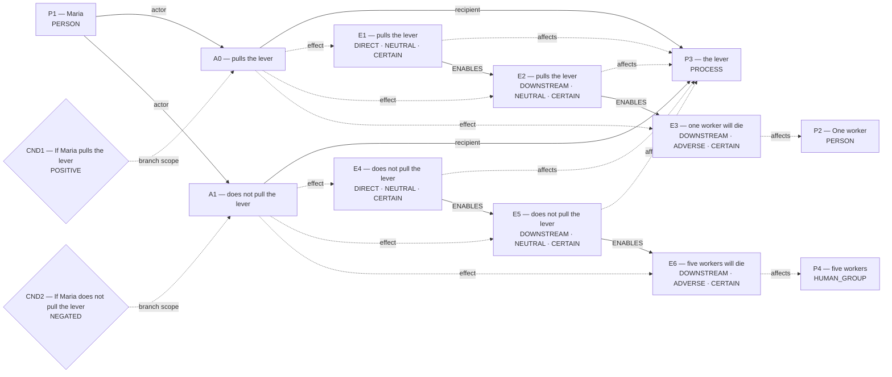
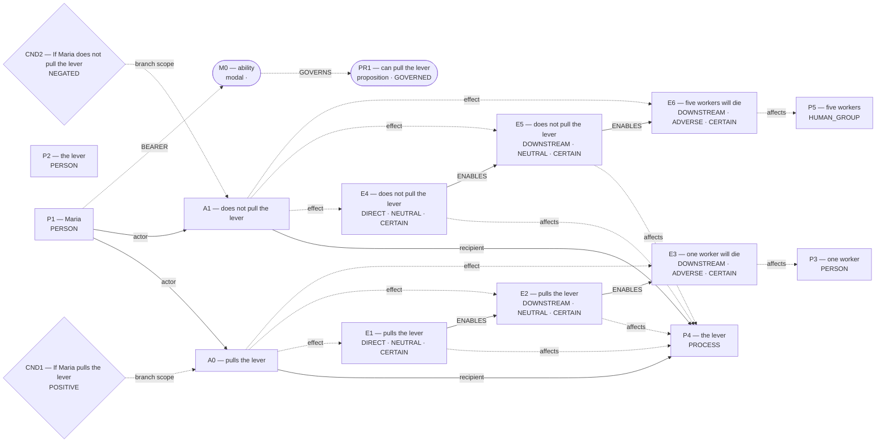

# Parliament demo

Status: **INTERPRETIVE_BEAM** (epistemic_abstention).

Native judgment status: NOT_RUN.

## Scenario

Five workers are on the track. One worker is on the side track. Maria can pull the lever, but not the brake. If Maria pulls the lever, one worker will die. If Maria does not pull the lever, five workers will die.

## What Parliament thinks is happening

No unique frozen world is reported.

## World-state diagram

No unique world was frozen. The following are competing admitted interpretations; **none was sent to agents**.

### omission_harm — candidate only; not sent to agents

### conditional_outcome — candidate only; not sent to agents

### ability_permission — candidate only; not sent to agents

## What is grounded

Admitted source copies and structurally derived records follow. Exact excerpts establish traceability; they do not independently prove every interpretation.

## What remains uncertain

No additional framework uncertainty was recorded; this is not proof of completeness.

## Framework views

## Agreement and disagreement

No operative preference recorded.

Framework-local normative arguments and empirical dependencies are shown above; no automatic causal classification is claimed.

## Decision hinges

No explicit reversal hinge was recorded. The report does not fabricate one.

## What Parliament did not decide

- This report does not adjudicate a governing moral verdict.
- Ledger admission does not prove the argument or supply missing welfare units.
- Unresolved objections remain live; reported reversal thresholds are not source facts.

## Pipeline stop and inspection

Competing admitted worlds are not separated or invariant.

Missing slots: none recorded

Competing admitted interpretations: omission_harm: pulls the lever, does not pull the lever; conditional_outcome: pulls the lever, does not pull the lever; ability_permission: pulls the lever, does not pull the lever

Inspection artifacts (saved replay references its original records):

- [candidate_graphs.md](/Users/benjaminkowal/Documents/Python/Python Coding/RL_Algorithms/diagnostics/live_pipeline_latest_20261006/trolley/candidate_graphs.md)
- [candidate_attempts.json](/Users/benjaminkowal/Documents/Python/Python Coding/RL_Algorithms/diagnostics/live_pipeline_latest_20261006/trolley/candidate_attempts.json)
- [question_assessment.json](/Users/benjaminkowal/Documents/Python/Python Coding/RL_Algorithms/diagnostics/live_pipeline_latest_20261006/trolley/question_assessment.json)
- [world_beam.json](/Users/benjaminkowal/Documents/Python/Python Coding/RL_Algorithms/diagnostics/live_pipeline_latest_20261006/trolley/world_beam.json)
- [preparation_manifest.json](/Users/benjaminkowal/Documents/Python/Python Coding/RL_Algorithms/diagnostics/live_pipeline_latest_20261006/trolley/preparation_manifest.json)
