# Candidate arguments

Nonvoting argument overlays. These are not admitted world-state graphs.

## Disclose-Only-What-is-Needed

STAGED_ARGUMENT

Source-applicability audit (attributed model review, not proof):

- CONDITIONAL_PRECONDITION: disclosing the minimum information to a treating physician is the only timely way to avert serious and otherwise unavoidable harm to the same patient — This is a hypothetical factual condition; the scenario neither confirms nor denies that it is uniquely the only timely way.

- NORMATIVE_ASSUMPTION: one ought to disclose exactly that minimum — Purely prescriptive; no supporting text in the scenario.

- NORMATIVE_ASSUMPTION: One ought to obey institutional confidentiality policies — Moral prescription not grounded in the scenario’s factual content.

- NORMATIVE_ASSUMPTION: unless a higher-priority moral duty overrides them — Sets a moral override condition; no factual verification supplied.

- NORMATIVE_ASSUMPTION: Mara ought to share only the allergy entry with the on-call physician — Normative conclusion; the scenario only states that Mara proposes this, not that she ought to do it.

- SOURCE_SUPPORTED: Sharing the allergy entry only with that physician may prevent a dangerous reaction — Quoted verbatim from the scenario.

- SOURCE_SUPPORTED: success is not guaranteed — Quoted verbatim from the scenario.

- NORMATIVE_ASSUMPTION: Preventing an imminent, serious harm to the patient has moral priority over keeping information confidential — Prioritisation of moral duties is not supplied by the factual scenario.

- NORMATIVE_ASSUMPTION: provided the disclosure is strictly limited to what is necessary — Conditional moral qualifier; no factual confirmation in the scenario.

Critic's proposed remaining conclusion (check accepted graph below): Provided that giving the allergy entry is indeed the only prompt way to prevent otherwise unavoidable serious harm, Mara ought to disclose exactly that entry and nothing more.

```mermaid
flowchart TB
n0["SOURCE_RULE / AFFIRMED / SUPPORTED: &quot;A clinic confidentiality policy tells Mara not to disclose a patient&#x27;s medical record without consent.&quot;"]
n1["SOURCE_RULE / AFFIRMED / SUPPORTED: &quot;Sharing the allergy entry only with that physician may prevent a dangerous reaction, but success is not guaranteed.&quot;"]
n2["MAXIM / AFFIRMED / CONDITIONAL: If disclosing the minimum information to a treating physician is the only timely way to avert serious and otherwise unavoidable harm to the same patie"]
n3["NORMATIVE_PREMISE / AFFIRMED / REQUIRES_REASSESSMENT: Preventing an imminent, serious harm to the patient has moral priority over keeping information confidential, provided the disclosure is strictly limi"]
n4["NORMATIVE_PREMISE / AFFIRMED / CONDITIONAL: One ought to obey institutional confidentiality policies unless a higher-priority moral duty overrides them."]
n5["NORMATIVE_JUDGMENT / AFFIRMED / REQUIRES_REASSESSMENT: Therefore, Mara ought to share only the allergy entry with the on-call physician."]
n6["NORMATIVE_JUDGMENT / AFFIRMED / REQUIRES_REASSESSMENT: If disclosing the minimum allergy information to the treating physician is the only timely way to avert serious and otherwise unavoidable harm to the "]
n1 -->|PRACTICAL_REASONING / REQUIRES_REASSESSMENT| n3
n2 -->|PRACTICAL_REASONING / REQUIRES_REASSESSMENT| n3
n3 -->|NORM_PRIORITY / REQUIRES_REASSESSMENT| n5
n4 -->|NORM_PRIORITY / REQUIRES_REASSESSMENT| n5
n2 -->|PRACTICAL_REASONING / REQUIRES_REASSESSMENT| n6
n3 -->|PRACTICAL_REASONING / REQUIRES_REASSESSMENT| n6
classDef retired fill:#eeeeee,stroke:#777,color:#777
class n5 retired
```

Remaining questions: Is disclosing the allergy information truly the only timely option, or could treatment be selected safely without it?; Does any institutional or legal rule explicitly permit emergency exceptions that would settle the normative conflict?

Original construction problems retained: 1
