# Candidate arguments

Nonvoting argument overlays. These are not admitted world-state graphs.

## Disclose-Only-What-is-Needed

STAGED_PRIOR_RETAINED

Construction/revision issue: Unknown evidence location

Strongest remaining conclusion: Not independently established.

```mermaid
flowchart TB
n0["SOURCE_RULE / AFFIRMED / UNASSESSED: &quot;A clinic confidentiality policy tells Mara not to disclose a patient&#x27;s medical record without consent.&quot;"]
n1["SOURCE_RULE / AFFIRMED / UNASSESSED: &quot;Sharing the allergy entry only with that physician may prevent a dangerous reaction, but success is not guaranteed.&quot;"]
n2["MAXIM / AFFIRMED / CONDITIONAL: If disclosing the minimum information to a treating physician is the only timely way to avert serious and otherwise unavoidable harm to the same patie"]
n3["NORMATIVE_PREMISE / AFFIRMED / REQUIRES_REASSESSMENT: Preventing an imminent, serious harm to the patient has moral priority over keeping information confidential, provided the disclosure is strictly limi"]
n4["NORMATIVE_PREMISE / AFFIRMED / CONDITIONAL: One ought to obey institutional confidentiality policies unless a higher-priority moral duty overrides them."]
n5["NORMATIVE_JUDGMENT / AFFIRMED / REQUIRES_REASSESSMENT: Therefore, Mara ought to share only the allergy entry with the on-call physician."]
n1 -->|PRACTICAL_REASONING / REQUIRES_REASSESSMENT| n3
n2 -->|PRACTICAL_REASONING / REQUIRES_REASSESSMENT| n3
n3 -->|NORM_PRIORITY / REQUIRES_REASSESSMENT| n5
n4 -->|NORM_PRIORITY / REQUIRES_REASSESSMENT| n5
```

Remaining questions: 

Original construction problems retained: 1
