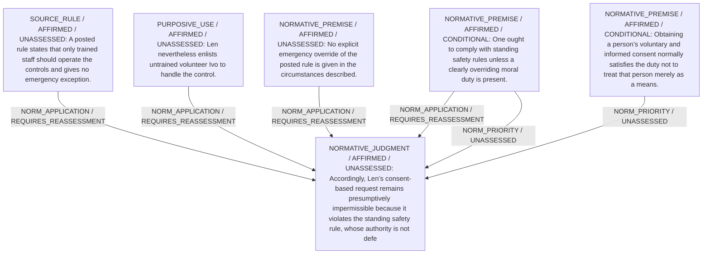

# Candidate arguments

Nonvoting argument overlays. These are not admitted world-state graphs.

## Rule-vs-Consent Permissibility

STAGED_PRIOR_RETAINED

Construction/revision issue: Invalid audited claim span or status

Strongest remaining conclusion: Not independently established.

Remaining questions: 
