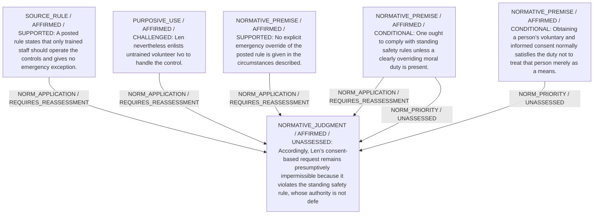

# Candidate arguments

Nonvoting argument overlays. These are not admitted world-state graphs.

## Rule-vs-Consent Permissibility

STAGED_PRIOR_RETAINED

Construction/revision issue: Hypothesis must refer to an existing candidate maxim

Source-applicability audit (attributed model review, not proof):

- NORMATIVE_ASSUMPTION: One ought to comply with standing safety rules — Purely prescriptive; no empirical claim in source to check.

- NORMATIVE_ASSUMPTION: unless a clearly overriding moral duty is present — Also ethical qualifier, not a factual claim established in the scenario.

- SOURCE_SUPPORTED: Len ... enlists ... volunteer Ivo to handle the control — Source explicitly states Len asked Ivo to operate the plate and Ivo agreed.

- NOT_ESTABLISHED: untrained — Scenario never says whether Ivo is or is not trained; only that he is a volunteer.

- NORMATIVE_ASSUMPTION: Len’s consent-based request remains presumptively impermissible — Moral evaluation, not a factual assertion.

- NOT_ESTABLISHED: it violates the standing safety rule — Violation depends on Ivo’s training status, which source does not state.

- SOURCE_SUPPORTED: whose authority is not defeated on the given facts — Source affirms no override or priority is provided for emergencies.

- SOURCE_SUPPORTED: No explicit emergency override of the posted rule is given in the circumstances described — Quote directly states absence of emergency priority/override.

- NORMATIVE_ASSUMPTION: Obtaining a person’s voluntary and informed consent normally satisfies the duty not to treat that person merely as a means — Ethical principle, not verified or contradicted by scenario facts.

- SOURCE_SUPPORTED: A posted rule states that only trained staff should operate the controls — Directly quoted.

- SOURCE_SUPPORTED: and gives no emergency exception — Same sentence affirms absence of emergency exception.

Strongest remaining conclusion: Not independently established.

Remaining questions: 
