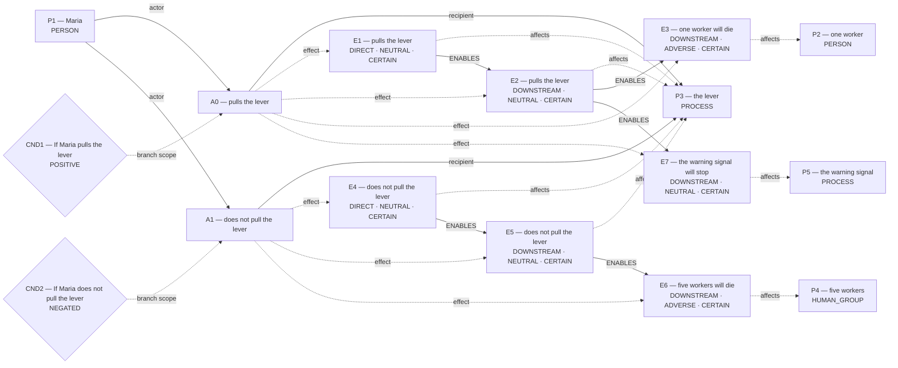
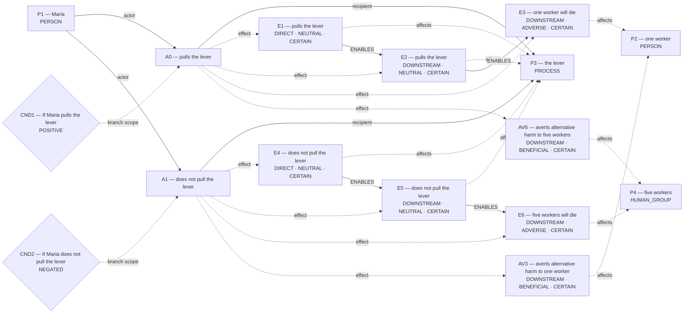
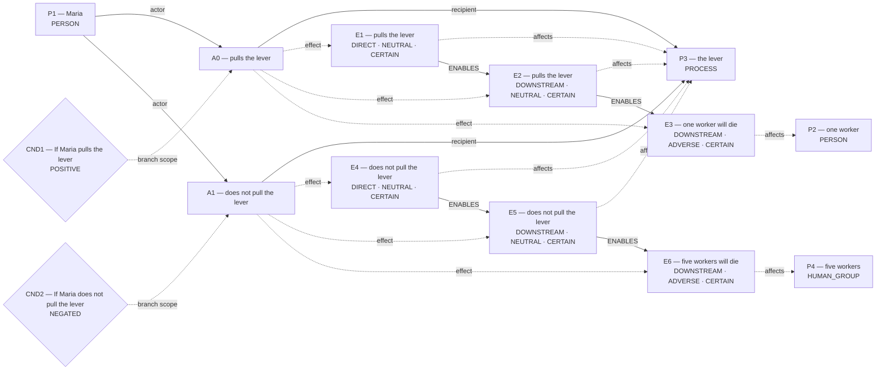

# Candidate world attempts

Chosen blueprint: **omission_harm**  
Chooser status: **FILLED**

## 1. omission_harm (selected; amended)

Template status: **FILLED**  
Proposal status: **FILLED**  
Contract valid: **true**  
Missing slots: `instrument`

### omission_harm candidate graph



Native admission:

```json
{
  "blueprint_id": "omission_harm",
  "rank": -0.1,
  "variant": "amended",
  "candidate_path": "/Users/benjaminkowal/Documents/Python/Python Coding/RL_Algorithms/diagnostics/primitive_composition_live_signal/admission_attempts/00_omission_harm/candidate.json",
  "overlay_path": "/Users/benjaminkowal/Documents/Python/Python Coding/RL_Algorithms/diagnostics/primitive_composition_live_signal/admission_attempts/00_omission_harm/hypothesis_overlay.json",
  "status": "ADMITTED",
  "admission": {
    "status": "COMMITTED",
    "world_model_status": "COMMITTED",
    "effects": 7,
    "causal_links": 5,
    "frozen_trace_valid": true,
    "fingerprint_sha256": "31311cbe5c05225c316f5ed38422997ffd52869f0ae8f44b1f883b9f6b6a9123"
  },
  "trace_path": "/Users/benjaminkowal/Documents/Python/Python Coding/RL_Algorithms/diagnostics/primitive_composition_live_signal/admission_attempts/00_omission_harm/frozen_world_trace.json"
}
```

## 2. omission_harm (alternative; baseline)

Template status: **FILLED**  
Proposal status: **FILLED**  
Contract valid: **true**  
Missing slots: `instrument`

### omission_harm candidate graph



Hypothesis overlay (not submitted as world effects):

- `AV3`: averts alternative harm to one worker; unresolved_derivation_assumptions, unsupported_outcome_transformation, hypothesized_averted_harm
- `AV6`: averts alternative harm to five workers; unresolved_derivation_assumptions, unsupported_outcome_transformation, hypothesized_averted_harm

### Supported core for admission



Native admission:

```json
{
  "blueprint_id": "omission_harm",
  "rank": 0,
  "variant": "baseline",
  "candidate_path": "/Users/benjaminkowal/Documents/Python/Python Coding/RL_Algorithms/diagnostics/primitive_composition_live_signal/admission_attempts/01_omission_harm/candidate.json",
  "overlay_path": "/Users/benjaminkowal/Documents/Python/Python Coding/RL_Algorithms/diagnostics/primitive_composition_live_signal/admission_attempts/01_omission_harm/hypothesis_overlay.json",
  "status": "ADMITTED",
  "admission": {
    "status": "COMMITTED",
    "world_model_status": "COMMITTED",
    "effects": 6,
    "causal_links": 4,
    "frozen_trace_valid": true,
    "fingerprint_sha256": "02ff768c00020fa33f825bc38898cc92bde4d33e1c3e9a9d4c09e1e5f2b4c6dc"
  },
  "trace_path": "/Users/benjaminkowal/Documents/Python/Python Coding/RL_Algorithms/diagnostics/primitive_composition_live_signal/admission_attempts/01_omission_harm/frozen_world_trace.json"
}
```

## 3. conditional_outcome (alternative; amended)

Template status: **FILLED**  
Proposal status: **FILLED**  
Contract valid: **true**  
Missing slots: `chance`

### conditional_outcome candidate graph


Native admission:

```json
{
  "blueprint_id": "conditional_outcome",
  "rank": 0.9,
  "variant": "amended",
  "candidate_path": "/Users/benjaminkowal/Documents/Python/Python Coding/RL_Algorithms/diagnostics/primitive_composition_live_signal/admission_attempts/02_conditional_outcome/candidate.json",
  "overlay_path": "/Users/benjaminkowal/Documents/Python/Python Coding/RL_Algorithms/diagnostics/primitive_composition_live_signal/admission_attempts/02_conditional_outcome/hypothesis_overlay.json",
  "status": "ADMITTED",
  "admission": {
    "status": "COMMITTED",
    "world_model_status": "COMMITTED",
    "effects": 7,
    "causal_links": 5,
    "frozen_trace_valid": true,
    "fingerprint_sha256": "31311cbe5c05225c316f5ed38422997ffd52869f0ae8f44b1f883b9f6b6a9123"
  },
  "trace_path": "/Users/benjaminkowal/Documents/Python/Python Coding/RL_Algorithms/diagnostics/primitive_composition_live_signal/admission_attempts/02_conditional_outcome/frozen_world_trace.json"
}
```

## 4. conditional_outcome (alternative; baseline)

Template status: **FILLED**  
Proposal status: **FILLED**  
Contract valid: **true**  
Missing slots: `chance`

### conditional_outcome candidate graph


Hypothesis overlay (not submitted as world effects):

- `AV3`: averts alternative harm to one worker; unresolved_derivation_assumptions, unsupported_outcome_transformation, hypothesized_averted_harm
- `AV6`: averts alternative harm to five workers; unresolved_derivation_assumptions, unsupported_outcome_transformation, hypothesized_averted_harm

### Supported core for admission


Native admission:

```json
{
  "blueprint_id": "conditional_outcome",
  "rank": 1,
  "variant": "baseline",
  "candidate_path": "/Users/benjaminkowal/Documents/Python/Python Coding/RL_Algorithms/diagnostics/primitive_composition_live_signal/admission_attempts/03_conditional_outcome/candidate.json",
  "overlay_path": "/Users/benjaminkowal/Documents/Python/Python Coding/RL_Algorithms/diagnostics/primitive_composition_live_signal/admission_attempts/03_conditional_outcome/hypothesis_overlay.json",
  "status": "ADMITTED",
  "admission": {
    "status": "COMMITTED",
    "world_model_status": "COMMITTED",
    "effects": 6,
    "causal_links": 4,
    "frozen_trace_valid": true,
    "fingerprint_sha256": "02ff768c00020fa33f825bc38898cc92bde4d33e1c3e9a9d4c09e1e5f2b4c6dc"
  },
  "trace_path": "/Users/benjaminkowal/Documents/Python/Python Coding/RL_Algorithms/diagnostics/primitive_composition_live_signal/admission_attempts/03_conditional_outcome/frozen_world_trace.json"
}
```

## 5. rescue_contrast (alternative; baseline)

Template status: **PARTIAL**  
Proposal status: **WITHHELD**  
Contract valid: **true**  
Missing slots: `first_saved`, `second_saved`, `rescue_exclusivity`, `first_rescue_action`, `second_rescue_action`, `second_benefit`, `scene`

World withheld:

- Required slots remain unfilled: first_saved, second_saved, rescue_exclusivity, first_rescue_action, second_rescue_action, second_benefit

## 6. flexible_graph (alternative; flexible)

Template status: **FILLED**  
Proposal status: **FILLED**  
Contract valid: **true**  
Missing slots: none

### flexible_graph candidate graph


Native admission:

```json
{
  "blueprint_id": "flexible_graph",
  "rank": 3,
  "variant": "flexible",
  "candidate_path": "/Users/benjaminkowal/Documents/Python/Python Coding/RL_Algorithms/diagnostics/primitive_composition_live_signal/admission_attempts/05_flexible_graph/candidate.json",
  "overlay_path": "/Users/benjaminkowal/Documents/Python/Python Coding/RL_Algorithms/diagnostics/primitive_composition_live_signal/admission_attempts/05_flexible_graph/hypothesis_overlay.json",
  "status": "ADMITTED",
  "admission": {
    "status": "COMMITTED",
    "world_model_status": "COMMITTED",
    "effects": 7,
    "causal_links": 5,
    "frozen_trace_valid": true,
    "fingerprint_sha256": "ed94011cce69fee92c223ab9425e31e9dfb8fd9309217a09564141a7f10eb507"
  },
  "trace_path": "/Users/benjaminkowal/Documents/Python/Python Coding/RL_Algorithms/diagnostics/primitive_composition_live_signal/admission_attempts/05_flexible_graph/frozen_world_trace.json"
}
```

## 7. primitive_composition (alternative; composition)

Template status: **FILLED**  
Proposal status: **FILLED**  
Contract valid: **true**  
Missing slots: none

### primitive_composition candidate graph


Native admission:

```json
{
  "blueprint_id": "primitive_composition",
  "rank": 4,
  "variant": "composition",
  "candidate_path": "/Users/benjaminkowal/Documents/Python/Python Coding/RL_Algorithms/diagnostics/primitive_composition_live_signal/admission_attempts/06_primitive_composition/candidate.json",
  "overlay_path": "/Users/benjaminkowal/Documents/Python/Python Coding/RL_Algorithms/diagnostics/primitive_composition_live_signal/admission_attempts/06_primitive_composition/hypothesis_overlay.json",
  "status": "ADMITTED",
  "admission": {
    "status": "COMMITTED",
    "world_model_status": "COMMITTED",
    "effects": 7,
    "causal_links": 5,
    "frozen_trace_valid": true,
    "fingerprint_sha256": "4d62ec608be4b5b4b68b16b93a3b2da7e11adf684103736f1ab07ab42a020f00"
  },
  "trace_path": "/Users/benjaminkowal/Documents/Python/Python Coding/RL_Algorithms/diagnostics/primitive_composition_live_signal/admission_attempts/06_primitive_composition/frozen_world_trace.json"
}
```
