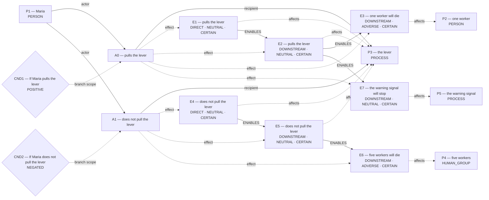
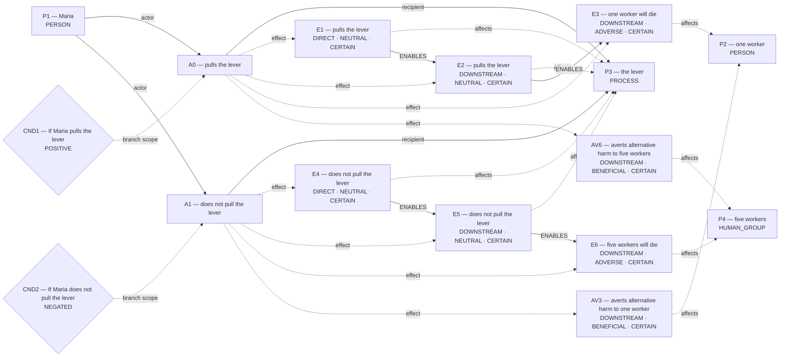
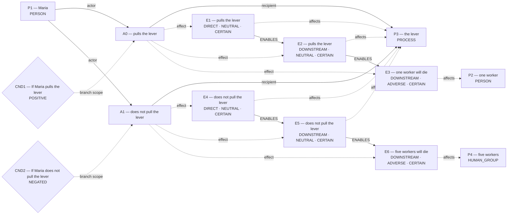

# Candidate world attempts

Chosen blueprint: **conditional_outcome**  
Chooser status: **FILLED**

## 1. conditional_outcome (selected; amended)

Template status: **FILLED**  
Proposal status: **FILLED**  
Contract valid: **true**  
Missing slots: none

### conditional_outcome candidate graph



Native admission:

```json
{
  "blueprint_id": "conditional_outcome",
  "rank": -0.1,
  "variant": "amended",
  "candidate_path": "/Users/benjaminkowal/Documents/Python/Python Coding/RL_Algorithms/diagnostics/primitive_composition_pilot/signal/admission_attempts/00_conditional_outcome/candidate.json",
  "overlay_path": "/Users/benjaminkowal/Documents/Python/Python Coding/RL_Algorithms/diagnostics/primitive_composition_pilot/signal/admission_attempts/00_conditional_outcome/hypothesis_overlay.json",
  "status": "ADMITTED",
  "admission": {
    "status": "COMMITTED",
    "world_model_status": "COMMITTED",
    "effects": 7,
    "causal_links": 5,
    "frozen_trace_valid": true,
    "fingerprint_sha256": "0f05a1fcfdafd009005ea5f8e366f6f9d7a696c3be2c30871b895b10867e803d"
  },
  "trace_path": "/Users/benjaminkowal/Documents/Python/Python Coding/RL_Algorithms/diagnostics/primitive_composition_pilot/signal/admission_attempts/00_conditional_outcome/frozen_world_trace.json"
}
```

## 2. conditional_outcome (alternative; baseline)

Template status: **FILLED**  
Proposal status: **FILLED**  
Contract valid: **true**  
Missing slots: none

### conditional_outcome candidate graph



Hypothesis overlay (not submitted as world effects):

- `AV3`: averts alternative harm to one worker; unresolved_derivation_assumptions, unsupported_outcome_transformation, hypothesized_averted_harm
- `AV6`: averts alternative harm to five workers; unresolved_derivation_assumptions, unsupported_outcome_transformation, hypothesized_averted_harm

### Supported core for admission



Native admission:

```json
{
  "blueprint_id": "conditional_outcome",
  "rank": 0,
  "variant": "baseline",
  "candidate_path": "/Users/benjaminkowal/Documents/Python/Python Coding/RL_Algorithms/diagnostics/primitive_composition_pilot/signal/admission_attempts/01_conditional_outcome/candidate.json",
  "overlay_path": "/Users/benjaminkowal/Documents/Python/Python Coding/RL_Algorithms/diagnostics/primitive_composition_pilot/signal/admission_attempts/01_conditional_outcome/hypothesis_overlay.json",
  "status": "ADMITTED",
  "admission": {
    "status": "COMMITTED",
    "world_model_status": "COMMITTED",
    "effects": 6,
    "causal_links": 4,
    "frozen_trace_valid": true,
    "fingerprint_sha256": "e040f3e9e5c9477ade6142acd6faa645d4b53e80433cd80117183dd976fd416b"
  },
  "trace_path": "/Users/benjaminkowal/Documents/Python/Python Coding/RL_Algorithms/diagnostics/primitive_composition_pilot/signal/admission_attempts/01_conditional_outcome/frozen_world_trace.json"
}
```

## 3. flexible_graph (alternative; flexible)

Template status: **FILLED**  
Proposal status: **FILLED**  
Contract valid: **true**  
Missing slots: none

### flexible_graph candidate graph


Native admission:

```json
{
  "blueprint_id": "flexible_graph",
  "rank": 1,
  "variant": "flexible",
  "candidate_path": "/Users/benjaminkowal/Documents/Python/Python Coding/RL_Algorithms/diagnostics/primitive_composition_pilot/signal/admission_attempts/02_flexible_graph/candidate.json",
  "overlay_path": "/Users/benjaminkowal/Documents/Python/Python Coding/RL_Algorithms/diagnostics/primitive_composition_pilot/signal/admission_attempts/02_flexible_graph/hypothesis_overlay.json",
  "status": "ADMITTED",
  "admission": {
    "status": "COMMITTED",
    "world_model_status": "COMMITTED",
    "effects": 7,
    "causal_links": 5,
    "frozen_trace_valid": true,
    "fingerprint_sha256": "561da03e62ddcac4d2df252603c07e8b8c1654e5410dcd3edbecefa5a5a4e275"
  },
  "trace_path": "/Users/benjaminkowal/Documents/Python/Python Coding/RL_Algorithms/diagnostics/primitive_composition_pilot/signal/admission_attempts/02_flexible_graph/frozen_world_trace.json"
}
```

## 4. primitive_composition (alternative; composition)

Template status: **FILLED**  
Proposal status: **FILLED**  
Contract valid: **true**  
Missing slots: none

### primitive_composition candidate graph


Native admission:

```json
{
  "blueprint_id": "primitive_composition",
  "rank": 2,
  "variant": "composition",
  "candidate_path": "/Users/benjaminkowal/Documents/Python/Python Coding/RL_Algorithms/diagnostics/primitive_composition_pilot/signal/admission_attempts/03_primitive_composition/candidate.json",
  "overlay_path": "/Users/benjaminkowal/Documents/Python/Python Coding/RL_Algorithms/diagnostics/primitive_composition_pilot/signal/admission_attempts/03_primitive_composition/hypothesis_overlay.json",
  "status": "ADMITTED",
  "admission": {
    "status": "COMMITTED",
    "world_model_status": "COMMITTED",
    "effects": 7,
    "causal_links": 5,
    "frozen_trace_valid": true,
    "fingerprint_sha256": "a8a1d6deeb17d11d4d294cfac1dd58e7842f7ce46ca637e2ee3504170a43bb11"
  },
  "trace_path": "/Users/benjaminkowal/Documents/Python/Python Coding/RL_Algorithms/diagnostics/primitive_composition_pilot/signal/admission_attempts/03_primitive_composition/frozen_world_trace.json"
}
```
