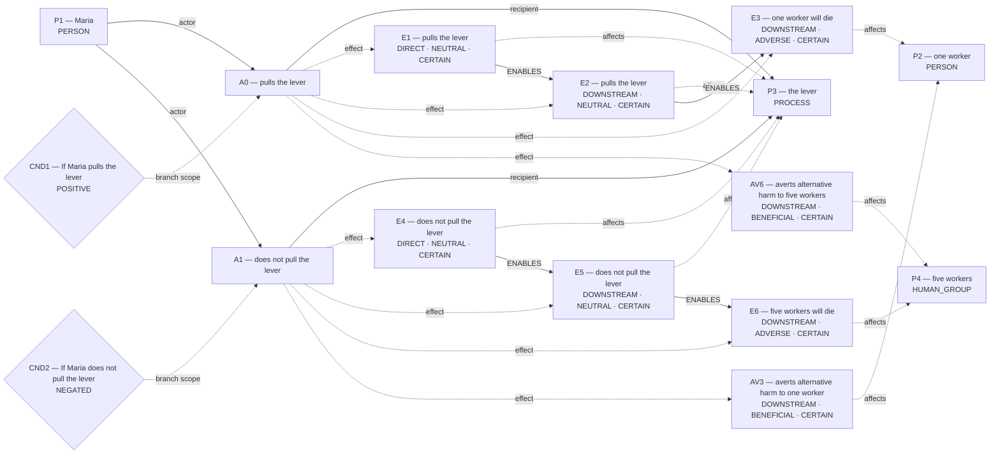
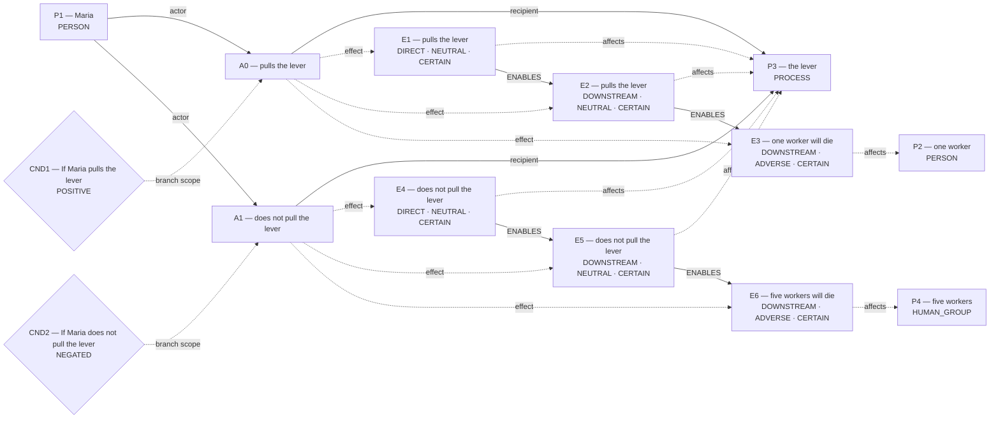
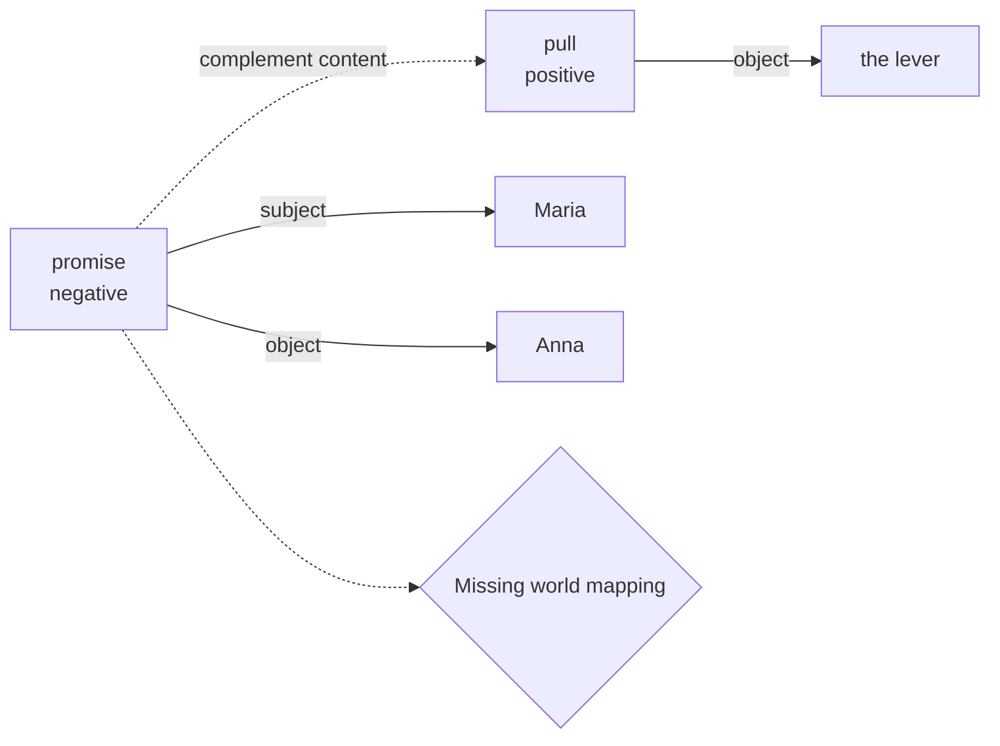
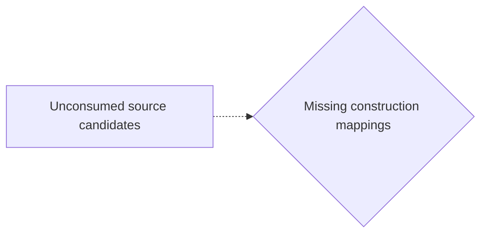

# Candidate world attempts

Chosen blueprint: **conditional_outcome**  
Chooser status: **FILLED**

## 1. conditional_outcome (selected; baseline)

Template status: **FILLED**  
Proposal status: **FILLED**  
Contract valid: **true**  
Missing slots: none

### conditional_outcome candidate graph



Hypothesis overlay (not submitted as world effects):

- `AV3`: averts alternative harm to one worker; unresolved_derivation_assumptions, unsupported_outcome_transformation, hypothesized_averted_harm
- `AV6`: averts alternative harm to five workers; unresolved_derivation_assumptions, unsupported_outcome_transformation, hypothesized_averted_harm

### Supported core for admission



Native admission:

```json
{
  "blueprint_id": "conditional_outcome",
  "rank": 0,
  "variant": "baseline",
  "candidate_path": "/Users/benjaminkowal/Documents/Python/Python Coding/RL_Algorithms/diagnostics/primitive_promise_coverage/negative_promise/admission_attempts/00_conditional_outcome/candidate.json",
  "overlay_path": "/Users/benjaminkowal/Documents/Python/Python Coding/RL_Algorithms/diagnostics/primitive_promise_coverage/negative_promise/admission_attempts/00_conditional_outcome/hypothesis_overlay.json",
  "status": "ADMITTED",
  "admission": {
    "status": "COMMITTED",
    "world_model_status": "COMMITTED",
    "effects": 6,
    "causal_links": 4,
    "frozen_trace_valid": true,
    "fingerprint_sha256": "6ae94a160d5c85ad0471326435de86de276ebbfd19210f309e3465c0bd33e491"
  },
  "trace_path": "/Users/benjaminkowal/Documents/Python/Python Coding/RL_Algorithms/diagnostics/primitive_promise_coverage/negative_promise/admission_attempts/00_conditional_outcome/frozen_world_trace.json"
}
```

Source constructions retained outside the admitted world:

Parser proposals below preserve alternatives and local scope; they do not establish occurrence or a resolved interpretation.

#### promise:p3 — retained, not projected



How should this scoped promise and its content map into Parliament? Retaining it establishes no reliance, breach, duty, or content occurrence.

Unconsumed parser candidates: **23**. These are visible mapping gaps, not admission failures.



- `c10`: Which construction should preserve this MODALITY reading?
- `c11`: Which construction should preserve this MODALITY reading?
- `c12`: Which construction should preserve this MODALITY reading?
- `c13`: Which construction should preserve this MODALITY reading?
- `c17`: Which construction should preserve this PARTICIPANT reading?
- `c18`: Which construction should preserve this PARTICIPANT reading?
- `c21`: Which construction should preserve this PARTICIPANT reading?
- `c24`: Which construction should preserve this PARTICIPANT reading?
- `c27`: Which construction should preserve this PARTICIPANT reading?
- `c29`: Which construction should preserve this QUANTITY reading?
- `c30`: Which construction should preserve this QUANTITY reading?
- `c31`: Which construction should preserve this SAME_REFERENT reading?
- `c32`: Which construction should preserve this SAME_REFERENT reading?
- `c33`: Which construction should preserve this SAME_REFERENT reading?
- `c34`: Which construction should preserve this SAME_REFERENT reading?
- `c35`: Which construction should preserve this SAME_REFERENT reading?
- `c36`: Which construction should preserve this SAME_REFERENT reading?
- `c37`: Which construction should preserve this SAME_REFERENT reading?
- `c38`: Which construction should preserve this SAME_REFERENT reading?
- `c39`: Which construction should preserve this SAME_REFERENT reading?
- `c40`: Which construction should preserve this SAME_REFERENT reading?
- `c41`: Which construction should preserve this SAME_REFERENT reading?
- `c42`: Which construction should preserve this SAME_REFERENT reading?

## 2. flexible_graph (alternative; flexible)

Template status: **FILLED**  
Proposal status: **FILLED**  
Contract valid: **true**  
Missing slots: none

### flexible_graph candidate graph


Native admission:

```json
{
  "blueprint_id": "flexible_graph",
  "rank": 1,
  "variant": "flexible",
  "candidate_path": "/Users/benjaminkowal/Documents/Python/Python Coding/RL_Algorithms/diagnostics/primitive_promise_coverage/negative_promise/admission_attempts/01_flexible_graph/candidate.json",
  "overlay_path": "/Users/benjaminkowal/Documents/Python/Python Coding/RL_Algorithms/diagnostics/primitive_promise_coverage/negative_promise/admission_attempts/01_flexible_graph/hypothesis_overlay.json",
  "status": "ADMITTED",
  "admission": {
    "status": "COMMITTED",
    "world_model_status": "COMMITTED",
    "effects": 6,
    "causal_links": 4,
    "frozen_trace_valid": true,
    "fingerprint_sha256": "b16bf9e1df38a45167c012199abf260dfa143f8f908f821679a01832a52a8864"
  },
  "trace_path": "/Users/benjaminkowal/Documents/Python/Python Coding/RL_Algorithms/diagnostics/primitive_promise_coverage/negative_promise/admission_attempts/01_flexible_graph/frozen_world_trace.json"
}
```

Source constructions retained outside the admitted world:

Parser proposals below preserve alternatives and local scope; they do not establish occurrence or a resolved interpretation.

#### promise:p3 — retained, not projected


How should this scoped promise and its content map into Parliament? Retaining it establishes no reliance, breach, duty, or content occurrence.

Unconsumed parser candidates: **23**. These are visible mapping gaps, not admission failures.


- `c10`: Which construction should preserve this MODALITY reading?
- `c11`: Which construction should preserve this MODALITY reading?
- `c12`: Which construction should preserve this MODALITY reading?
- `c13`: Which construction should preserve this MODALITY reading?
- `c17`: Which construction should preserve this PARTICIPANT reading?
- `c18`: Which construction should preserve this PARTICIPANT reading?
- `c21`: Which construction should preserve this PARTICIPANT reading?
- `c24`: Which construction should preserve this PARTICIPANT reading?
- `c27`: Which construction should preserve this PARTICIPANT reading?
- `c29`: Which construction should preserve this QUANTITY reading?
- `c30`: Which construction should preserve this QUANTITY reading?
- `c31`: Which construction should preserve this SAME_REFERENT reading?
- `c32`: Which construction should preserve this SAME_REFERENT reading?
- `c33`: Which construction should preserve this SAME_REFERENT reading?
- `c34`: Which construction should preserve this SAME_REFERENT reading?
- `c35`: Which construction should preserve this SAME_REFERENT reading?
- `c36`: Which construction should preserve this SAME_REFERENT reading?
- `c37`: Which construction should preserve this SAME_REFERENT reading?
- `c38`: Which construction should preserve this SAME_REFERENT reading?
- `c39`: Which construction should preserve this SAME_REFERENT reading?
- `c40`: Which construction should preserve this SAME_REFERENT reading?
- `c41`: Which construction should preserve this SAME_REFERENT reading?
- `c42`: Which construction should preserve this SAME_REFERENT reading?

## 3. primitive_composition (alternative; composition)

Template status: **FILLED**  
Proposal status: **FILLED**  
Contract valid: **true**  
Missing slots: none

### primitive_composition candidate graph


Native admission:

```json
{
  "blueprint_id": "primitive_composition",
  "rank": 2,
  "variant": "composition",
  "candidate_path": "/Users/benjaminkowal/Documents/Python/Python Coding/RL_Algorithms/diagnostics/primitive_promise_coverage/negative_promise/admission_attempts/02_primitive_composition/candidate.json",
  "overlay_path": "/Users/benjaminkowal/Documents/Python/Python Coding/RL_Algorithms/diagnostics/primitive_promise_coverage/negative_promise/admission_attempts/02_primitive_composition/hypothesis_overlay.json",
  "status": "ADMITTED",
  "admission": {
    "status": "COMMITTED",
    "world_model_status": "COMMITTED",
    "effects": 6,
    "causal_links": 4,
    "frozen_trace_valid": true,
    "fingerprint_sha256": "db03713ed20155a098afb578b9324a180b86477e355109bda5b2058280323d79"
  },
  "trace_path": "/Users/benjaminkowal/Documents/Python/Python Coding/RL_Algorithms/diagnostics/primitive_promise_coverage/negative_promise/admission_attempts/02_primitive_composition/frozen_world_trace.json"
}
```

Source constructions retained outside the admitted world:

Parser proposals below preserve alternatives and local scope; they do not establish occurrence or a resolved interpretation.

#### promise:p3 — retained, not projected


How should this scoped promise and its content map into Parliament? Retaining it establishes no reliance, breach, duty, or content occurrence.

Unconsumed parser candidates: **23**. These are visible mapping gaps, not admission failures.


- `c10`: Which construction should preserve this MODALITY reading?
- `c11`: Which construction should preserve this MODALITY reading?
- `c12`: Which construction should preserve this MODALITY reading?
- `c13`: Which construction should preserve this MODALITY reading?
- `c17`: Which construction should preserve this PARTICIPANT reading?
- `c18`: Which construction should preserve this PARTICIPANT reading?
- `c21`: Which construction should preserve this PARTICIPANT reading?
- `c24`: Which construction should preserve this PARTICIPANT reading?
- `c27`: Which construction should preserve this PARTICIPANT reading?
- `c29`: Which construction should preserve this QUANTITY reading?
- `c30`: Which construction should preserve this QUANTITY reading?
- `c31`: Which construction should preserve this SAME_REFERENT reading?
- `c32`: Which construction should preserve this SAME_REFERENT reading?
- `c33`: Which construction should preserve this SAME_REFERENT reading?
- `c34`: Which construction should preserve this SAME_REFERENT reading?
- `c35`: Which construction should preserve this SAME_REFERENT reading?
- `c36`: Which construction should preserve this SAME_REFERENT reading?
- `c37`: Which construction should preserve this SAME_REFERENT reading?
- `c38`: Which construction should preserve this SAME_REFERENT reading?
- `c39`: Which construction should preserve this SAME_REFERENT reading?
- `c40`: Which construction should preserve this SAME_REFERENT reading?
- `c41`: Which construction should preserve this SAME_REFERENT reading?
- `c42`: Which construction should preserve this SAME_REFERENT reading?
