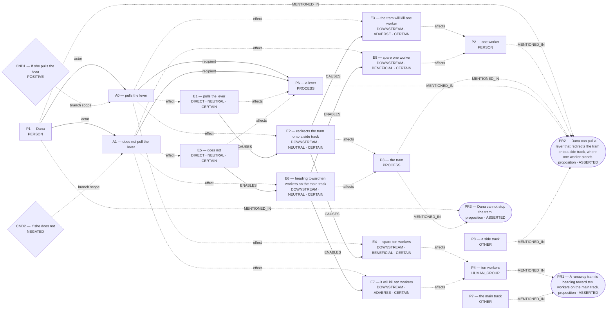

# Parliament demo

Status: **FRAMEWORK_PARTIAL** (recorded_pipeline_outcome).

Native judgment status: NOT_ADJUDICATED.

## Scenario

A runaway tram is heading toward ten workers on the main track. Dana can pull a lever that redirects the tram onto a side track, where one worker stands. If she pulls the lever, the tram will kill that worker and spare the ten. If she does not, it will kill the ten and spare the one. Dana cannot stop the tram. Should she pull the lever?

## What Parliament thinks is happening

Actions: pulls the lever; does not pull the lever

Parties: Dana, one worker, the tram, ten workers, a lever, the main track, a side track

These are alternative action branches and their stipulated outcomes, not claims that both actions occurred.

- Under A0, a lever: pulls the lever (CERTAIN)
- Under A0, the tram: redirects the tram onto a side track (CERTAIN)
- Under A0, one worker: the tram will kill one worker (CERTAIN)
- Under A0, ten workers: spare ten workers (CERTAIN)
- Under A1, a lever: does not (CERTAIN)
- Under A1, the tram: heading toward ten workers on the main track (CERTAIN)
- Under A1, ten workers: it will kill ten workers (CERTAIN)
- Under A1, one worker: spare one worker (CERTAIN)
- pulls the lever → CAUSES → redirects the tram onto a side track
- redirects the tram onto a side track → CAUSES → the tram will kill one worker
- redirects the tram onto a side track → CAUSES → spare ten workers
- does not → ENABLES → heading toward ten workers on the main track
- heading toward ten workers on the main track → ENABLES → it will kill ten workers
- heading toward ten workers on the main track → ENABLES → spare one worker

Source scene and constraints:

- A runaway tram is heading toward ten workers on the main track.
- Dana can pull a lever that redirects the tram onto a side track, where one worker stands.
- Dana cannot stop the tram.

## World-state diagram

### Frozen world supplied to framework assessment

## What is grounded

Admitted source copies and structurally derived records follow. Exact excerpts establish traceability; they do not independently prove every interpretation.

- pulls the lever — DIRECT_COPY; source: “If she pulls the lever, the tram will kill that worker and spare the ten.”
- redirects the tram onto a side track — SOURCE_STIPULATED_CAUSAL; source: “Dana can pull a lever that redirects the tram onto a side track, where one worker stands.”
- the tram will kill one worker — SOURCE_STIPULATED_CAUSAL; source: “If she pulls the lever, the tram will kill that worker and spare the ten.; Dana can pull a lever that redirects the tram onto a side track, where one worker stands.; If she does not, it will kill the ten and spare the one.”
- spare ten workers — SOURCE_STIPULATED_CAUSAL; source: “If she pulls the lever, the tram will kill that worker and spare the ten.; If she does not, it will kill the ten and spare the one.; A runaway tram is heading toward ten workers on the main track.”
- does not — DIRECT_COPY; source: “If she does not, it will kill the ten and spare the one.”
- heading toward ten workers on the main track — SOURCE_STIPULATED_CAUSAL; source: “If she does not, it will kill the ten and spare the one.; A runaway tram is heading toward ten workers on the main track.”
- it will kill ten workers — SOURCE_STIPULATED_CAUSAL; source: “If she does not, it will kill the ten and spare the one.; If she pulls the lever, the tram will kill that worker and spare the ten.; A runaway tram is heading toward ten workers on the main track.”
- spare one worker — SOURCE_STIPULATED_CAUSAL; source: “If she does not, it will kill the ten and spare the one.; If she pulls the lever, the tram will kill that worker and spare the ten.; Dana can pull a lever that redirects the tram onto a side track, where one worker stands.”
- Stipulated source claim: Dana cannot stop the tram.
- Stipulated source claim: If she pulls the lever, the tram will kill that worker and spare the ten.
- Stipulated source claim: If she does not, it will kill the ten and spare the one.
- Stipulated source claim: Dana can pull a lever that redirects the tram onto a side track, where one worker stands.
- Stipulated source claim: A runaway tram is heading toward ten workers on the main track.

## What remains uncertain

- unresolved judgment claims its tiebreaker fully succeeded
- intended-as-means classification corrected to side-effect
- Optional deeper review is available for a decision-relevant question in the revised argument.

## Optional deeper review

Follow-ups examine revised arguments. Extra calls require opt-in; a model answer is not an independently verified moral resolution.

Interactive demo runs ask before proceeding. Use `--review-depth deep` to opt in in advance, or `logic_puzzles_followup.py --trace <saved-review> --output-dir <new-folder> --execute` to continue a saved review.

A decision-relevant question remains in the revised argument. Review it more deeply? Up to two additional model calls; the conclusion may remain unresolved.

For A0, your revised interpretation classifies the death or harm as a foreseen side effect, not an intended means. Distinguish intending the intervention, intending harm as an end, intending harm as a means, and foreseeing harm. Not being a means does not establish that an outcome is unintended in every respect. Your governing norm prohibits intentional harm or killing. Explain why the action falls under that norm despite your revised means classification. If another prohibition governs foreseeable lethal or serious harm, identify and defend it explicitly rather than substituting its label. Test the particular rescue maxim and the omission maxim against universalization and the strongest rescue-duty objection. Explain what justifies the duty priority in this case. The physical world establishes causal relationships, not the actor's actual intentions or the truth of the normative rule. You may retain or revise your conclusion, or acknowledge an unresolved application. A RESOLVED label alone does not settle this philosophical question.

Additional rounds: 0. Stop: USER_OPT_IN_REQUIRED.

## Framework views

### deontological

Position: **ATTENUATED**. Recorded preference: does not pull the lever (not necessarily operative).

The agent assesses Dana’s duty “do not intentionally kill the innocent” toward one worker. Dana is the duty-bearer; one worker is the protected party. The competing obligation being assessed is Dana’s “Imperfect duty to aid” toward ten workers. For “pulls the lever”, the agent proposes the maxim “Pull the lever”. This is an interpretation of possible practical reasoning, not an established intention. Its purpose is Preserve ten lives; its chosen means are Redirect tram onto side track. The proposed justification is: If everyone caused a certain innocent death to avert greater harm, security of persons would erode. The agent assesses the maxim as indefensible, and the action as impermissible. Its proposed means–ends reasoning is: Dana relies on redirecting the tram; the death is foreseen but not relied upon as a causal step. Physical means references: E2; end references: E4. For Dana’s option “pulls the lever”, the ledger records prohibited. The agent’s stated reason is: direct harm to innocent violates perfect duty. The agent assesses Dana’s duty “refrain from killing an innocent person” toward one worker. Dana is the duty-bearer; one worker is the protected party. The competing obligation being assessed is Dana’s “Imperfect duty to aid” toward ten workers. For “does not pull the lever”, the agent proposes the maxim “Do not intervene”. This is an interpretation of possible practical reasoning, not an established intention. Its purpose is Avoid killing innocents oneself; its chosen means are Omit lever pull. The proposed justification is: Refraining from killing to help others can be willed universally. The agent assesses the maxim as defensible, and the action as permissible. Its proposed means–ends reasoning is: Dana refuses to become a killer even though she foresees the tram will kill ten. Physical means references: none; end references: none. For Dana’s option “does not pull the lever”, the ledger records permissible. The agent’s stated reason is: omission keeps hands clean of direct killing.

[Full recorded explanation (Markdown)](arguments/deontological.md).

Assumptions / interpretive commitments: Recorded interpretive commitment: Provisionally: Omission that avoids killing satisfies higher-priority perfect duty; Recorded interpretive commitment: Numbers do not override perfect duty; Run assumption: The stated scenario facts are accepted as givens for this analysis; their accuracy outside this scenario has not been verified.

The counts (one worker; ten workers) are stipulated by the scenario for this run. No separate record says whether they were observed, reported by someone, or supplied as simulation facts. This is a provenance limitation, not a claim that the stated counts are missing.

Dependencies: Not separately recorded.

Live objection: unresolved judgment claims its tiebreaker fully succeeded; intended-as-means classification corrected to side-effect

Would reverse the recorded preference: The agent reports a switch from “does not pull the lever” to “pulls the lever”. Condition: If perfect duties did not outrank imperfect, ranking could switch. This is an agent-reported condition, not an independently established threshold.

## Agreement and disagreement

Recorded preferences agree; this is not a collective verdict.

Framework-local normative arguments and empirical dependencies are shown above; no automatic causal classification is claimed.

- deontological: normative dependency — If perfect duties did not outrank imperfect, ranking could switch.

## Decision hinges

- deontological: If perfect duties did not outrank imperfect, ranking could switch. (would reverse a recorded preference; `cycles/1/candidates/0/normative_reversal_threshold`).

## What Parliament did not decide

- This report does not adjudicate a governing moral verdict.
- Ledger admission does not prove the argument or supply missing welfare units.
- Unresolved objections remain live; reported reversal thresholds are not source facts.

## Topography

Survivor arithmetic does not settle total welfare. Coordinates are native ledger records, not a calibrated moral physics. Attractors are occupancy of recorded points, not interpolated terrain.

Recorded action loci only. Missing axes are omitted; UNKNOWN is not plotted as zero.

- A0 pulls the lever — care: omitted; welfare: omitted; obligation: PROHIBITED
- A1 does not pull the lever — care: omitted; welfare: omitted; obligation: PERMISSIBLE

Degenerate: none
Attractors: none

## Run provenance

Execution: unknown historical run; run ID: not recorded.
Application commit: not recorded; source fingerprint: not recorded.
Original generation: unknown historical provenance.
The finalized run_manifest.json records configuration, runtime checks, source snapshot, and output hashes.

## Pipeline stop and inspection

FRAMEWORK_PARTIAL

Missing slots: none recorded

Competing admitted interpretations: none recorded

Inspection artifacts (saved replay references its original records):

- [reasoning_followup.json](/Users/benjaminkowal/Documents/Python/Python Coding/RL_Algorithms/diagnostics/revised_argument_followup_20261015/offer/reasoning_followup.json)
- [run_manifest.json](/Users/benjaminkowal/Documents/Python/Python Coding/RL_Algorithms/diagnostics/revised_argument_followup_20261015/offer/run_manifest.json)
