# Candidate world attempts

Chosen blueprint: **exclusive_allocation**  
Chooser status: **FILLED**

## 1. exclusive_allocation (alternative; amended)

Template status: **FILLED**  
Proposal status: **FILLED**  
Contract valid: **true**  
Missing slots: `survival_chance`

### exclusive_allocation candidate graph

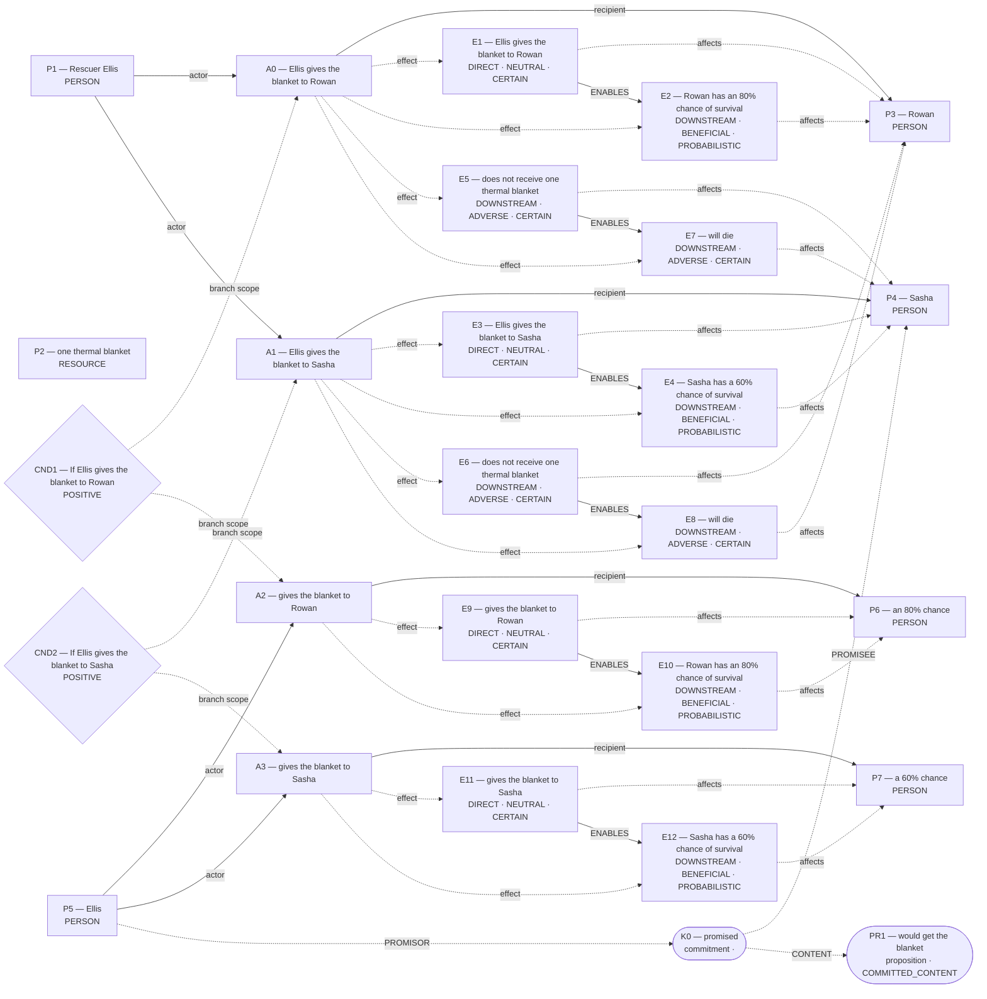

Hypothesis overlay (not submitted as world effects):

- `E10`: Rowan has an 80% chance of survival; unlicensed_welfare_effect
- `E12`: Sasha has a 60% chance of survival; unlicensed_welfare_effect

### Supported core for admission

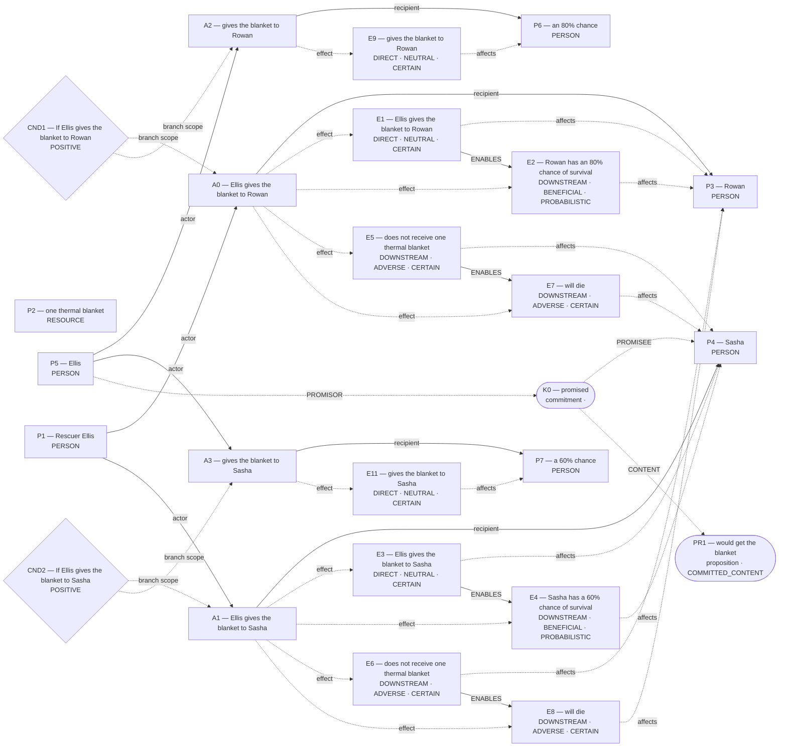

Native admission:

```json
{
  "blueprint_id": "exclusive_allocation",
  "rank": -0.1,
  "variant": "amended",
  "candidate_path": "/Users/benjaminkowal/Documents/Python/Python Coding/RL_Algorithms/diagnostics/thermal_blanket_demo_live_20261023/pipeline/admission_attempts/00_exclusive_allocation/candidate.json",
  "overlay_path": "/Users/benjaminkowal/Documents/Python/Python Coding/RL_Algorithms/diagnostics/thermal_blanket_demo_live_20261023/pipeline/admission_attempts/00_exclusive_allocation/hypothesis_overlay.json",
  "status": "REJECTED",
  "returncode": 1,
  "error": "Parliament rejected the blueprint candidate: {\"status\": \"REJECTED\", \"actions\": {}, \"world_model\": {}, \"world_model_status\": \"COMMITTED\", \"world_contradictions\": [], \"errors\": [\"A0 has no distinguishing source clause; its grounding ['C3'] is covered entirely by the other actions\", \"A1 has no distinguishing source clause; its grounding ['C4'] is covered entirely by the other actions\", \"A2 has no distinguishing source clause; its grounding ['C3'] is covered entirely by the other actions\", \"A3 has no distinguishing source clause; its grounding ['C4'] is covered entirely by the other actions\"], \"warnings\": [], \"validation_issues\": [{\"code\": \"WORLD_VALIDATION_ERROR\", \"message\": \"A0 has no distinguishing source clause; its grounding ['C3'] is covered entirely by the other actions\", \"entity_kind\": \"action\", \"entity_id\": \"A0\", \"field\": \"\", \"related_ids\": [], \"repair_class\": \"SEMANTIC_PATCH\", \"permits_removal\": false}, {\"code\": \"WORLD_VALIDATION_ERROR\", \"message\": \"A1 has no distinguishing source clause; its grounding ['C4'] is covered entirely by the other actions\", \"entity_kind\": \"action\", \"entity_id\": \"A1\", \"field\": \"\", \"related_ids\": [], \"repair_class\": \"SEMANTIC_PATCH\", \"permits_removal\": false}, {\"code\": \"WORLD_VALIDATION_ERROR\", \"message\": \"A2 has no distinguishing source clause; its grounding ['C3'] is covered entirely by the other actions\", \"entity_kind\": \"action\", \"entity_id\": \"A2\", \"field\": \"\", \"related_ids\": [], \"repair_class\": \"SEMANTIC_PATCH\", \"permits_removal\": false}, {\"code\": \"WORLD_VALIDATION_ERROR\", \"message\": \"A3 has no distinguishing source clause; its grounding ['C4'] is covered entirely by the other actions\", \"entity_kind\": \"action\", \"entity_id\": \"A3\", \"field\": \"\", \"related_ids\": [], \"repair_class\": \"SEMANTIC_PATCH\", \"permits_removal\": false}], \"compiler_loss_telemetry\": {}, \"clauses\": [{\"clause_id\": \"C0\", \"text\": \"A mountain rescue shelter has one thermal blanket.\"}, {\"clause_id\": \"C1\", \"text\": \"Rescuer Ellis can give the blanket to Rowan or Sasha, but not both.\"}, {\"clause_id\": \"C2\", \"text\": \"Both hikers are stranded in the cold, and no other rescue or warming equipment will arrive in time.\"}, {\"clause_id\": \"C3\", \"text\": \"If Ellis gives the blanket to Rowan, Rowan has an 80% chance of survival.\"}, {\"clause_id\": \"C4\", \"text\": \"If Ellis gives the blanket to Sasha, Sasha has a 60% chance of survival.\"}, {\"clause_id\": \"C5\", \"text\": \"The hiker who does not get the blanket will die.\"}, {\"clause_id\": \"C6\", \"text\": \"Before learning about Rowan, Ellis promised Sasha that Sasha would get the blanket.\"}, {\"clause_id\": \"C7\", \"text\": \"Whom should Ellis give the blanket to?\"}]}\n"
}
```

Source constructions retained outside the admitted world:

Parser proposals below preserve alternatives and local scope; they do not establish occurrence or a resolved interpretation.

#### promise:p95 — retained, not projected

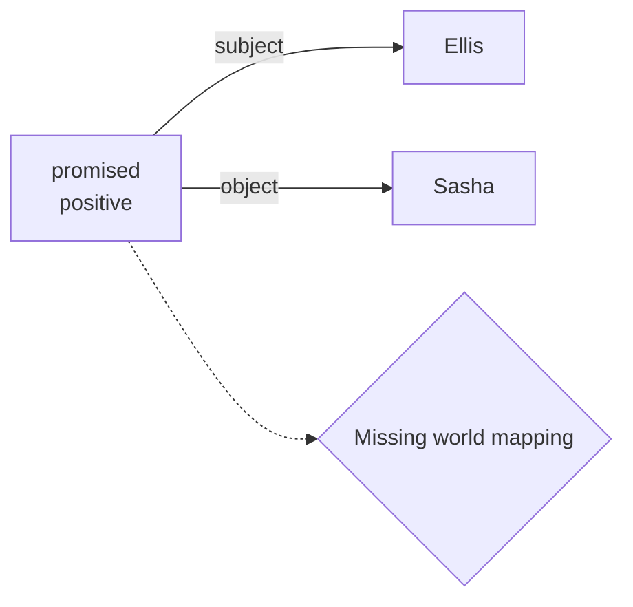

How should this scoped promise and its content map into Parliament? Retaining it establishes no reliance, breach, duty, or content occurrence.

Unconsumed parser candidates: **70**. These are visible mapping gaps, not admission failures.

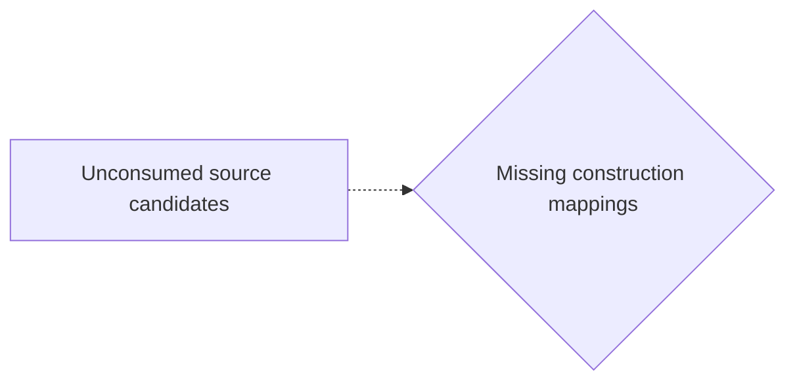

- `c0`: Which construction should preserve this PREDICATION reading?
- `c1`: Which construction should preserve this PREDICATION reading?
- `c2`: Which construction should preserve this PREDICATION reading?
- `c3`: Which construction should preserve this PREDICATION reading?
- `c8`: Which construction should preserve this PREDICATION reading?
- `c9`: Which construction should preserve this PREDICATION reading?
- `c10`: Which construction should preserve this PREDICATION reading?
- `c12`: Which construction should preserve this PREDICATION reading?
- `c13`: Which construction should preserve this PREDICATION reading?
- `c16`: Which construction should preserve this MODALITY reading?
- `c17`: Which construction should preserve this MODALITY reading?
- `c18`: Which construction should preserve this MODALITY reading?
- `c19`: Which construction should preserve this MODALITY reading?
- `c20`: Which construction should preserve this MODALITY reading?
- `c21`: Which construction should preserve this MODALITY reading?
- `c22`: Which construction should preserve this MODALITY reading?
- `c23`: Which construction should preserve this MODALITY reading?
- `c24`: Which construction should preserve this MODALITY reading?
- `c25`: Which construction should preserve this PARTICIPANT reading?
- `c26`: Which construction should preserve this PARTICIPANT reading?
- `c27`: Which construction should preserve this PARTICIPANT reading?
- `c28`: Which construction should preserve this PARTICIPANT reading?
- `c29`: Which construction should preserve this PARTICIPANT reading?
- `c30`: Which construction should preserve this PARTICIPANT reading?
- `c31`: Which construction should preserve this PARTICIPANT reading?
- `c32`: Which construction should preserve this PARTICIPANT reading?
- `c36`: Which construction should preserve this PARTICIPANT reading?
- `c37`: Which construction should preserve this PARTICIPANT reading?
- `c41`: Which construction should preserve this PARTICIPANT reading?
- `c42`: Which construction should preserve this PARTICIPANT reading?
- `c43`: Which construction should preserve this PARTICIPANT reading?
- `c44`: Which construction should preserve this PARTICIPANT reading?
- `c47`: Which construction should preserve this PARTICIPANT reading?
- `c48`: Which construction should preserve this PARTICIPANT reading?
- `c49`: Which construction should preserve this PARTICIPANT reading?
- `c50`: Which construction should preserve this PARTICIPANT reading?
- `c51`: Which construction should preserve this PARTICIPANT reading?
- `c52`: Which construction should preserve this PARTICIPANT reading?
- `c53`: Which construction should preserve this QUANTITY reading?
- `c54`: Which construction should preserve this SAME_REFERENT reading?
- `c55`: Which construction should preserve this SAME_REFERENT reading?
- `c56`: Which construction should preserve this SAME_REFERENT reading?
- `c57`: Which construction should preserve this SAME_REFERENT reading?
- `c58`: Which construction should preserve this SAME_REFERENT reading?
- `c59`: Which construction should preserve this SAME_REFERENT reading?
- `c60`: Which construction should preserve this SAME_REFERENT reading?
- `c61`: Which construction should preserve this SAME_REFERENT reading?
- `c62`: Which construction should preserve this SAME_REFERENT reading?
- `c63`: Which construction should preserve this SAME_REFERENT reading?
- `c64`: Which construction should preserve this SAME_REFERENT reading?
- `c65`: Which construction should preserve this SAME_REFERENT reading?
- `c66`: Which construction should preserve this SAME_REFERENT reading?
- `c67`: Which construction should preserve this SAME_REFERENT reading?
- `c68`: Which construction should preserve this SAME_REFERENT reading?
- `c69`: Which construction should preserve this SAME_REFERENT reading?
- `c70`: Which construction should preserve this SAME_REFERENT reading?
- `c71`: Which construction should preserve this SAME_REFERENT reading?
- `c72`: Which construction should preserve this SAME_REFERENT reading?
- `c73`: Which construction should preserve this SAME_REFERENT reading?
- `c74`: Which construction should preserve this SAME_REFERENT reading?
- `c75`: Which construction should preserve this SAME_REFERENT reading?
- `c76`: Which construction should preserve this SAME_REFERENT reading?
- `c77`: Which construction should preserve this SAME_REFERENT reading?
- `c78`: Which construction should preserve this SAME_REFERENT reading?
- `c79`: Which construction should preserve this SAME_REFERENT reading?
- `c80`: Which construction should preserve this SAME_REFERENT reading?
- `c81`: Which construction should preserve this SAME_REFERENT reading?
- `c82`: Which construction should preserve this SAME_REFERENT reading?
- `c83`: Which construction should preserve this SAME_REFERENT reading?
- `c84`: Which construction should preserve this SAME_REFERENT reading?

## 2. exclusive_allocation (alternative; baseline)

Template status: **FILLED**  
Proposal status: **FILLED**  
Contract valid: **true**  
Missing slots: `survival_chance`

### exclusive_allocation candidate graph

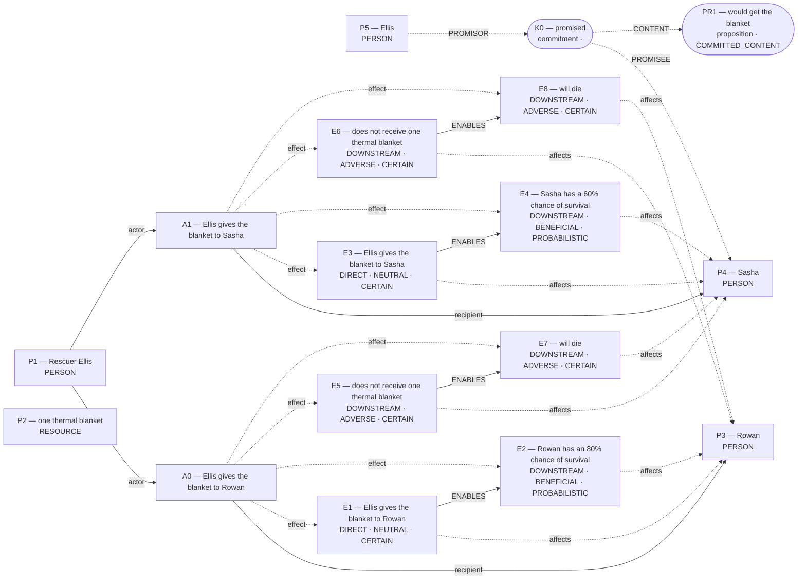

Native admission:

```json
{
  "blueprint_id": "exclusive_allocation",
  "rank": 0,
  "variant": "baseline",
  "candidate_path": "/Users/benjaminkowal/Documents/Python/Python Coding/RL_Algorithms/diagnostics/thermal_blanket_demo_live_20261023/pipeline/admission_attempts/01_exclusive_allocation/candidate.json",
  "overlay_path": "/Users/benjaminkowal/Documents/Python/Python Coding/RL_Algorithms/diagnostics/thermal_blanket_demo_live_20261023/pipeline/admission_attempts/01_exclusive_allocation/hypothesis_overlay.json",
  "status": "ADMITTED",
  "admission": {
    "status": "COMMITTED",
    "world_model_status": "COMMITTED",
    "effects": 8,
    "causal_links": 6,
    "frozen_trace_valid": true,
    "discourse_committed": false,
    "relent_workspace": {
      "established": [
        {
          "kind": "occurrence_effect",
          "effect_id": "E1",
          "outcome": "Ellis gives the blanket to Rowan",
          "predicate": null,
          "status": "established"
        },
        {
          "kind": "occurrence_effect",
          "effect_id": "E2",
          "outcome": "Rowan has an 80% chance of survival",
          "predicate": null,
          "status": "established"
        },
        {
          "kind": "occurrence_effect",
          "effect_id": "E3",
          "outcome": "Ellis gives the blanket to Sasha",
          "predicate": null,
          "status": "established"
        },
        {
          "kind": "occurrence_effect",
          "effect_id": "E4",
          "outcome": "Sasha has a 60% chance of survival",
          "predicate": null,
          "status": "established"
        },
        {
          "kind": "occurrence_effect",
          "effect_id": "E5",
          "outcome": "does not receive one thermal blanket",
          "predicate": null,
          "status": "established"
        },
        {
          "kind": "occurrence_effect",
          "effect_id": "E6",
          "outcome": "does not receive one thermal blanket",
          "predicate": null,
          "status": "established"
        },
        {
          "kind": "occurrence_effect",
          "effect_id": "E7",
          "outcome": "will die",
          "predicate": null,
          "status": "established"
        },
        {
          "kind": "occurrence_effect",
          "effect_id": "E8",
          "outcome": "will die",
          "predicate": null,
          "status": "established"
        }
      ],
      "not_established": [
        {
          "kind": "proposition",
          "proposition_id": "PR1",
          "predication": "would get the blanket",
          "status": "COMMITTED_CONTENT"
        },
        {
          "kind": "commitment",
          "commitment_id": "K0",
          "content_proposition_id": "PR1",
          "status": "committed"
        }
      ],
      "duty_ledger_citations": [
        {
          "kind": "commitment",
          "commitment_id": "K0"
        }
      ],
      "ev_forbidden_proposition_ids": [
        "PR1"
      ],
      "factual_status_sources": [
        "occurrence_effects"
      ]
    },
    "fingerprint_sha256": "d234023acba0f9224ca6218d63064e36a304bb6aa74204747175979ee2fab555"
  },
  "trace_path": "/Users/benjaminkowal/Documents/Python/Python Coding/RL_Algorithms/diagnostics/thermal_blanket_demo_live_20261023/pipeline/admission_attempts/01_exclusive_allocation/frozen_world_trace.json"
}
```

Source constructions retained outside the admitted world:

Parser proposals below preserve alternatives and local scope; they do not establish occurrence or a resolved interpretation.

#### promise:p95 — retained, not projected


How should this scoped promise and its content map into Parliament? Retaining it establishes no reliance, breach, duty, or content occurrence.

Unconsumed parser candidates: **70**. These are visible mapping gaps, not admission failures.


- `c0`: Which construction should preserve this PREDICATION reading?
- `c1`: Which construction should preserve this PREDICATION reading?
- `c2`: Which construction should preserve this PREDICATION reading?
- `c3`: Which construction should preserve this PREDICATION reading?
- `c8`: Which construction should preserve this PREDICATION reading?
- `c9`: Which construction should preserve this PREDICATION reading?
- `c10`: Which construction should preserve this PREDICATION reading?
- `c12`: Which construction should preserve this PREDICATION reading?
- `c13`: Which construction should preserve this PREDICATION reading?
- `c16`: Which construction should preserve this MODALITY reading?
- `c17`: Which construction should preserve this MODALITY reading?
- `c18`: Which construction should preserve this MODALITY reading?
- `c19`: Which construction should preserve this MODALITY reading?
- `c20`: Which construction should preserve this MODALITY reading?
- `c21`: Which construction should preserve this MODALITY reading?
- `c22`: Which construction should preserve this MODALITY reading?
- `c23`: Which construction should preserve this MODALITY reading?
- `c24`: Which construction should preserve this MODALITY reading?
- `c25`: Which construction should preserve this PARTICIPANT reading?
- `c26`: Which construction should preserve this PARTICIPANT reading?
- `c27`: Which construction should preserve this PARTICIPANT reading?
- `c28`: Which construction should preserve this PARTICIPANT reading?
- `c29`: Which construction should preserve this PARTICIPANT reading?
- `c30`: Which construction should preserve this PARTICIPANT reading?
- `c31`: Which construction should preserve this PARTICIPANT reading?
- `c32`: Which construction should preserve this PARTICIPANT reading?
- `c36`: Which construction should preserve this PARTICIPANT reading?
- `c37`: Which construction should preserve this PARTICIPANT reading?
- `c41`: Which construction should preserve this PARTICIPANT reading?
- `c42`: Which construction should preserve this PARTICIPANT reading?
- `c43`: Which construction should preserve this PARTICIPANT reading?
- `c44`: Which construction should preserve this PARTICIPANT reading?
- `c47`: Which construction should preserve this PARTICIPANT reading?
- `c48`: Which construction should preserve this PARTICIPANT reading?
- `c49`: Which construction should preserve this PARTICIPANT reading?
- `c50`: Which construction should preserve this PARTICIPANT reading?
- `c51`: Which construction should preserve this PARTICIPANT reading?
- `c52`: Which construction should preserve this PARTICIPANT reading?
- `c53`: Which construction should preserve this QUANTITY reading?
- `c54`: Which construction should preserve this SAME_REFERENT reading?
- `c55`: Which construction should preserve this SAME_REFERENT reading?
- `c56`: Which construction should preserve this SAME_REFERENT reading?
- `c57`: Which construction should preserve this SAME_REFERENT reading?
- `c58`: Which construction should preserve this SAME_REFERENT reading?
- `c59`: Which construction should preserve this SAME_REFERENT reading?
- `c60`: Which construction should preserve this SAME_REFERENT reading?
- `c61`: Which construction should preserve this SAME_REFERENT reading?
- `c62`: Which construction should preserve this SAME_REFERENT reading?
- `c63`: Which construction should preserve this SAME_REFERENT reading?
- `c64`: Which construction should preserve this SAME_REFERENT reading?
- `c65`: Which construction should preserve this SAME_REFERENT reading?
- `c66`: Which construction should preserve this SAME_REFERENT reading?
- `c67`: Which construction should preserve this SAME_REFERENT reading?
- `c68`: Which construction should preserve this SAME_REFERENT reading?
- `c69`: Which construction should preserve this SAME_REFERENT reading?
- `c70`: Which construction should preserve this SAME_REFERENT reading?
- `c71`: Which construction should preserve this SAME_REFERENT reading?
- `c72`: Which construction should preserve this SAME_REFERENT reading?
- `c73`: Which construction should preserve this SAME_REFERENT reading?
- `c74`: Which construction should preserve this SAME_REFERENT reading?
- `c75`: Which construction should preserve this SAME_REFERENT reading?
- `c76`: Which construction should preserve this SAME_REFERENT reading?
- `c77`: Which construction should preserve this SAME_REFERENT reading?
- `c78`: Which construction should preserve this SAME_REFERENT reading?
- `c79`: Which construction should preserve this SAME_REFERENT reading?
- `c80`: Which construction should preserve this SAME_REFERENT reading?
- `c81`: Which construction should preserve this SAME_REFERENT reading?
- `c82`: Which construction should preserve this SAME_REFERENT reading?
- `c83`: Which construction should preserve this SAME_REFERENT reading?
- `c84`: Which construction should preserve this SAME_REFERENT reading?

## 3. promise_reliance (alternative; amended)

Template status: **FILLED**  
Proposal status: **FILLED**  
Contract valid: **true**  
Missing slots: `reliance`, `breach`

### promise_reliance candidate graph

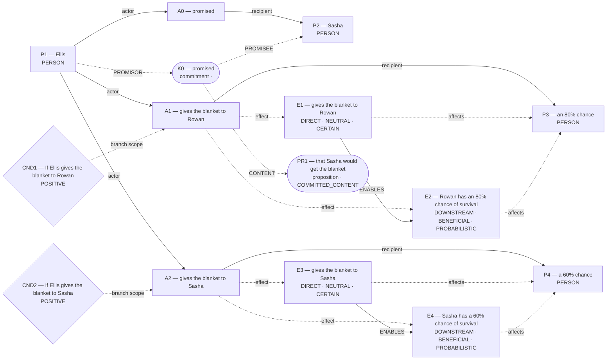

Hypothesis overlay (not submitted as world effects):

- `E2`: Rowan has an 80% chance of survival; unlicensed_welfare_effect
- `E4`: Sasha has a 60% chance of survival; unlicensed_welfare_effect

### Supported core for admission

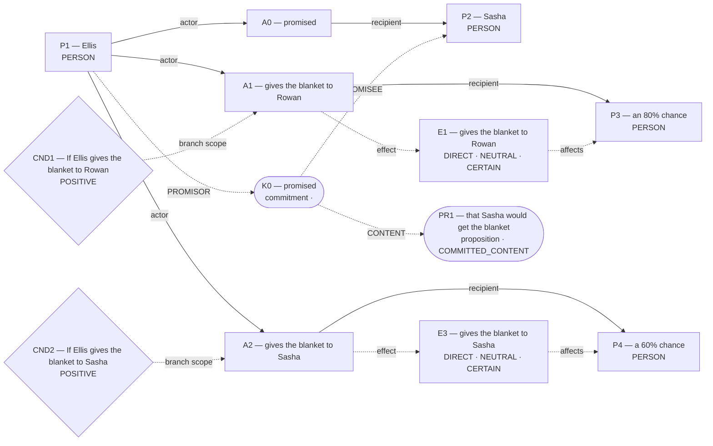

Native admission:

```json
{
  "blueprint_id": "promise_reliance",
  "rank": 0.9,
  "variant": "amended",
  "candidate_path": "/Users/benjaminkowal/Documents/Python/Python Coding/RL_Algorithms/diagnostics/thermal_blanket_demo_live_20261023/pipeline/admission_attempts/02_promise_reliance/candidate.json",
  "overlay_path": "/Users/benjaminkowal/Documents/Python/Python Coding/RL_Algorithms/diagnostics/thermal_blanket_demo_live_20261023/pipeline/admission_attempts/02_promise_reliance/hypothesis_overlay.json",
  "status": "REJECTED",
  "returncode": 1,
  "error": "Traceback (most recent call last):\n  File \"/var/folders/n8/ljhm3wm554j1rvxbx9vdvw600000gn/T/tmphj6zo8wz/admit_blueprint.py\", line 148, in <module>\n    parse_world_model(\n  File \"/Users/benjaminkowal/Documents/Python/Python Coding/RL_Algorithms/.runtime/parliament/global_workspace/world_state.py\", line 3123, in parse_world_model\n    raise WorldModelValidationError(\nglobal_workspace.world_validation.WorldModelValidationError: A0 recipient P2 lacks an atomic DIRECT INTERVENTION, RESOURCE_TRANSFER, or INSTITUTIONAL_OUTCOME effect\n"
}
```

Source constructions retained outside the admitted world:

Parser proposals below preserve alternatives and local scope; they do not establish occurrence or a resolved interpretation.

#### promise:p95 — retained, not projected


How should this scoped promise and its content map into Parliament? Retaining it establishes no reliance, breach, duty, or content occurrence.

Unconsumed parser candidates: **70**. These are visible mapping gaps, not admission failures.


- `c0`: Which construction should preserve this PREDICATION reading?
- `c1`: Which construction should preserve this PREDICATION reading?
- `c2`: Which construction should preserve this PREDICATION reading?
- `c3`: Which construction should preserve this PREDICATION reading?
- `c8`: Which construction should preserve this PREDICATION reading?
- `c9`: Which construction should preserve this PREDICATION reading?
- `c10`: Which construction should preserve this PREDICATION reading?
- `c12`: Which construction should preserve this PREDICATION reading?
- `c13`: Which construction should preserve this PREDICATION reading?
- `c16`: Which construction should preserve this MODALITY reading?
- `c17`: Which construction should preserve this MODALITY reading?
- `c18`: Which construction should preserve this MODALITY reading?
- `c19`: Which construction should preserve this MODALITY reading?
- `c20`: Which construction should preserve this MODALITY reading?
- `c21`: Which construction should preserve this MODALITY reading?
- `c22`: Which construction should preserve this MODALITY reading?
- `c23`: Which construction should preserve this MODALITY reading?
- `c24`: Which construction should preserve this MODALITY reading?
- `c25`: Which construction should preserve this PARTICIPANT reading?
- `c26`: Which construction should preserve this PARTICIPANT reading?
- `c27`: Which construction should preserve this PARTICIPANT reading?
- `c28`: Which construction should preserve this PARTICIPANT reading?
- `c29`: Which construction should preserve this PARTICIPANT reading?
- `c30`: Which construction should preserve this PARTICIPANT reading?
- `c31`: Which construction should preserve this PARTICIPANT reading?
- `c32`: Which construction should preserve this PARTICIPANT reading?
- `c36`: Which construction should preserve this PARTICIPANT reading?
- `c37`: Which construction should preserve this PARTICIPANT reading?
- `c41`: Which construction should preserve this PARTICIPANT reading?
- `c42`: Which construction should preserve this PARTICIPANT reading?
- `c43`: Which construction should preserve this PARTICIPANT reading?
- `c44`: Which construction should preserve this PARTICIPANT reading?
- `c47`: Which construction should preserve this PARTICIPANT reading?
- `c48`: Which construction should preserve this PARTICIPANT reading?
- `c49`: Which construction should preserve this PARTICIPANT reading?
- `c50`: Which construction should preserve this PARTICIPANT reading?
- `c51`: Which construction should preserve this PARTICIPANT reading?
- `c52`: Which construction should preserve this PARTICIPANT reading?
- `c53`: Which construction should preserve this QUANTITY reading?
- `c54`: Which construction should preserve this SAME_REFERENT reading?
- `c55`: Which construction should preserve this SAME_REFERENT reading?
- `c56`: Which construction should preserve this SAME_REFERENT reading?
- `c57`: Which construction should preserve this SAME_REFERENT reading?
- `c58`: Which construction should preserve this SAME_REFERENT reading?
- `c59`: Which construction should preserve this SAME_REFERENT reading?
- `c60`: Which construction should preserve this SAME_REFERENT reading?
- `c61`: Which construction should preserve this SAME_REFERENT reading?
- `c62`: Which construction should preserve this SAME_REFERENT reading?
- `c63`: Which construction should preserve this SAME_REFERENT reading?
- `c64`: Which construction should preserve this SAME_REFERENT reading?
- `c65`: Which construction should preserve this SAME_REFERENT reading?
- `c66`: Which construction should preserve this SAME_REFERENT reading?
- `c67`: Which construction should preserve this SAME_REFERENT reading?
- `c68`: Which construction should preserve this SAME_REFERENT reading?
- `c69`: Which construction should preserve this SAME_REFERENT reading?
- `c70`: Which construction should preserve this SAME_REFERENT reading?
- `c71`: Which construction should preserve this SAME_REFERENT reading?
- `c72`: Which construction should preserve this SAME_REFERENT reading?
- `c73`: Which construction should preserve this SAME_REFERENT reading?
- `c74`: Which construction should preserve this SAME_REFERENT reading?
- `c75`: Which construction should preserve this SAME_REFERENT reading?
- `c76`: Which construction should preserve this SAME_REFERENT reading?
- `c77`: Which construction should preserve this SAME_REFERENT reading?
- `c78`: Which construction should preserve this SAME_REFERENT reading?
- `c79`: Which construction should preserve this SAME_REFERENT reading?
- `c80`: Which construction should preserve this SAME_REFERENT reading?
- `c81`: Which construction should preserve this SAME_REFERENT reading?
- `c82`: Which construction should preserve this SAME_REFERENT reading?
- `c83`: Which construction should preserve this SAME_REFERENT reading?
- `c84`: Which construction should preserve this SAME_REFERENT reading?

## 4. promise_reliance (alternative; baseline)

Template status: **FILLED**  
Proposal status: **FILLED**  
Contract valid: **true**  
Missing slots: `reliance`, `breach`

### promise_reliance candidate graph

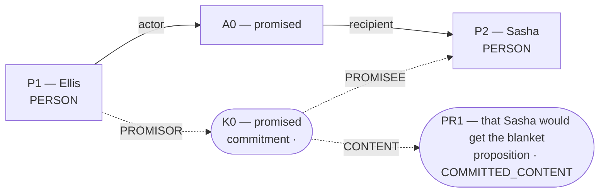

Native admission:

```json
{
  "blueprint_id": "promise_reliance",
  "rank": 1,
  "variant": "baseline",
  "candidate_path": "/Users/benjaminkowal/Documents/Python/Python Coding/RL_Algorithms/diagnostics/thermal_blanket_demo_live_20261023/pipeline/admission_attempts/03_promise_reliance/candidate.json",
  "overlay_path": "/Users/benjaminkowal/Documents/Python/Python Coding/RL_Algorithms/diagnostics/thermal_blanket_demo_live_20261023/pipeline/admission_attempts/03_promise_reliance/hypothesis_overlay.json",
  "status": "ADMITTED",
  "admission": {
    "status": "COMMITTED",
    "world_model_status": "COMMITTED",
    "effects": 0,
    "causal_links": 0,
    "frozen_trace_valid": false,
    "discourse_committed": true,
    "relent_workspace": {
      "established": [],
      "not_established": [
        {
          "kind": "proposition",
          "proposition_id": "PR1",
          "predication": "that Sasha would get the blanket",
          "status": "COMMITTED_CONTENT"
        },
        {
          "kind": "commitment",
          "commitment_id": "K0",
          "content_proposition_id": "PR1",
          "status": "committed"
        }
      ],
      "duty_ledger_citations": [
        {
          "kind": "commitment",
          "commitment_id": "K0"
        }
      ],
      "ev_forbidden_proposition_ids": [
        "PR1"
      ],
      "factual_status_sources": [
        "occurrence_effects"
      ]
    },
    "fingerprint_sha256": null
  },
  "trace_path": "/Users/benjaminkowal/Documents/Python/Python Coding/RL_Algorithms/diagnostics/thermal_blanket_demo_live_20261023/pipeline/admission_attempts/03_promise_reliance/frozen_world_trace.json"
}
```

Source constructions retained outside the admitted world:

Parser proposals below preserve alternatives and local scope; they do not establish occurrence or a resolved interpretation.

#### promise:p95 — retained, not projected


How should this scoped promise and its content map into Parliament? Retaining it establishes no reliance, breach, duty, or content occurrence.

Unconsumed parser candidates: **70**. These are visible mapping gaps, not admission failures.


- `c0`: Which construction should preserve this PREDICATION reading?
- `c1`: Which construction should preserve this PREDICATION reading?
- `c2`: Which construction should preserve this PREDICATION reading?
- `c3`: Which construction should preserve this PREDICATION reading?
- `c8`: Which construction should preserve this PREDICATION reading?
- `c9`: Which construction should preserve this PREDICATION reading?
- `c10`: Which construction should preserve this PREDICATION reading?
- `c12`: Which construction should preserve this PREDICATION reading?
- `c13`: Which construction should preserve this PREDICATION reading?
- `c16`: Which construction should preserve this MODALITY reading?
- `c17`: Which construction should preserve this MODALITY reading?
- `c18`: Which construction should preserve this MODALITY reading?
- `c19`: Which construction should preserve this MODALITY reading?
- `c20`: Which construction should preserve this MODALITY reading?
- `c21`: Which construction should preserve this MODALITY reading?
- `c22`: Which construction should preserve this MODALITY reading?
- `c23`: Which construction should preserve this MODALITY reading?
- `c24`: Which construction should preserve this MODALITY reading?
- `c25`: Which construction should preserve this PARTICIPANT reading?
- `c26`: Which construction should preserve this PARTICIPANT reading?
- `c27`: Which construction should preserve this PARTICIPANT reading?
- `c28`: Which construction should preserve this PARTICIPANT reading?
- `c29`: Which construction should preserve this PARTICIPANT reading?
- `c30`: Which construction should preserve this PARTICIPANT reading?
- `c31`: Which construction should preserve this PARTICIPANT reading?
- `c32`: Which construction should preserve this PARTICIPANT reading?
- `c36`: Which construction should preserve this PARTICIPANT reading?
- `c37`: Which construction should preserve this PARTICIPANT reading?
- `c41`: Which construction should preserve this PARTICIPANT reading?
- `c42`: Which construction should preserve this PARTICIPANT reading?
- `c43`: Which construction should preserve this PARTICIPANT reading?
- `c44`: Which construction should preserve this PARTICIPANT reading?
- `c47`: Which construction should preserve this PARTICIPANT reading?
- `c48`: Which construction should preserve this PARTICIPANT reading?
- `c49`: Which construction should preserve this PARTICIPANT reading?
- `c50`: Which construction should preserve this PARTICIPANT reading?
- `c51`: Which construction should preserve this PARTICIPANT reading?
- `c52`: Which construction should preserve this PARTICIPANT reading?
- `c53`: Which construction should preserve this QUANTITY reading?
- `c54`: Which construction should preserve this SAME_REFERENT reading?
- `c55`: Which construction should preserve this SAME_REFERENT reading?
- `c56`: Which construction should preserve this SAME_REFERENT reading?
- `c57`: Which construction should preserve this SAME_REFERENT reading?
- `c58`: Which construction should preserve this SAME_REFERENT reading?
- `c59`: Which construction should preserve this SAME_REFERENT reading?
- `c60`: Which construction should preserve this SAME_REFERENT reading?
- `c61`: Which construction should preserve this SAME_REFERENT reading?
- `c62`: Which construction should preserve this SAME_REFERENT reading?
- `c63`: Which construction should preserve this SAME_REFERENT reading?
- `c64`: Which construction should preserve this SAME_REFERENT reading?
- `c65`: Which construction should preserve this SAME_REFERENT reading?
- `c66`: Which construction should preserve this SAME_REFERENT reading?
- `c67`: Which construction should preserve this SAME_REFERENT reading?
- `c68`: Which construction should preserve this SAME_REFERENT reading?
- `c69`: Which construction should preserve this SAME_REFERENT reading?
- `c70`: Which construction should preserve this SAME_REFERENT reading?
- `c71`: Which construction should preserve this SAME_REFERENT reading?
- `c72`: Which construction should preserve this SAME_REFERENT reading?
- `c73`: Which construction should preserve this SAME_REFERENT reading?
- `c74`: Which construction should preserve this SAME_REFERENT reading?
- `c75`: Which construction should preserve this SAME_REFERENT reading?
- `c76`: Which construction should preserve this SAME_REFERENT reading?
- `c77`: Which construction should preserve this SAME_REFERENT reading?
- `c78`: Which construction should preserve this SAME_REFERENT reading?
- `c79`: Which construction should preserve this SAME_REFERENT reading?
- `c80`: Which construction should preserve this SAME_REFERENT reading?
- `c81`: Which construction should preserve this SAME_REFERENT reading?
- `c82`: Which construction should preserve this SAME_REFERENT reading?
- `c83`: Which construction should preserve this SAME_REFERENT reading?
- `c84`: Which construction should preserve this SAME_REFERENT reading?

## 5. conditional_outcome (alternative; amended)

Template status: **FILLED**  
Proposal status: **FILLED**  
Contract valid: **true**  
Missing slots: `controllable_process`

### conditional_outcome candidate graph

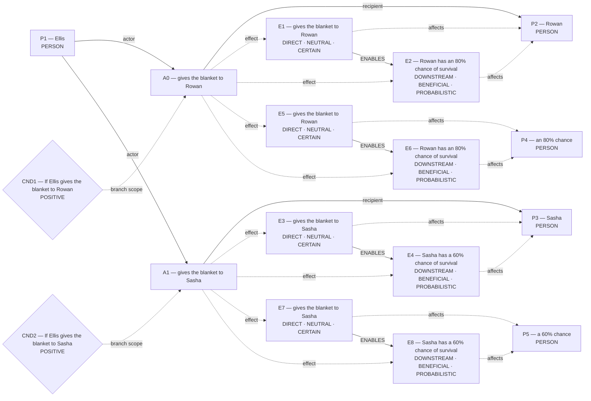

Hypothesis overlay (not submitted as world effects):

- `E6`: Rowan has an 80% chance of survival; unlicensed_welfare_effect
- `E8`: Sasha has a 60% chance of survival; unlicensed_welfare_effect

### Supported core for admission

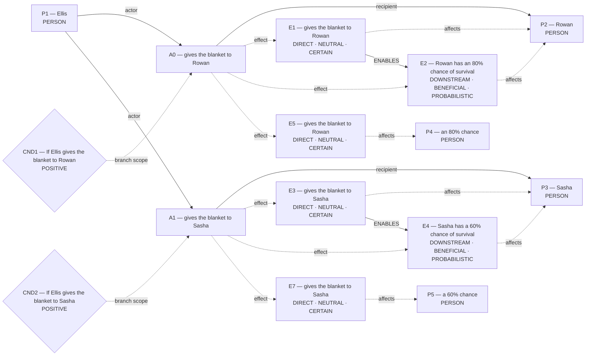

Native admission:

```json
{
  "blueprint_id": "conditional_outcome",
  "rank": 1.9,
  "variant": "amended",
  "candidate_path": "/Users/benjaminkowal/Documents/Python/Python Coding/RL_Algorithms/diagnostics/thermal_blanket_demo_live_20261023/pipeline/admission_attempts/04_conditional_outcome/candidate.json",
  "overlay_path": "/Users/benjaminkowal/Documents/Python/Python Coding/RL_Algorithms/diagnostics/thermal_blanket_demo_live_20261023/pipeline/admission_attempts/04_conditional_outcome/hypothesis_overlay.json",
  "status": "REJECTED",
  "returncode": 1,
  "error": "Traceback (most recent call last):\n  File \"/var/folders/n8/ljhm3wm554j1rvxbx9vdvw600000gn/T/tmphj6zo8wz/admit_blueprint.py\", line 148, in <module>\n    parse_world_model(\n  File \"/Users/benjaminkowal/Documents/Python/Python Coding/RL_Algorithms/.runtime/parliament/global_workspace/world_state.py\", line 3123, in parse_world_model\n    raise WorldModelValidationError(\nglobal_workspace.world_validation.WorldModelValidationError: causal_link[0] is conditional but has no condition; causal_link[1] is conditional but has no condition; E5 is DIRECT on P4, who is neither the actor nor a named recipient; non-recipient process and population states are DOWNSTREAM or FOREGONE. If this row is later conduct (assist, remain, use a road), recast it DOWNSTREAM with a non-INTERVENTION kind; do not add that party as a recipient to make the conduct DIRECT. If this row is the actor assigning or allocating that party, they may be a recipient of a separate DIRECT assignment, not of this later conduct; E7 is DIRECT on P5, who is neither the actor nor a named recipient; non-recipient process and population states are DOWNSTREAM or FOREGONE. If this row is later conduct (assist, remain, use a road), recast it DOWNSTREAM with a non-INTERVENTION kind; do not add that party as a recipient to make the conduct DIRECT. If this row is the actor assigning or allocating that party, they may be a recipient of a separate DIRECT assignment, not of this later conduct\n"
}
```

Source constructions retained outside the admitted world:

Parser proposals below preserve alternatives and local scope; they do not establish occurrence or a resolved interpretation.

#### promise:p95 — retained, not projected


How should this scoped promise and its content map into Parliament? Retaining it establishes no reliance, breach, duty, or content occurrence.

Unconsumed parser candidates: **70**. These are visible mapping gaps, not admission failures.


- `c0`: Which construction should preserve this PREDICATION reading?
- `c1`: Which construction should preserve this PREDICATION reading?
- `c2`: Which construction should preserve this PREDICATION reading?
- `c3`: Which construction should preserve this PREDICATION reading?
- `c8`: Which construction should preserve this PREDICATION reading?
- `c9`: Which construction should preserve this PREDICATION reading?
- `c10`: Which construction should preserve this PREDICATION reading?
- `c12`: Which construction should preserve this PREDICATION reading?
- `c13`: Which construction should preserve this PREDICATION reading?
- `c16`: Which construction should preserve this MODALITY reading?
- `c17`: Which construction should preserve this MODALITY reading?
- `c18`: Which construction should preserve this MODALITY reading?
- `c19`: Which construction should preserve this MODALITY reading?
- `c20`: Which construction should preserve this MODALITY reading?
- `c21`: Which construction should preserve this MODALITY reading?
- `c22`: Which construction should preserve this MODALITY reading?
- `c23`: Which construction should preserve this MODALITY reading?
- `c24`: Which construction should preserve this MODALITY reading?
- `c25`: Which construction should preserve this PARTICIPANT reading?
- `c26`: Which construction should preserve this PARTICIPANT reading?
- `c27`: Which construction should preserve this PARTICIPANT reading?
- `c28`: Which construction should preserve this PARTICIPANT reading?
- `c29`: Which construction should preserve this PARTICIPANT reading?
- `c30`: Which construction should preserve this PARTICIPANT reading?
- `c31`: Which construction should preserve this PARTICIPANT reading?
- `c32`: Which construction should preserve this PARTICIPANT reading?
- `c36`: Which construction should preserve this PARTICIPANT reading?
- `c37`: Which construction should preserve this PARTICIPANT reading?
- `c41`: Which construction should preserve this PARTICIPANT reading?
- `c42`: Which construction should preserve this PARTICIPANT reading?
- `c43`: Which construction should preserve this PARTICIPANT reading?
- `c44`: Which construction should preserve this PARTICIPANT reading?
- `c47`: Which construction should preserve this PARTICIPANT reading?
- `c48`: Which construction should preserve this PARTICIPANT reading?
- `c49`: Which construction should preserve this PARTICIPANT reading?
- `c50`: Which construction should preserve this PARTICIPANT reading?
- `c51`: Which construction should preserve this PARTICIPANT reading?
- `c52`: Which construction should preserve this PARTICIPANT reading?
- `c53`: Which construction should preserve this QUANTITY reading?
- `c54`: Which construction should preserve this SAME_REFERENT reading?
- `c55`: Which construction should preserve this SAME_REFERENT reading?
- `c56`: Which construction should preserve this SAME_REFERENT reading?
- `c57`: Which construction should preserve this SAME_REFERENT reading?
- `c58`: Which construction should preserve this SAME_REFERENT reading?
- `c59`: Which construction should preserve this SAME_REFERENT reading?
- `c60`: Which construction should preserve this SAME_REFERENT reading?
- `c61`: Which construction should preserve this SAME_REFERENT reading?
- `c62`: Which construction should preserve this SAME_REFERENT reading?
- `c63`: Which construction should preserve this SAME_REFERENT reading?
- `c64`: Which construction should preserve this SAME_REFERENT reading?
- `c65`: Which construction should preserve this SAME_REFERENT reading?
- `c66`: Which construction should preserve this SAME_REFERENT reading?
- `c67`: Which construction should preserve this SAME_REFERENT reading?
- `c68`: Which construction should preserve this SAME_REFERENT reading?
- `c69`: Which construction should preserve this SAME_REFERENT reading?
- `c70`: Which construction should preserve this SAME_REFERENT reading?
- `c71`: Which construction should preserve this SAME_REFERENT reading?
- `c72`: Which construction should preserve this SAME_REFERENT reading?
- `c73`: Which construction should preserve this SAME_REFERENT reading?
- `c74`: Which construction should preserve this SAME_REFERENT reading?
- `c75`: Which construction should preserve this SAME_REFERENT reading?
- `c76`: Which construction should preserve this SAME_REFERENT reading?
- `c77`: Which construction should preserve this SAME_REFERENT reading?
- `c78`: Which construction should preserve this SAME_REFERENT reading?
- `c79`: Which construction should preserve this SAME_REFERENT reading?
- `c80`: Which construction should preserve this SAME_REFERENT reading?
- `c81`: Which construction should preserve this SAME_REFERENT reading?
- `c82`: Which construction should preserve this SAME_REFERENT reading?
- `c83`: Which construction should preserve this SAME_REFERENT reading?
- `c84`: Which construction should preserve this SAME_REFERENT reading?

## 6. conditional_outcome (alternative; baseline)

Template status: **FILLED**  
Proposal status: **FILLED**  
Contract valid: **true**  
Missing slots: `controllable_process`

### conditional_outcome candidate graph

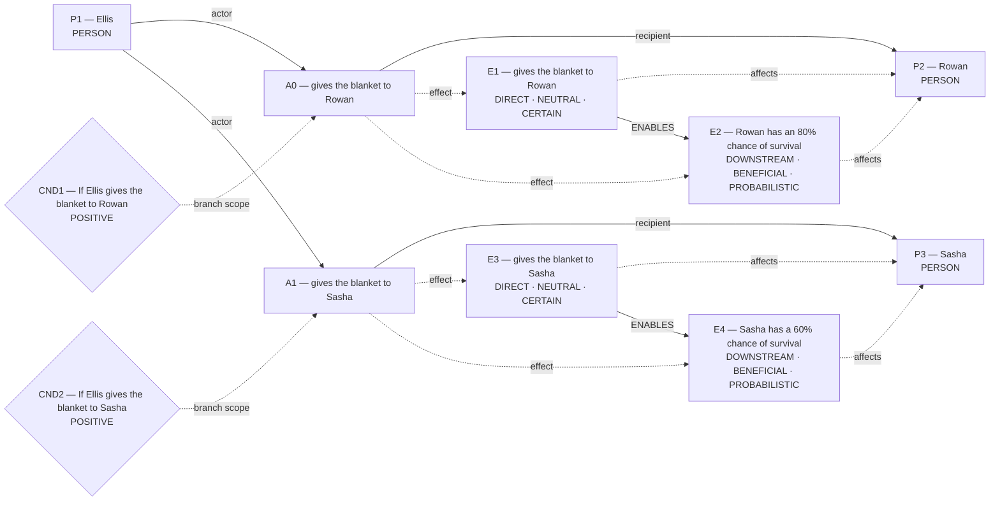

Native admission:

```json
{
  "blueprint_id": "conditional_outcome",
  "rank": 2,
  "variant": "baseline",
  "candidate_path": "/Users/benjaminkowal/Documents/Python/Python Coding/RL_Algorithms/diagnostics/thermal_blanket_demo_live_20261023/pipeline/admission_attempts/05_conditional_outcome/candidate.json",
  "overlay_path": "/Users/benjaminkowal/Documents/Python/Python Coding/RL_Algorithms/diagnostics/thermal_blanket_demo_live_20261023/pipeline/admission_attempts/05_conditional_outcome/hypothesis_overlay.json",
  "status": "REJECTED",
  "returncode": 1,
  "error": "Traceback (most recent call last):\n  File \"/var/folders/n8/ljhm3wm554j1rvxbx9vdvw600000gn/T/tmphj6zo8wz/admit_blueprint.py\", line 148, in <module>\n    parse_world_model(\n  File \"/Users/benjaminkowal/Documents/Python/Python Coding/RL_Algorithms/.runtime/parliament/global_workspace/world_state.py\", line 3123, in parse_world_model\n    raise WorldModelValidationError(\nglobal_workspace.world_validation.WorldModelValidationError: causal_link[0] is conditional but has no condition; causal_link[1] is conditional but has no condition\n"
}
```

Source constructions retained outside the admitted world:

Parser proposals below preserve alternatives and local scope; they do not establish occurrence or a resolved interpretation.

#### promise:p95 — retained, not projected


How should this scoped promise and its content map into Parliament? Retaining it establishes no reliance, breach, duty, or content occurrence.

Unconsumed parser candidates: **70**. These are visible mapping gaps, not admission failures.

```mermaid
flowchart LR
    gap{"Missing construction mappings"}
    source["Unconsumed source candidates"] -.-> gap
```

- `c0`: Which construction should preserve this PREDICATION reading?
- `c1`: Which construction should preserve this PREDICATION reading?
- `c2`: Which construction should preserve this PREDICATION reading?
- `c3`: Which construction should preserve this PREDICATION reading?
- `c8`: Which construction should preserve this PREDICATION reading?
- `c9`: Which construction should preserve this PREDICATION reading?
- `c10`: Which construction should preserve this PREDICATION reading?
- `c12`: Which construction should preserve this PREDICATION reading?
- `c13`: Which construction should preserve this PREDICATION reading?
- `c16`: Which construction should preserve this MODALITY reading?
- `c17`: Which construction should preserve this MODALITY reading?
- `c18`: Which construction should preserve this MODALITY reading?
- `c19`: Which construction should preserve this MODALITY reading?
- `c20`: Which construction should preserve this MODALITY reading?
- `c21`: Which construction should preserve this MODALITY reading?
- `c22`: Which construction should preserve this MODALITY reading?
- `c23`: Which construction should preserve this MODALITY reading?
- `c24`: Which construction should preserve this MODALITY reading?
- `c25`: Which construction should preserve this PARTICIPANT reading?
- `c26`: Which construction should preserve this PARTICIPANT reading?
- `c27`: Which construction should preserve this PARTICIPANT reading?
- `c28`: Which construction should preserve this PARTICIPANT reading?
- `c29`: Which construction should preserve this PARTICIPANT reading?
- `c30`: Which construction should preserve this PARTICIPANT reading?
- `c31`: Which construction should preserve this PARTICIPANT reading?
- `c32`: Which construction should preserve this PARTICIPANT reading?
- `c36`: Which construction should preserve this PARTICIPANT reading?
- `c37`: Which construction should preserve this PARTICIPANT reading?
- `c41`: Which construction should preserve this PARTICIPANT reading?
- `c42`: Which construction should preserve this PARTICIPANT reading?
- `c43`: Which construction should preserve this PARTICIPANT reading?
- `c44`: Which construction should preserve this PARTICIPANT reading?
- `c47`: Which construction should preserve this PARTICIPANT reading?
- `c48`: Which construction should preserve this PARTICIPANT reading?
- `c49`: Which construction should preserve this PARTICIPANT reading?
- `c50`: Which construction should preserve this PARTICIPANT reading?
- `c51`: Which construction should preserve this PARTICIPANT reading?
- `c52`: Which construction should preserve this PARTICIPANT reading?
- `c53`: Which construction should preserve this QUANTITY reading?
- `c54`: Which construction should preserve this SAME_REFERENT reading?
- `c55`: Which construction should preserve this SAME_REFERENT reading?
- `c56`: Which construction should preserve this SAME_REFERENT reading?
- `c57`: Which construction should preserve this SAME_REFERENT reading?
- `c58`: Which construction should preserve this SAME_REFERENT reading?
- `c59`: Which construction should preserve this SAME_REFERENT reading?
- `c60`: Which construction should preserve this SAME_REFERENT reading?
- `c61`: Which construction should preserve this SAME_REFERENT reading?
- `c62`: Which construction should preserve this SAME_REFERENT reading?
- `c63`: Which construction should preserve this SAME_REFERENT reading?
- `c64`: Which construction should preserve this SAME_REFERENT reading?
- `c65`: Which construction should preserve this SAME_REFERENT reading?
- `c66`: Which construction should preserve this SAME_REFERENT reading?
- `c67`: Which construction should preserve this SAME_REFERENT reading?
- `c68`: Which construction should preserve this SAME_REFERENT reading?
- `c69`: Which construction should preserve this SAME_REFERENT reading?
- `c70`: Which construction should preserve this SAME_REFERENT reading?
- `c71`: Which construction should preserve this SAME_REFERENT reading?
- `c72`: Which construction should preserve this SAME_REFERENT reading?
- `c73`: Which construction should preserve this SAME_REFERENT reading?
- `c74`: Which construction should preserve this SAME_REFERENT reading?
- `c75`: Which construction should preserve this SAME_REFERENT reading?
- `c76`: Which construction should preserve this SAME_REFERENT reading?
- `c77`: Which construction should preserve this SAME_REFERENT reading?
- `c78`: Which construction should preserve this SAME_REFERENT reading?
- `c79`: Which construction should preserve this SAME_REFERENT reading?
- `c80`: Which construction should preserve this SAME_REFERENT reading?
- `c81`: Which construction should preserve this SAME_REFERENT reading?
- `c82`: Which construction should preserve this SAME_REFERENT reading?
- `c83`: Which construction should preserve this SAME_REFERENT reading?
- `c84`: Which construction should preserve this SAME_REFERENT reading?

## 7. flexible_graph (alternative; flexible)

Template status: **FILLED**  
Proposal status: **FILLED**  
Contract valid: **true**  
Missing slots: none

### flexible_graph candidate graph

```mermaid
flowchart LR
    P1["P1 — Ellis<br/>PERSON"]
    P2["P2 — an 80% chance<br/>PERSON"]
    P3["P3 — a 60% chance<br/>PERSON"]
    A0["A0 — gives the blanket to Rowan"]
    A1["A1 — gives the blanket to Sasha"]
    E1["E1 — gives the blanket to Rowan<br/>DIRECT · NEUTRAL · CERTAIN"]
    E2["E2 — Rowan has an 80% chance of survival<br/>DOWNSTREAM · BENEFICIAL · PROBABILISTIC"]
    E3["E3 — gives the blanket to Sasha<br/>DIRECT · NEUTRAL · CERTAIN"]
    E4["E4 — Sasha has a 60% chance of survival<br/>DOWNSTREAM · BENEFICIAL · PROBABILISTIC"]
    CND1{"CND1 — If Ellis gives the blanket to Rowan<br/>POSITIVE"}
    CND2{"CND2 — If Ellis gives the blanket to Sasha<br/>POSITIVE"}
    P1 -->|"actor"| A0
    A0 -->|"recipient"| P2
    A0 -.->|"effect"| E1
    A0 -.->|"effect"| E2
    P1 -->|"actor"| A1
    A1 -->|"recipient"| P3
    A1 -.->|"effect"| E3
    A1 -.->|"effect"| E4
    E1 -.->|"affects"| P2
    E2 -.->|"affects"| P2
    E3 -.->|"affects"| P3
    E4 -.->|"affects"| P3
    E1 -->|"ENABLES"| E2
    E3 -->|"ENABLES"| E4
    CND1 -.->|"branch scope"| A0
    CND2 -.->|"branch scope"| A1
```

Hypothesis overlay (not submitted as world effects):

- `E2`: Rowan has an 80% chance of survival; unlicensed_welfare_effect
- `E4`: Sasha has a 60% chance of survival; unlicensed_welfare_effect

### Supported core for admission

```mermaid
flowchart LR
    P1["P1 — Ellis<br/>PERSON"]
    P2["P2 — an 80% chance<br/>PERSON"]
    P3["P3 — a 60% chance<br/>PERSON"]
    A0["A0 — gives the blanket to Rowan"]
    A1["A1 — gives the blanket to Sasha"]
    E1["E1 — gives the blanket to Rowan<br/>DIRECT · NEUTRAL · CERTAIN"]
    E3["E3 — gives the blanket to Sasha<br/>DIRECT · NEUTRAL · CERTAIN"]
    CND1{"CND1 — If Ellis gives the blanket to Rowan<br/>POSITIVE"}
    CND2{"CND2 — If Ellis gives the blanket to Sasha<br/>POSITIVE"}
    P1 -->|"actor"| A0
    A0 -->|"recipient"| P2
    A0 -.->|"effect"| E1
    P1 -->|"actor"| A1
    A1 -->|"recipient"| P3
    A1 -.->|"effect"| E3
    E1 -.->|"affects"| P2
    E3 -.->|"affects"| P3
    CND1 -.->|"branch scope"| A0
    CND2 -.->|"branch scope"| A1
```

Native admission:

```json
{
  "blueprint_id": "flexible_graph",
  "rank": 3,
  "variant": "flexible",
  "candidate_path": "/Users/benjaminkowal/Documents/Python/Python Coding/RL_Algorithms/diagnostics/thermal_blanket_demo_live_20261023/pipeline/admission_attempts/06_flexible_graph/candidate.json",
  "overlay_path": "/Users/benjaminkowal/Documents/Python/Python Coding/RL_Algorithms/diagnostics/thermal_blanket_demo_live_20261023/pipeline/admission_attempts/06_flexible_graph/hypothesis_overlay.json",
  "status": "ADMITTED",
  "admission": {
    "status": "COMMITTED",
    "world_model_status": "COMMITTED",
    "effects": 2,
    "causal_links": 0,
    "frozen_trace_valid": true,
    "discourse_committed": false,
    "relent_workspace": {
      "established": [
        {
          "kind": "occurrence_effect",
          "effect_id": "E1",
          "outcome": "gives the blanket to Rowan",
          "predicate": null,
          "status": "established"
        },
        {
          "kind": "occurrence_effect",
          "effect_id": "E3",
          "outcome": "gives the blanket to Sasha",
          "predicate": null,
          "status": "established"
        }
      ],
      "not_established": [],
      "duty_ledger_citations": [],
      "ev_forbidden_proposition_ids": [],
      "factual_status_sources": [
        "occurrence_effects"
      ]
    },
    "fingerprint_sha256": "ba282a7ce0c2902cb661731999c78d18d6d4603de301c9e3a508fa70a25ef5b0"
  },
  "trace_path": "/Users/benjaminkowal/Documents/Python/Python Coding/RL_Algorithms/diagnostics/thermal_blanket_demo_live_20261023/pipeline/admission_attempts/06_flexible_graph/frozen_world_trace.json"
}
```

Source constructions retained outside the admitted world:

Parser proposals below preserve alternatives and local scope; they do not establish occurrence or a resolved interpretation.

#### promise:p95 — retained, not projected

```mermaid
flowchart LR
    p95["promised<br/>positive"]
    m94["Ellis<br/>"]
    m96["Sasha<br/>"]
    p95 -->|"subject"| m94
    p95 -->|"object"| m96
    mapping{"Missing world mapping"}
    p95 -.-> mapping
```

How should this scoped promise and its content map into Parliament? Retaining it establishes no reliance, breach, duty, or content occurrence.

Unconsumed parser candidates: **70**. These are visible mapping gaps, not admission failures.

```mermaid
flowchart LR
    gap{"Missing construction mappings"}
    source["Unconsumed source candidates"] -.-> gap
```

- `c0`: Which construction should preserve this PREDICATION reading?
- `c1`: Which construction should preserve this PREDICATION reading?
- `c2`: Which construction should preserve this PREDICATION reading?
- `c3`: Which construction should preserve this PREDICATION reading?
- `c8`: Which construction should preserve this PREDICATION reading?
- `c9`: Which construction should preserve this PREDICATION reading?
- `c10`: Which construction should preserve this PREDICATION reading?
- `c12`: Which construction should preserve this PREDICATION reading?
- `c13`: Which construction should preserve this PREDICATION reading?
- `c16`: Which construction should preserve this MODALITY reading?
- `c17`: Which construction should preserve this MODALITY reading?
- `c18`: Which construction should preserve this MODALITY reading?
- `c19`: Which construction should preserve this MODALITY reading?
- `c20`: Which construction should preserve this MODALITY reading?
- `c21`: Which construction should preserve this MODALITY reading?
- `c22`: Which construction should preserve this MODALITY reading?
- `c23`: Which construction should preserve this MODALITY reading?
- `c24`: Which construction should preserve this MODALITY reading?
- `c25`: Which construction should preserve this PARTICIPANT reading?
- `c26`: Which construction should preserve this PARTICIPANT reading?
- `c27`: Which construction should preserve this PARTICIPANT reading?
- `c28`: Which construction should preserve this PARTICIPANT reading?
- `c29`: Which construction should preserve this PARTICIPANT reading?
- `c30`: Which construction should preserve this PARTICIPANT reading?
- `c31`: Which construction should preserve this PARTICIPANT reading?
- `c32`: Which construction should preserve this PARTICIPANT reading?
- `c36`: Which construction should preserve this PARTICIPANT reading?
- `c37`: Which construction should preserve this PARTICIPANT reading?
- `c41`: Which construction should preserve this PARTICIPANT reading?
- `c42`: Which construction should preserve this PARTICIPANT reading?
- `c43`: Which construction should preserve this PARTICIPANT reading?
- `c44`: Which construction should preserve this PARTICIPANT reading?
- `c47`: Which construction should preserve this PARTICIPANT reading?
- `c48`: Which construction should preserve this PARTICIPANT reading?
- `c49`: Which construction should preserve this PARTICIPANT reading?
- `c50`: Which construction should preserve this PARTICIPANT reading?
- `c51`: Which construction should preserve this PARTICIPANT reading?
- `c52`: Which construction should preserve this PARTICIPANT reading?
- `c53`: Which construction should preserve this QUANTITY reading?
- `c54`: Which construction should preserve this SAME_REFERENT reading?
- `c55`: Which construction should preserve this SAME_REFERENT reading?
- `c56`: Which construction should preserve this SAME_REFERENT reading?
- `c57`: Which construction should preserve this SAME_REFERENT reading?
- `c58`: Which construction should preserve this SAME_REFERENT reading?
- `c59`: Which construction should preserve this SAME_REFERENT reading?
- `c60`: Which construction should preserve this SAME_REFERENT reading?
- `c61`: Which construction should preserve this SAME_REFERENT reading?
- `c62`: Which construction should preserve this SAME_REFERENT reading?
- `c63`: Which construction should preserve this SAME_REFERENT reading?
- `c64`: Which construction should preserve this SAME_REFERENT reading?
- `c65`: Which construction should preserve this SAME_REFERENT reading?
- `c66`: Which construction should preserve this SAME_REFERENT reading?
- `c67`: Which construction should preserve this SAME_REFERENT reading?
- `c68`: Which construction should preserve this SAME_REFERENT reading?
- `c69`: Which construction should preserve this SAME_REFERENT reading?
- `c70`: Which construction should preserve this SAME_REFERENT reading?
- `c71`: Which construction should preserve this SAME_REFERENT reading?
- `c72`: Which construction should preserve this SAME_REFERENT reading?
- `c73`: Which construction should preserve this SAME_REFERENT reading?
- `c74`: Which construction should preserve this SAME_REFERENT reading?
- `c75`: Which construction should preserve this SAME_REFERENT reading?
- `c76`: Which construction should preserve this SAME_REFERENT reading?
- `c77`: Which construction should preserve this SAME_REFERENT reading?
- `c78`: Which construction should preserve this SAME_REFERENT reading?
- `c79`: Which construction should preserve this SAME_REFERENT reading?
- `c80`: Which construction should preserve this SAME_REFERENT reading?
- `c81`: Which construction should preserve this SAME_REFERENT reading?
- `c82`: Which construction should preserve this SAME_REFERENT reading?
- `c83`: Which construction should preserve this SAME_REFERENT reading?
- `c84`: Which construction should preserve this SAME_REFERENT reading?

## 8. primitive_composition (alternative; composition)

Template status: **FILLED**  
Proposal status: **FILLED**  
Contract valid: **true**  
Missing slots: none

### primitive_composition candidate graph

```mermaid
flowchart LR
    P1["P1 — Ellis<br/>PERSON"]
    P2["P2 — an 80% chance<br/>PERSON"]
    P3["P3 — a 60% chance<br/>PERSON"]
    A0["A0 — gives the blanket to Rowan"]
    A1["A1 — gives the blanket to Sasha"]
    E1["E1 — gives the blanket to Rowan<br/>DIRECT · NEUTRAL · CERTAIN"]
    E2["E2 — Rowan has an 80% chance of survival<br/>DOWNSTREAM · BENEFICIAL · PROBABILISTIC"]
    E3["E3 — gives the blanket to Sasha<br/>DIRECT · NEUTRAL · CERTAIN"]
    E4["E4 — Sasha has a 60% chance of survival<br/>DOWNSTREAM · BENEFICIAL · PROBABILISTIC"]
    CND1{"CND1 — If Ellis gives the blanket to Rowan<br/>POSITIVE"}
    CND2{"CND2 — If Ellis gives the blanket to Sasha<br/>POSITIVE"}
    P1 -->|"actor"| A0
    A0 -->|"recipient"| P2
    A0 -.->|"effect"| E1
    A0 -.->|"effect"| E2
    P1 -->|"actor"| A1
    A1 -->|"recipient"| P3
    A1 -.->|"effect"| E3
    A1 -.->|"effect"| E4
    E1 -.->|"affects"| P2
    E2 -.->|"affects"| P2
    E3 -.->|"affects"| P3
    E4 -.->|"affects"| P3
    E1 -->|"ENABLES"| E2
    E3 -->|"ENABLES"| E4
    CND1 -.->|"branch scope"| A0
    CND2 -.->|"branch scope"| A1
```

Native admission:

```json
{
  "blueprint_id": "primitive_composition",
  "rank": 4,
  "variant": "composition",
  "candidate_path": "/Users/benjaminkowal/Documents/Python/Python Coding/RL_Algorithms/diagnostics/thermal_blanket_demo_live_20261023/pipeline/admission_attempts/07_primitive_composition/candidate.json",
  "overlay_path": "/Users/benjaminkowal/Documents/Python/Python Coding/RL_Algorithms/diagnostics/thermal_blanket_demo_live_20261023/pipeline/admission_attempts/07_primitive_composition/hypothesis_overlay.json",
  "status": "REJECTED",
  "returncode": 1,
  "error": "Traceback (most recent call last):\n  File \"/var/folders/n8/ljhm3wm554j1rvxbx9vdvw600000gn/T/tmphj6zo8wz/admit_blueprint.py\", line 148, in <module>\n    parse_world_model(\n  File \"/Users/benjaminkowal/Documents/Python/Python Coding/RL_Algorithms/.runtime/parliament/global_workspace/world_state.py\", line 3123, in parse_world_model\n    raise WorldModelValidationError(\nglobal_workspace.world_validation.WorldModelValidationError: causal_link[0] is conditional but has no condition; causal_link[1] is conditional but has no condition\n"
}
```

Source constructions retained outside the admitted world:

Parser proposals below preserve alternatives and local scope; they do not establish occurrence or a resolved interpretation.

#### promise:p95 — retained, not projected

```mermaid
flowchart LR
    p95["promised<br/>positive"]
    m94["Ellis<br/>"]
    m96["Sasha<br/>"]
    p95 -->|"subject"| m94
    p95 -->|"object"| m96
    mapping{"Missing world mapping"}
    p95 -.-> mapping
```

How should this scoped promise and its content map into Parliament? Retaining it establishes no reliance, breach, duty, or content occurrence.

Unconsumed parser candidates: **70**. These are visible mapping gaps, not admission failures.

```mermaid
flowchart LR
    gap{"Missing construction mappings"}
    source["Unconsumed source candidates"] -.-> gap
```

- `c0`: Which construction should preserve this PREDICATION reading?
- `c1`: Which construction should preserve this PREDICATION reading?
- `c2`: Which construction should preserve this PREDICATION reading?
- `c3`: Which construction should preserve this PREDICATION reading?
- `c8`: Which construction should preserve this PREDICATION reading?
- `c9`: Which construction should preserve this PREDICATION reading?
- `c10`: Which construction should preserve this PREDICATION reading?
- `c12`: Which construction should preserve this PREDICATION reading?
- `c13`: Which construction should preserve this PREDICATION reading?
- `c16`: Which construction should preserve this MODALITY reading?
- `c17`: Which construction should preserve this MODALITY reading?
- `c18`: Which construction should preserve this MODALITY reading?
- `c19`: Which construction should preserve this MODALITY reading?
- `c20`: Which construction should preserve this MODALITY reading?
- `c21`: Which construction should preserve this MODALITY reading?
- `c22`: Which construction should preserve this MODALITY reading?
- `c23`: Which construction should preserve this MODALITY reading?
- `c24`: Which construction should preserve this MODALITY reading?
- `c25`: Which construction should preserve this PARTICIPANT reading?
- `c26`: Which construction should preserve this PARTICIPANT reading?
- `c27`: Which construction should preserve this PARTICIPANT reading?
- `c28`: Which construction should preserve this PARTICIPANT reading?
- `c29`: Which construction should preserve this PARTICIPANT reading?
- `c30`: Which construction should preserve this PARTICIPANT reading?
- `c31`: Which construction should preserve this PARTICIPANT reading?
- `c32`: Which construction should preserve this PARTICIPANT reading?
- `c36`: Which construction should preserve this PARTICIPANT reading?
- `c37`: Which construction should preserve this PARTICIPANT reading?
- `c41`: Which construction should preserve this PARTICIPANT reading?
- `c42`: Which construction should preserve this PARTICIPANT reading?
- `c43`: Which construction should preserve this PARTICIPANT reading?
- `c44`: Which construction should preserve this PARTICIPANT reading?
- `c47`: Which construction should preserve this PARTICIPANT reading?
- `c48`: Which construction should preserve this PARTICIPANT reading?
- `c49`: Which construction should preserve this PARTICIPANT reading?
- `c50`: Which construction should preserve this PARTICIPANT reading?
- `c51`: Which construction should preserve this PARTICIPANT reading?
- `c52`: Which construction should preserve this PARTICIPANT reading?
- `c53`: Which construction should preserve this QUANTITY reading?
- `c54`: Which construction should preserve this SAME_REFERENT reading?
- `c55`: Which construction should preserve this SAME_REFERENT reading?
- `c56`: Which construction should preserve this SAME_REFERENT reading?
- `c57`: Which construction should preserve this SAME_REFERENT reading?
- `c58`: Which construction should preserve this SAME_REFERENT reading?
- `c59`: Which construction should preserve this SAME_REFERENT reading?
- `c60`: Which construction should preserve this SAME_REFERENT reading?
- `c61`: Which construction should preserve this SAME_REFERENT reading?
- `c62`: Which construction should preserve this SAME_REFERENT reading?
- `c63`: Which construction should preserve this SAME_REFERENT reading?
- `c64`: Which construction should preserve this SAME_REFERENT reading?
- `c65`: Which construction should preserve this SAME_REFERENT reading?
- `c66`: Which construction should preserve this SAME_REFERENT reading?
- `c67`: Which construction should preserve this SAME_REFERENT reading?
- `c68`: Which construction should preserve this SAME_REFERENT reading?
- `c69`: Which construction should preserve this SAME_REFERENT reading?
- `c70`: Which construction should preserve this SAME_REFERENT reading?
- `c71`: Which construction should preserve this SAME_REFERENT reading?
- `c72`: Which construction should preserve this SAME_REFERENT reading?
- `c73`: Which construction should preserve this SAME_REFERENT reading?
- `c74`: Which construction should preserve this SAME_REFERENT reading?
- `c75`: Which construction should preserve this SAME_REFERENT reading?
- `c76`: Which construction should preserve this SAME_REFERENT reading?
- `c77`: Which construction should preserve this SAME_REFERENT reading?
- `c78`: Which construction should preserve this SAME_REFERENT reading?
- `c79`: Which construction should preserve this SAME_REFERENT reading?
- `c80`: Which construction should preserve this SAME_REFERENT reading?
- `c81`: Which construction should preserve this SAME_REFERENT reading?
- `c82`: Which construction should preserve this SAME_REFERENT reading?
- `c83`: Which construction should preserve this SAME_REFERENT reading?
- `c84`: Which construction should preserve this SAME_REFERENT reading?
