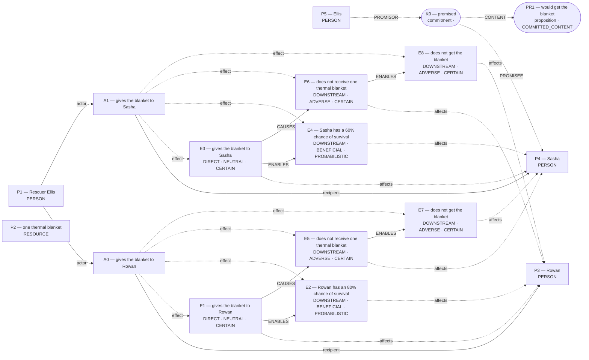
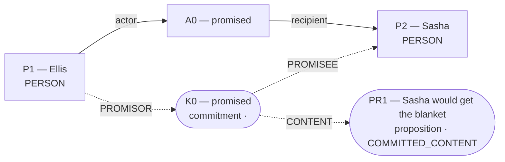

# Parliament demo

Status: **INTERPRETIVE_BEAM** (epistemic_abstention).

Native judgment status: NOT_RUN.

## Scenario

A mountain rescue shelter has one thermal blanket. Rescuer Ellis can give the blanket to Rowan or Sasha, but not both. Both hikers are stranded in the cold, and no other rescue or warming equipment will arrive in time. If Ellis gives the blanket to Rowan, Rowan has an 80% chance of survival. If Ellis gives the blanket to Sasha, Sasha has a 60% chance of survival. The hiker who does not get the blanket will die. Before learning about Rowan, Ellis promised Sasha that Sasha would get the blanket. Whom should Ellis give the blanket to?

## What Parliament thinks is happening

No unique frozen world is reported.

## World-state diagram

No unique world was frozen. The following are competing admitted interpretations; **none was sent to agents**.

### exclusive_allocation — candidate only; not sent to agents

### promise_reliance — candidate only; not sent to agents

## What is grounded

Admitted source copies and structurally derived records follow. Exact excerpts establish traceability; they do not independently prove every interpretation.

## What remains uncertain

No additional framework uncertainty was recorded; this is not proof of completeness.

## Framework views

## Agreement and disagreement

No operative preference recorded.

Framework-local normative arguments and empirical dependencies are shown above; no automatic causal classification is claimed.

## Decision hinges

No explicit reversal hinge was recorded. The report does not fabricate one.

## What Parliament did not decide

- This report does not adjudicate a governing moral verdict.
- Ledger admission does not prove the argument or supply missing welfare units.
- Unresolved objections remain live; reported reversal thresholds are not source facts.

## Topography

Survivor arithmetic does not settle total welfare. Coordinates are native ledger records, not a calibrated moral physics. Attractors are occupancy of recorded points, not interpolated terrain.

No unique frozen world was supplied to agents; no framework coordinates exist.

## Run provenance

Execution: compact_demo; run ID: run_75121107db5b47baae1a65ee36aacdb9.
Application commit: a1a79d242b2ef4ffb8e4a2e7a6256075b0232cdf; source fingerprint: 5ac66b759596e46fed8d9bb7ef23bf1ce5bb97b842b13a7bf4579a47f7b9d877.
Original generation: run_829bd784673f4a89947429f152463e14.
The finalized run_manifest.json records configuration, runtime checks, source snapshot, and output hashes.

## Pipeline stop and inspection

Competing admitted worlds are not separated or invariant.

Missing slots: rescue_contrast: first_saved, rescue_contrast: second_saved, rescue_contrast: first_rescue_action, rescue_contrast: second_rescue_action, rescue_contrast: first_benefit, rescue_contrast: second_benefit

Competing admitted interpretations: exclusive_allocation: gives the blanket to Rowan, gives the blanket to Sasha; promise_reliance: promised

Inspection artifacts (saved replay references its original records):

- [run_manifest.json](/Users/benjaminkowal/Documents/Python/Python Coding/RL_Algorithms/diagnostics/thermal_blanket_demo_o3_fixed_live_20261023/pipeline/run_manifest.json)
- [runtime_check.json](/Users/benjaminkowal/Documents/Python/Python Coding/RL_Algorithms/diagnostics/thermal_blanket_demo_o3_fixed_live_20261023/pipeline/runtime_check.json)
- [candidate_graphs.md](/Users/benjaminkowal/Documents/Python/Python Coding/RL_Algorithms/diagnostics/thermal_blanket_demo_o3_fixed_live_20261023/pipeline/candidate_graphs.md)
- [candidate_attempts.json](/Users/benjaminkowal/Documents/Python/Python Coding/RL_Algorithms/diagnostics/thermal_blanket_demo_o3_fixed_live_20261023/pipeline/candidate_attempts.json)
- [question_assessment.json](/Users/benjaminkowal/Documents/Python/Python Coding/RL_Algorithms/diagnostics/thermal_blanket_demo_o3_fixed_live_20261023/pipeline/question_assessment.json)
- [world_beam.json](/Users/benjaminkowal/Documents/Python/Python Coding/RL_Algorithms/diagnostics/thermal_blanket_demo_o3_fixed_live_20261023/pipeline/world_beam.json)
- [preparation_manifest.json](/Users/benjaminkowal/Documents/Python/Python Coding/RL_Algorithms/diagnostics/thermal_blanket_demo_o3_fixed_live_20261023/pipeline/preparation_manifest.json)
- [runtime_check.json](/Users/benjaminkowal/Documents/Python/Python Coding/RL_Algorithms/diagnostics/thermal_blanket_demo_o3_fixed_live_20261023/runtime_check.json)
