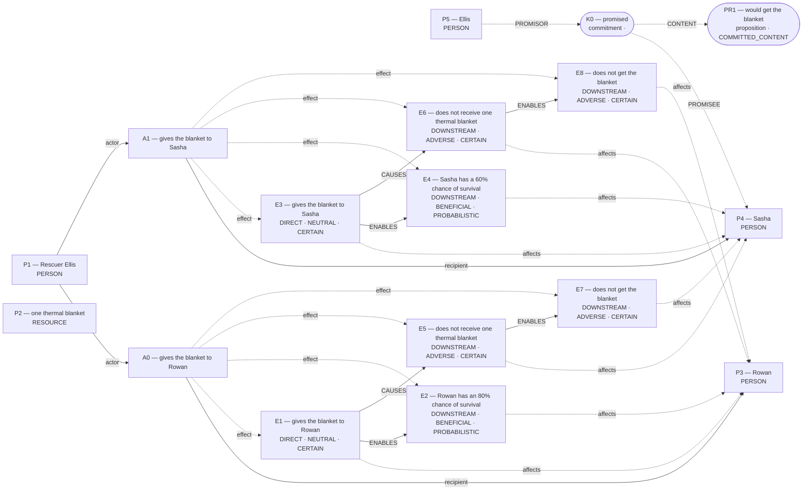

# Parliament demo

Status: **FRAMEWORK_PARTIAL** (recorded_pipeline_outcome).

Native judgment status: NOT_ADJUDICATED.

## Scenario

A mountain rescue shelter has one thermal blanket. Rescuer Ellis can give the blanket to Rowan or Sasha, but not both. Both hikers are stranded in the cold, and no other rescue or warming equipment will arrive in time. If Ellis gives the blanket to Rowan, Rowan has an 80% chance of survival. If Ellis gives the blanket to Sasha, Sasha has a 60% chance of survival. The hiker who does not get the blanket will die. Before learning about Rowan, Ellis promised Sasha that Sasha would get the blanket. Whom should Ellis give the blanket to?

## What Parliament thinks is happening

Actions: gives the blanket to Rowan; gives the blanket to Sasha

Parties: Rescuer Ellis, one thermal blanket, Rowan, Sasha, Ellis

These are alternative action branches and their stipulated outcomes, not claims that both actions occurred.

- Under A0, Rowan: gives the blanket to Rowan (CERTAIN)
- Under A0, Rowan: Rowan has an 80% chance of survival (PROBABILISTIC)
- Under A1, Sasha: gives the blanket to Sasha (CERTAIN)
- Under A1, Sasha: Sasha has a 60% chance of survival (PROBABILISTIC)
- Under A0, Sasha: does not receive one thermal blanket (CERTAIN)
- Under A1, Rowan: does not receive one thermal blanket (CERTAIN)
- Under A0, Sasha: does not get the blanket (CERTAIN)
- Under A1, Rowan: does not get the blanket (CERTAIN)
- gives the blanket to Rowan → ENABLES → Rowan has an 80% chance of survival
- gives the blanket to Sasha → ENABLES → Sasha has a 60% chance of survival
- does not receive one thermal blanket → ENABLES → does not get the blanket
- does not receive one thermal blanket → ENABLES → does not get the blanket
- gives the blanket to Rowan → CAUSES → does not receive one thermal blanket
- gives the blanket to Sasha → CAUSES → does not receive one thermal blanket

## World-state diagram

### Frozen world supplied to framework assessment

## What is grounded

Admitted source copies and structurally derived records follow. Exact excerpts establish traceability; they do not independently prove every interpretation.

- gives the blanket to Rowan — DIRECT_COPY; source: “If Ellis gives the blanket to Rowan, Rowan has an 80% chance of survival.”
- Rowan has an 80% chance of survival — SOURCE_STIPULATED_CAUSAL; source: “If Ellis gives the blanket to Rowan, Rowan has an 80% chance of survival.”
- gives the blanket to Sasha — DIRECT_COPY; source: “If Ellis gives the blanket to Sasha, Sasha has a 60% chance of survival.”
- Sasha has a 60% chance of survival — SOURCE_STIPULATED_CAUSAL; source: “If Ellis gives the blanket to Sasha, Sasha has a 60% chance of survival.”
- does not receive one thermal blanket — EXCLUSIVE_ALLOCATION_COMPLEMENT; source: “A mountain rescue shelter has one thermal blanket.; Rescuer Ellis can give the blanket to Rowan or Sasha, but not both.; If Ellis gives the blanket to Rowan, Rowan has an 80% chance of survival.”
- does not receive one thermal blanket — EXCLUSIVE_ALLOCATION_COMPLEMENT; source: “A mountain rescue shelter has one thermal blanket.; Rescuer Ellis can give the blanket to Rowan or Sasha, but not both.; If Ellis gives the blanket to Sasha, Sasha has a 60% chance of survival.”
- does not get the blanket — SOURCE_STIPULATED_CAUSAL; source: “The hiker who does not get the blanket will die.”
- does not get the blanket — SOURCE_STIPULATED_CAUSAL; source: “The hiker who does not get the blanket will die.”
- Stipulated source claim: Rowan has an 80% chance of survival; affected subject: Rowan; modality: PROBABILISTIC
- Stipulated source claim: 80% chance — Rowan has an 80% chance of survival
- Stipulated source claim: Sasha has a 60% chance of survival; affected subject: Sasha; modality: PROBABILISTIC
- Stipulated source claim: 60% chance — Sasha has a 60% chance of survival
- Stipulated source claim: Rescuer Ellis can give the blanket to Rowan or Sasha, but not both.
- Stipulated source claim: A mountain rescue shelter has one thermal blanket.
- Stipulated source claim: If Ellis gives the blanket to Rowan, Rowan has an 80% chance of survival.
- Stipulated source claim: If Ellis gives the blanket to Sasha, Sasha has a 60% chance of survival.
- Stipulated source claim: The hiker who does not get the blanket will die.

## What remains uncertain

- A0: numeric EV cannot be recomputed from its cited effects
- A1: numeric EV cannot be recomputed from its cited effects
- The utilitarian ledger contains unknown welfare magnitude or duration; survivor arithmetic does not settle total welfare.
- unresolved judgment claims its tiebreaker fully succeeded
- A0 ADJUDICATION_CALIBRATION: omission was classified as a perfect negative-duty violation without a separate basis
- A0 ADJUDICATION_CALIBRATION: candidate maxim person-role conflicts with means classification
- A0 ADJUDICATION_CALIBRATION: resolved adjudication rests on unsupported decisive premises
- whether the omission violates a separate right-correlative prohibition
- whether the candidate maxim's means, person-role, and action assessment justify the claimed priority
- ellis's duty 'keep promises' protecting sasha ↔ ellis's competing duty 'duty of beneficence' protecting rowan
- A0 prohibited by keep promises ↔ whether the omission violates a separate right-correlative prohibition
- A0 prohibited by keep promises ↔ whether the candidate maxim's means, person-role, and action assessment justify the claimed priority
- unresolved Care ranking must remain provisional
- framework map for gives the blanket to Rowan lacks framework-specific grounds
- decisive numbers are not tied to the affected subject or Rawlsian position
- A0 IMPROVES lacked directional support; committed as UNCERTAIN
- A1 WORSENS lacked directional support; committed as UNCERTAIN
- Optional deeper review is available for a decision-relevant question in the revised argument.

## Optional deeper review

Follow-ups examine revised arguments. Extra calls require opt-in; a model answer is not an independently verified moral resolution.

Interactive demo runs ask before proceeding. Use `--review-depth deep` to opt in in advance, or `logic_puzzles_followup.py --trace <saved-review> --output-dir <new-folder> --execute` to continue a saved review.

A decision-relevant question remains in the revised argument. Review it more deeply? Up to two additional model calls; the conclusion may remain unresolved.

Your revised argument retains these decision-relevant premise questions: omission was classified as a perfect negative-duty violation without a separate basis; candidate maxim person-role conflicts with means classification; resolved adjudication rests on unsupported decisive premises. Address the specific missing inference, revise the affected classification or preserve uncertainty. Do not invent a causal path, intention, consent, or normative priority to remove the objection.

## Framework views

### utilitarian

Position: **ABSTAIN**. Recorded preference: withheld (not necessarily operative).

Framework did not select a live action. UNRESOLVED FRAMEWORK CONFLICT: live competing derivations. No comparative leaning is yet grounded. Interim working action recorded without becoming a ranking: gives the blanket to Rowan. higher expected survival. Unresolved contestation: prefer the action producing the larger expected number of survivors. Recorded comparison — “gives the blanket to Rowan”: Giving Rowan the blanket yields the highest expected number of lives (0.8 vs 0.6) and therefore maximises aggregate welfare.; “gives the blanket to Sasha”: Giving Sasha the blanket honours Ellis’s promise, but it saves fewer expected lives (0.6) and thus sacrifices overall welfare. Unadmitted magnitude cannot decide the ranking; the claim remains a reversal boundary.

[Full recorded explanation (Markdown)](arguments/utilitarian.md).

Assumptions / interpretive commitments: Recorded interpretive commitment: prefer the action producing the larger expected number of survivors; Run assumption: The stated scenario facts are accepted as givens for this analysis; their accuracy outside this scenario has not been verified.

The scenario’s stated facts are treated as givens for this run. No separate record says whether they were observed, reported by someone, or supplied as simulation facts. This is a provenance limitation, not a claim that the stated counts are missing.

Dependencies: 80% chance — Rowan has an 80% chance of survival; 60% chance — Sasha has a 60% chance of survival; If Ellis gives the blanket to Rowan, Rowan has an 80% chance of survival.; If Ellis gives the blanket to Sasha, Sasha has a 60% chance of survival.

Live objection: A0: numeric EV cannot be recomputed from its cited effects; A1: numeric EV cannot be recomputed from its cited effects

Abstention boundary (no ranking to reverse): promise keeping given decisive priority; Rowan’s survival probability drops below Sasha’s (e.g. <60 %).

### deontological

Position: **ATTENUATED**. Recorded preference: gives the blanket to Sasha (not necessarily operative).

The agent assesses Ellis’s duty “keep promises” toward sasha. Ellis is the duty-bearer; sasha is the protected party. The competing obligation being assessed is Ellis’s “duty of beneficence” toward rowan. For “gives the blanket to Rowan”, the agent proposes the maxim “give blanket to Rowan despite promise”. This is an interpretation of possible practical reasoning, not an established intention. Its purpose is maximize saved lives; its chosen means are breaking the promise. The proposed justification is: if universal, promises unreliable. The agent assesses the maxim as indefensible, and the action as impermissible. Its proposed means–ends reasoning is: beneficent purpose thought to outweigh fidelity. Physical means references: E1; end references: E2. For Ellis’s option “gives the blanket to Rowan”, the ledger records conflicted. The agent’s stated reason is: breaks promise so impermissible. For “gives the blanket to Sasha”, the agent proposes the maxim “give blanket to Sasha as promised”. This is an interpretation of possible practical reasoning, not an established intention. Its purpose is honor promise; its chosen means are hand over blanket. The proposed justification is: promise-keeping sustainable. The agent assesses the maxim as defensible, and the action as permissible. Its proposed means–ends reasoning is: fidelity duty independent of consequences. Physical means references: E3; end references: none. For Ellis’s option “gives the blanket to Sasha”, the ledger records required. The agent’s stated reason is: honors promise so required. The ledger retains unresolved issues; this does not establish that one duty overrides the other.

[Full recorded explanation (Markdown)](arguments/deontological.md).

Assumptions / interpretive commitments: Recorded interpretive commitment: Provisionally: Treat the duty priority as unestablished until whether the omission violates a separate right-correlative prohibition; and whether the candidate maxim's means, person-role, and action assessment justify the claimed priority; Recorded interpretive commitment: probabilities matter only to imperfect beneficence; Run assumption: The stated scenario facts are accepted as givens for this analysis; their accuracy outside this scenario has not been verified.

The scenario’s stated facts are treated as givens for this run. No separate record says whether they were observed, reported by someone, or supplied as simulation facts. This is a provenance limitation, not a claim that the stated counts are missing.

Dependencies: Not separately recorded.

Live objection: unresolved judgment claims its tiebreaker fully succeeded; A0 ADJUDICATION_CALIBRATION: omission was classified as a perfect negative-duty violation without a separate basis; A0 ADJUDICATION_CALIBRATION: candidate maxim person-role conflicts with means classification; A0 ADJUDICATION_CALIBRATION: resolved adjudication rests on unsupported decisive premises; whether the omission violates a separate right-correlative prohibition; whether the candidate maxim's means, person-role, and action assessment justify the claimed priority; ellis's duty 'keep promises' protecting sasha ↔ ellis's competing duty 'duty of beneficence' protecting rowan; A0 prohibited by keep promises ↔ whether the omission violates a separate right-correlative prohibition; A0 prohibited by keep promises ↔ whether the candidate maxim's means, person-role, and action assessment justify the claimed priority

Would reverse the recorded preference: The agent reports a switch from “gives the blanket to Sasha” to “gives the blanket to Rowan”. Condition: if beneficence were perfect duty. This is an agent-reported condition, not an independently established threshold.; The agent reports a switch from “gives the blanket to Sasha” to “gives the blanket to Rowan”. Condition: if promise absent or annulled. This is an agent-reported condition, not an independently established threshold.

### care

Position: **ABSTAIN**. Recorded preference: gives the blanket to Rowan (not necessarily operative).

Expected CARE_RELATIONSHIP_LEDGER, but no matching committed ledger is operative. competence outweighs promise. prefer “gives the blanket to Rowan” when it preserves more life under equal immediacy and dependency. Recorded comparison — “gives the blanket to Rowan”: Giving the blanket to Rowan directly meets an equally urgent basic need with the higher chance of successful care, showing competent and attentive responsiveness while still acknowledging Sasha’s loss.; “gives the blanket to Sasha”: Giving the blanket to Sasha honors Ellis’s prior promise and preserves that specific trust relationship, but delivers a less competent response to the shared life-threatening dependency.

[Full recorded explanation (Markdown)](arguments/care.md).

Assumptions / interpretive commitments: Recorded interpretive commitment: prefer “gives the blanket to Rowan” when it preserves more life under equal immediacy and dependency; Recorded interpretive commitment: probabilities inform competence and responsiveness but are not the only care factor; Run assumption: The stated scenario facts are accepted as givens for this analysis; their accuracy outside this scenario has not been verified.

The scenario’s stated facts are treated as givens for this run. No separate record says whether they were observed, reported by someone, or supplied as simulation facts. This is a provenance limitation, not a claim that the stated counts are missing.

Dependencies: Not separately recorded.

Live objection: unresolved Care ranking must remain provisional

Would reverse the recorded preference: The agent reports a switch from “gives the blanket to Rowan” to “gives the blanket to Sasha”. Condition: promise-keeping is judged overriding even when less effective. This is an agent-reported condition, not an independently established threshold.; The agent reports a switch from “gives the blanket to Rowan” to “gives the blanket to Sasha”. Condition: Sasha’s survival probability surpasses Rowan’s. This is an agent-reported condition, not an independently established threshold.

### virtue

Position: **FULL**. Recorded preference: gives the blanket to Rowan (not necessarily operative).

Phronesis favors Rowan. Prefer “gives the blanket to Rowan” when saving a life is markedly more probable than promise fidelity benefit. Recorded comparison — “gives the blanket to Rowan”: Ellis saves more likely life, showing phronesis, courage, and beneficence though breaking promise.; “gives the blanket to Sasha”: Ellis keeps promise, showing honesty and loyalty, yet risks imprudent waste of scarce aid and greater loss of life.

[Full recorded explanation (Markdown)](arguments/virtue.md).

Assumptions / interpretive commitments: Recorded interpretive commitment: Prefer “gives the blanket to Rowan” when saving a life is markedly more probable than promise fidelity benefit.; Recorded interpretive commitment: Probabilities guide prudent choice but numbers serve character aims, not pure maximization.; Run assumption: The stated scenario facts are accepted as givens for this analysis; their accuracy outside this scenario has not been verified.

The scenario’s stated facts are treated as givens for this run. No separate record says whether they were observed, reported by someone, or supplied as simulation facts. This is a provenance limitation, not a claim that the stated counts are missing.

Dependencies: Not separately recorded.

Live objection: None separately recorded.

Would reverse the recorded preference: The agent reports a switch from “gives the blanket to Rowan” to “gives the blanket to Sasha”. Condition: Promise-keeping deemed overriding duty. This is an agent-reported condition, not an independently established threshold.; The agent reports a switch from “gives the blanket to Rowan” to “gives the blanket to Sasha”. Condition: Sasha survival probability rises to ≈80%. This is an agent-reported condition, not an independently established threshold.

### rawlsian

Position: **ABSTAIN**. Recorded preference: gives the blanket to Rowan (not necessarily operative).

Decisive aggregation is not licensed by the committed Rawlsian ranking basis. higher survival chance. prefer the action that offers the higher survival probability to whichever hiker one might be. Recorded comparison — “gives the blanket to Rowan”: IMPROVES: Giving Rowan the blanket yields an 80 % survival chance, maximizing the worst-case prospect one would accept behind the veil.; “gives the blanket to Sasha”: WORSENS: Giving Sasha the blanket leaves only a 60 % survival chance for the possible self and thus a lower maximin position, though it honours a prior promise.

[Full recorded explanation (Markdown)](arguments/rawlsian.md).

Assumptions / interpretive commitments: Recorded interpretive commitment: prefer the action that offers the higher survival probability to whichever hiker one might be; Recorded interpretive commitment: Explicit probabilities: 80 % vs 60 % survival for the person receiving the blanket; Run assumption: The stated scenario facts are accepted as givens for this analysis; their accuracy outside this scenario has not been verified.

The scenario’s stated facts are treated as givens for this run. No separate record says whether they were observed, reported by someone, or supplied as simulation facts. This is a provenance limitation, not a claim that the stated counts are missing.

Dependencies: Not separately recorded.

Live objection: framework map for gives the blanket to Rowan lacks framework-specific grounds; decisive numbers are not tied to the affected subject or Rawlsian position; A0 IMPROVES lacked directional support; committed as UNCERTAIN; A1 WORSENS lacked directional support; committed as UNCERTAIN

Would reverse the recorded preference: The agent reports a switch from “gives the blanket to Rowan” to “gives the blanket to Sasha”. Condition: Promise-keeping outweighs maximin survival. This is an agent-reported condition, not an independently established threshold.; The agent reports a switch from “gives the blanket to Rowan” to “gives the blanket to Sasha”. Condition: Rowan’s survival chance drops below Sasha’s. This is an agent-reported condition, not an independently established threshold.

## Agreement and disagreement

Recorded preferences differ.

Framework-local normative arguments and empirical dependencies are shown above; no automatic causal classification is claimed.

- deontological: normative dependency — if beneficence were perfect duty
- care: normative dependency — promise-keeping is judged overriding even when less effective

## Decision hinges

- utilitarian: promise keeping given decisive priority (abstention boundary, no ranking to reverse; `cycles/1/candidates/0/normative_reversal_threshold`).
- deontological: if beneficence were perfect duty (would reverse a recorded preference; `cycles/1/candidates/1/normative_reversal_threshold`).
- care: promise-keeping is judged overriding even when less effective (would reverse a recorded preference; `cycles/1/candidates/2/normative_reversal_threshold`).

## What Parliament did not decide

- This report does not adjudicate a governing moral verdict.
- Ledger admission does not prove the argument or supply missing welfare units.
- Unresolved objections remain live; reported reversal thresholds are not source facts.

## Topography

Survivor arithmetic does not settle total welfare. Coordinates are native ledger records, not a calibrated moral physics. Attractors are occupancy of recorded points, not interpolated terrain.

Recorded action loci only. Missing axes are omitted; UNKNOWN is not plotted as zero.

- A0 gives the blanket to Rowan — care: omitted; welfare: omitted; obligation: CONFLICTED
- A1 gives the blanket to Sasha — care: omitted; welfare: omitted; obligation: REQUIRED

Degenerate: none
Attractors: none

## Run provenance

Execution: saved_replay; run ID: run_628b9dc14b6c4252b7c5fb1564019436.
Application commit: a1a79d242b2ef4ffb8e4a2e7a6256075b0232cdf; source fingerprint: d512980c6749847e5bd9e625999cc999470a05ef1f82b9f26842ef1d9a762e36.
Original generation: run_829bd784673f4a89947429f152463e14.
The finalized run_manifest.json records configuration, runtime checks, source snapshot, and output hashes.

## Pipeline stop and inspection

FRAMEWORK_PARTIAL

Missing slots: none recorded

Competing admitted interpretations: none recorded

Inspection artifacts (saved replay references its original records):

- [preparation_manifest.json](/Users/benjaminkowal/Documents/Python/Python Coding/RL_Algorithms/diagnostics/thermal_blanket_end_to_end_20261023/report_input/preparation_manifest.json)
- [frozen_world_trace.json](/Users/benjaminkowal/Documents/Python/Python Coding/RL_Algorithms/diagnostics/thermal_blanket_end_to_end_20261023/report_input/frozen_world_trace.json)
- [framework_generation.json](/Users/benjaminkowal/Documents/Python/Python Coding/RL_Algorithms/diagnostics/thermal_blanket_end_to_end_20261023/report_input/framework_generation.json)
- [targeted_review.json](/Users/benjaminkowal/Documents/Python/Python Coding/RL_Algorithms/diagnostics/thermal_blanket_end_to_end_20261023/report_input/targeted_review.json)
- [run_manifest.json](/Users/benjaminkowal/Documents/Python/Python Coding/RL_Algorithms/diagnostics/thermal_blanket_end_to_end_20261023/frameworks/run_manifest.json)
- [framework_generation.json](/Users/benjaminkowal/Documents/Python/Python Coding/RL_Algorithms/diagnostics/thermal_blanket_end_to_end_20261023/frameworks/framework_generation.json)
- [conflict_graph.md](/Users/benjaminkowal/Documents/Python/Python Coding/RL_Algorithms/diagnostics/thermal_blanket_end_to_end_20261023/frameworks/conflict_graph.md)
