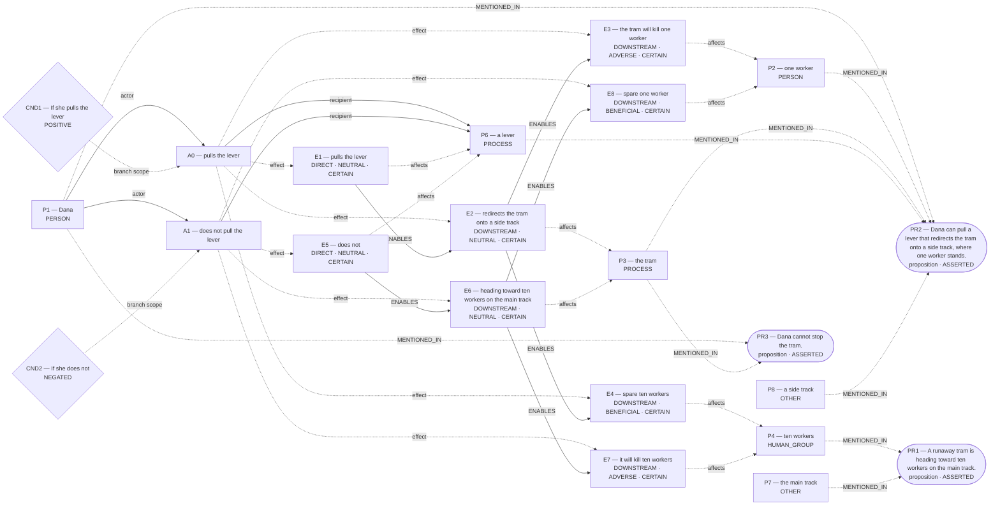

# Parliament demo

Status: **FRAMEWORK_PARTIAL** (recorded_pipeline_outcome).

Native judgment status: NOT_ADJUDICATED.

## Scenario

A runaway tram is heading toward ten workers on the main track. Dana can pull a lever that redirects the tram onto a side track, where one worker stands. If she pulls the lever, the tram will kill that worker and spare the ten. If she does not, it will kill the ten and spare the one. Dana cannot stop the tram. Should she pull the lever?

## What Parliament thinks is happening

Actions: pulls the lever; does not pull the lever

Parties: Dana, one worker, the tram, ten workers, a lever, the main track, a side track

These are alternative action branches and their stipulated outcomes, not claims that both actions occurred.

- Under A0, a lever: pulls the lever (CERTAIN)
- Under A0, the tram: redirects the tram onto a side track (CERTAIN)
- Under A0, one worker: the tram will kill one worker (CERTAIN)
- Under A0, ten workers: spare ten workers (CERTAIN)
- Under A1, a lever: does not (CERTAIN)
- Under A1, the tram: heading toward ten workers on the main track (CERTAIN)
- Under A1, ten workers: it will kill ten workers (CERTAIN)
- Under A1, one worker: spare one worker (CERTAIN)
- pulls the lever → ENABLES → redirects the tram onto a side track
- redirects the tram onto a side track → ENABLES → the tram will kill one worker
- redirects the tram onto a side track → ENABLES → spare ten workers
- does not → ENABLES → heading toward ten workers on the main track
- heading toward ten workers on the main track → ENABLES → it will kill ten workers
- heading toward ten workers on the main track → ENABLES → spare one worker

Source scene and constraints:

- A runaway tram is heading toward ten workers on the main track.
- Dana can pull a lever that redirects the tram onto a side track, where one worker stands.
- Dana cannot stop the tram.

## World-state diagram

### Frozen world supplied to framework assessment

## What is grounded

Admitted source copies and structurally derived records follow. Exact excerpts establish traceability; they do not independently prove every interpretation.

- pulls the lever — DIRECT_COPY; source: “If she pulls the lever, the tram will kill that worker and spare the ten.”
- redirects the tram onto a side track — SOURCE_STIPULATED_CAUSAL; source: “Dana can pull a lever that redirects the tram onto a side track, where one worker stands.”
- the tram will kill one worker — SOURCE_STIPULATED_CAUSAL; source: “If she pulls the lever, the tram will kill that worker and spare the ten.; Dana can pull a lever that redirects the tram onto a side track, where one worker stands.; If she does not, it will kill the ten and spare the one.”
- spare ten workers — SOURCE_STIPULATED_CAUSAL; source: “If she pulls the lever, the tram will kill that worker and spare the ten.; If she does not, it will kill the ten and spare the one.; A runaway tram is heading toward ten workers on the main track.”
- does not — DIRECT_COPY; source: “If she does not, it will kill the ten and spare the one.”
- heading toward ten workers on the main track — SOURCE_STIPULATED_CAUSAL; source: “If she does not, it will kill the ten and spare the one.; A runaway tram is heading toward ten workers on the main track.”
- it will kill ten workers — SOURCE_STIPULATED_CAUSAL; source: “If she does not, it will kill the ten and spare the one.; If she pulls the lever, the tram will kill that worker and spare the ten.; A runaway tram is heading toward ten workers on the main track.”
- spare one worker — SOURCE_STIPULATED_CAUSAL; source: “If she does not, it will kill the ten and spare the one.; If she pulls the lever, the tram will kill that worker and spare the ten.; Dana can pull a lever that redirects the tram onto a side track, where one worker stands.”
- Stipulated source claim: Dana cannot stop the tram.
- Stipulated source claim: If she pulls the lever, the tram will kill that worker and spare the ten.
- Stipulated source claim: If she does not, it will kill the ten and spare the one.
- Stipulated source claim: Dana can pull a lever that redirects the tram onto a side track, where one worker stands.
- Stipulated source claim: A runaway tram is heading toward ten workers on the main track.

## What remains uncertain

- case for A1 tracks the opposing action but not its own action
- numeric reversal threshold lacks a scenario-grounded quantity
- The utilitarian ledger contains unknown welfare magnitude or duration; survivor arithmetic does not settle total welfare.
- A0 ADJUDICATION_CALIBRATION: doing-harm classification lacks an agent-caused settled welfare harm on the protected party
- A0 ADJUDICATION_CALIBRATION: resolved adjudication rests on unsupported decisive premises
- whether the harm-relation follows the admitted graph's causal topology rather than a relabel chosen to fit the verdict
- dana's duty 'refrain from killing' protecting side-track worker ↔ dana's competing duty 'duty to rescue those in peril' protecting ten workers
- A0 prohibited by do not kill an innocent person ↔ whether the harm-relation follows the admitted graph's causal topology rather than a relabel chosen to fit the verdict
- A0 competing Care claim remains contested
- A1 competing Care claim remains contested
- Would verifying this unestablished consequence reverse the admitted ranking: ten workers are entrusted to the decision maker?
- decisive numbers are not tied to the affected subject or Rawlsian position

## Framework views

### utilitarian

Position: **ATTENUATED**. Recorded preference: pulls the lever (not necessarily operative).

Pulling minimizes deaths. Prefer “pulls the lever” when it results in fewer deaths than “does not pull the lever”. Recorded comparison — “pulls the lever”: Pulling diverts the tram, killing one but saving ten; net harm is lowest so total welfare highest.; “does not pull the lever”: Not pulling lets the tram continue, killing ten and sparing one; avoids direct intervention but causes far greater harm.

[Full recorded explanation (Markdown)](arguments/utilitarian.md).

Assumptions / interpretive commitments: Recorded interpretive commitment: Prefer “pulls the lever” when it results in fewer deaths than “does not pull the lever”.; Run assumption: The stated scenario facts are accepted as givens for this analysis; their accuracy outside this scenario has not been verified.

The counts (one worker; ten workers) are stipulated by the scenario for this run. No separate record says whether they were observed, reported by someone, or supplied as simulation facts. This is a provenance limitation, not a claim that the stated counts are missing.

Dependencies: Not separately recorded.

Live objection: case for A1 tracks the opposing action but not its own action; numeric reversal threshold lacks a scenario-grounded quantity

Would reverse the recorded preference: The agent reports a switch from “pulls the lever” to “does not pull the lever”. Condition: Absolute duty never to kill even to save more lives. This is an agent-reported condition, not an independently established threshold.; The agent reports a switch from “pulls the lever” to “does not pull the lever”. Condition: Main-track workers drop below side-track workers (e.g., 0 vs 1). This is an agent-reported condition, not an independently established threshold.

### deontological

Position: **ABSTAIN**. Recorded preference: does not pull the lever (not necessarily operative).

The agent assesses Dana’s duty “do not kill an innocent person” toward side-track worker. Dana is the duty-bearer; side-track worker is the protected party. The competing obligation being assessed is Dana’s “duty to rescue those in peril” toward ten workers. For Dana’s option “pulls the lever”, the ledger records conflicted. The agent’s stated reason is: Killing uses the worker as a mere means. The agent assesses Dana’s duty “refrain from killing” toward side-track worker. Dana is the duty-bearer; side-track worker is the protected party. The competing obligation being assessed is Dana’s “duty to rescue those in peril” toward ten workers. For Dana’s option “does not pull the lever”, the ledger records permissible. The agent’s stated reason is: Omission keeps hands free from wrongful killing. The ledger retains unresolved issues; this does not establish that one duty overrides the other.

[Full recorded explanation (Markdown)](arguments/deontological.md).

Assumptions / interpretive commitments: Recorded interpretive commitment: Prefer “does not pull the lever” whenever “pulls the lever” would violate a perfect negative duty while “does not pull the lever” merely omits an imperfect positive duty; Recorded interpretive commitment: Numbers affect scope of rescue duty but cannot override perfect duty; Run assumption: The stated scenario facts are accepted as givens for this analysis; their accuracy outside this scenario has not been verified.

The counts (one worker; ten workers) are stipulated by the scenario for this run. No separate record says whether they were observed, reported by someone, or supplied as simulation facts. This is a provenance limitation, not a claim that the stated counts are missing.

Dependencies: the tram will kill one worker; affected subject: one worker; it will kill ten workers; affected subject: ten workers

Live objection: case for A1 tracks the opposing action but not its own action; A0 ADJUDICATION_CALIBRATION: doing-harm classification lacks an agent-caused settled welfare harm on the protected party; A0 ADJUDICATION_CALIBRATION: resolved adjudication rests on unsupported decisive premises; whether the harm-relation follows the admitted graph's causal topology rather than a relabel chosen to fit the verdict; dana's duty 'refrain from killing' protecting side-track worker ↔ dana's competing duty 'duty to rescue those in peril' protecting ten workers; A0 prohibited by do not kill an innocent person ↔ whether the harm-relation follows the admitted graph's causal topology rather than a relabel chosen to fit the verdict

Would reverse the recorded preference: The agent reports a switch from “does not pull the lever” to “pulls the lever”. Condition: If perfect negative duties were deemed overridable by a more beneficial rescue duty. This is an agent-reported condition, not an independently established threshold.; The agent reports a switch from “does not pull the lever” to “pulls the lever”. Condition: If the side-track worker were already certain to die regardless of Dana’s choice. This is an agent-reported condition, not an independently established threshold.

### care

Position: **ATTENUATED**. Recorded preference: pulls the lever (not necessarily operative).

Lever saves more dependents. Prefer the action that responds competently and attentively to the greater group’s imminent fatal harm when relational standing is otherwise similar. Recorded comparison — “pulls the lever”: Pulling the lever directly meets an urgent life-and-death dependency of ten workers who are already in the runaway tram’s path, showing attentiveness and responsiveness despite the tragic harm to one.; “does not pull the lever”: Not pulling the lever avoids direct physical interference but leaves ten workers’ immediate dependency unanswered, treating their basic need neglectfully while only indirectly preserving one life.

[Full recorded explanation (Markdown)](arguments/care.md).

Assumptions / interpretive commitments: Recorded interpretive commitment: Prefer the action that responds competently and attentively to the greater group’s imminent fatal harm when relational standing is otherwise similar.; Recorded interpretive commitment: Headcount magnifies the scope of unmet dependency but does not alone ground responsibility.; Run assumption: The stated scenario facts are accepted as givens for this analysis; their accuracy outside this scenario has not been verified.

The counts (one worker; ten workers) are stipulated by the scenario for this run. No separate record says whether they were observed, reported by someone, or supplied as simulation facts. This is a provenance limitation, not a claim that the stated counts are missing.

Dependencies: ten workers are entrusted to the decision maker

Live objection: case for A1 tracks the opposing action but not its own action; A0 competing Care claim remains contested; A1 competing Care claim remains contested; Would verifying this unestablished consequence reverse the admitted ranking: ten workers are entrusted to the decision maker?

Would reverse the recorded preference: The agent reports a switch from “pulls the lever” to “does not pull the lever”. Condition: Would reverse if duty never to actively harm overrides responsive care to multiple dependents. This is an agent-reported condition, not an independently established threshold.; The agent reports a switch from “pulls the lever” to “does not pull the lever”. Condition: “pulls the lever” preference reverses if the side track holds more workers than the main track. This is an agent-reported condition, not an independently established threshold.

### virtue

Position: **FULL**. Recorded preference: pulls the lever (not necessarily operative).

Saving many shows virtue. prefer “pulls the lever” when it preserves more innocent lives without vicious motive. Recorded comparison — “pulls the lever”: EXEMPLIFIES: As responsible guardian of all on site, Dana displays practical wisdom, justice, and benevolent courage by accepting the lesser, unavoidable harm to spare ten lives.; “does not pull the lever”: MIXED: Dana avoids direct harm, showing compassion for the one but risks cowardly omission and injustice toward the ten in her care.

[Full recorded explanation (Markdown)](arguments/virtue.md).

Assumptions / interpretive commitments: Recorded interpretive commitment: prefer “pulls the lever” when it preserves more innocent lives without vicious motive; Recorded interpretive commitment: Numbers highlight gravity, guiding prudential judgment without reducing virtue to arithmetic; Run assumption: The stated scenario facts are accepted as givens for this analysis; their accuracy outside this scenario has not been verified.

The counts (one worker; ten workers) are stipulated by the scenario for this run. No separate record says whether they were observed, reported by someone, or supplied as simulation facts. This is a provenance limitation, not a claim that the stated counts are missing.

Dependencies: Not separately recorded.

Live objection: None separately recorded.

Would reverse the recorded preference: The agent reports a switch from “pulls the lever” to “does not pull the lever”. Condition: If any intentional killing is always vicious regardless of benefit, ranking reverses. This is an agent-reported condition, not an independently established threshold.; The agent reports a switch from “pulls the lever” to “does not pull the lever”. Condition: If more die on side track than on main, ranking reverses. This is an agent-reported condition, not an independently established threshold.

### rawlsian

Position: **ABSTAIN**. Recorded preference: pulls the lever (not necessarily operative).

Decisive Rawlsian numerical comparison rests on mixed or unresolved positions. fewer workers die. prefer the action that leaves the least-advantaged group (those at risk of death) best off. Recorded comparison — “pulls the lever”: IMPROVES: by acting, only one worker dies instead of ten, raising the primary good of basic security for the worst-off group.; “does not pull the lever”: WORSENS: inaction lets ten workers die, leaving the worst-off far worse in basic security.

[Full recorded explanation (Markdown)](arguments/rawlsian.md).

Assumptions / interpretive commitments: Recorded interpretive commitment: prefer the action that leaves the least-advantaged group (those at risk of death) best off; Recorded interpretive commitment: death count among workers (1 vs 10); Run assumption: The stated scenario facts are accepted as givens for this analysis; their accuracy outside this scenario has not been verified.

The counts (one worker; ten workers) are stipulated by the scenario for this run. No separate record says whether they were observed, reported by someone, or supplied as simulation facts. This is a provenance limitation, not a claim that the stated counts are missing.

Dependencies: the tram will kill one worker; affected subject: one worker; it will kill ten workers; affected subject: ten workers

Live objection: decisive numbers are not tied to the affected subject or Rawlsian position

Would reverse the recorded preference: The agent reports a switch from “pulls the lever” to “does not pull the lever”. Condition: intentional-killing ban given lexical liberty priority. This is an agent-reported condition, not an independently established threshold.; The agent reports a switch from “pulls the lever” to “does not pull the lever”. Condition: side track contains ten or more workers. This is an agent-reported condition, not an independently established threshold.

## Agreement and disagreement

Recorded preferences differ.

Framework-local normative arguments and empirical dependencies are shown above; no automatic causal classification is claimed.

- utilitarian: normative dependency — Absolute duty never to kill even to save more lives.
- deontological: normative dependency — If perfect negative duties were deemed overridable by a more beneficial rescue duty
- care: normative dependency — Would reverse if duty never to actively harm overrides responsive care to multiple dependents.

## Decision hinges

- utilitarian: Absolute duty never to kill even to save more lives. (would reverse a recorded preference; `cycles/0/candidates/0/normative_reversal_threshold`).
- deontological: If perfect negative duties were deemed overridable by a more beneficial rescue duty (would reverse a recorded preference; `cycles/0/candidates/1/normative_reversal_threshold`).
- care: Would reverse if duty never to actively harm overrides responsive care to multiple dependents. (would reverse a recorded preference; `cycles/0/candidates/2/normative_reversal_threshold`).

## What Parliament did not decide

- This report does not adjudicate a governing moral verdict.
- Ledger admission does not prove the argument or supply missing welfare units.
- Unresolved objections remain live; reported reversal thresholds are not source facts.

## Topography

Survivor arithmetic does not settle total welfare. Coordinates are native ledger records, not a calibrated moral physics. Attractors are occupancy of recorded points, not interpolated terrain.

Recorded action loci only. Missing axes are omitted; UNKNOWN is not plotted as zero.

- A0 pulls the lever — care: RESPONSIVE; welfare: 1.0; obligation: CONFLICTED
- A1 does not pull the lever — care: NEGLECTFUL; welfare: 10.0; obligation: PERMISSIBLE

Degenerate: care_welfare_survival_copy
Attractors: none

- Plotted welfare is a restricted survivor or count endpoint. It is not total welfare.
- Care ranking coincides with the welfare/count ranking; this is marked degenerate, not an attractor.

## Run provenance

Execution: saved_replay; run ID: run_f430794096b74db78443f081579dc3dc.
Application commit: 63628a08e49bfa1cd27a548b1710013448e0aca0; source fingerprint: 5fa09dc6667d95ee0f8a6f1a79364423ceb966e75c75a4bfb0f1c293bd440b24.
Original generation: run_6d09f87228314f8697aeab07c6f6e01e.
The finalized run_manifest.json records configuration, runtime checks, source snapshot, and output hashes.

## Pipeline stop and inspection

FRAMEWORK_PARTIAL

Missing slots: rescue_contrast: first_saved, rescue_contrast: second_saved, rescue_contrast: rescue_exclusivity, rescue_contrast: first_rescue_action, rescue_contrast: second_rescue_action, diversion_redirection: controllable_process

Competing admitted interpretations: omission_harm: pulls the lever, does not pull the lever

Inspection artifacts (saved replay references its original records):

- [run_manifest.json](/Users/benjaminkowal/Documents/Python/Python Coding/RL_Algorithms/diagnostics/tram_ten_workers_20261015/live_prepare_network/run_manifest.json)
- [runtime_check.json](/Users/benjaminkowal/Documents/Python/Python Coding/RL_Algorithms/diagnostics/tram_ten_workers_20261015/live_prepare_network/runtime_check.json)
- [candidate_graphs.md](/Users/benjaminkowal/Documents/Python/Python Coding/RL_Algorithms/diagnostics/tram_ten_workers_20261015/live_prepare_network/candidate_graphs.md)
- [candidate_attempts.json](/Users/benjaminkowal/Documents/Python/Python Coding/RL_Algorithms/diagnostics/tram_ten_workers_20261015/live_prepare_network/candidate_attempts.json)
- [question_assessment.json](/Users/benjaminkowal/Documents/Python/Python Coding/RL_Algorithms/diagnostics/tram_ten_workers_20261015/live_prepare_network/question_assessment.json)
- [world_beam.json](/Users/benjaminkowal/Documents/Python/Python Coding/RL_Algorithms/diagnostics/tram_ten_workers_20261015/live_prepare_network/world_beam.json)
- [preparation_manifest.json](/Users/benjaminkowal/Documents/Python/Python Coding/RL_Algorithms/diagnostics/tram_ten_workers_20261015/live_prepare_network/preparation_manifest.json)
- [frozen_world_trace.json](/Users/benjaminkowal/Documents/Python/Python Coding/RL_Algorithms/diagnostics/tram_ten_workers_20261015/live_prepare_network/frozen_world_trace.json)
- [run_manifest.json](/Users/benjaminkowal/Documents/Python/Python Coding/RL_Algorithms/diagnostics/tram_ten_workers_20261015/frameworks/run_manifest.json)
- [framework_generation.json](/Users/benjaminkowal/Documents/Python/Python Coding/RL_Algorithms/diagnostics/tram_ten_workers_20261015/frameworks/framework_generation.json)
- [conflict_graph.md](/Users/benjaminkowal/Documents/Python/Python Coding/RL_Algorithms/diagnostics/tram_ten_workers_20261015/frameworks/conflict_graph.md)
