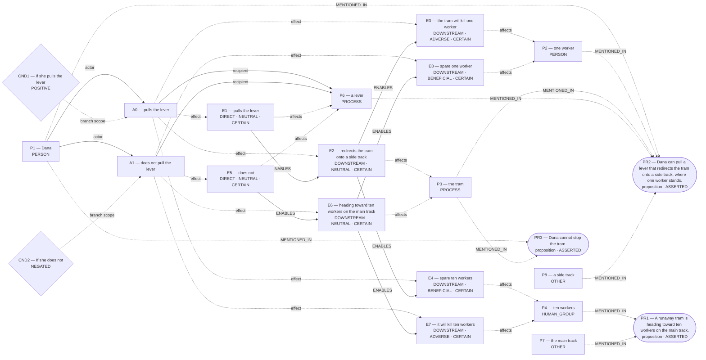

# Parliament demo

Status: **FRAMEWORK_PARTIAL** (recorded_pipeline_outcome).

Native judgment status: NOT_ADJUDICATED.

## Scenario

A runaway tram is heading toward ten workers on the main track. Dana can pull a lever that redirects the tram onto a side track, where one worker stands. If she pulls the lever, the tram will kill that worker and spare the ten. If she does not, it will kill the ten and spare the one. Dana cannot stop the tram. Should she pull the lever?

## What Parliament thinks is happening

Actions: pulls the lever; does not pull the lever

Parties: Dana, one worker, the tram, ten workers, a lever, the main track, a side track

These are alternative action branches and their stipulated outcomes, not claims that both actions occurred.

- Under A0, a lever: pulls the lever (CERTAIN)
- Under A0, the tram: redirects the tram onto a side track (CERTAIN)
- Under A0, one worker: the tram will kill one worker (CERTAIN)
- Under A0, ten workers: spare ten workers (CERTAIN)
- Under A1, a lever: does not (CERTAIN)
- Under A1, the tram: heading toward ten workers on the main track (CERTAIN)
- Under A1, ten workers: it will kill ten workers (CERTAIN)
- Under A1, one worker: spare one worker (CERTAIN)
- pulls the lever → ENABLES → redirects the tram onto a side track
- redirects the tram onto a side track → ENABLES → the tram will kill one worker
- redirects the tram onto a side track → ENABLES → spare ten workers
- does not → ENABLES → heading toward ten workers on the main track
- heading toward ten workers on the main track → ENABLES → it will kill ten workers
- heading toward ten workers on the main track → ENABLES → spare one worker

Source scene and constraints:

- A runaway tram is heading toward ten workers on the main track.
- Dana can pull a lever that redirects the tram onto a side track, where one worker stands.
- Dana cannot stop the tram.

## World-state diagram

### Frozen world supplied to framework assessment

## What is grounded

Admitted source copies and structurally derived records follow. Exact excerpts establish traceability; they do not independently prove every interpretation.

- pulls the lever — DIRECT_COPY; source: “If she pulls the lever, the tram will kill that worker and spare the ten.”
- redirects the tram onto a side track — SOURCE_STIPULATED_CAUSAL; source: “Dana can pull a lever that redirects the tram onto a side track, where one worker stands.”
- the tram will kill one worker — SOURCE_STIPULATED_CAUSAL; source: “If she pulls the lever, the tram will kill that worker and spare the ten.; Dana can pull a lever that redirects the tram onto a side track, where one worker stands.; If she does not, it will kill the ten and spare the one.”
- spare ten workers — SOURCE_STIPULATED_CAUSAL; source: “If she pulls the lever, the tram will kill that worker and spare the ten.; If she does not, it will kill the ten and spare the one.; A runaway tram is heading toward ten workers on the main track.”
- does not — DIRECT_COPY; source: “If she does not, it will kill the ten and spare the one.”
- heading toward ten workers on the main track — SOURCE_STIPULATED_CAUSAL; source: “If she does not, it will kill the ten and spare the one.; A runaway tram is heading toward ten workers on the main track.”
- it will kill ten workers — SOURCE_STIPULATED_CAUSAL; source: “If she does not, it will kill the ten and spare the one.; If she pulls the lever, the tram will kill that worker and spare the ten.; A runaway tram is heading toward ten workers on the main track.”
- spare one worker — SOURCE_STIPULATED_CAUSAL; source: “If she does not, it will kill the ten and spare the one.; If she pulls the lever, the tram will kill that worker and spare the ten.; Dana can pull a lever that redirects the tram onto a side track, where one worker stands.”
- Stipulated source claim: Dana cannot stop the tram.
- Stipulated source claim: If she pulls the lever, the tram will kill that worker and spare the ten.
- Stipulated source claim: If she does not, it will kill the ten and spare the one.
- Stipulated source claim: Dana can pull a lever that redirects the tram onto a side track, where one worker stands.
- Stipulated source claim: A runaway tram is heading toward ten workers on the main track.

## What remains uncertain

- The utilitarian ledger contains unknown welfare magnitude or duration; survivor arithmetic does not settle total welfare.
- A0 ADJUDICATION_CALIBRATION: doing-harm classification lacks an agent-caused settled welfare harm on the protected party
- A0 ADJUDICATION_CALIBRATION: resolved adjudication rests on unsupported decisive premises
- whether the harm-relation follows the admitted graph's causal topology rather than a relabel chosen to fit the verdict
- dana's duty 'do not kill an innocent person' protecting all workers ↔ dana's competing duty 'imperfect duty to rescue' protecting ten workers
- A0 prohibited by do not kill an innocent person ↔ whether the harm-relation follows the admitted graph's causal topology rather than a relabel chosen to fit the verdict
- A0 competing Care claim remains contested
- A1 competing Care claim remains contested
- framework map for pulls the lever lacks framework-specific grounds
- framework map for does not pull the lever lacks framework-specific grounds
- Rawlsian position for A0 conflicts with its framework map
- Rawlsian position for A1 conflicts with its framework map

## Framework views

### utilitarian

Position: **FULL**. Recorded preference: pulls the lever (not necessarily operative).

Save more total lives. Prefer an action whose expected deaths are fewer. Recorded comparison — “pulls the lever”: Pulling the lever diverts the tram, saving ten people at the known cost of one; utilitarian calculus favours the larger net survival.; “does not pull the lever”: Not intervening avoids directly causing a death, but allows ten certain deaths, producing far greater total harm.

[Full recorded explanation (Markdown)](arguments/utilitarian.md).

Assumptions / interpretive commitments: Recorded interpretive commitment: Prefer an action whose expected deaths are fewer.; Run assumption: The stated scenario facts are accepted as givens for this analysis; their accuracy outside this scenario has not been verified.

The counts (one worker; ten workers) are stipulated by the scenario for this run. No separate record says whether they were observed, reported by someone, or supplied as simulation facts. This is a provenance limitation, not a claim that the stated counts are missing.

Dependencies: the tram will kill one worker; affected subject: one worker; it will kill ten workers; affected subject: ten workers

Live objection: None separately recorded.

Would reverse the recorded preference: The agent reports a switch from “pulls the lever” to “does not pull the lever”. Condition: Equal-worth principle is dropped so each death no longer counts alike. This is an agent-reported condition, not an independently established threshold.; The agent reports a switch from “pulls the lever” to “does not pull the lever”. Condition: Side track contains two or more workers instead of one. This is an agent-reported condition, not an independently established threshold.

### deontological

Position: **ABSTAIN**. Recorded preference: does not pull the lever (not necessarily operative).

The agent assesses Dana’s duty “do not kill an innocent person” toward side-track worker. Dana is the duty-bearer; side-track worker is the protected party. The competing obligation being assessed is Dana’s “imperfect duty to rescue” toward ten workers. For “pulls the lever”, the agent proposes the maxim “Pull lever to divert tram”. This is an interpretation of possible practical reasoning, not an established intention. Its purpose is Save ten; its chosen means are Tram strikes side-track worker. The proposed justification is: Cannot will rule that permits killing innocents as side-effect rescue. The agent assesses the maxim as indefensible, and the action as impermissible. For Dana’s option “pulls the lever”, the ledger records conflicted. The agent’s stated reason is: Intervention causes death of protected party.. The agent assesses Dana’s duty “do not kill an innocent person” toward all workers. Dana is the duty-bearer; all workers is the protected party. The competing obligation being assessed is Dana’s “imperfect duty to rescue” toward ten workers. For “does not pull the lever”, the agent proposes the maxim “Refrain from diverting tram”. This is an interpretation of possible practical reasoning, not an established intention. Its purpose is Avoid killing; its chosen means are Take no action affecting tram path. The proposed justification is: Can will omission when proposed action is killing. The agent assesses the maxim as defensible, and the action as permissible. For Dana’s option “does not pull the lever”, the ledger records permissible. The agent’s stated reason is: No act that kills; harm permitted is not agent-caused. The ledger retains unresolved issues; this does not establish that one duty overrides the other.

[Full recorded explanation (Markdown)](arguments/deontological.md).

Assumptions / interpretive commitments: Recorded interpretive commitment: Provisionally: Treat the duty priority as unestablished until whether the harm-relation follows the admitted graph's causal topology rather than a relabel chosen to fit the verdict; Recorded interpretive commitment: Headcount does not override perfect duty; Run assumption: The stated scenario facts are accepted as givens for this analysis; their accuracy outside this scenario has not been verified.

The counts (one worker; ten workers) are stipulated by the scenario for this run. No separate record says whether they were observed, reported by someone, or supplied as simulation facts. This is a provenance limitation, not a claim that the stated counts are missing.

Dependencies: Not separately recorded.

Live objection: A0 ADJUDICATION_CALIBRATION: doing-harm classification lacks an agent-caused settled welfare harm on the protected party; A0 ADJUDICATION_CALIBRATION: resolved adjudication rests on unsupported decisive premises; whether the harm-relation follows the admitted graph's causal topology rather than a relabel chosen to fit the verdict; dana's duty 'do not kill an innocent person' protecting all workers ↔ dana's competing duty 'imperfect duty to rescue' protecting ten workers; A0 prohibited by do not kill an innocent person ↔ whether the harm-relation follows the admitted graph's causal topology rather than a relabel chosen to fit the verdict

Would reverse the recorded preference: The agent reports a switch from “does not pull the lever” to “pulls the lever”. Condition: If imperfect rescue could override perfect negative, preference would switch. This is an agent-reported condition, not an independently established threshold.

### care

Position: **ATTENUATED**. Recorded preference: pulls the lever (not necessarily operative).

Lever shows greater responsiveness. Prefer “pulls the lever” when it better answers the most urgent basic‐need claims of those depending on the agent’s sole feasible action. Recorded comparison — “pulls the lever”: Pulling the lever directly prevents ten imminent deaths, showing attentiveness, competence, and responsiveness to the greater group’s acute survival need, despite causing one tragic death.; “does not pull the lever”: Doing nothing avoids personally redirecting harm but lets the tram kill ten workers, neglecting a larger equally vulnerable group and showing inadequate responsiveness.

[Full recorded explanation (Markdown)](arguments/care.md).

Assumptions / interpretive commitments: Recorded interpretive commitment: Prefer “pulls the lever” when it better answers the most urgent basic‐need claims of those depending on the agent’s sole feasible action.; Recorded interpretive commitment: greater number of equally vulnerable dependents justifies priority; Run assumption: The stated scenario facts are accepted as givens for this analysis; their accuracy outside this scenario has not been verified.

The counts (one worker; ten workers) are stipulated by the scenario for this run. No separate record says whether they were observed, reported by someone, or supplied as simulation facts. This is a provenance limitation, not a claim that the stated counts are missing.

Dependencies: Not separately recorded.

Live objection: A0 competing Care claim remains contested; A1 competing Care claim remains contested

Would reverse the recorded preference: The agent reports a switch from “pulls the lever” to “does not pull the lever”. Condition: a strict rule against intentional killing outweighs need‐based responsiveness. This is an agent-reported condition, not an independently established threshold.; The agent reports a switch from “pulls the lever” to “does not pull the lever”. Condition: side track contains ten or more workers instead of one. This is an agent-reported condition, not an independently established threshold.

### virtue

Position: **FULL**. Recorded preference: pulls the lever (not necessarily operative).

Prudence saves more lives. prefer “pulls the lever” when prudent intervention reduces innocent deaths far more than it causes. Recorded comparison — “pulls the lever”: By intervening, Dana shows practical wisdom and courageous compassion: she takes tragic responsibility to minimise overall loss of life, acting as a responsible steward of public safety despite the sorrow of causing one death.; “does not pull the lever”: By refraining, Dana avoids direct violence but lets greater harm unfold; this shows misplaced scruple and timidity, allowing preventable deaths and failing in the role-based duty to protect many when she can.

[Full recorded explanation (Markdown)](arguments/virtue.md).

Assumptions / interpretive commitments: Recorded interpretive commitment: prefer “pulls the lever” when prudent intervention reduces innocent deaths far more than it causes; Recorded interpretive commitment: The numbers highlight scale of harm; prudence weighs them but does not reduce virtue to arithmetic.; Run assumption: The stated scenario facts are accepted as givens for this analysis; their accuracy outside this scenario has not been verified.

The counts (one worker; ten workers) are stipulated by the scenario for this run. No separate record says whether they were observed, reported by someone, or supplied as simulation facts. This is a provenance limitation, not a claim that the stated counts are missing.

Dependencies: Not separately recorded.

Live objection: None separately recorded.

Would reverse the recorded preference: The agent reports a switch from “pulls the lever” to “does not pull the lever”. Condition: absolute prohibition on killing innocents overrides prudence. This is an agent-reported condition, not an independently established threshold.; The agent reports a switch from “pulls the lever” to “does not pull the lever”. Condition: side-track contains more lives than main track. This is an agent-reported condition, not an independently established threshold.

### rawlsian

Position: **ABSTAIN**. Recorded preference: pulls the lever (not necessarily operative).

Decisive aggregation is not licensed by the committed Rawlsian ranking basis. Veil lowers death risk. Prefer “pulls the lever” when it reduces each person’s chance of being the one killed compared with “does not pull the lever”. Recorded comparison — “pulls the lever”: MIXED: pulling saves ten workers but fatally harms one, lowering any given worker’s chance of death.; “does not pull the lever”: MIXED: inaction spares one but fatally harms ten, leaving a higher death risk for each worker.

[Full recorded explanation (Markdown)](arguments/rawlsian.md).

Assumptions / interpretive commitments: Recorded interpretive commitment: Prefer “pulls the lever” when it reduces each person’s chance of being the one killed compared with “does not pull the lever”.; Recorded interpretive commitment: chance any given worker dies (1⁄11 vs 10⁄11); Run assumption: The stated scenario facts are accepted as givens for this analysis; their accuracy outside this scenario has not been verified.

The counts (one worker; ten workers) are stipulated by the scenario for this run. No separate record says whether they were observed, reported by someone, or supplied as simulation facts. This is a provenance limitation, not a claim that the stated counts are missing.

Dependencies: Not separately recorded.

Live objection: framework map for pulls the lever lacks framework-specific grounds; framework map for does not pull the lever lacks framework-specific grounds; Rawlsian position for A0 conflicts with its framework map; Rawlsian position for A1 conflicts with its framework map

Would reverse the recorded preference: The agent reports a switch from “pulls the lever” to “does not pull the lever”. Condition: Reject veil-of-ignorance; treat redirecting harm as impermissible. This is an agent-reported condition, not an independently established threshold.; The agent reports a switch from “pulls the lever” to “does not pull the lever”. Condition: Side track holds ten or more workers. This is an agent-reported condition, not an independently established threshold.

## Agreement and disagreement

Recorded preferences differ.

Framework-local normative arguments and empirical dependencies are shown above; no automatic causal classification is claimed.

- utilitarian: normative dependency — Equal-worth principle is dropped so each death no longer counts alike.
- deontological: normative dependency — If imperfect rescue could override perfect negative, preference would switch
- care: normative dependency — a strict rule against intentional killing outweighs need‐based responsiveness

## Decision hinges

- utilitarian: Equal-worth principle is dropped so each death no longer counts alike. (would reverse a recorded preference; `cycles/1/candidates/0/normative_reversal_threshold`).
- deontological: If imperfect rescue could override perfect negative, preference would switch (would reverse a recorded preference; `cycles/1/candidates/1/normative_reversal_threshold`).
- care: a strict rule against intentional killing outweighs need‐based responsiveness (would reverse a recorded preference; `cycles/1/candidates/2/normative_reversal_threshold`).

## What Parliament did not decide

- This report does not adjudicate a governing moral verdict.
- Ledger admission does not prove the argument or supply missing welfare units.
- Unresolved objections remain live; reported reversal thresholds are not source facts.

## Topography

Survivor arithmetic does not settle total welfare. Coordinates are native ledger records, not a calibrated moral physics. Attractors are occupancy of recorded points, not interpolated terrain.

Recorded action loci only. Missing axes are omitted; UNKNOWN is not plotted as zero.

- A0 pulls the lever — care: RESPONSIVE; welfare: 1.0; obligation: CONFLICTED
- A1 does not pull the lever — care: NEGLECTFUL; welfare: 10.0; obligation: PERMISSIBLE

Degenerate: care_welfare_survival_copy
Attractors: none

- Plotted welfare is a restricted survivor or count endpoint. It is not total welfare.
- Care ranking coincides with the welfare/count ranking; this is marked degenerate, not an attractor.

## Run provenance

Execution: compact_demo; run ID: run_e3e923d2ddac48d2822a020b6b500643.
Application commit: 63628a08e49bfa1cd27a548b1710013448e0aca0; source fingerprint: a6ce698b670cf23c064e344c91af1ba72f689e46659885870395ed13d44cd193.
Original generation: run_0610432e84e749048441881a1e5cf426.
The finalized run_manifest.json records configuration, runtime checks, source snapshot, and output hashes.

## Pipeline stop and inspection

FRAMEWORK_PARTIAL

Missing slots: rescue_contrast: first_saved, rescue_contrast: second_saved, rescue_contrast: rescue_exclusivity, rescue_contrast: first_rescue_action, rescue_contrast: second_rescue_action, diversion_redirection: controllable_process

Competing admitted interpretations: omission_harm: pulls the lever, does not pull the lever

Inspection artifacts (saved replay references its original records):

- [run_manifest.json](/Users/benjaminkowal/Documents/Python/Python Coding/RL_Algorithms/diagnostics/tram_ten_workers_maxims_live_20261015_network/pipeline/run_manifest.json)
- [runtime_check.json](/Users/benjaminkowal/Documents/Python/Python Coding/RL_Algorithms/diagnostics/tram_ten_workers_maxims_live_20261015_network/pipeline/runtime_check.json)
- [candidate_graphs.md](/Users/benjaminkowal/Documents/Python/Python Coding/RL_Algorithms/diagnostics/tram_ten_workers_maxims_live_20261015_network/pipeline/candidate_graphs.md)
- [candidate_attempts.json](/Users/benjaminkowal/Documents/Python/Python Coding/RL_Algorithms/diagnostics/tram_ten_workers_maxims_live_20261015_network/pipeline/candidate_attempts.json)
- [question_assessment.json](/Users/benjaminkowal/Documents/Python/Python Coding/RL_Algorithms/diagnostics/tram_ten_workers_maxims_live_20261015_network/pipeline/question_assessment.json)
- [world_beam.json](/Users/benjaminkowal/Documents/Python/Python Coding/RL_Algorithms/diagnostics/tram_ten_workers_maxims_live_20261015_network/pipeline/world_beam.json)
- [preparation_manifest.json](/Users/benjaminkowal/Documents/Python/Python Coding/RL_Algorithms/diagnostics/tram_ten_workers_maxims_live_20261015_network/pipeline/preparation_manifest.json)
- [frozen_world_trace.json](/Users/benjaminkowal/Documents/Python/Python Coding/RL_Algorithms/diagnostics/tram_ten_workers_maxims_live_20261015_network/pipeline/frozen_world_trace.json)
- [runtime_check.json](/Users/benjaminkowal/Documents/Python/Python Coding/RL_Algorithms/diagnostics/tram_ten_workers_maxims_live_20261015_network/runtime_check.json)
- [run_manifest.json](/Users/benjaminkowal/Documents/Python/Python Coding/RL_Algorithms/diagnostics/tram_ten_workers_maxims_live_20261015_network/frameworks/run_manifest.json)
- [framework_generation.json](/Users/benjaminkowal/Documents/Python/Python Coding/RL_Algorithms/diagnostics/tram_ten_workers_maxims_live_20261015_network/frameworks/framework_generation.json)
- [conflict_graph.md](/Users/benjaminkowal/Documents/Python/Python Coding/RL_Algorithms/diagnostics/tram_ten_workers_maxims_live_20261015_network/frameworks/conflict_graph.md)
- [run_manifest.json](/Users/benjaminkowal/Documents/Python/Python Coding/RL_Algorithms/diagnostics/tram_ten_workers_maxims_live_20261015_network/review/run_manifest.json)
- [conflict_graph.md](/Users/benjaminkowal/Documents/Python/Python Coding/RL_Algorithms/diagnostics/tram_ten_workers_maxims_live_20261015_network/review/conflict_graph.md)
- [targeted_review.json](/Users/benjaminkowal/Documents/Python/Python Coding/RL_Algorithms/diagnostics/tram_ten_workers_maxims_live_20261015_network/review/targeted_review.json)
