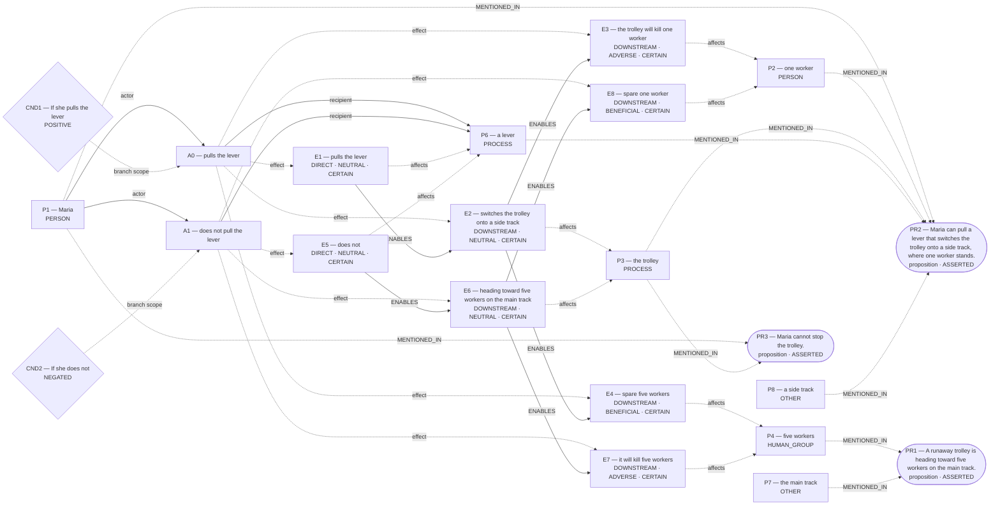

# Parliament demo

Status: **FRAMEWORK_PARTIAL** (recorded_pipeline_outcome).

Native judgment status: NOT_ADJUDICATED.

## Scenario

A runaway trolley is heading toward five workers on the main track. Maria can pull a lever that switches the trolley onto a side track, where one worker stands. If she pulls the lever, the trolley will kill that worker and spare the five. If she does not, it will kill the five and spare the one. Maria cannot stop the trolley. Should she pull the lever?

## What Parliament thinks is happening

Actions: pulls the lever; does not pull the lever

Parties: Maria, one worker, the trolley, five workers, a lever, the main track, a side track

These are alternative action branches and their stipulated outcomes, not claims that both actions occurred.

- Under A0, a lever: pulls the lever (CERTAIN)
- Under A0, the trolley: switches the trolley onto a side track (CERTAIN)
- Under A0, one worker: the trolley will kill one worker (CERTAIN)
- Under A0, five workers: spare five workers (CERTAIN)
- Under A1, a lever: does not (CERTAIN)
- Under A1, the trolley: heading toward five workers on the main track (CERTAIN)
- Under A1, five workers: it will kill five workers (CERTAIN)
- Under A1, one worker: spare one worker (CERTAIN)
- pulls the lever → ENABLES → switches the trolley onto a side track
- switches the trolley onto a side track → ENABLES → the trolley will kill one worker
- switches the trolley onto a side track → ENABLES → spare five workers
- does not → ENABLES → heading toward five workers on the main track
- heading toward five workers on the main track → ENABLES → it will kill five workers
- heading toward five workers on the main track → ENABLES → spare one worker

Source scene and constraints:

- A runaway trolley is heading toward five workers on the main track.
- Maria can pull a lever that switches the trolley onto a side track, where one worker stands.
- Maria cannot stop the trolley.

## World-state diagram

### Frozen world supplied to framework assessment

Diagram unavailable: Omission interpretation is a world-bound advisory. Native action bookkeeping remains unchanged; no moral exemption is implied.

## What is grounded

Admitted source copies and structurally derived records follow. Exact excerpts establish traceability; they do not independently prove every interpretation.

- pulls the lever — DIRECT_COPY; source: “If she pulls the lever, the trolley will kill that worker and spare the five.”
- switches the trolley onto a side track — SOURCE_STIPULATED_CAUSAL; source: “Maria can pull a lever that switches the trolley onto a side track, where one worker stands.”
- the trolley will kill one worker — SOURCE_STIPULATED_CAUSAL; source: “If she pulls the lever, the trolley will kill that worker and spare the five.; Maria can pull a lever that switches the trolley onto a side track, where one worker stands.; If she does not, it will kill the five and spare the one.”
- spare five workers — SOURCE_STIPULATED_CAUSAL; source: “If she pulls the lever, the trolley will kill that worker and spare the five.; If she does not, it will kill the five and spare the one.; A runaway trolley is heading toward five workers on the main track.”
- does not — DIRECT_COPY; source: “If she does not, it will kill the five and spare the one.”
- heading toward five workers on the main track — SOURCE_STIPULATED_CAUSAL; source: “If she does not, it will kill the five and spare the one.; A runaway trolley is heading toward five workers on the main track.”
- it will kill five workers — SOURCE_STIPULATED_CAUSAL; source: “If she does not, it will kill the five and spare the one.; If she pulls the lever, the trolley will kill that worker and spare the five.; A runaway trolley is heading toward five workers on the main track.”
- spare one worker — SOURCE_STIPULATED_CAUSAL; source: “If she does not, it will kill the five and spare the one.; If she pulls the lever, the trolley will kill that worker and spare the five.; Maria can pull a lever that switches the trolley onto a side track, where one worker stands.”
- Stipulated source claim: If she does not, it will kill the five and spare the one.
- Stipulated source claim: If she pulls the lever, the trolley will kill that worker and spare the five.
- Stipulated source claim: Maria can pull a lever that switches the trolley onto a side track, where one worker stands.
- Stipulated source claim: Maria cannot stop the trolley.
- Stipulated source claim: A runaway trolley is heading toward five workers on the main track.

## What remains uncertain

- case for A1 tracks the opposing action but not its own action
- The utilitarian ledger contains unknown welfare magnitude or duration; survivor arithmetic does not settle total welfare.
- A0 ADJUDICATION_CALIBRATION: doing-harm classification lacks an agent-caused settled welfare harm on the protected party
- A0 ADJUDICATION_CALIBRATION: resolved adjudication rests on unsupported decisive premises
- whether the harm-relation follows the admitted graph's causal topology rather than a relabel chosen to fit the verdict
- maria's duty 'imperfect duty to aid others' protecting five workers ↔ maria's competing duty 'perfect duty not to kill' protecting one worker
- A0 prohibited by do not kill innocent persons ↔ whether the harm-relation follows the admitted graph's causal topology rather than a relabel chosen to fit the verdict

## Framework views

### utilitarian

Position: **ATTENUATED**. Recorded preference: pulls the lever (not necessarily operative).

Saves more lives. Prefer the action that results in the fewest deaths. Recorded comparison — “pulls the lever”: Pulling diverts the trolley, sacrificing one but preventing five certain deaths—maximises overall welfare.; “does not pull the lever”: Not pulling avoids direct complicity in a death, but allows five certain deaths, producing far greater net harm.

[Full recorded explanation (Markdown)](arguments/utilitarian.md).

Assumptions / interpretive commitments: Recorded interpretive commitment: Prefer the action that results in the fewest deaths.; Run assumption: The stated scenario facts are accepted as givens for this analysis; their accuracy outside this scenario has not been verified.

The counts (one worker; five workers) are stipulated by the scenario for this run. No separate record says whether they were observed, reported by someone, or supplied as simulation facts. This is a provenance limitation, not a claim that the stated counts are missing.

Dependencies: Not separately recorded.

Live objection: case for A1 tracks the opposing action but not its own action

Would reverse the recorded preference: The agent reports a switch from “pulls the lever” to “does not pull the lever”. Condition: Absolute ban on killing an innocent regardless of outcomes. This is an agent-reported condition, not an independently established threshold.; The agent reports a switch from “pulls the lever” to “does not pull the lever”. Condition: Lever would kill more than it saves (e.g., if five stood on side track). This is an agent-reported condition, not an independently established threshold.

### deontological

Position: **ABSTAIN**. Recorded preference: does not pull the lever (not necessarily operative).

The agent assesses Maria’s duty “do not kill innocent persons” toward one worker. Maria is the duty-bearer; one worker is the protected party. The competing obligation being assessed is Maria’s “imperfect duty to rescue” toward five workers. For Maria’s option “pulls the lever”, the ledger records conflicted. The agent’s stated reason is: Killing one as a means/side-effect breaches universal rule. The agent assesses Maria’s duty “imperfect duty to aid others” toward five workers. Maria is the duty-bearer; five workers is the protected party. The competing obligation being assessed is Maria’s “perfect duty not to kill” toward one worker. For Maria’s option “does not pull the lever”, the ledger records permissible. The agent’s stated reason is: Omission respects perfect duty hierarchy. The ledger retains unresolved issues; this does not establish that one duty overrides the other.

[Full recorded explanation (Markdown)](arguments/deontological.md).

Assumptions / interpretive commitments: Recorded interpretive commitment: Prefer the action that avoids violating a perfect negative duty even when an imperfect rescue duty remains unmet.; Recorded interpretive commitment: Numbers do not override duty categories; Run assumption: The stated scenario facts are accepted as givens for this analysis; their accuracy outside this scenario has not been verified.

The counts (one worker; five workers) are stipulated by the scenario for this run. No separate record says whether they were observed, reported by someone, or supplied as simulation facts. This is a provenance limitation, not a claim that the stated counts are missing.

Dependencies: the trolley will kill one worker; affected subject: one worker; it will kill five workers; affected subject: five workers

Live objection: A0 ADJUDICATION_CALIBRATION: doing-harm classification lacks an agent-caused settled welfare harm on the protected party; A0 ADJUDICATION_CALIBRATION: resolved adjudication rests on unsupported decisive premises; whether the harm-relation follows the admitted graph's causal topology rather than a relabel chosen to fit the verdict; maria's duty 'imperfect duty to aid others' protecting five workers ↔ maria's competing duty 'perfect duty not to kill' protecting one worker; A0 prohibited by do not kill innocent persons ↔ whether the harm-relation follows the admitted graph's causal topology rather than a relabel chosen to fit the verdict

Would reverse the recorded preference: The agent reports a switch from “does not pull the lever” to “pulls the lever”. Condition: If imperfect rescue duties were equal or higher priority than perfect negative duties, ranking would reverse. This is an agent-reported condition, not an independently established threshold.; The agent reports a switch from “does not pull the lever” to “pulls the lever”. Condition: If the side-track worker could consent or be unharmed, ranking would reverse. This is an agent-reported condition, not an independently established threshold.

## Agreement and disagreement

Recorded preferences differ.

Framework-local normative arguments and empirical dependencies are shown above; no automatic causal classification is claimed.

- utilitarian: normative dependency — Absolute ban on killing an innocent regardless of outcomes.
- deontological: normative dependency — If imperfect rescue duties were equal or higher priority than perfect negative duties, ranking would reverse.

## Decision hinges

- utilitarian: Absolute ban on killing an innocent regardless of outcomes. (would reverse a recorded preference; `cycles/0/candidates/0/normative_reversal_threshold`).
- deontological: If imperfect rescue duties were equal or higher priority than perfect negative duties, ranking would reverse. (would reverse a recorded preference; `cycles/0/candidates/1/normative_reversal_threshold`).

## What Parliament did not decide

- This report does not adjudicate a governing moral verdict.
- Ledger admission does not prove the argument or supply missing welfare units.
- Unresolved objections remain live; reported reversal thresholds are not source facts.

## Topography

Survivor arithmetic does not settle total welfare. Coordinates are native ledger records, not a calibrated moral physics. Attractors are occupancy of recorded points, not interpolated terrain.

Recorded action loci only. Missing axes are omitted; UNKNOWN is not plotted as zero.

- A0 pulls the lever — care: omitted; welfare: omitted; obligation: CONFLICTED
- A1 does not pull the lever — care: omitted; welfare: omitted; obligation: PERMISSIBLE

Degenerate: none
Attractors: none

## Run provenance

Execution: unknown historical run; run ID: not recorded.
Application commit: not recorded; source fingerprint: not recorded.
Original generation: unknown historical provenance.
The finalized run_manifest.json records configuration, runtime checks, source snapshot, and output hashes.

## Pipeline stop and inspection

FRAMEWORK_PARTIAL

Missing slots: none recorded

Competing admitted interpretations: none recorded

Inspection artifacts (saved replay references its original records):

- [framework_generation.json](/Users/benjaminkowal/Documents/Python/Python Coding/RL_Algorithms/diagnostics/trolley_choice_pipeline_20261014/live_frameworks_02/framework_generation.json)
