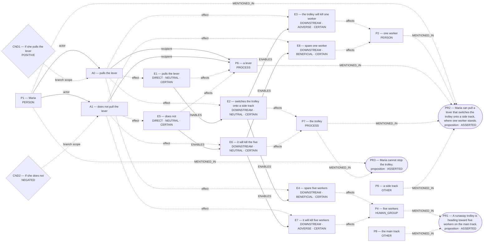

# Parliament demo

Status: **FRAMEWORK_PARTIAL** (recorded_pipeline_outcome).

Native judgment status: NOT_ADJUDICATED.

## Scenario

A runaway trolley is heading toward five workers on the main track. Maria can pull a lever that switches the trolley onto a side track, where one worker stands. If she pulls the lever, the trolley will kill that worker and spare the five. If she does not, it will kill the five and spare the one. Maria cannot stop the trolley. Should she pull the lever?

## What Parliament thinks is happening

Actions: pulls the lever; does not pull the lever

Parties: Maria, one worker, five workers, a lever, the trolley, the main track, a side track

These are alternative action branches and their stipulated outcomes, not claims that both actions occurred.

- Under A0, a lever: pulls the lever (CERTAIN)
- Under A0, the trolley: switches the trolley onto a side track (CERTAIN)
- Under A0, one worker: the trolley will kill one worker (CERTAIN)
- Under A0, five workers: spare five workers (CERTAIN)
- Under A1, a lever: does not (CERTAIN)
- Under A1, the trolley: it will kill the five (CERTAIN)
- Under A1, five workers: it will kill five workers (CERTAIN)
- Under A1, one worker: spare one worker (CERTAIN)
- pulls the lever → ENABLES → switches the trolley onto a side track
- switches the trolley onto a side track → ENABLES → the trolley will kill one worker
- switches the trolley onto a side track → ENABLES → spare five workers
- does not → ENABLES → it will kill the five
- it will kill the five → ENABLES → it will kill five workers
- it will kill the five → ENABLES → spare one worker

Source scene and constraints:

- A runaway trolley is heading toward five workers on the main track.
- Maria can pull a lever that switches the trolley onto a side track, where one worker stands.
- Maria cannot stop the trolley.

## World-state diagram

### Frozen world supplied to framework assessment

## What is grounded

Admitted source copies and structurally derived records follow. Exact excerpts establish traceability; they do not independently prove every interpretation.

- pulls the lever — DIRECT_COPY; source: “If she pulls the lever, the trolley will kill that worker and spare the five.”
- switches the trolley onto a side track — SOURCE_STIPULATED_CAUSAL; source: “Maria can pull a lever that switches the trolley onto a side track, where one worker stands.”
- the trolley will kill one worker — SOURCE_STIPULATED_CAUSAL; source: “If she pulls the lever, the trolley will kill that worker and spare the five.; Maria can pull a lever that switches the trolley onto a side track, where one worker stands.; If she does not, it will kill the five and spare the one.”
- spare five workers — SOURCE_STIPULATED_CAUSAL; source: “If she pulls the lever, the trolley will kill that worker and spare the five.; If she does not, it will kill the five and spare the one.; A runaway trolley is heading toward five workers on the main track.”
- does not — DIRECT_COPY; source: “If she does not, it will kill the five and spare the one.”
- it will kill the five — SOURCE_STIPULATED_CAUSAL; source: “If she does not, it will kill the five and spare the one.”
- it will kill five workers — SOURCE_STIPULATED_CAUSAL; source: “If she does not, it will kill the five and spare the one.; If she pulls the lever, the trolley will kill that worker and spare the five.; A runaway trolley is heading toward five workers on the main track.”
- spare one worker — SOURCE_STIPULATED_CAUSAL; source: “If she does not, it will kill the five and spare the one.; If she pulls the lever, the trolley will kill that worker and spare the five.; Maria can pull a lever that switches the trolley onto a side track, where one worker stands.”
- Stipulated source claim: If she does not, it will kill the five and spare the one.
- Stipulated source claim: If she pulls the lever, the trolley will kill that worker and spare the five.
- Stipulated source claim: Maria can pull a lever that switches the trolley onto a side track, where one worker stands.
- Stipulated source claim: Maria cannot stop the trolley.
- Stipulated source claim: A runaway trolley is heading toward five workers on the main track.

## What remains uncertain

- The utilitarian ledger contains unknown welfare magnitude or duration; survivor arithmetic does not settle total welfare.
- A0 ADJUDICATION_CALIBRATION: doing-harm classification lacks an agent-caused settled welfare harm on the protected party
- A0 ADJUDICATION_CALIBRATION: resolved adjudication rests on unsupported decisive premises
- whether the harm-relation follows the admitted graph's causal topology rather than a relabel chosen to fit the verdict
- one worker: do not kill innocent person ↔ five workers: duty to rescue many
- A0 prohibited by do not kill innocent person ↔ whether the harm-relation follows the admitted graph's causal topology rather than a relabel chosen to fit the verdict
- case for A1 tracks the opposing action but not its own action
- A0 competing Care claim remains contested
- A1 competing Care claim remains contested
- framework map for pulls the lever lacks framework-specific grounds
- framework map for does not pull the lever lacks framework-specific grounds
- decisive numbers are not tied to the affected subject or Rawlsian position
- decisive numerical role cites no explicit quantity
- Rawlsian preference lacks a stated difference in position or principle priority
- Rawlsian position for A0 conflicts with its framework map
- Rawlsian position for A1 conflicts with its framework map

## Framework views

### utilitarian

Position: **FULL**. Recorded preference: pulls the lever (not necessarily operative).

Net four lives saved. Prefer action that yields greatest net lives saved. Recorded comparison — “pulls the lever”: Pulling diverts trolley, sacrifices one, saves five—maximises total welfare.; “does not pull the lever”: Inaction avoids direct agency but results in five deaths, far greater harm.

[Full recorded explanation (Markdown)](arguments/utilitarian.md).

Assumptions / interpretive commitments: Recorded interpretive commitment: Prefer action that yields greatest net lives saved.; Run assumption: The stated scenario facts are accepted as givens for this analysis; their accuracy outside this scenario has not been verified.

The counts (one worker; five workers) are stipulated by the scenario for this run. No separate record says whether they were observed, reported by someone, or supplied as simulation facts. This is a provenance limitation, not a claim that the stated counts are missing.

Dependencies: Not separately recorded.

Live objection: None separately recorded.

Would reverse the recorded preference: The agent reports a switch from “pulls the lever” to “does not pull the lever”. Condition: If killing is absolutely prohibited regardless of numbers. This is an agent-reported condition, not an independently established threshold.; The agent reports a switch from “pulls the lever” to “does not pull the lever”. Condition: If side track held five or more workers instead of one. This is an agent-reported condition, not an independently established threshold.

### deontological

Position: **ABSTAIN**. Recorded preference: does not pull the lever (not necessarily operative).

Maria is the duty-bearer. The norm “do not kill innocent person” protects one worker. The competing norm “duty to rescue many” protects five workers. For “pulls the lever”, the ledger records conflicted. The agent’s stated reason is: directly causing death violates perfect duty. For “does not pull the lever”, the ledger records permissible. The agent’s stated reason is: allows harm but avoids killing. The ledger retains unresolved issues; this does not establish that one duty overrides the other.

[Full recorded explanation (Markdown)](arguments/deontological.md).

Assumptions / interpretive commitments: Recorded interpretive commitment: Prefer “does not pull the lever” when one option does killing and the other only allows harm; Recorded interpretive commitment: Numbers do not override perfect duties; Run assumption: The stated scenario facts are accepted as givens for this analysis; their accuracy outside this scenario has not been verified.

The counts (one worker; five workers) are stipulated by the scenario for this run. No separate record says whether they were observed, reported by someone, or supplied as simulation facts. This is a provenance limitation, not a claim that the stated counts are missing.

Dependencies: Not separately recorded.

Live objection: A0 ADJUDICATION_CALIBRATION: doing-harm classification lacks an agent-caused settled welfare harm on the protected party; A0 ADJUDICATION_CALIBRATION: resolved adjudication rests on unsupported decisive premises; whether the harm-relation follows the admitted graph's causal topology rather than a relabel chosen to fit the verdict; one worker: do not kill innocent person ↔ five workers: duty to rescue many; A0 prohibited by do not kill innocent person ↔ whether the harm-relation follows the admitted graph's causal topology rather than a relabel chosen to fit the verdict

Would reverse the recorded preference: The agent reports a switch from “does not pull the lever” to “pulls the lever”. Condition: If rescue duty outweighed no-killing duty. This is an agent-reported condition, not an independently established threshold.

### care

Position: **ATTENUATED**. Recorded preference: pulls the lever (not necessarily operative).

Responds to greater need. Prefer “pulls the lever” when it answers the most urgent dependency facing the caregiver. Recorded comparison — “does not pull the lever”: Not pulling avoids actively harming the single worker, but neglects the urgent dependency of five.

[Full recorded explanation (Markdown)](arguments/care.md).

Assumptions / interpretive commitments: Recorded interpretive commitment: Prefer “pulls the lever” when it answers the most urgent dependency facing the caregiver.; Recorded interpretive commitment: headcount informs weight but relationship priority rules first; Run assumption: The stated scenario facts are accepted as givens for this analysis; their accuracy outside this scenario has not been verified.

The counts (one worker; five workers) are stipulated by the scenario for this run. No separate record says whether they were observed, reported by someone, or supplied as simulation facts. This is a provenance limitation, not a claim that the stated counts are missing.

Dependencies: Not separately recorded.

Live objection: case for A1 tracks the opposing action but not its own action; A0 competing Care claim remains contested; A1 competing Care claim remains contested

Would reverse the recorded preference: The agent reports a switch from “pulls the lever” to “does not pull the lever”. Condition: If any intentional killing were absolutely forbidden, preference reverses. This is an agent-reported condition, not an independently established threshold.; The agent reports a switch from “pulls the lever” to “does not pull the lever”. Condition: If only one worker were on each track, preference reverses. This is an agent-reported condition, not an independently established threshold.

### virtue

Position: **FULL**. Recorded preference: pulls the lever (not necessarily operative).

Acting shows wise compassion. prefer “pulls the lever” when deliberate intervention preserves more lives without vicious motive. Recorded comparison — “pulls the lever”: EXEMPLIFIES: conscientious steward acts with courage and practical wisdom to minimise needless loss

[Full recorded explanation (Markdown)](arguments/virtue.md).

Assumptions / interpretive commitments: Recorded interpretive commitment: prefer “pulls the lever” when deliberate intervention preserves more lives without vicious motive; Recorded interpretive commitment: Numbers inform judgment but do not mechanically decide; virtue integrates them through prudence.; Run assumption: The stated scenario facts are accepted as givens for this analysis; their accuracy outside this scenario has not been verified.

The counts (one worker; five workers) are stipulated by the scenario for this run. No separate record says whether they were observed, reported by someone, or supplied as simulation facts. This is a provenance limitation, not a claim that the stated counts are missing.

Dependencies: Not separately recorded.

Live objection: None separately recorded.

Would reverse the recorded preference: The agent reports a switch from “pulls the lever” to “does not pull the lever”. Condition: Strict ban on intentional killing would reverse. This is an agent-reported condition, not an independently established threshold.; The agent reports a switch from “pulls the lever” to “does not pull the lever”. Condition: More lives on side-track than main would reverse. This is an agent-reported condition, not an independently established threshold.

### rawlsian

Position: **ABSTAIN**. Recorded preference: pulls the lever (not necessarily operative).

Decisive aggregation is not licensed by the committed Rawlsian ranking basis. MIXED: improves basic security for five workers but worsens it for one. prefer “pulls the lever” when it leaves fewer workers dead than “does not pull the lever”. Recorded comparison — “pulls the lever”: MIXED: kills one but spares five, improving worst‐case safety for anonymous workers; “does not pull the lever”: MIXED: spares one but kills five, leaving more workers fatally harmed

[Full recorded explanation (Markdown)](arguments/rawlsian.md).

Assumptions / interpretive commitments: Recorded interpretive commitment: prefer “pulls the lever” when it leaves fewer workers dead than “does not pull the lever”; Recorded interpretive commitment: five versus one deaths; Run assumption: The stated scenario facts are accepted as givens for this analysis; their accuracy outside this scenario has not been verified.

The counts (one worker; five workers) are stipulated by the scenario for this run. No separate record says whether they were observed, reported by someone, or supplied as simulation facts. This is a provenance limitation, not a claim that the stated counts are missing.

Dependencies: Not separately recorded.

Live objection: framework map for pulls the lever lacks framework-specific grounds; framework map for does not pull the lever lacks framework-specific grounds; decisive numbers are not tied to the affected subject or Rawlsian position; decisive numerical role cites no explicit quantity; Rawlsian preference lacks a stated difference in position or principle priority; Rawlsian position for A0 conflicts with its framework map; Rawlsian position for A1 conflicts with its framework map

Would reverse the recorded preference: The agent reports a switch from “pulls the lever” to “does not pull the lever”. Condition: life‐inviolability forbids redirecting harm. This is an agent-reported condition, not an independently established threshold.; The agent reports a switch from “pulls the lever” to “does not pull the lever”. Condition: side track had >5 workers. This is an agent-reported condition, not an independently established threshold.

## Agreement and disagreement

Recorded preferences differ.

Framework-local normative arguments and empirical dependencies are shown above; no automatic causal classification is claimed.

- utilitarian: normative dependency — If killing is absolutely prohibited regardless of numbers.
- deontological: normative dependency — If rescue duty outweighed no-killing duty
- care: normative dependency — If any intentional killing were absolutely forbidden, preference reverses.

## Decision hinges

- utilitarian: If killing is absolutely prohibited regardless of numbers. (would reverse a recorded preference; `cycles/0/candidates/0/normative_reversal_threshold`).
- deontological: If rescue duty outweighed no-killing duty (would reverse a recorded preference; `cycles/0/candidates/1/normative_reversal_threshold`).
- care: If any intentional killing were absolutely forbidden, preference reverses. (would reverse a recorded preference; `cycles/0/candidates/2/normative_reversal_threshold`).

## What Parliament did not decide

- This report does not adjudicate a governing moral verdict.
- Ledger admission does not prove the argument or supply missing welfare units.
- Unresolved objections remain live; reported reversal thresholds are not source facts.

## Topography

Survivor arithmetic does not settle total welfare. Coordinates are native ledger records, not a calibrated moral physics. Attractors are occupancy of recorded points, not interpolated terrain.

Recorded action loci only. Missing axes are omitted; UNKNOWN is not plotted as zero.

- A0 pulls the lever — care: RESPONSIVE; welfare: omitted; obligation: CONFLICTED
- A1 does not pull the lever — care: NEGLECTFUL; welfare: omitted; obligation: PERMISSIBLE

Degenerate: none
Attractors: none

## Pipeline stop and inspection

FRAMEWORK_PARTIAL

Missing slots: rescue_contrast: first_saved, rescue_contrast: second_saved, rescue_contrast: rescue_exclusivity, rescue_contrast: first_rescue_action, rescue_contrast: second_rescue_action

Competing admitted interpretations: omission_harm: pulls the lever, does not pull the lever; conditional_outcome: pulls the lever, does not pull the lever

Inspection artifacts (saved replay references its original records):

- [candidate_graphs.md](/Users/benjaminkowal/Documents/Python/Python Coding/RL_Algorithms/diagnostics/trolley_refinement_final_live_20261008/pipeline/candidate_graphs.md)
- [candidate_attempts.json](/Users/benjaminkowal/Documents/Python/Python Coding/RL_Algorithms/diagnostics/trolley_refinement_final_live_20261008/pipeline/candidate_attempts.json)
- [question_assessment.json](/Users/benjaminkowal/Documents/Python/Python Coding/RL_Algorithms/diagnostics/trolley_refinement_final_live_20261008/pipeline/question_assessment.json)
- [world_beam.json](/Users/benjaminkowal/Documents/Python/Python Coding/RL_Algorithms/diagnostics/trolley_refinement_final_live_20261008/pipeline/world_beam.json)
- [preparation_manifest.json](/Users/benjaminkowal/Documents/Python/Python Coding/RL_Algorithms/diagnostics/trolley_refinement_final_live_20261008/pipeline/preparation_manifest.json)
- [frozen_world_trace.json](/Users/benjaminkowal/Documents/Python/Python Coding/RL_Algorithms/diagnostics/trolley_refinement_final_live_20261008/pipeline/frozen_world_trace.json)
