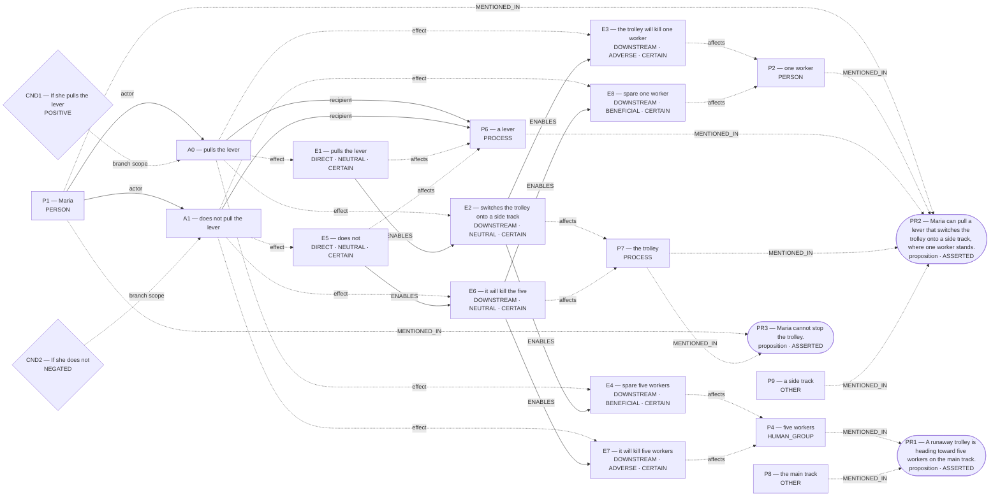

# Parliament demo

Status: **FRAMEWORK_PARTIAL** (recorded_pipeline_outcome).

Native judgment status: NOT_ADJUDICATED.

## Scenario

A runaway trolley is heading toward five workers on the main track. Maria can pull a lever that switches the trolley onto a side track, where one worker stands. If she pulls the lever, the trolley will kill that worker and spare the five. If she does not, it will kill the five and spare the one. Maria cannot stop the trolley. Should she pull the lever?

## What Parliament thinks is happening

Actions: pulls the lever; does not pull the lever

Parties: Maria, one worker, five workers, a lever, the trolley, the main track, a side track

These are alternative action branches and their stipulated outcomes, not claims that both actions occurred.

- Under A0, a lever: pulls the lever (CERTAIN)
- Under A0, the trolley: switches the trolley onto a side track (CERTAIN)
- Under A0, one worker: the trolley will kill one worker (CERTAIN)
- Under A0, five workers: spare five workers (CERTAIN)
- Under A1, a lever: does not (CERTAIN)
- Under A1, the trolley: it will kill the five (CERTAIN)
- Under A1, five workers: it will kill five workers (CERTAIN)
- Under A1, one worker: spare one worker (CERTAIN)
- pulls the lever → ENABLES → switches the trolley onto a side track
- switches the trolley onto a side track → ENABLES → the trolley will kill one worker
- switches the trolley onto a side track → ENABLES → spare five workers
- does not → ENABLES → it will kill the five
- it will kill the five → ENABLES → it will kill five workers
- it will kill the five → ENABLES → spare one worker

Source scene and constraints:

- A runaway trolley is heading toward five workers on the main track.
- Maria can pull a lever that switches the trolley onto a side track, where one worker stands.
- Maria cannot stop the trolley.

## World-state diagram

### Frozen world supplied to framework assessment

## What is grounded

Admitted source copies and structurally derived records follow. Exact excerpts establish traceability; they do not independently prove every interpretation.

- pulls the lever — DIRECT_COPY; source: “If she pulls the lever, the trolley will kill that worker and spare the five.”
- switches the trolley onto a side track — SOURCE_STIPULATED_CAUSAL; source: “Maria can pull a lever that switches the trolley onto a side track, where one worker stands.”
- the trolley will kill one worker — SOURCE_STIPULATED_CAUSAL; source: “If she pulls the lever, the trolley will kill that worker and spare the five.; Maria can pull a lever that switches the trolley onto a side track, where one worker stands.; If she does not, it will kill the five and spare the one.”
- spare five workers — SOURCE_STIPULATED_CAUSAL; source: “If she pulls the lever, the trolley will kill that worker and spare the five.; If she does not, it will kill the five and spare the one.; A runaway trolley is heading toward five workers on the main track.”
- does not — DIRECT_COPY; source: “If she does not, it will kill the five and spare the one.”
- it will kill the five — SOURCE_STIPULATED_CAUSAL; source: “If she does not, it will kill the five and spare the one.”
- it will kill five workers — SOURCE_STIPULATED_CAUSAL; source: “If she does not, it will kill the five and spare the one.; If she pulls the lever, the trolley will kill that worker and spare the five.; A runaway trolley is heading toward five workers on the main track.”
- spare one worker — SOURCE_STIPULATED_CAUSAL; source: “If she does not, it will kill the five and spare the one.; If she pulls the lever, the trolley will kill that worker and spare the five.; Maria can pull a lever that switches the trolley onto a side track, where one worker stands.”
- Stipulated source claim: If she does not, it will kill the five and spare the one.
- Stipulated source claim: If she pulls the lever, the trolley will kill that worker and spare the five.
- Stipulated source claim: Maria can pull a lever that switches the trolley onto a side track, where one worker stands.
- Stipulated source claim: Maria cannot stop the trolley.
- Stipulated source claim: A runaway trolley is heading toward five workers on the main track.

## What remains uncertain

- The utilitarian ledger contains unknown welfare magnitude or duration; survivor arithmetic does not settle total welfare.
- A0 ADJUDICATION_CALIBRATION: doing-harm classification lacks an agent-caused settled welfare harm on the protected party
- A0 ADJUDICATION_CALIBRATION: resolved adjudication rests on unsupported decisive premises
- whether the harm-relation follows the admitted graph's causal topology rather than a relabel chosen to fit the verdict
- one worker: do not kill innocent person ↔ five workers: duty to rescue many
- A0 prohibited by do not kill innocent person ↔ whether the harm-relation follows the admitted graph's causal topology rather than a relabel chosen to fit the verdict
- case for A1 tracks the opposing action but not its own action
- A0 competing Care claim remains contested
- A1 competing Care claim remains contested
- framework map for pulls the lever lacks framework-specific grounds
- framework map for does not pull the lever lacks framework-specific grounds
- decisive numbers are not tied to the affected subject or Rawlsian position
- decisive numerical role cites no explicit quantity
- Rawlsian preference lacks a stated difference in position or principle priority
- Rawlsian position for A0 conflicts with its framework map
- Rawlsian position for A1 conflicts with its framework map

## Framework views

### utilitarian

Position: **FULL**. Recorded preference: pulls the lever (not necessarily operative).

Net four lives saved

Assumption: Not separately recorded.

Dependencies: Not separately recorded.

Live objection: None separately recorded.

Reversal: If killing is absolutely prohibited regardless of numbers.; If side track held five or more workers instead of one.

### deontological

Position: **ABSTAIN**. Recorded preference: does not pull the lever (not necessarily operative).

Deontology ranks one worker's do not kill innocent person above five workers's duty to rescue many through respect persons, but that priority holds only if A0 is genuinely provisionally favored under incomplete adjudication, and the prohibi

Assumption: Not separately recorded.

Dependencies: Not separately recorded.

Live objection: A0 ADJUDICATION_CALIBRATION: doing-harm classification lacks an agent-caused settled welfare harm on the protected party; A0 ADJUDICATION_CALIBRATION: resolved adjudication rests on unsupported decisive premises; whether the harm-relation follows the admitted graph's causal topology rather than a relabel chosen to fit the verdict; one worker: do not kill innocent person ↔ five workers: duty to rescue many; A0 prohibited by do not kill innocent person ↔ whether the harm-relation follows the admitted graph's causal topology rather than a relabel chosen to fit the verdict

Reversal: If rescue duty outweighed no-killing duty

### care

Position: **ATTENUATED**. Recorded preference: pulls the lever (not necessarily operative).

responds to greater need

Assumption: Not separately recorded.

Dependencies: Not separately recorded.

Live objection: case for A1 tracks the opposing action but not its own action; A0 competing Care claim remains contested; A1 competing Care claim remains contested

Reversal: If any intentional killing were absolutely forbidden, preference reverses.; If only one worker were on each track, preference reverses.

### virtue

Position: **FULL**. Recorded preference: pulls the lever (not necessarily operative).

acting shows wise compassion

Assumption: Not separately recorded.

Dependencies: Not separately recorded.

Live objection: None separately recorded.

Reversal: Strict ban on intentional killing would reverse; More lives on side-track than main would reverse

### rawlsian

Position: **ABSTAIN**. Recorded preference: pulls the lever (not necessarily operative).

NONE","fr":true,"bd":"NONE","fic":[],"foq":[],"sps":["PROP:WORLD:CONDITION:CND1"],"dcp":[],"ep":[{"c":"If she pulls the lever","p":"PROP:WAY

Assumption: Not separately recorded.

Dependencies: Not separately recorded.

Live objection: framework map for pulls the lever lacks framework-specific grounds; framework map for does not pull the lever lacks framework-specific grounds; decisive numbers are not tied to the affected subject or Rawlsian position; decisive numerical role cites no explicit quantity; Rawlsian preference lacks a stated difference in position or principle priority; Rawlsian position for A0 conflicts with its framework map; Rawlsian position for A1 conflicts with its framework map

Reversal: life‐inviolability forbids redirecting harm; side track had >5 workers

## Agreement and disagreement

Recorded preferences differ.

Framework-local normative arguments and empirical dependencies are shown above; no automatic causal classification is claimed.

- utilitarian: normative dependency — If killing is absolutely prohibited regardless of numbers.
- deontological: normative dependency — If rescue duty outweighed no-killing duty
- care: normative dependency — If any intentional killing were absolutely forbidden, preference reverses.

## Decision hinges

- utilitarian: If killing is absolutely prohibited regardless of numbers. (reported argument, not verified premise; `cycles/0/candidates/0/normative_reversal_threshold`).
- deontological: If rescue duty outweighed no-killing duty (reported argument, not verified premise; `cycles/0/candidates/1/normative_reversal_threshold`).
- care: If any intentional killing were absolutely forbidden, preference reverses. (reported argument, not verified premise; `cycles/0/candidates/2/normative_reversal_threshold`).

## What Parliament did not decide

- This report does not adjudicate a governing moral verdict.
- Ledger admission does not prove the argument or supply missing welfare units.
- Unresolved objections remain live; reported reversal thresholds are not source facts.

## Pipeline stop and inspection

FRAMEWORK_PARTIAL

Missing slots: rescue_contrast: first_saved, rescue_contrast: second_saved, rescue_contrast: rescue_exclusivity, rescue_contrast: first_rescue_action, rescue_contrast: second_rescue_action

Competing admitted interpretations: omission_harm: pulls the lever, does not pull the lever; conditional_outcome: pulls the lever, does not pull the lever

Inspection artifacts (saved replay references its original records):

- [candidate_graphs.md](/Users/benjaminkowal/Documents/Python/Python Coding/RL_Algorithms/diagnostics/trolley_refinement_final_live_20261008/pipeline/candidate_graphs.md)
- [candidate_attempts.json](/Users/benjaminkowal/Documents/Python/Python Coding/RL_Algorithms/diagnostics/trolley_refinement_final_live_20261008/pipeline/candidate_attempts.json)
- [question_assessment.json](/Users/benjaminkowal/Documents/Python/Python Coding/RL_Algorithms/diagnostics/trolley_refinement_final_live_20261008/pipeline/question_assessment.json)
- [world_beam.json](/Users/benjaminkowal/Documents/Python/Python Coding/RL_Algorithms/diagnostics/trolley_refinement_final_live_20261008/pipeline/world_beam.json)
- [preparation_manifest.json](/Users/benjaminkowal/Documents/Python/Python Coding/RL_Algorithms/diagnostics/trolley_refinement_final_live_20261008/pipeline/preparation_manifest.json)
- [frozen_world_trace.json](/Users/benjaminkowal/Documents/Python/Python Coding/RL_Algorithms/diagnostics/trolley_refinement_final_live_20261008/pipeline/frozen_world_trace.json)
- [framework_generation.json](/Users/benjaminkowal/Documents/Python/Python Coding/RL_Algorithms/diagnostics/trolley_refinement_final_live_20261008/frameworks/framework_generation.json)
- [conflict_graph.md](/Users/benjaminkowal/Documents/Python/Python Coding/RL_Algorithms/diagnostics/trolley_refinement_final_live_20261008/frameworks/conflict_graph.md)
