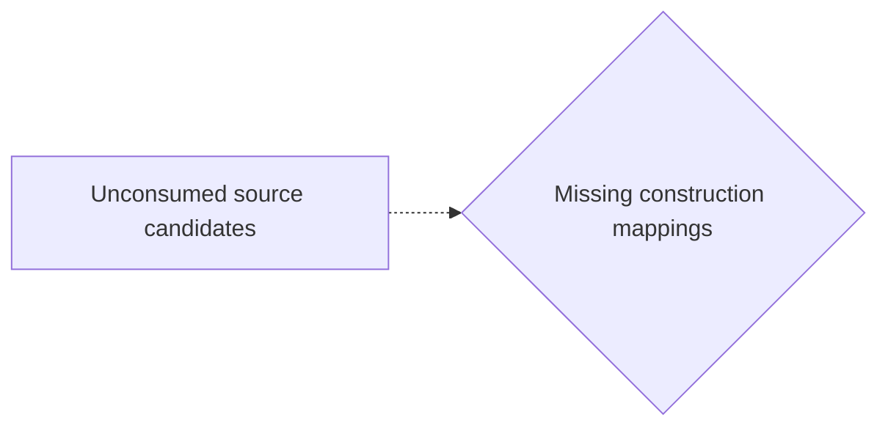
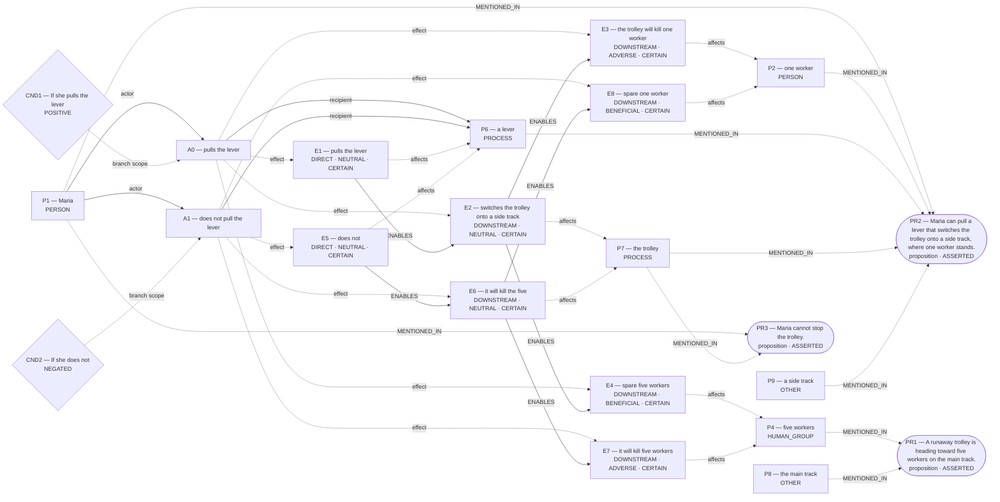
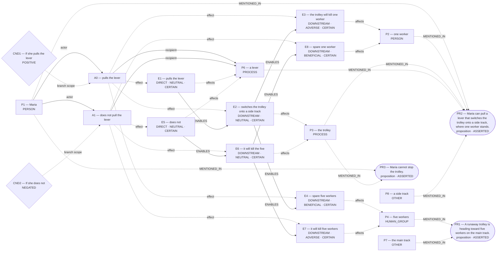

# Candidate world attempts

Chosen blueprint: **omission_harm**  
Chooser status: **FILLED**

## 1. rescue_contrast (alternative; baseline)

Template status: **PARTIAL**  
Proposal status: **WITHHELD**  
Contract valid: **true**  
Missing slots: `first_saved`, `second_saved`, `rescue_exclusivity`, `first_rescue_action`, `second_rescue_action`, `scene`

World withheld:

- Required slots remain unfilled: first_saved, second_saved, rescue_exclusivity, first_rescue_action, second_rescue_action

Source constructions retained outside the admitted world:

Parser proposals below preserve alternatives and local scope; they do not establish occurrence or a resolved interpretation.

Unconsumed parser candidates: **63**. These are visible mapping gaps, not admission failures.



- `c0`: Which construction should preserve this PREDICATION reading?
- `c1`: Which construction should preserve this PREDICATION reading?
- `c2`: Which construction should preserve this PREDICATION reading?
- `c3`: Which construction should preserve this PREDICATION reading?
- `c6`: Which construction should preserve this PREDICATION reading?
- `c9`: Which construction should preserve this PREDICATION reading?
- `c10`: Which construction should preserve this PREDICATION reading?
- `c11`: Which construction should preserve this PREDICATION reading?
- `c14`: Which construction should preserve this MODALITY reading?
- `c15`: Which construction should preserve this MODALITY reading?
- `c16`: Which construction should preserve this MODALITY reading?
- `c17`: Which construction should preserve this MODALITY reading?
- `c18`: Which construction should preserve this MODALITY reading?
- `c19`: Which construction should preserve this MODALITY reading?
- `c20`: Which construction should preserve this MODALITY reading?
- `c21`: Which construction should preserve this MODALITY reading?
- `c22`: Which construction should preserve this MODALITY reading?
- `c23`: Which construction should preserve this MODALITY reading?
- `c24`: Which construction should preserve this PARTICIPANT reading?
- `c25`: Which construction should preserve this PARTICIPANT reading?
- `c26`: Which construction should preserve this PARTICIPANT reading?
- `c27`: Which construction should preserve this PARTICIPANT reading?
- `c28`: Which construction should preserve this PARTICIPANT reading?
- `c29`: Which construction should preserve this PARTICIPANT reading?
- `c32`: Which construction should preserve this PARTICIPANT reading?
- `c33`: Which construction should preserve this PARTICIPANT reading?
- `c34`: Which construction should preserve this PARTICIPANT reading?
- `c36`: Which construction should preserve this PARTICIPANT reading?
- `c37`: Which construction should preserve this PARTICIPANT reading?
- `c38`: Which construction should preserve this PARTICIPANT reading?
- `c39`: Which construction should preserve this PARTICIPANT reading?
- `c40`: Which construction should preserve this PARTICIPANT reading?
- `c41`: Which construction should preserve this PARTICIPANT reading?
- `c42`: Which construction should preserve this PARTICIPANT reading?
- `c43`: Which construction should preserve this QUANTITY reading?
- `c44`: Which construction should preserve this QUANTITY reading?
- `c45`: Which construction should preserve this SAME_REFERENT reading?
- `c46`: Which construction should preserve this SAME_REFERENT reading?
- `c47`: Which construction should preserve this SAME_REFERENT reading?
- `c48`: Which construction should preserve this SAME_REFERENT reading?
- `c49`: Which construction should preserve this SAME_REFERENT reading?
- `c50`: Which construction should preserve this SAME_REFERENT reading?
- `c51`: Which construction should preserve this SAME_REFERENT reading?
- `c52`: Which construction should preserve this SAME_REFERENT reading?
- `c53`: Which construction should preserve this SAME_REFERENT reading?
- `c54`: Which construction should preserve this SAME_REFERENT reading?
- `c55`: Which construction should preserve this SAME_REFERENT reading?
- `c56`: Which construction should preserve this SAME_REFERENT reading?
- `c57`: Which construction should preserve this SAME_REFERENT reading?
- `c58`: Which construction should preserve this SAME_REFERENT reading?
- `c59`: Which construction should preserve this SAME_REFERENT reading?
- `c60`: Which construction should preserve this SAME_REFERENT reading?
- `c61`: Which construction should preserve this SAME_REFERENT reading?
- `c62`: Which construction should preserve this SAME_REFERENT reading?
- `c63`: Which construction should preserve this SAME_REFERENT reading?
- `c64`: Which construction should preserve this SAME_REFERENT reading?
- `c65`: Which construction should preserve this SAME_REFERENT reading?
- `c66`: Which construction should preserve this SAME_REFERENT reading?
- `c67`: Which construction should preserve this SAME_REFERENT reading?
- `c68`: Which construction should preserve this SAME_REFERENT reading?
- `c69`: Which construction should preserve this SAME_REFERENT reading?
- `c70`: Which construction should preserve this SAME_REFERENT reading?
- `c71`: Which construction should preserve this SAME_REFERENT reading?

## 2. omission_harm (selected; baseline)

Template status: **FILLED**  
Proposal status: **FILLED**  
Contract valid: **true**  
Missing slots: `instrument`

### omission_harm candidate graph



Native admission:

```json
{
  "blueprint_id": "omission_harm",
  "rank": 1,
  "variant": "baseline",
  "candidate_path": "/Users/benjaminkowal/Documents/Python/Python Coding/RL_Algorithms/diagnostics/trolley_refinement_final_live_20261008/pipeline/admission_attempts/01_omission_harm/candidate.json",
  "overlay_path": "/Users/benjaminkowal/Documents/Python/Python Coding/RL_Algorithms/diagnostics/trolley_refinement_final_live_20261008/pipeline/admission_attempts/01_omission_harm/hypothesis_overlay.json",
  "status": "ADMITTED",
  "admission": {
    "status": "COMMITTED",
    "world_model_status": "COMMITTED",
    "effects": 8,
    "causal_links": 6,
    "frozen_trace_valid": true,
    "discourse_committed": false,
    "relent_workspace": {
      "established": [
        {
          "kind": "occurrence_effect",
          "effect_id": "E1",
          "outcome": "pulls the lever",
          "predicate": null,
          "status": "established"
        },
        {
          "kind": "occurrence_effect",
          "effect_id": "E2",
          "outcome": "switches the trolley onto a side track",
          "predicate": null,
          "status": "established"
        },
        {
          "kind": "occurrence_effect",
          "effect_id": "E3",
          "outcome": "the trolley will kill one worker",
          "predicate": null,
          "status": "established"
        },
        {
          "kind": "occurrence_effect",
          "effect_id": "E4",
          "outcome": "spare five workers",
          "predicate": null,
          "status": "established"
        },
        {
          "kind": "occurrence_effect",
          "effect_id": "E5",
          "outcome": "does not",
          "predicate": null,
          "status": "established"
        },
        {
          "kind": "occurrence_effect",
          "effect_id": "E6",
          "outcome": "it will kill the five",
          "predicate": null,
          "status": "established"
        },
        {
          "kind": "occurrence_effect",
          "effect_id": "E7",
          "outcome": "it will kill five workers",
          "predicate": null,
          "status": "established"
        },
        {
          "kind": "occurrence_effect",
          "effect_id": "E8",
          "outcome": "spare one worker",
          "predicate": null,
          "status": "established"
        }
      ],
      "not_established": [],
      "duty_ledger_citations": [],
      "ev_forbidden_proposition_ids": [],
      "factual_status_sources": [
        "occurrence_effects"
      ]
    },
    "fingerprint_sha256": "1385b6f34087b29e291f691b7714f90bc63bbf9123b63568adae2fa49ae65107"
  },
  "trace_path": "/Users/benjaminkowal/Documents/Python/Python Coding/RL_Algorithms/diagnostics/trolley_refinement_final_live_20261008/pipeline/admission_attempts/01_omission_harm/frozen_world_trace.json"
}
```

Source constructions retained outside the admitted world:

Parser proposals below preserve alternatives and local scope; they do not establish occurrence or a resolved interpretation.

Unconsumed parser candidates: **63**. These are visible mapping gaps, not admission failures.


- `c0`: Which construction should preserve this PREDICATION reading?
- `c1`: Which construction should preserve this PREDICATION reading?
- `c2`: Which construction should preserve this PREDICATION reading?
- `c3`: Which construction should preserve this PREDICATION reading?
- `c6`: Which construction should preserve this PREDICATION reading?
- `c9`: Which construction should preserve this PREDICATION reading?
- `c10`: Which construction should preserve this PREDICATION reading?
- `c11`: Which construction should preserve this PREDICATION reading?
- `c14`: Which construction should preserve this MODALITY reading?
- `c15`: Which construction should preserve this MODALITY reading?
- `c16`: Which construction should preserve this MODALITY reading?
- `c17`: Which construction should preserve this MODALITY reading?
- `c18`: Which construction should preserve this MODALITY reading?
- `c19`: Which construction should preserve this MODALITY reading?
- `c20`: Which construction should preserve this MODALITY reading?
- `c21`: Which construction should preserve this MODALITY reading?
- `c22`: Which construction should preserve this MODALITY reading?
- `c23`: Which construction should preserve this MODALITY reading?
- `c24`: Which construction should preserve this PARTICIPANT reading?
- `c25`: Which construction should preserve this PARTICIPANT reading?
- `c26`: Which construction should preserve this PARTICIPANT reading?
- `c27`: Which construction should preserve this PARTICIPANT reading?
- `c28`: Which construction should preserve this PARTICIPANT reading?
- `c29`: Which construction should preserve this PARTICIPANT reading?
- `c32`: Which construction should preserve this PARTICIPANT reading?
- `c33`: Which construction should preserve this PARTICIPANT reading?
- `c34`: Which construction should preserve this PARTICIPANT reading?
- `c36`: Which construction should preserve this PARTICIPANT reading?
- `c37`: Which construction should preserve this PARTICIPANT reading?
- `c38`: Which construction should preserve this PARTICIPANT reading?
- `c39`: Which construction should preserve this PARTICIPANT reading?
- `c40`: Which construction should preserve this PARTICIPANT reading?
- `c41`: Which construction should preserve this PARTICIPANT reading?
- `c42`: Which construction should preserve this PARTICIPANT reading?
- `c43`: Which construction should preserve this QUANTITY reading?
- `c44`: Which construction should preserve this QUANTITY reading?
- `c45`: Which construction should preserve this SAME_REFERENT reading?
- `c46`: Which construction should preserve this SAME_REFERENT reading?
- `c47`: Which construction should preserve this SAME_REFERENT reading?
- `c48`: Which construction should preserve this SAME_REFERENT reading?
- `c49`: Which construction should preserve this SAME_REFERENT reading?
- `c50`: Which construction should preserve this SAME_REFERENT reading?
- `c51`: Which construction should preserve this SAME_REFERENT reading?
- `c52`: Which construction should preserve this SAME_REFERENT reading?
- `c53`: Which construction should preserve this SAME_REFERENT reading?
- `c54`: Which construction should preserve this SAME_REFERENT reading?
- `c55`: Which construction should preserve this SAME_REFERENT reading?
- `c56`: Which construction should preserve this SAME_REFERENT reading?
- `c57`: Which construction should preserve this SAME_REFERENT reading?
- `c58`: Which construction should preserve this SAME_REFERENT reading?
- `c59`: Which construction should preserve this SAME_REFERENT reading?
- `c60`: Which construction should preserve this SAME_REFERENT reading?
- `c61`: Which construction should preserve this SAME_REFERENT reading?
- `c62`: Which construction should preserve this SAME_REFERENT reading?
- `c63`: Which construction should preserve this SAME_REFERENT reading?
- `c64`: Which construction should preserve this SAME_REFERENT reading?
- `c65`: Which construction should preserve this SAME_REFERENT reading?
- `c66`: Which construction should preserve this SAME_REFERENT reading?
- `c67`: Which construction should preserve this SAME_REFERENT reading?
- `c68`: Which construction should preserve this SAME_REFERENT reading?
- `c69`: Which construction should preserve this SAME_REFERENT reading?
- `c70`: Which construction should preserve this SAME_REFERENT reading?
- `c71`: Which construction should preserve this SAME_REFERENT reading?

## 3. conditional_outcome (alternative; baseline)

Template status: **FILLED**  
Proposal status: **FILLED**  
Contract valid: **true**  
Missing slots: `chance`

### conditional_outcome candidate graph



Native admission:

```json
{
  "blueprint_id": "conditional_outcome",
  "rank": 2,
  "variant": "baseline",
  "candidate_path": "/Users/benjaminkowal/Documents/Python/Python Coding/RL_Algorithms/diagnostics/trolley_refinement_final_live_20261008/pipeline/admission_attempts/02_conditional_outcome/candidate.json",
  "overlay_path": "/Users/benjaminkowal/Documents/Python/Python Coding/RL_Algorithms/diagnostics/trolley_refinement_final_live_20261008/pipeline/admission_attempts/02_conditional_outcome/hypothesis_overlay.json",
  "status": "ADMITTED",
  "admission": {
    "status": "COMMITTED",
    "world_model_status": "COMMITTED",
    "effects": 8,
    "causal_links": 6,
    "frozen_trace_valid": true,
    "discourse_committed": false,
    "relent_workspace": {
      "established": [
        {
          "kind": "occurrence_effect",
          "effect_id": "E1",
          "outcome": "pulls the lever",
          "predicate": null,
          "status": "established"
        },
        {
          "kind": "occurrence_effect",
          "effect_id": "E2",
          "outcome": "switches the trolley onto a side track",
          "predicate": null,
          "status": "established"
        },
        {
          "kind": "occurrence_effect",
          "effect_id": "E3",
          "outcome": "the trolley will kill one worker",
          "predicate": null,
          "status": "established"
        },
        {
          "kind": "occurrence_effect",
          "effect_id": "E4",
          "outcome": "spare five workers",
          "predicate": null,
          "status": "established"
        },
        {
          "kind": "occurrence_effect",
          "effect_id": "E5",
          "outcome": "does not",
          "predicate": null,
          "status": "established"
        },
        {
          "kind": "occurrence_effect",
          "effect_id": "E6",
          "outcome": "it will kill the five",
          "predicate": null,
          "status": "established"
        },
        {
          "kind": "occurrence_effect",
          "effect_id": "E7",
          "outcome": "it will kill five workers",
          "predicate": null,
          "status": "established"
        },
        {
          "kind": "occurrence_effect",
          "effect_id": "E8",
          "outcome": "spare one worker",
          "predicate": null,
          "status": "established"
        }
      ],
      "not_established": [],
      "duty_ledger_citations": [],
      "ev_forbidden_proposition_ids": [],
      "factual_status_sources": [
        "occurrence_effects"
      ]
    },
    "fingerprint_sha256": "d79c072481ffb9bb2cd32b9dab8f21c7b4ef2e0183044e5b4490b3b16d39d8f7"
  },
  "trace_path": "/Users/benjaminkowal/Documents/Python/Python Coding/RL_Algorithms/diagnostics/trolley_refinement_final_live_20261008/pipeline/admission_attempts/02_conditional_outcome/frozen_world_trace.json"
}
```

Source constructions retained outside the admitted world:

Parser proposals below preserve alternatives and local scope; they do not establish occurrence or a resolved interpretation.

Unconsumed parser candidates: **63**. These are visible mapping gaps, not admission failures.


- `c0`: Which construction should preserve this PREDICATION reading?
- `c1`: Which construction should preserve this PREDICATION reading?
- `c2`: Which construction should preserve this PREDICATION reading?
- `c3`: Which construction should preserve this PREDICATION reading?
- `c6`: Which construction should preserve this PREDICATION reading?
- `c9`: Which construction should preserve this PREDICATION reading?
- `c10`: Which construction should preserve this PREDICATION reading?
- `c11`: Which construction should preserve this PREDICATION reading?
- `c14`: Which construction should preserve this MODALITY reading?
- `c15`: Which construction should preserve this MODALITY reading?
- `c16`: Which construction should preserve this MODALITY reading?
- `c17`: Which construction should preserve this MODALITY reading?
- `c18`: Which construction should preserve this MODALITY reading?
- `c19`: Which construction should preserve this MODALITY reading?
- `c20`: Which construction should preserve this MODALITY reading?
- `c21`: Which construction should preserve this MODALITY reading?
- `c22`: Which construction should preserve this MODALITY reading?
- `c23`: Which construction should preserve this MODALITY reading?
- `c24`: Which construction should preserve this PARTICIPANT reading?
- `c25`: Which construction should preserve this PARTICIPANT reading?
- `c26`: Which construction should preserve this PARTICIPANT reading?
- `c27`: Which construction should preserve this PARTICIPANT reading?
- `c28`: Which construction should preserve this PARTICIPANT reading?
- `c29`: Which construction should preserve this PARTICIPANT reading?
- `c32`: Which construction should preserve this PARTICIPANT reading?
- `c33`: Which construction should preserve this PARTICIPANT reading?
- `c34`: Which construction should preserve this PARTICIPANT reading?
- `c36`: Which construction should preserve this PARTICIPANT reading?
- `c37`: Which construction should preserve this PARTICIPANT reading?
- `c38`: Which construction should preserve this PARTICIPANT reading?
- `c39`: Which construction should preserve this PARTICIPANT reading?
- `c40`: Which construction should preserve this PARTICIPANT reading?
- `c41`: Which construction should preserve this PARTICIPANT reading?
- `c42`: Which construction should preserve this PARTICIPANT reading?
- `c43`: Which construction should preserve this QUANTITY reading?
- `c44`: Which construction should preserve this QUANTITY reading?
- `c45`: Which construction should preserve this SAME_REFERENT reading?
- `c46`: Which construction should preserve this SAME_REFERENT reading?
- `c47`: Which construction should preserve this SAME_REFERENT reading?
- `c48`: Which construction should preserve this SAME_REFERENT reading?
- `c49`: Which construction should preserve this SAME_REFERENT reading?
- `c50`: Which construction should preserve this SAME_REFERENT reading?
- `c51`: Which construction should preserve this SAME_REFERENT reading?
- `c52`: Which construction should preserve this SAME_REFERENT reading?
- `c53`: Which construction should preserve this SAME_REFERENT reading?
- `c54`: Which construction should preserve this SAME_REFERENT reading?
- `c55`: Which construction should preserve this SAME_REFERENT reading?
- `c56`: Which construction should preserve this SAME_REFERENT reading?
- `c57`: Which construction should preserve this SAME_REFERENT reading?
- `c58`: Which construction should preserve this SAME_REFERENT reading?
- `c59`: Which construction should preserve this SAME_REFERENT reading?
- `c60`: Which construction should preserve this SAME_REFERENT reading?
- `c61`: Which construction should preserve this SAME_REFERENT reading?
- `c62`: Which construction should preserve this SAME_REFERENT reading?
- `c63`: Which construction should preserve this SAME_REFERENT reading?
- `c64`: Which construction should preserve this SAME_REFERENT reading?
- `c65`: Which construction should preserve this SAME_REFERENT reading?
- `c66`: Which construction should preserve this SAME_REFERENT reading?
- `c67`: Which construction should preserve this SAME_REFERENT reading?
- `c68`: Which construction should preserve this SAME_REFERENT reading?
- `c69`: Which construction should preserve this SAME_REFERENT reading?
- `c70`: Which construction should preserve this SAME_REFERENT reading?
- `c71`: Which construction should preserve this SAME_REFERENT reading?

## 4. primitive_composition (alternative; composition)

Template status: **WITHHELD**  
Proposal status: **WITHHELD**  
Contract valid: **true**  
Missing slots: none

World withheld:

- No supported conditional branch was extracted.

Source constructions retained outside the admitted world:

Parser proposals below preserve alternatives and local scope; they do not establish occurrence or a resolved interpretation.

Unconsumed parser candidates: **63**. These are visible mapping gaps, not admission failures.


- `c0`: Which construction should preserve this PREDICATION reading?
- `c1`: Which construction should preserve this PREDICATION reading?
- `c2`: Which construction should preserve this PREDICATION reading?
- `c3`: Which construction should preserve this PREDICATION reading?
- `c6`: Which construction should preserve this PREDICATION reading?
- `c9`: Which construction should preserve this PREDICATION reading?
- `c10`: Which construction should preserve this PREDICATION reading?
- `c11`: Which construction should preserve this PREDICATION reading?
- `c14`: Which construction should preserve this MODALITY reading?
- `c15`: Which construction should preserve this MODALITY reading?
- `c16`: Which construction should preserve this MODALITY reading?
- `c17`: Which construction should preserve this MODALITY reading?
- `c18`: Which construction should preserve this MODALITY reading?
- `c19`: Which construction should preserve this MODALITY reading?
- `c20`: Which construction should preserve this MODALITY reading?
- `c21`: Which construction should preserve this MODALITY reading?
- `c22`: Which construction should preserve this MODALITY reading?
- `c23`: Which construction should preserve this MODALITY reading?
- `c24`: Which construction should preserve this PARTICIPANT reading?
- `c25`: Which construction should preserve this PARTICIPANT reading?
- `c26`: Which construction should preserve this PARTICIPANT reading?
- `c27`: Which construction should preserve this PARTICIPANT reading?
- `c28`: Which construction should preserve this PARTICIPANT reading?
- `c29`: Which construction should preserve this PARTICIPANT reading?
- `c32`: Which construction should preserve this PARTICIPANT reading?
- `c33`: Which construction should preserve this PARTICIPANT reading?
- `c34`: Which construction should preserve this PARTICIPANT reading?
- `c36`: Which construction should preserve this PARTICIPANT reading?
- `c37`: Which construction should preserve this PARTICIPANT reading?
- `c38`: Which construction should preserve this PARTICIPANT reading?
- `c39`: Which construction should preserve this PARTICIPANT reading?
- `c40`: Which construction should preserve this PARTICIPANT reading?
- `c41`: Which construction should preserve this PARTICIPANT reading?
- `c42`: Which construction should preserve this PARTICIPANT reading?
- `c43`: Which construction should preserve this QUANTITY reading?
- `c44`: Which construction should preserve this QUANTITY reading?
- `c45`: Which construction should preserve this SAME_REFERENT reading?
- `c46`: Which construction should preserve this SAME_REFERENT reading?
- `c47`: Which construction should preserve this SAME_REFERENT reading?
- `c48`: Which construction should preserve this SAME_REFERENT reading?
- `c49`: Which construction should preserve this SAME_REFERENT reading?
- `c50`: Which construction should preserve this SAME_REFERENT reading?
- `c51`: Which construction should preserve this SAME_REFERENT reading?
- `c52`: Which construction should preserve this SAME_REFERENT reading?
- `c53`: Which construction should preserve this SAME_REFERENT reading?
- `c54`: Which construction should preserve this SAME_REFERENT reading?
- `c55`: Which construction should preserve this SAME_REFERENT reading?
- `c56`: Which construction should preserve this SAME_REFERENT reading?
- `c57`: Which construction should preserve this SAME_REFERENT reading?
- `c58`: Which construction should preserve this SAME_REFERENT reading?
- `c59`: Which construction should preserve this SAME_REFERENT reading?
- `c60`: Which construction should preserve this SAME_REFERENT reading?
- `c61`: Which construction should preserve this SAME_REFERENT reading?
- `c62`: Which construction should preserve this SAME_REFERENT reading?
- `c63`: Which construction should preserve this SAME_REFERENT reading?
- `c64`: Which construction should preserve this SAME_REFERENT reading?
- `c65`: Which construction should preserve this SAME_REFERENT reading?
- `c66`: Which construction should preserve this SAME_REFERENT reading?
- `c67`: Which construction should preserve this SAME_REFERENT reading?
- `c68`: Which construction should preserve this SAME_REFERENT reading?
- `c69`: Which construction should preserve this SAME_REFERENT reading?
- `c70`: Which construction should preserve this SAME_REFERENT reading?
- `c71`: Which construction should preserve this SAME_REFERENT reading?
