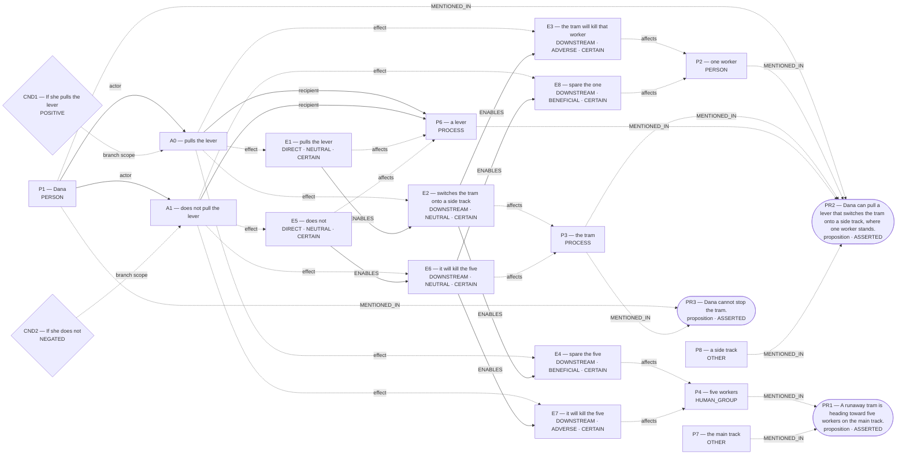

# Admitted world-state topology

Admission: **COMMITTED**  
Admitted effects: `E1, E2, E3, E4, E5, E6, E7, E8`  
Conditions: **2**; Temporal links: **0**; Counterfactual links: **0**.

Discourse objects (not established effects):

- `PR1` (proposition): A runaway tram is heading toward five workers on the main track.
- `PR2` (proposition): Dana can pull a lever that switches the tram onto a side track, where one worker stands.
- `PR3` (proposition): Dana cannot stop the tram.
