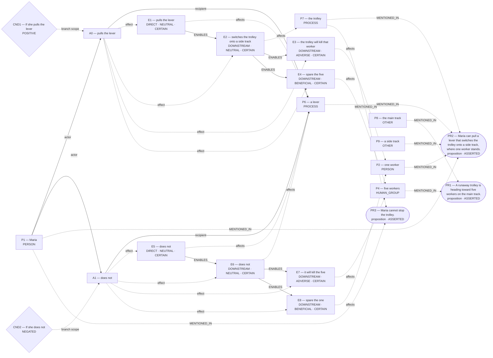

# Parliament demo

Status: **FRAMEWORK_PARTIAL** (recorded_pipeline_outcome).

Native judgment status: NOT_ADJUDICATED.

## Scenario

A runaway trolley is heading toward five workers on the main track. Maria can pull a lever that switches the trolley onto a side track, where one worker stands. If she pulls the lever, the trolley will kill that worker and spare the five. If she does not, it will kill the five and spare the one. Maria cannot stop the trolley. Should she pull the lever?

## What Parliament thinks is happening

Actions: pulls the lever; does not

Parties: Maria, one worker, five workers, a lever, the trolley, the main track, a side track

These are alternative action branches and their stipulated outcomes, not claims that both actions occurred.

- Under A0, a lever: pulls the lever (CERTAIN)
- Under A0, the trolley: switches the trolley onto a side track (CERTAIN)
- Under A0, one worker: the trolley will kill that worker (CERTAIN)
- Under A0, five workers: spare the five (CERTAIN)
- Under A1, a lever: does not (CERTAIN)
- Under A1, a lever: does not (CERTAIN)
- Under A1, five workers: it will kill the five (CERTAIN)
- Under A1, one worker: spare the one (CERTAIN)
- pulls the lever → ENABLES → switches the trolley onto a side track
- switches the trolley onto a side track → ENABLES → the trolley will kill that worker
- switches the trolley onto a side track → ENABLES → spare the five
- does not → ENABLES → does not
- does not → ENABLES → it will kill the five
- does not → ENABLES → spare the one

Source scene and constraints:

- A runaway trolley is heading toward five workers on the main track.
- Maria can pull a lever that switches the trolley onto a side track, where one worker stands.
- Maria cannot stop the trolley.

## World-state diagram

### Frozen world supplied to framework assessment

## What is grounded

Admitted source copies and structurally derived records follow. Exact excerpts establish traceability; they do not independently prove every interpretation.

- pulls the lever — DIRECT_COPY; source: “If she pulls the lever, the trolley will kill that worker and spare the five.”
- switches the trolley onto a side track — SOURCE_STIPULATED_CAUSAL; source: “Maria can pull a lever that switches the trolley onto a side track, where one worker stands.”
- the trolley will kill that worker — SOURCE_STIPULATED_CAUSAL; source: “If she pulls the lever, the trolley will kill that worker and spare the five.; Maria can pull a lever that switches the trolley onto a side track, where one worker stands.; If she does not, it will kill the five and spare the one.”
- spare the five — SOURCE_STIPULATED_CAUSAL; source: “If she pulls the lever, the trolley will kill that worker and spare the five.; If she does not, it will kill the five and spare the one.; A runaway trolley is heading toward five workers on the main track.”
- does not — DIRECT_COPY; source: “If she does not, it will kill the five and spare the one.”
- does not — SOURCE_STIPULATED_CAUSAL; source: “If she does not, it will kill the five and spare the one.”
- it will kill the five — SOURCE_STIPULATED_CAUSAL; source: “If she does not, it will kill the five and spare the one.; If she pulls the lever, the trolley will kill that worker and spare the five.; A runaway trolley is heading toward five workers on the main track.”
- spare the one — SOURCE_STIPULATED_CAUSAL; source: “If she does not, it will kill the five and spare the one.; If she pulls the lever, the trolley will kill that worker and spare the five.; Maria can pull a lever that switches the trolley onto a side track, where one worker stands.”
- Stipulated source claim: If she does not, it will kill the five and spare the one.
- Stipulated source claim: If she pulls the lever, the trolley will kill that worker and spare the five.
- Stipulated source claim: Maria can pull a lever that switches the trolley onto a side track, where one worker stands.
- Stipulated source claim: Maria cannot stop the trolley.
- Stipulated source claim: A runaway trolley is heading toward five workers on the main track.

## What remains uncertain

- The utilitarian ledger contains unknown welfare magnitude or duration; survivor arithmetic does not settle total welfare.
- A0 ADJUDICATION_CALIBRATION: doing-harm classification lacks an agent-caused settled welfare harm on the protected party
- A0 ADJUDICATION_CALIBRATION: intended-as-means classification lacks an in-action causal path
- A0 ADJUDICATION_CALIBRATION: resolved adjudication rests on unsupported decisive premises
- whether the harm-relation follows the admitted graph's causal topology rather than a relabel chosen to fit the verdict
- whether an in-action causal path makes the burden instrumental to the chosen end
- one worker: refrain from killing innocents ↔ five workers: imperfect duty to rescue
- A0 prohibited by do not intentionally kill ↔ whether the harm-relation follows the admitted graph's causal topology rather than a relabel chosen to fit the verdict
- A0 prohibited by do not intentionally kill ↔ whether an in-action causal path makes the burden instrumental to the chosen end
- A0 competing Care claim remains contested
- A1 competing Care claim remains contested
- Would verifying this unestablished consequence reverse the admitted ranking: five workers are entrusted to the decision maker?
- framework map for pulls the lever lacks framework-specific grounds
- framework map for does not lacks framework-specific grounds
- decisive numbers are not tied to the affected subject or Rawlsian position
- Rawlsian position for A0 conflicts with its framework map
- numeric reversal threshold lacks a scenario-grounded quantity

## Framework views

### utilitarian

Position: **FULL**. Recorded preference: pulls the lever (not necessarily operative).

Minimises total deaths

Assumption: Not separately recorded.

Dependencies: Not separately recorded.

Live objection: None separately recorded.

Reversal: If the side track had five or more workers, the ranking would reverse.

### deontological

Position: **ABSTAIN**. Recorded preference: does not (not necessarily operative).

Deontology ranks one worker's refrain from killing innocents above five workers's imperfect duty to rescue through respect persons, but that priority holds only if A0 is genuinely provisionally favored under incomplete adjudication, and the

Assumption: Not separately recorded.

Dependencies: Not separately recorded.

Live objection: A0 ADJUDICATION_CALIBRATION: doing-harm classification lacks an agent-caused settled welfare harm on the protected party; A0 ADJUDICATION_CALIBRATION: intended-as-means classification lacks an in-action causal path; A0 ADJUDICATION_CALIBRATION: resolved adjudication rests on unsupported decisive premises; whether the harm-relation follows the admitted graph's causal topology rather than a relabel chosen to fit the verdict; whether an in-action causal path makes the burden instrumental to the chosen end; one worker: refrain from killing innocents ↔ five workers: imperfect duty to rescue; A0 prohibited by do not intentionally kill ↔ whether the harm-relation follows the admitted graph's causal topology rather than a relabel chosen to fit the verdict; A0 prohibited by do not intentionally kill ↔ whether an in-action causal path makes the burden instrumental to the chosen end

Reversal: If perfect duty could be outweighed

### care

Position: **ATTENUATED**. Recorded preference: pulls the lever (not necessarily operative).

lever aids more vulnerable.

Assumption: Not separately recorded.

Dependencies: five workers are entrusted to the decision maker

Live objection: A0 competing Care claim remains contested; A1 competing Care claim remains contested; Would verifying this unestablished consequence reverse the admitted ranking: five workers are entrusted to the decision maker?

Reversal: care priority shifts from immediacy to non-interference; side track holds five or more

### virtue

Position: **FULL**. Recorded preference: pulls the lever (not necessarily operative).

courageous compassionate choice

Assumption: Not separately recorded.

Dependencies: Not separately recorded.

Live objection: None separately recorded.

Reversal: if any direct killing is always vicious; if lever saved fewer lives than it costs

### rawlsian

Position: **ABSTAIN**. Recorded preference: pulls the lever (not necessarily operative).

NONE","fr":true,"bd":"NONE","fic":[],"foq":[],"sps":["PROP:WORLD:E3","PROP:WORLD:E7"],"dcp":[],"ep":[{"c":"the trolley will kill that worker

Assumption: Not separately recorded.

Dependencies: Not separately recorded.

Live objection: framework map for pulls the lever lacks framework-specific grounds; framework map for does not lacks framework-specific grounds; decisive numbers are not tied to the affected subject or Rawlsian position; Rawlsian position for A0 conflicts with its framework map; numeric reversal threshold lacks a scenario-grounded quantity

Reversal: agency-based duty never to kill overrides risk gains

## Agreement and disagreement

Recorded preferences differ.

Framework-local normative arguments and empirical dependencies are shown above; no automatic causal classification is claimed.

- utilitarian: empirical dependency — If the side track had five or more workers, the ranking would reverse.
- deontological: normative dependency — If perfect duty could be outweighed
- care: normative dependency — care priority shifts from immediacy to non-interference

## Decision hinges

- utilitarian: If the side track had five or more workers, the ranking would reverse. (reported argument, not verified premise; `cycles/0/candidates/0/factual_reversal_threshold`).
- deontological: If perfect duty could be outweighed (reported argument, not verified premise; `cycles/0/candidates/1/normative_reversal_threshold`).
- care: care priority shifts from immediacy to non-interference (reported argument, not verified premise; `cycles/0/candidates/2/normative_reversal_threshold`).

## What Parliament did not decide

- This report does not adjudicate a governing moral verdict.
- Ledger admission does not prove the argument or supply missing welfare units.
- Unresolved objections remain live; reported reversal thresholds are not source facts.

## Pipeline stop and inspection

FRAMEWORK_PARTIAL

Missing slots: rescue_contrast: first_saved, rescue_contrast: second_saved, rescue_contrast: rescue_exclusivity, rescue_contrast: first_rescue_action, rescue_contrast: second_rescue_action

Competing admitted interpretations: omission_harm: pulls the lever, does not; conditional_outcome: pulls the lever, does not

Inspection artifacts (saved replay references its original records):

- [candidate_graphs.md](/Users/benjaminkowal/Documents/Python/Python Coding/RL_Algorithms/diagnostics/trolley_scene_complete_live_20261008/pipeline/candidate_graphs.md)
- [candidate_attempts.json](/Users/benjaminkowal/Documents/Python/Python Coding/RL_Algorithms/diagnostics/trolley_scene_complete_live_20261008/pipeline/candidate_attempts.json)
- [question_assessment.json](/Users/benjaminkowal/Documents/Python/Python Coding/RL_Algorithms/diagnostics/trolley_scene_complete_live_20261008/pipeline/question_assessment.json)
- [world_beam.json](/Users/benjaminkowal/Documents/Python/Python Coding/RL_Algorithms/diagnostics/trolley_scene_complete_live_20261008/pipeline/world_beam.json)
- [preparation_manifest.json](/Users/benjaminkowal/Documents/Python/Python Coding/RL_Algorithms/diagnostics/trolley_scene_complete_live_20261008/pipeline/preparation_manifest.json)
- [frozen_world_trace.json](/Users/benjaminkowal/Documents/Python/Python Coding/RL_Algorithms/diagnostics/trolley_scene_complete_live_20261008/pipeline/frozen_world_trace.json)
- [framework_generation.json](/Users/benjaminkowal/Documents/Python/Python Coding/RL_Algorithms/diagnostics/trolley_scene_complete_live_20261008/frameworks/framework_generation.json)
- [conflict_graph.md](/Users/benjaminkowal/Documents/Python/Python Coding/RL_Algorithms/diagnostics/trolley_scene_complete_live_20261008/frameworks/conflict_graph.md)
