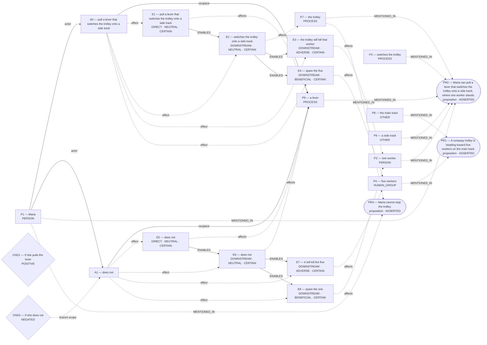
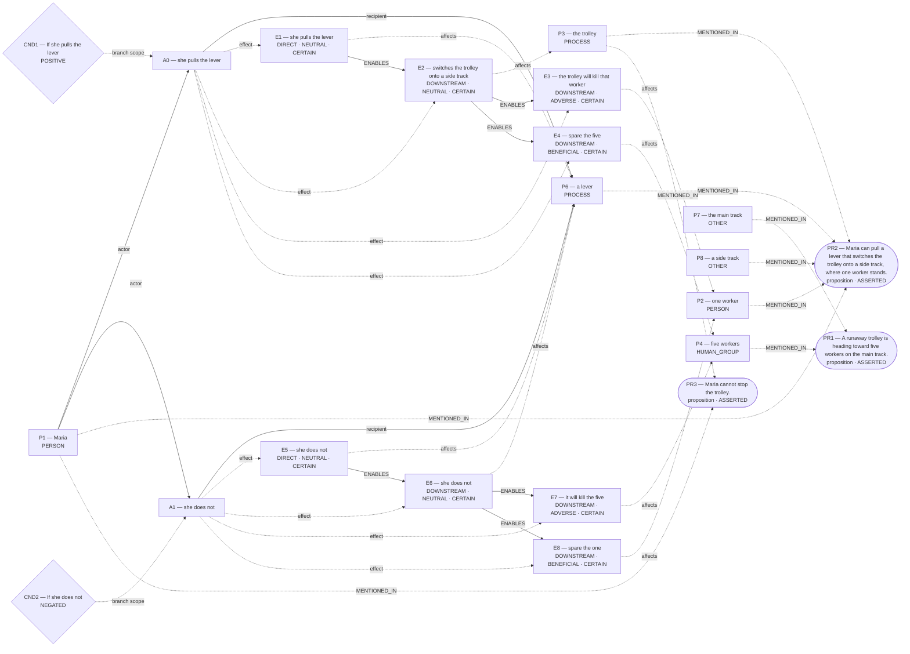

# Parliament demo

Status: **INTERPRETIVE_BEAM** (epistemic_abstention).

Native judgment status: NOT_RUN.

## Scenario

A runaway trolley is heading toward five workers on the main track. Maria can pull a lever that switches the trolley onto a side track, where one worker stands. If she pulls the lever, the trolley will kill that worker and spare the five. If she does not, it will kill the five and spare the one. Maria cannot stop the trolley. Should she pull the lever?

## What Parliament thinks is happening

No unique frozen world is reported.

## World-state diagram

No unique world was frozen. The following are competing admitted interpretations; **none was sent to agents**.

### omission_harm — candidate only; not sent to agents

### conditional_outcome — candidate only; not sent to agents

## What is grounded

Admitted source copies and structurally derived records follow. Exact excerpts establish traceability; they do not independently prove every interpretation.

## What remains uncertain

No additional framework uncertainty was recorded; this is not proof of completeness.

## Framework views

## Agreement and disagreement

No operative preference recorded.

Framework-local normative arguments and empirical dependencies are shown above; no automatic causal classification is claimed.

## Decision hinges

No explicit reversal hinge was recorded. The report does not fabricate one.

## What Parliament did not decide

- This report does not adjudicate a governing moral verdict.
- Ledger admission does not prove the argument or supply missing welfare units.
- Unresolved objections remain live; reported reversal thresholds are not source facts.

## Pipeline stop and inspection

Competing admitted worlds are not separated or invariant.

Missing slots: rescue_contrast: first_saved, rescue_contrast: second_saved, rescue_contrast: rescue_exclusivity, rescue_contrast: first_rescue_action, rescue_contrast: second_rescue_action

Competing admitted interpretations: omission_harm: pull a lever that switches the trolley onto a side track, does not; conditional_outcome: she pulls the lever, she does not

Inspection artifacts (saved replay references its original records):

- [candidate_graphs.md](/Users/benjaminkowal/Documents/Python/Python Coding/RL_Algorithms/diagnostics/trolley_scene_live_20261008/pipeline/candidate_graphs.md)
- [candidate_attempts.json](/Users/benjaminkowal/Documents/Python/Python Coding/RL_Algorithms/diagnostics/trolley_scene_live_20261008/pipeline/candidate_attempts.json)
- [question_assessment.json](/Users/benjaminkowal/Documents/Python/Python Coding/RL_Algorithms/diagnostics/trolley_scene_live_20261008/pipeline/question_assessment.json)
- [world_beam.json](/Users/benjaminkowal/Documents/Python/Python Coding/RL_Algorithms/diagnostics/trolley_scene_live_20261008/pipeline/world_beam.json)
- [preparation_manifest.json](/Users/benjaminkowal/Documents/Python/Python Coding/RL_Algorithms/diagnostics/trolley_scene_live_20261008/pipeline/preparation_manifest.json)
