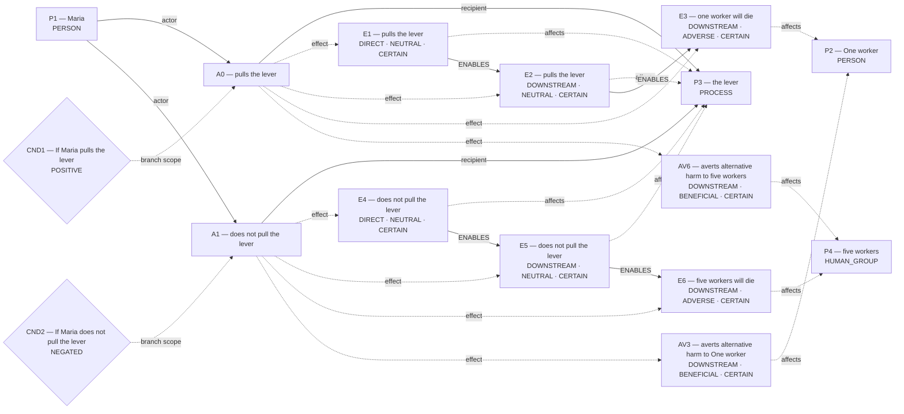
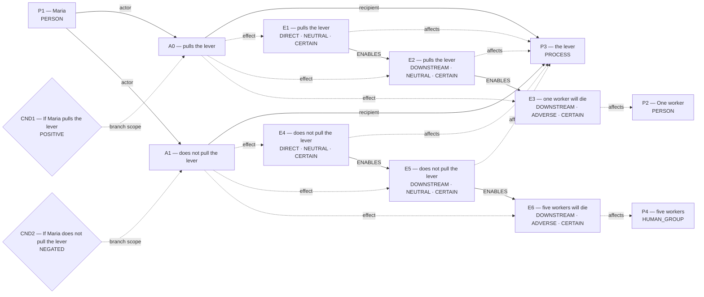
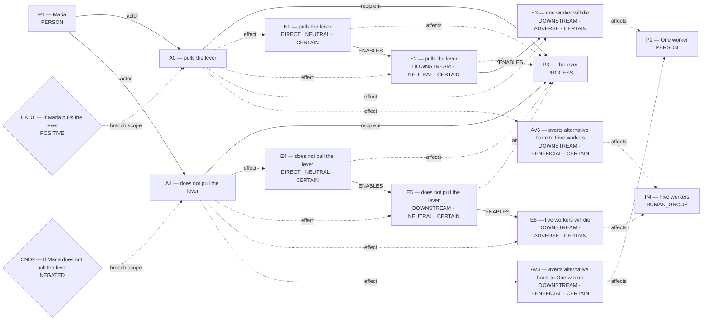

# Candidate world attempts

Chosen blueprint: **omission_harm**  
Chooser status: **FILLED**

## 1. rescue_contrast (alternative)

Template status: **PARTIAL**  
Proposal status: **WITHHELD**  
Contract valid: **true**  
Missing slots: `first_saved`, `second_saved`, `rescue_exclusivity`, `first_rescue_action`, `second_rescue_action`, `first_harm`, `second_benefit`, `scene`

World withheld:

- Required slots remain unfilled: first_saved, second_saved, rescue_exclusivity, first_rescue_action, second_rescue_action, second_benefit

## 2. omission_harm (selected)

Template status: **FILLED**  
Proposal status: **FILLED**  
Contract valid: **true**  
Missing slots: none

### omission_harm candidate graph



Hypothesis overlay (not submitted as world effects):

- `AV3`: averts alternative harm to One worker; unresolved_derivation_assumptions, unsupported_outcome_transformation, hypothesized_averted_harm
- `AV6`: averts alternative harm to five workers; unresolved_derivation_assumptions, unsupported_outcome_transformation, hypothesized_averted_harm

### Supported core for admission



Native admission:

```json
{
  "blueprint_id": "omission_harm",
  "rank": 1,
  "candidate_path": "diagnostics/trolley_supported_core_admission_final/admission_attempts/01_omission_harm/candidate.json",
  "overlay_path": "diagnostics/trolley_supported_core_admission_final/admission_attempts/01_omission_harm/hypothesis_overlay.json",
  "status": "ADMITTED",
  "admission": {
    "status": "COMMITTED",
    "world_model_status": "COMMITTED",
    "effects": 6,
    "causal_links": 4,
    "frozen_trace_valid": true,
    "fingerprint_sha256": "ba13eb0eb78e08f96a55153a7339379c37009b68123275a54b953fca8bea71c8"
  },
  "trace_path": "diagnostics/trolley_supported_core_admission_final/admission_attempts/01_omission_harm/frozen_world_trace.json"
}
```

## 3. conditional_outcome (alternative)

Template status: **FILLED**  
Proposal status: **FILLED**  
Contract valid: **true**  
Missing slots: `chance`

### conditional_outcome candidate graph



Hypothesis overlay (not submitted as world effects):

- `AV3`: averts alternative harm to One worker; unresolved_derivation_assumptions, unsupported_outcome_transformation, hypothesized_averted_harm
- `AV6`: averts alternative harm to Five workers; unresolved_derivation_assumptions, unsupported_outcome_transformation, hypothesized_averted_harm

### Supported core for admission


Native admission:

```json
{
  "blueprint_id": "conditional_outcome",
  "rank": 2,
  "candidate_path": "diagnostics/trolley_supported_core_admission_final/admission_attempts/02_conditional_outcome/candidate.json",
  "overlay_path": "diagnostics/trolley_supported_core_admission_final/admission_attempts/02_conditional_outcome/hypothesis_overlay.json",
  "status": "ADMITTED",
  "admission": {
    "status": "COMMITTED",
    "world_model_status": "COMMITTED",
    "effects": 6,
    "causal_links": 4,
    "frozen_trace_valid": true,
    "fingerprint_sha256": "2fe4885ca8e22fd3aa390dac4e98a9e272320bb8be4ea3ca0d0838cb40664078"
  },
  "trace_path": "diagnostics/trolley_supported_core_admission_final/admission_attempts/02_conditional_outcome/frozen_world_trace.json"
}
```
