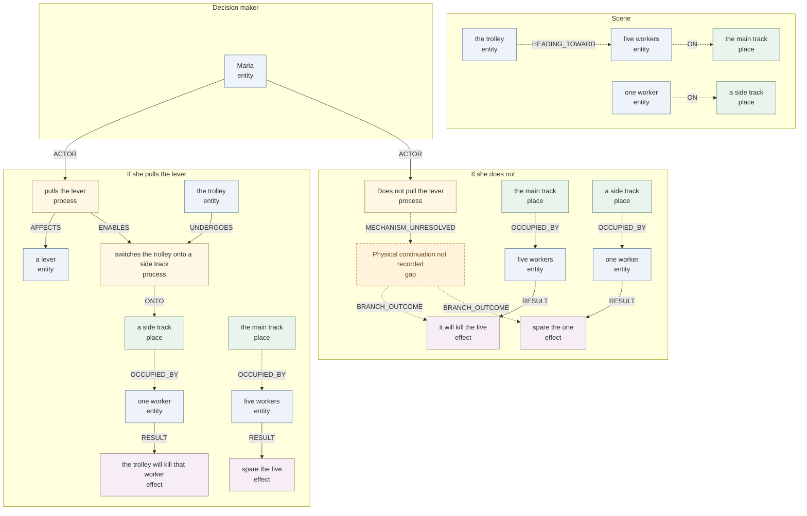

# Typed trolley reader view

The saved trolley demo now opens with typed, directional arrows, organized into scene, pull, and omission branches. Entity, place, process, and effect have distinct display colors. Repeated nodes are display aliases retaining their original world IDs.

Open the running [viewer](http://127.0.0.1:7861/?run=trolley). Use the full-graph toggle to inspect the original admitted topology. Click reader nodes to inspect their original records and provenance.

## What changed

- Source-supported ON, OCCUPIED_BY, HEADING_TOWARD and ONTO relations expose places previously buried in scene prose.
- ACTOR, AFFECTS, UNDERGOES and ENABLES have explicit endpoint types. Pulling affects the lever; the trolley undergoes the switching process.
- RESULT connects an affected person or group to a saved effect. It does not assign causation or moral responsibility.
- Dashed arrows distinguish source readings and unresolved structure from projections of saved roles/links.
- Cloze version 0.13 shares optional evidence-linked physical_scene_cells: mover, instrument, destination, occupancy and branch transitions. The existing required blanks remain unchanged.

## Remaining gap

The saved omission branch contains a placeholder “does not” physical effect. The new view exposes a missing physical continuation instead of inventing a “stays on the main track” event. REMAINS_ON is not inferred; AWAY_FROM the side track would also be misleading. The next construction improvement should bind an explicitly supported default-route process to this branch, with its own provenance.

This is a reversible reader projection, not a new native world schema. Display roles do not change original native kinds. The exported frozen world exactly equals the saved report world; no new world was admitted and no agent/API calls were made.

## Verification

94 regression tests ran: 90 passed and four skipped. Coverage includes typed endpoints, original-world preservation, source offsets, negation/attribution, whitespace invariance, absent/ambiguous mechanisms, and shared Cloze cells. The browser rendered the view successfully; payload and renderer receipts matched. Git diff whitespace checks passed.

Artifacts: [typed records](typed_reader_view.json), [Mermaid source](diagram.mmd), [regression log](regression.log), [export verification](verification.json).

## Diagram

