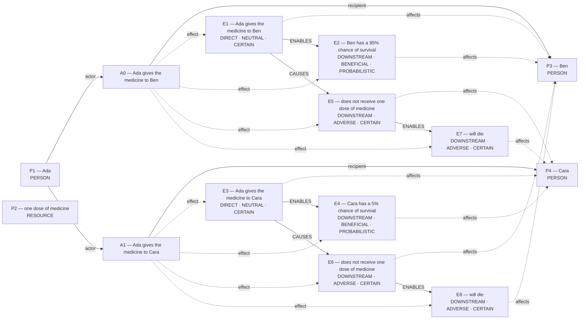

# Parliament demo

Status: **FRAMEWORK_PARTIAL** (recorded_pipeline_outcome).

Native judgment status: UNRESOLVED.

## Scenario

A clinic has one dose of medicine. Ada can give the medicine to Ben or Cara, but not both. If Ada gives the medicine to Ben, Ben has a 95% chance of survival. If Ada gives the medicine to Cara, Cara has a 5% chance of survival. The patient who does not get the medicine will die.

## What Parliament thinks is happening

Actions: Ada gives the medicine to Ben; Ada gives the medicine to Cara

Parties: Ada, one dose of medicine, Ben, Cara

These are alternative action branches and their stipulated outcomes, not claims that both actions occurred.

- Under A0, Ben: Ada gives the medicine to Ben (CERTAIN)
- Under A0, Ben: Ben has a 95% chance of survival (PROBABILISTIC)
- Under A1, Cara: Ada gives the medicine to Cara (CERTAIN)
- Under A1, Cara: Cara has a 5% chance of survival (PROBABILISTIC)
- Under A0, Cara: does not receive one dose of medicine (CERTAIN)
- Under A1, Ben: does not receive one dose of medicine (CERTAIN)
- Under A0, Cara: will die (CERTAIN)
- Under A1, Ben: will die (CERTAIN)
- Ada gives the medicine to Ben → ENABLES → Ben has a 95% chance of survival
- Ada gives the medicine to Cara → ENABLES → Cara has a 5% chance of survival
- does not receive one dose of medicine → ENABLES → will die
- does not receive one dose of medicine → ENABLES → will die
- Ada gives the medicine to Ben → CAUSES → does not receive one dose of medicine
- Ada gives the medicine to Cara → CAUSES → does not receive one dose of medicine

## World-state diagram

### Frozen world supplied to framework assessment

## What is grounded

Admitted source copies and structurally derived records follow. Exact excerpts establish traceability; they do not independently prove every interpretation.

- Ada gives the medicine to Ben — DIRECT_COPY; source: “If Ada gives the medicine to Ben, Ben has a 95% chance of survival.”
- Ben has a 95% chance of survival — SOURCE_STIPULATED_CAUSAL; source: “If Ada gives the medicine to Ben, Ben has a 95% chance of survival.”
- Ada gives the medicine to Cara — DIRECT_COPY; source: “If Ada gives the medicine to Cara, Cara has a 5% chance of survival.”
- Cara has a 5% chance of survival — SOURCE_STIPULATED_CAUSAL; source: “If Ada gives the medicine to Cara, Cara has a 5% chance of survival.”
- does not receive one dose of medicine — EXCLUSIVE_ALLOCATION_COMPLEMENT; source: “A clinic has one dose of medicine.; Ada can give the medicine to Ben or Cara, but not both.; If Ada gives the medicine to Ben, Ben has a 95% chance of survival.”
- does not receive one dose of medicine — EXCLUSIVE_ALLOCATION_COMPLEMENT; source: “A clinic has one dose of medicine.; Ada can give the medicine to Ben or Cara, but not both.; If Ada gives the medicine to Cara, Cara has a 5% chance of survival.”
- will die — SOURCE_STIPULATED_CAUSAL; source: “The patient who does not get the medicine will die.”
- will die — SOURCE_STIPULATED_CAUSAL; source: “The patient who does not get the medicine will die.”
- Stipulated source claim: Ben has a 95% chance of survival; affected subject: Ben; modality: PROBABILISTIC
- Stipulated source claim: 95% chance — Ben has a 95% chance of survival
- Stipulated source claim: Cara has a 5% chance of survival; affected subject: Cara; modality: PROBABILISTIC
- Stipulated source claim: 5% chance — Cara has a 5% chance of survival

## What remains uncertain

- dependency continuity preserved unresolved proposition IDs: PROP:HYPOTHESIS:b11eb479a9d1aeb0
- Would verifying this unestablished consequence reverse the admitted ranking: Only one dose of the life-saving medicine is available (so only one patient can receive it)?
- The utilitarian ledger contains unknown welfare magnitude or duration; survivor arithmetic does not settle total welfare.
- perfect-duty priority for A0 lacks a perfect-duty classification
- perfect-duty priority for A1 lacks a perfect-duty classification
- rejected update: perfect-duty priority for A0 lacks a perfect-duty classification
- rejected update: perfect-duty priority for A1 lacks a perfect-duty classification
- Would verifying this unestablished consequence reverse the admitted ranking: Only one dose of the life-saving medicine is available (so only one patient can be aided)?
- dependency continuity preserved unresolved proposition IDs: PROP:HYPOTHESIS:3481f0238231ad3a
- Would verifying this unestablished consequence reverse the admitted ranking: The medicine is a scarce resource that can be given to only one patient?
- dependency continuity preserved unresolved proposition IDs: PROP:HYPOTHESIS:ba3744fde6124acf
- Would verifying this unestablished consequence reverse the admitted ranking: Ben are entrusted to the decision maker?
- decisive numbers are not tied to the affected subject or Rawlsian position
- Rawlsian preference lacks a stated difference in position or principle priority
- Rawlsian position for A0 conflicts with its framework map
- Rawlsian position for A1 conflicts with its framework map
- A0 IMPROVES lacked directional support; committed as UNCERTAIN
- A1 WORSENS lacked directional support; committed as UNCERTAIN
- rejected update: Rawlsian position for A0 conflicts with its framework map
- rejected update: Rawlsian position for A1 conflicts with its framework map
- rejected update: A0 IMPROVES lacked directional support; committed as UNCERTAIN
- rejected update: A1 WORSENS lacked directional support; committed as UNCERTAIN
- rejected update: decisive numbers are not tied to the affected subject or Rawlsian position
- rejected update: Rawlsian preference lacks a stated difference in position or principle priority
- Would verifying this unestablished consequence reverse the admitted ranking: There is only one dose of medicine, so only one patient can benefit?

## Framework views

### utilitarian

Position: **ABSTAIN**. Recorded preference: Ada gives the medicine to Ben (not necessarily operative).

Utilitarian evidence is insufficient to rank actions. Would verifying this unestablished consequence reverse the admitted ranking: Only one dose of the life-saving medicine is available (so only one patient can receive it)? 95% beats 5% survival. Prefer the action whose expected survivor count is higher. Recorded comparison — Ada gives the medicine to Ben: One dose to Ben saves a life with 95 % chance; only Cara dies.; Ada gives the medicine to Cara: One dose to Cara makes slim 5 % rescue attempt while Ben certainly dies. Premise rebound from PROP:WORLD:E7 to canonical PROP:HYPOTHESIS:67d6bcaf133579a0. Dependency continuity preserved unresolved decision-critical premises from the prior operative framework state because the recommendation did not change. Unsupported hypothesis may raise investigative salience; it cannot uniquely govern.

[Full recorded explanation (Markdown)](arguments/utilitarian.md).

Assumptions / interpretive commitments: Model reported assumption: Survival probabilities decisive for utilitarian calculus.; Recorded interpretive commitment: Prefer the action whose expected survivor count is higher.; Run assumption: The stated scenario facts are accepted as givens for this analysis; their accuracy outside this scenario has not been verified.

The scenario’s stated facts are treated as givens for this run. No separate record says whether they were observed, reported by someone, or supplied as simulation facts. This is a provenance limitation, not a claim that the stated counts are missing.

Dependencies: 95% chance — Ben has a 95% chance of survival; 5% chance — Cara has a 5% chance of survival; Only one dose of the life-saving medicine is available (so only one patient can receive it)

Live objection: dependency continuity preserved unresolved proposition IDs: PROP:HYPOTHESIS:b11eb479a9d1aeb0; Would verifying this unestablished consequence reverse the admitted ranking: Only one dose of the life-saving medicine is available (so only one patient can receive it)?

Would reverse the recorded preference: The agent reports a switch from “Ada gives the medicine to Ben” to “Ada gives the medicine to Cara”. Condition: Survival probabilities decisive for utilitarian calculus. This is an agent-reported condition, not an independently established threshold.; The agent reports a switch from “Ada gives the medicine to Ben” to “Ada gives the medicine to Cara”. Condition: Cara’s survival chance exceeds Ben’s. This is an agent-reported condition, not an independently established threshold.

### deontological

Position: **ABSTAIN**. Recorded preference: Ada gives the medicine to Ben (not necessarily operative).

Expected DEONTOLOGICAL_DUTY_LEDGER, but no matching committed ledger is operative. Would verifying this unestablished consequence reverse the admitted ranking: Only one dose of the life-saving medicine is available (so only one patient can be aided)? duty to rescue effectively. Prefer “Ada gives the medicine to Ben” when it secures far higher survival chance for one patient without using the other merely as a means. Recorded comparison — Ada gives the medicine to Ben: REQUIRED: fulfills duty to save when only one can be aided, non-arbitrary rule.; Ada gives the medicine to Cara: PROHIBITED: disregards effective rescue duty, arbitrarily sacrifices better chance. Premise rebound from PROP:WORLD:E7 to canonical PROP:HYPOTHESIS:67d6bcaf133579a0.

[Full recorded explanation (Markdown)](arguments/deontological.md).

Assumptions / interpretive commitments: Model reported assumption: Probability difference grounds rescue duty; Recorded interpretive commitment: Prefer “Ada gives the medicine to Ben” when it secures far higher survival chance for one patient without using the other merely as a means.; Recorded interpretive commitment: Duty to rescue requires choosing patient with better survival chance, not tallying aggregate welfare.; Run assumption: The stated scenario facts are accepted as givens for this analysis; their accuracy outside this scenario has not been verified.

The scenario’s stated facts are treated as givens for this run. No separate record says whether they were observed, reported by someone, or supplied as simulation facts. This is a provenance limitation, not a claim that the stated counts are missing.

Dependencies: Only one dose of the life-saving medicine is available (so only one patient can be aided); Ben has a 95% chance of survival; affected subject: Ben; modality: PROBABILISTIC; Cara has a 5% chance of survival; affected subject: Cara; modality: PROBABILISTIC

Live objection: perfect-duty priority for A0 lacks a perfect-duty classification; perfect-duty priority for A1 lacks a perfect-duty classification; rejected update: perfect-duty priority for A0 lacks a perfect-duty classification; rejected update: perfect-duty priority for A1 lacks a perfect-duty classification; Would verifying this unestablished consequence reverse the admitted ranking: Only one dose of the life-saving medicine is available (so only one patient can be aided)?

Would reverse the recorded preference: The agent reports a switch from “Ada gives the medicine to Ben” to “Ada gives the medicine to Cara”. Condition: rescue duty no longer decisive. This is an agent-reported condition, not an independently established threshold.; The agent reports a switch from “Ada gives the medicine to Ben” to “Ada gives the medicine to Cara”. Condition: Cara survival > Ben survival. This is an agent-reported condition, not an independently established threshold.

### virtue

Position: **ATTENUATED**. Recorded preference: Ada gives the medicine to Ben (not necessarily operative).

Prudence saves life. Prefer “Ada gives the medicine to Ben” when its survival likelihood far exceeds “Ada gives the medicine to Cara” with no morally relevant difference in patients. Recorded comparison — Ada gives the medicine to Ben: Allocates scarce medicine to give 95 % survival; exemplifies prudence, beneficence, compassion.; Ada gives the medicine to Cara: Allocates to 5 % survival; shows compassion but risks imprudence and waste of life-saving chance. Dependency continuity preserved unresolved decision-critical premises from the prior operative framework state because the recommendation did not change.

[Full recorded explanation (Markdown)](arguments/virtue.md).

Assumptions / interpretive commitments: Model reported assumption: Higher efficacy is decisive for prudent stewardship; Recorded interpretive commitment: Prefer “Ada gives the medicine to Ben” when its survival likelihood far exceeds “Ada gives the medicine to Cara” with no morally relevant difference in patients.; Recorded interpretive commitment: Stakes highlight prudence but numbers inform rather than replace virtue judgment.; Run assumption: The stated scenario facts are accepted as givens for this analysis; their accuracy outside this scenario has not been verified.

The scenario’s stated facts are treated as givens for this run. No separate record says whether they were observed, reported by someone, or supplied as simulation facts. This is a provenance limitation, not a claim that the stated counts are missing.

Dependencies: Ben has a 95% chance of survival; affected subject: Ben; modality: PROBABILISTIC; Cara has a 5% chance of survival; affected subject: Cara; modality: PROBABILISTIC; The medicine is a scarce resource that can be given to only one patient

Live objection: dependency continuity preserved unresolved proposition IDs: PROP:HYPOTHESIS:3481f0238231ad3a; Would verifying this unestablished consequence reverse the admitted ranking: The medicine is a scarce resource that can be given to only one patient?

Would reverse the recorded preference: The agent reports a switch from “Ada gives the medicine to Ben” to “Ada gives the medicine to Cara”. Condition: Higher efficacy is decisive for prudent stewardship. This is an agent-reported condition, not an independently established threshold.; The agent reports a switch from “Ada gives the medicine to Ben” to “Ada gives the medicine to Cara”. Condition: Impartial equality overrides outcome maximisation. This is an agent-reported condition, not an independently established threshold.; The agent reports a switch from “Ada gives the medicine to Ben” to “Ada gives the medicine to Cara”. Condition: Cara survival probability exceeds Ben’s. This is an agent-reported condition, not an independently established threshold.

### care

Position: **ATTENUATED**. Recorded preference: Ada gives the medicine to Ben (not necessarily operative).

Higher survival for entrusted. Prefer “Ada gives the medicine to Ben” when its expected survival for an equally dependent patient greatly exceeds “Ada gives the medicine to Cara”. Recorded comparison — Ada gives the medicine to Ben: Gives sole dose to Ben, honoring entrusted dependency with 95 % survival chance; directly responsive; Ada gives the medicine to Cara: Gives dose to Cara, but leaves Ben to certain death despite far greater treatable need. Dependency continuity preserved unresolved decision-critical premises from the prior operative framework state because the recommendation did not change.

[Full recorded explanation (Markdown)](arguments/care.md).

Assumptions / interpretive commitments: Model reported assumption: Probability values already stated; Recorded interpretive commitment: Prefer “Ada gives the medicine to Ben” when its expected survival for an equally dependent patient greatly exceeds “Ada gives the medicine to Cara”; Recorded interpretive commitment: Probability magnitude informs competence but relation is main axis; Run assumption: The stated scenario facts are accepted as givens for this analysis; their accuracy outside this scenario has not been verified.

The scenario’s stated facts are treated as givens for this run. No separate record says whether they were observed, reported by someone, or supplied as simulation facts. This is a provenance limitation, not a claim that the stated counts are missing.

Dependencies: Ben has a 95% chance of survival; affected subject: Ben; modality: PROBABILISTIC; Cara has a 5% chance of survival; affected subject: Cara; modality: PROBABILISTIC; Ben are entrusted to the decision maker; Ada controls the sole dose of medicine, so only one dependent patient can receive it

Live objection: dependency continuity preserved unresolved proposition IDs: PROP:HYPOTHESIS:ba3744fde6124acf; Would verifying this unestablished consequence reverse the admitted ranking: Ben are entrusted to the decision maker?

Would reverse the recorded preference: The agent reports a switch from “Ada gives the medicine to Ben” to “Ada gives the medicine to Cara”. Condition: The audited variable does not govern this framework's primary rule. This is an agent-reported condition, not an independently established threshold.; The agent reports a switch from “Ada gives the medicine to Ben” to “Ada gives the medicine to Cara”. Condition: priority for strict equality over competent care. This is an agent-reported condition, not an independently established threshold.; The agent reports a switch from “Ada gives the medicine to Ben” to “Ada gives the medicine to Cara”. Condition: Cara survival probability ≥ Ben’s. This is an agent-reported condition, not an independently established threshold.

### rawlsian

Position: **ABSTAIN**. Recorded preference: Ada gives the medicine to Ben (not necessarily operative).

Decisive Rawlsian numerical comparison rests on mixed or unresolved positions. Would verifying this unestablished consequence reverse the admitted ranking: There is only one dose of medicine, so only one patient can benefit? Higher survival chance for all behind veil. prefer action with higher expected survival when worst-off equal. Recorded comparison — Ada gives the medicine to Ben: IMPROVES: gives one patient 95 % survival; least-advantaged no worse; Ada gives the medicine to Cara: WORSENS: uses scarce dose on 5 % case; least-advantaged no better

[Full recorded explanation (Markdown)](arguments/rawlsian.md).

Assumptions / interpretive commitments: Model reported assumption: utility-uncertainty audit not Rawls-decisive; Recorded interpretive commitment: prefer action with higher expected survival when worst-off equal; Recorded interpretive commitment: 95 % vs 5 % survival chance; Run assumption: The stated scenario facts are accepted as givens for this analysis; their accuracy outside this scenario has not been verified.

The scenario’s stated facts are treated as givens for this run. No separate record says whether they were observed, reported by someone, or supplied as simulation facts. This is a provenance limitation, not a claim that the stated counts are missing.

Dependencies: will die; affected subject: Cara; will die; affected subject: Ben; There is only one dose of medicine, so only one patient can benefit; Ben has a 95% chance of survival; affected subject: Ben; modality: PROBABILISTIC

Live objection: decisive numbers are not tied to the affected subject or Rawlsian position; Rawlsian preference lacks a stated difference in position or principle priority; Rawlsian position for A0 conflicts with its framework map; Rawlsian position for A1 conflicts with its framework map; A0 IMPROVES lacked directional support; committed as UNCERTAIN; A1 WORSENS lacked directional support; committed as UNCERTAIN; rejected update: Rawlsian position for A0 conflicts with its framework map; rejected update: Rawlsian position for A1 conflicts with its framework map; rejected update: A0 IMPROVES lacked directional support; committed as UNCERTAIN; rejected update: A1 WORSENS lacked directional support; committed as UNCERTAIN; rejected update: decisive numbers are not tied to the affected subject or Rawlsian position; rejected update: Rawlsian preference lacks a stated difference in position or principle priority; Would verifying this unestablished consequence reverse the admitted ranking: There is only one dose of medicine, so only one patient can benefit?

Would reverse the recorded preference: The agent reports a switch from “Ada gives the medicine to Ben” to “Ada gives the medicine to Cara”. Condition: lexical liberty priority introduced. This is an agent-reported condition, not an independently established threshold.; The agent reports a switch from “Ada gives the medicine to Ben” to “Ada gives the medicine to Cara”. Condition: Cara survival probability rises above Ben’s. This is an agent-reported condition, not an independently established threshold.

## Agreement and disagreement

Recorded preferences agree; this is not a collective verdict.

Framework-local normative arguments and empirical dependencies are shown above; no automatic causal classification is claimed.

- utilitarian: unclassified dependency — Survival probabilities decisive for utilitarian calculus.
- deontological: normative dependency — rescue duty no longer decisive
- virtue: unclassified dependency — Higher efficacy is decisive for prudent stewardship

## Decision hinges

- utilitarian: Survival probabilities decisive for utilitarian calculus. (would reverse a recorded preference; `cycles/2/candidates/0/reversal_condition`).
- deontological: rescue duty no longer decisive (would reverse a recorded preference; `cycles/2/candidates/1/normative_reversal_threshold`).
- virtue: Higher efficacy is decisive for prudent stewardship (would reverse a recorded preference; `cycles/2/candidates/2/reversal_condition`).

## What Parliament did not decide

- This report does not adjudicate a governing moral verdict.
- Ledger admission does not prove the argument or supply missing welfare units.
- Unresolved objections remain live; reported reversal thresholds are not source facts.

## Topography

Survivor arithmetic does not settle total welfare. Coordinates are native ledger records, not a calibrated moral physics. Attractors are occupancy of recorded points, not interpolated terrain.

Recorded action loci only. Missing axes are omitted; UNKNOWN is not plotted as zero.

- A0 Ada gives the medicine to Ben — care: RESPONSIVE; welfare: omitted; obligation: omitted
- A1 Ada gives the medicine to Cara — care: NEGLECTFUL; welfare: omitted; obligation: omitted

Degenerate: none
Attractors: none

## Run provenance

Execution: saved_replay; run ID: run_128f484f47ac49faa908f9f7595eed59.
Application commit: 63628a08e49bfa1cd27a548b1710013448e0aca0; source fingerprint: 1a11516ac8a24c0cd11a2eb91a4b656d51bb011604edfc61c6efe81c48f85a94.
Original generation: unknown historical provenance.
The finalized run_manifest.json records configuration, runtime checks, source snapshot, and output hashes.

## Pipeline stop and inspection

FRAMEWORK_PARTIAL

Missing slots: rescue_contrast: first_saved, rescue_contrast: second_saved, rescue_contrast: first_rescue_action, rescue_contrast: second_rescue_action, rescue_contrast: first_benefit, rescue_contrast: second_benefit, omission_harm: done

Competing admitted interpretations: exclusive_allocation: Ada gives the medicine to Ben, Ada gives the medicine to Cara; flexible_graph: gives the medicine to Ben, gives the medicine to Cara

Inspection artifacts (saved replay references its original records):

- [candidate_graphs.md](/Users/benjaminkowal/Documents/Python/Python Coding/RL_Algorithms/diagnostics/live_pipeline_latest_20261006/medicine/candidate_graphs.md)
- [candidate_attempts.json](/Users/benjaminkowal/Documents/Python/Python Coding/RL_Algorithms/diagnostics/live_pipeline_latest_20261006/medicine/candidate_attempts.json)
- [question_assessment.json](/Users/benjaminkowal/Documents/Python/Python Coding/RL_Algorithms/diagnostics/live_pipeline_latest_20261006/medicine/question_assessment.json)
- [world_beam.json](/Users/benjaminkowal/Documents/Python/Python Coding/RL_Algorithms/diagnostics/live_pipeline_latest_20261006/medicine/world_beam.json)
- [preparation_manifest.json](/Users/benjaminkowal/Documents/Python/Python Coding/RL_Algorithms/diagnostics/live_pipeline_latest_20261006/medicine/preparation_manifest.json)
- [frozen_world_trace.json](/Users/benjaminkowal/Documents/Python/Python Coding/RL_Algorithms/diagnostics/live_pipeline_latest_20261006/medicine/frozen_world_trace.json)
